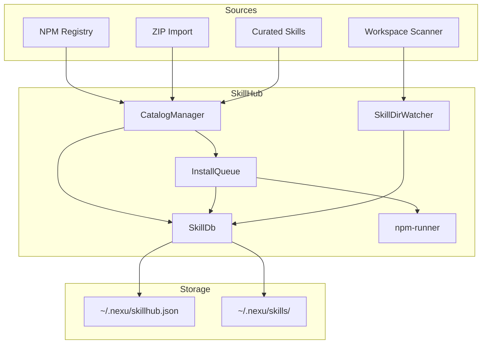
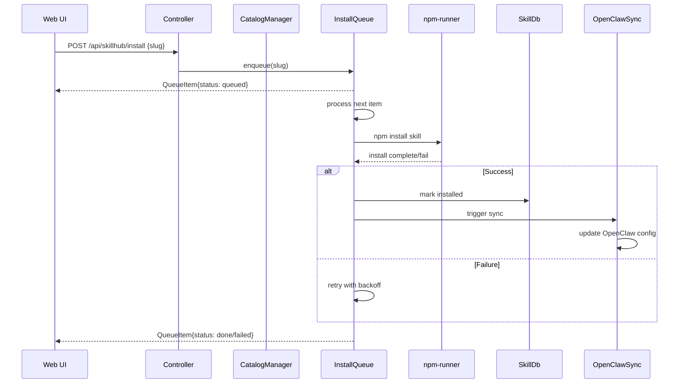

# 09 — SkillHub — Skill Catalog, Install Queue, npm-Runner, Workspace Scanning

The SkillHub service manages skill discovery, installation, and execution for the nexu platform. Skills are composable units of functionality that agents can invoke mid-task.

Source: `/home/darkvoid/Boxxed/@formulas/src.rust/src.AI/src.Opendesign/nexu/apps/controller/src/services/skillhub/`

## SkillHub Architecture



## Skill Install Flow



## Module Structure

| File | Purpose |
|------|---------|
| `index.ts` | Re-exports all SkillHub modules |
| `catalog-manager.ts` | Manages skill catalog, fetches from npm |
| `skill-db.ts` | Persistent skill database (JSON file) |
| `install-queue.ts` | Async install queue with retry |
| `npm-runner.ts` | Runs npm install for skill dependencies |
| `skill-dir-watcher.ts` | Watches skill directories for changes |
| `workspace-skill-scanner.ts` | Scans workspace for local skills |
| `curated-skills.ts` | Curated/built-in skill definitions |
| `zip-importer.ts` | Imports skills from ZIP archives |
| `types.ts` | Shared type definitions |

Source: `nexu/apps/controller/src/services/skillhub/index.ts`.

## Skill Types

Source: `nexu/apps/controller/src/services/skillhub/types.ts:18-27`

```typescript
export type SkillSource = "managed" | "custom" | "workspace" | "user";

export type InstalledSkill = {
  slug: string;
  source: SkillSource;
  name: string;
  description: string;
  installedAt: string | null;
  agentId: string | null;
};
```

| Source | Description |
|--------|-------------|
| `managed` | Skills from the official catalog (npm) |
| `custom` | User-imported skills (ZIP, URL) |
| `workspace` | Skills found in the workspace directory |
| `user` | User-created skills |

## Catalog Manager

The `CatalogManager` fetches and manages the skill catalog:

Source: `nexu/apps/controller/src/services/skillhub/catalog-manager.ts`

Responsibilities:
- Fetch catalog from npm registry
- Merge with installed skills
- Serve catalog queries (search, filter by tag)
- Track catalog metadata (version, update time, skill count)

## Skill Database

The `SkillDb` provides persistent storage for skill state:

Source: `nexu/apps/controller/src/services/skillhub/skill-db.ts`

Operations:
- `getInstalled()` — List installed skills
- `install(slug, skill)` — Mark skill as installed
- `uninstall(slug)` — Remove skill
- `get(slug)` — Get skill details

## Install Queue

The `InstallQueue` handles async skill installation with retry:

Source: `nexu/apps/controller/src/services/skillhub/install-queue.ts`

Queue states:
- `queued` — Waiting to be processed
- `downloading` — Fetching skill package
- `installing-deps` — Running npm install
- `done` — Installation complete
- `failed` — Installation failed

Error codes:
- `skill_not_found` — Skill not in registry
- `rate_limit` — NPM rate limit hit
- `npm_missing` — npm not on PATH
- `deps_install_failed` — Dependency installation failed
- `unknown` — Other error

The queue supports retries with exponential backoff and rate limit pause handling (`parseRateLimitPauseMs`).

## npm Runner

The `npm-runner` executes npm commands for skill dependencies:

Source: `nexu/apps/controller/src/services/skillhub/npm-runner.ts`

Responsibilities:
- Run `npm install` in skill directories
- Handle npm output parsing
- Report installation progress

## Skill Directory Watcher

The `SkillDirWatcher` monitors skill directories for changes:

Source: `nexu/apps/controller/src/services/skillhub/skill-dir-watcher.ts`

When a skill file changes, the watcher triggers a sync to update the runtime.

## Workspace Skill Scanner

The `WorkspaceSkillScanner` discovers skills in the workspace:

Source: `nexu/apps/controller/src/services/skillhub/workspace-skill-scanner.ts`

It scans for:
- `SKILL.md` files in the workspace
- Skill directories with proper structure
- Skills referenced in agent configurations

## ZIP Importer

The `ZipImporter` installs skills from ZIP archives:

Source: `nexu/apps/controller/src/services/skillhub/zip-importer.ts`

It extracts the ZIP, validates the skill structure, and registers it as a `custom` source skill.

## Curated Skills

The `curated-skills.ts` module defines built-in skills:

Source: `nexu/apps/controller/src/services/skillhub/curated-skills.ts`

These are skills that ship with nexu and don't require installation from npm.

## Skill Service

The `SkillhubService` orchestrates all SkillHub components:

Source: `nexu/apps/controller/src/services/skillhub-service.ts`

It creates the `CatalogManager`, `SkillDb`, `InstallQueue`, and `SkillDirWatcher`, wiring them together with callbacks:

```typescript
const skillhubService = await SkillhubService.create(env, {
  onSyncNeeded: () => { void syncService?.syncAll(); },
  getBotIds: async () => { /* ... */ },
});
```

The `onSyncNeeded` callback triggers a full OpenClaw sync when skills change.

## SkillHub API Routes

| Route | Method | Purpose |
|-------|--------|---------|
| `/api/skillhub/catalog` | GET | Get skill catalog |
| `/api/skillhub/catalog/installed` | GET | Get installed skills |
| `/api/skillhub/install` | POST | Queue skill installation |
| `/api/skillhub/queue` | GET | Get install queue status |
| `/api/skillhub/:slug/uninstall` | DELETE | Uninstall a skill |
| `/api/skillhub/import` | POST | Import skill (ZIP) |

**Aha:** The SkillHub uses an **async install queue** rather than synchronous installation. This is important because npm installs can take seconds, and the controller must remain responsive. The queue processes installs one at a time (to avoid npm lock conflicts), reports progress via the queue status endpoint, and retries on transient failures.

## Next

- [10 — HTML Anything](10-html-anything.md) — 75 skills, 9 surfaces, SSE streaming
- [02 — Nexu Platform](02-nexu-platform.md) — Nexu controller and services
