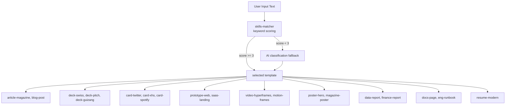
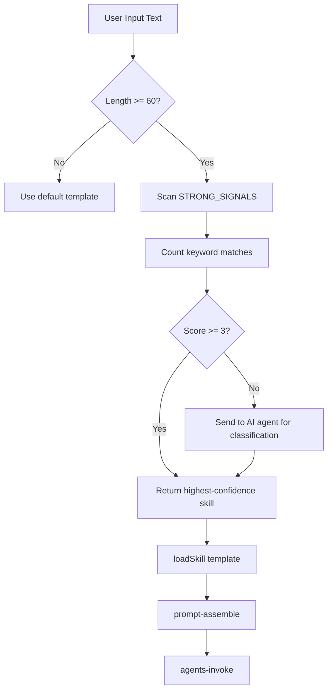

# 10 — HTML Anything — 75 Skills, 9 Surfaces, SSE Streaming, Iframe Preview

HTML Anything converts any input (Markdown, CSV, Excel) into single-file HTML via local agents with 75+ composable skill templates across 9 deliverable surfaces. All skills are registered with `SKILL.md` frontmatter including a `recommended` rank.

Source: `/home/darkvoid/Boxxed/@formulas/src.rust/src.AI/src.Opendesign/html-anything/`

## Monorepo Structure

```
html-anything/
  cli/                    ← CLI entry point
    src/
      index.ts            ← Main CLI
      agents-detect.ts    ← Agent detection (same pattern as open-design)
      agents-invoke.ts    ← Agent invocation with spawn
      skills-loader.ts    ← Skill loading from directory
      skills-matcher.ts   ← Keyword-based skill matching (75+ signals)
      prompt-assemble.ts  ← Prompt assembly from input + skill
      collision-resolve.ts ← Skill collision resolution
      config.ts           ← CLI configuration
      extract-html.ts     ← HTML extraction from agent output
      prompt.ts           ← Prompt building
      run.ts              ← Run orchestration
  next/                   ← Next.js web app
  e2e/                    ← Playwright end-to-end tests
  scripts/                ← Build and utility scripts
  docs/                   ← Documentation
```

## Skill-to-Surface Mapping



## 75+ Skill Signals

The skills matcher uses keyword-based matching with a confidence threshold of 3:

Source: `html-anything/cli/src/skills-matcher.ts:4-80`

```typescript
const CONFIDENCE_THRESHOLD = 3;
const MIN_CONTENT_LENGTH_FOR_AI = 60;

const STRONG_SIGNALS: [keywords: string[], templateId: string][] = [
  [["简历", "resume", "CV", "求职"], "resume-modern"],
  [["定价", "pricing", "价格方案"], "pricing-page"],
  [["OKR", "KR", "关键结果"], "team-okrs"],
  [["PRD", "产品需求", "spec"], "pm-spec"],
  [["周报", "weekly", "本周"], "weekly-update"],
  [["Runbook", "oncall", "SRE"], "eng-runbook"],
  [["发票", "invoice", "账单"], "invoice"],
  [["入职", "onboarding", "新人"], "hr-onboarding"],
  [["SaaS", "landing", "落地页"], "saas-landing"],
  [["等候", "waitlist", "coming soon"], "waitlist-page"],
  // ... 65+ more signals covering decks, cards, posters, prototypes, etc.
];
```

Each signal maps multilingual keywords (Chinese + English) to a template ID. The matcher counts matching keywords and returns the highest-confidence template when the count exceeds the threshold of 3.

**Aha:** The skill matcher uses **keyword counting** rather than AI-based classification. This is intentional — it's fast, deterministic, and works offline. The `CONFIDENCE_THRESHOLD = 3` means at least 3 keywords must match before a skill is selected. If no skill reaches the threshold, the content is sent to the AI agent for classification (the `MIN_CONTENT_LENGTH_FOR_AI = 60` guard prevents sending trivially short inputs).

## 9 Surface Types

HTML Anything produces 9 types of deliverables:

| Surface | Description | Key Skills |
|---------|-------------|-----------|
| **Article/Magazine** | Long-form article layouts | `article-magazine`, `blog-post` |
| **Deck/Presentation** | Presentation slides | `deck-swiss-international`, `deck-guizang-editorial`, `deck-pitch`, `deck-product-launch`, `deck-simple` |
| **Resume** | Professional resume | `resume-modern` |
| **Poster** | Visual posters | `poster-hero`, `magazine-poster` |
| **Social Cards** | Social media cards | `card-twitter`, `card-xiaohongshu`, `social-spotify-card`, `social-reddit-card`, `social-carousel` |
| **Web Prototype** | Interactive web prototypes | `prototype-web`, `saas-landing`, `waitlist-page`, `dating-web`, `mobile-app` |
| **Data Report** | Data visualization reports | `data-report`, `finance-report`, `dashboard` |
| **HyperFrames Video** | Video production | `video-hyperframes`, `vfx-text-cursor`, `motion-frames` |
| **Documentation** | Technical documentation | `docs-page`, `eng-runbook` |

## Skill Matching Pipeline



Source: `html-anything/cli/src/skills-matcher.ts` — Matching logic.

## Agent Detection and Invocation

The CLI reuses the same agent detection pattern as open-design, scanning PATH for known agent binaries:

Source: `html-anything/cli/src/agents-detect.ts`

Agent invocation spawns the selected agent with the assembled prompt:

Source: `html-anything/cli/src/agents-invoke.ts`

The invocation system handles:
1. Resolving the agent binary on PATH
2. Building CLI arguments from the prompt
3. Spawning the child process
4. Capturing stdout/stderr streams
5. Extracting HTML from the output

## Prompt Assembly

The prompt assembler combines user input with skill templates:

Source: `html-anything/cli/src/prompt-assemble.ts`

The assembled prompt includes:
1. System instructions for the target surface
2. Skill-specific formatting rules
3. User input (Markdown, CSV, etc.)
4. Variable placeholders for the template

## HTML Extraction

The extraction module parses agent output to extract the generated HTML:

Source: `html-anything/cli/src/extract-html.ts`

It handles:
- Extracting HTML from markdown code blocks
- Cleaning up agent artifacts
- Validating HTML structure

## Collision Resolution

When multiple skills match the input, the collision resolver selects the best one:

Source: `html-anything/cli/src/collision-resolve.ts`

Resolution considers:
1. Keyword match score (higher = better)
2. Skill `recommended` rank
3. Surface match specificity
4. Input type compatibility

## SSE Streaming

The server uses Server-Sent Events to stream agent output to the web UI:

```
Event: token
data: {"content": "Partial HTML output..."}

Event: complete
data: {"status": "done", "artifactId": "..."}
```

The SSE stream enables real-time preview as the agent generates HTML incrementally.

## Iframe Preview

Generated HTML is rendered in a sandboxed iframe:

```html
<iframe sandbox="allow-scripts" srcdoc="...generated HTML..."></iframe>
```

The sandbox (`allow-scripts`) isolates the generated content from the parent page while allowing scripts to run for interactive prototypes.

## CLI Commands

```bash
html-anything generate --input file.md --surface article
html-anything list-skills
html-anything detect-agents
```

## E2E Testing

Playwright tests validate the UI:

Source: `html-anything/e2e/ui/deploy-control.spec.ts` — Deploy control test.
Source: `html-anything/e2e/ui/export-menu.test.ts` — Export menu test.
Source: `html-anything/e2e/ui/host-validation.spec.ts` — Host validation test.

## Next

- [11 — HTML Video](11-html-video.md) — Engine adapters, templates, soundtrack
- [04 — Agent Detection](04-agent-detection.md) — Agent detection system
