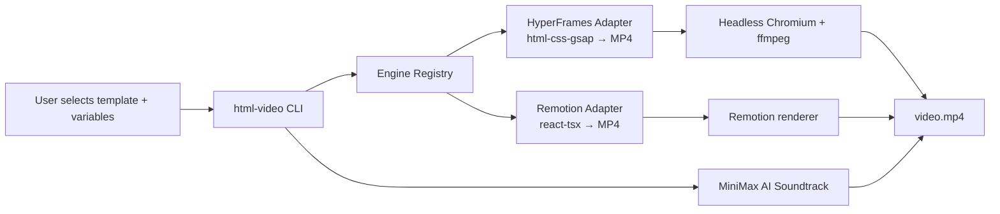
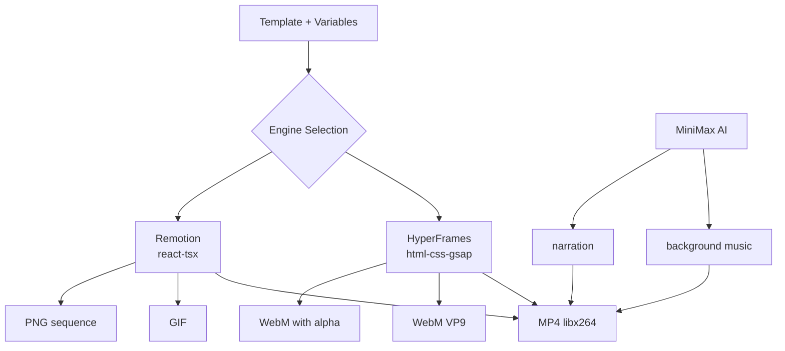

# 11 — HTML Video — Engine Adapters, 21 Templates, AI Soundtrack, Content Graph

HTML Video renders HTML to MP4 video via pluggable rendering engines, with 21 curated templates and an AI-powered soundtrack system.

Source: `/home/darkvoid/Boxxed/@formulas/src.rust/src.AI/src.Opendesign/html-video/`

## Monorepo Structure

```
html-video/
  packages/
    core/                  ← Core types and registry
      src/
        types/index.ts     ← Engine adapter, render types (RFC-01, RFC-02, RFC-05)
        registry.ts        ← Engine registry
        project.ts         ← Project management
        asset-store.ts     ← Asset storage
        minimax.ts         ← AI soundtrack (MiniMax)
        errors.ts          ← Error types
    cli/                   ← CLI commands
      src/
        bin.ts             ← CLI entry
        commands/          ← CLI commands (doctor, list-engines, templates)
        context.ts         ← CLI context
        render.ts          ← Render orchestration
    runtime/               ← Agent runtime
      src/
        detect.ts          ← Agent detection
        spawn.ts           ← Agent spawning
        defs/              ← Agent adapter definitions
        acp-client.ts      ← ACP client
    adapter-hyperframes/   ← HyperFrames engine adapter
      src/
        capabilities.ts    ← Engine capabilities
        render.ts          ← Render implementation
        validate.ts        ← Input validation
    adapter-remotion/      ← Remotion engine adapter
      src/
        bridge/            ← Remotion bridge components
        capabilities.ts    ← Engine capabilities
        render.ts          ← Render implementation
        validate.ts        ← Input validation
    content-graph/         ← Content graph for storyboards
      src/index.ts         ← Content graph types and operations
    studio-next/           ← Studio web UI (Vite + React)
  templates/               ← 21 curated templates
  research/                ← RFC research documents
  docs/                    ← Documentation
```

## Engine Adapter Architecture

The engine adapter pattern enables pluggable rendering backends:

Source: `html-video/packages/core/src/types/index.ts`

```typescript
export interface EngineCapabilities {
  paradigms: Paradigm[];         // 'html-css-gsap', 'react-tsx', 'ts-generator', etc.
  outputFormats: OutputFormat[]; // 'mp4', 'webm', 'webm-alpha', 'gif', etc.
  maxResolution: { width: number; height: number };
  alpha: boolean;
  audio: 'none' | 'single' | 'multi';
  subtitles: ('none' | 'burn-in' | 'sidecar')[];
  renderTarget: RenderTarget[];  // 'local-chromium', 'local-canvas', 'lambda', 'cloud-run'
  licensing: LicensingTier;
  renderSpeedHint?: RenderSpeedHint;
  bestFor: string[];
  weaknesses: string[];
}
```

## Engine Adapter Capability Matrix



Each engine adapter implements:
- `capabilities` — What the engine can do
- `validate(input)` — Validate render input
- `render(input, context)` — Execute the render

## Render Types

Source: `html-video/packages/core/src/types/index.ts`

```typescript
export interface RenderConfig {
  format: OutputFormat;
  resolution: { width: number; height: number };
  fps: number;
  duration: number | 'auto';
  durationMode?: 'explicit' | 'auto';
  outputPath: string;
  alpha?: boolean;
  quality?: number | 'low' | 'medium' | 'high' | 'lossless';
  audio?: { path: string; volumeDb?: number }[];
}

export interface RenderInput {
  template: TemplateRef;
  variables: Record<string, unknown>;
  config: RenderConfig;
}

export interface RenderOutput {
  outputPath: string;
  meta: {
    durationSec: number;
    fileSizeBytes: number;
    actualResolution: { width: number; height: number };
    fps: number;
  };
}
```

## Paradigms

The system supports multiple rendering paradigms:

| Paradigm | Description | Example Engine |
|----------|-------------|----------------|
| `html-css-gsap` | HTML + CSS + GSAP animation | HyperFrames |
| `react-tsx` | React TSX compositions | Remotion |
| `ts-generator` | TypeScript scene generation | Custom |
| `json-scene` | JSON scene description | Custom |
| `imperative-canvas` | Canvas API drawing | Custom |

## HyperFrames Adapter

## Output Format Support



The HyperFrames adapter uses headless Chromium + ffmpeg for rendering:

Source: `html-video/packages/adapter-hyperframes/src/`

- `capabilities.ts` — Declares `html-css-gsap` paradigm, `mp4`/`webm` output
- `render.ts` — Launches headless Chromium, records frames, encodes with ffmpeg (libx264)
- `validate.ts` — Validates template and variables

## Remotion Adapter

The Remotion adapter bridges to the Remotion rendering engine:

Source: `html-video/packages/adapter-remotion/src/`

- `bridge/Root.tsx` — Remotion root component
- `bridge/HtmlFrameDriver.tsx` — Drives HTML frames within Remotion
- `bridge/entry.ts` — Remotion entry point

## Templates

21 curated, license-clean templates ship with the project:

Source: `html-video/templates/`

Templates define:
- HTML/CSS structure
- GSAP animations (for HyperFrames) or React compositions (for Remotion)
- Variable schema for customization
- Recommended resolution and duration

## AI Soundtrack

The `minimax.ts` module generates AI soundtracks via MiniMax:

Source: `html-video/packages/core/src/minimax.ts`

The soundtrack system supports:
- Background music generation
- Narration generation
- Audio mixing with video

## Content Graph

The content graph manages storyboard/scene relationships:

Source: `html-video/packages/content-graph/src/index.ts`

Note: Storyboard/scene types from RFC-04 were removed in v0.1 after product clarification (see RFC-05).

## Agent Detection

The html-video runtime detects agents using the same pattern as open-design:

Source: `html-video/packages/runtime/src/detect.ts`

14 agent backends are supported:

| Agent | Binary |
|-------|--------|
| Claude Code | `claude` |
| Codex CLI | `codex` |
| Gemini | `gemini` |
| OpenCode | `opencode` |
| Cursor | `cursor-agent` |
| Copilot | `copilot` |
| Qwen | `qwen` |
| Qoder | `qoder` |
| Hermes | `hermes` |
| Aider | `aider` |
| Trae | `trae` |
| Grok | `grok` |
| Kimi | `kimi` |
| AMR | `amr` |

## CLI Commands

```bash
html-video render --template intro --variables data.json --output video.mp4
html-video list-engines
html-video list-templates
html-video doctor
```

Source: `html-video/packages/cli/src/commands/`

**Aha:** The engine adapter pattern means HTML Video is **engine-agnostic**. The core types define a `RenderConfig` interface, and each engine adapter implements the rendering logic. This allows swapping rendering backends (HyperFrames → Remotion → Manim) without changing the user-facing API or templates.

## RFC Documents

The research directory contains RFC documents that defined the architecture:

- `research/2026-05-26-spec-01-*.md` — RFC-01: Engine adapter
- `research/2026-05-27-spec-02-*.md` — RFC-02: Template metadata
- `research/2026-05-27-spec-05-*.md` — RFC-05: Project-centric workflow

Storyboard/scene types (RFC-04) were removed after product clarification.

## Next

- [12 — Looper](12-looper.md) — Autonomous AI dev team
- [14 — Data Flow](14-data-flow.md) — End-to-end data flows
