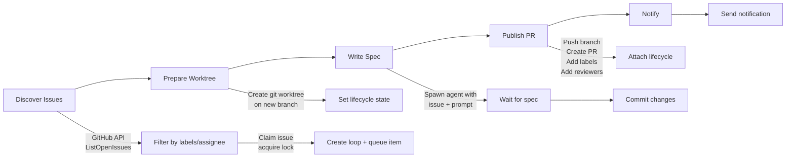
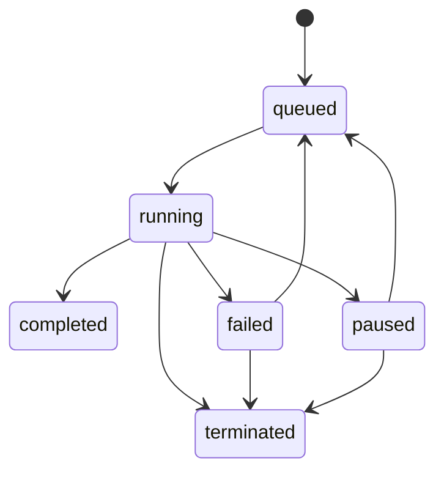

# 12 — Looper — Autonomous AI Dev Team, Planner, Reviewer, Fixer, Worker, Worktrees

Looper is an autonomous AI dev team that runs specialized agents (Planner, Reviewer, Fixer, Worker) in isolated git worktrees, coordinating through GitHub label state machines. It supports both GitHub and Forgejo, with a network mode (`loopernet`) for multi-node deployments.

Source: `/home/darkvoid/Boxxed/@formulas/src.rust/src.AI/src.Opendesign/looper/`

## Monorepo Structure

```
looper/
  cmd/
    looper/       ← CLI entry point
    looperd/      ← Daemon entry point
    loopernet/    ← Network daemon entry point
  internal/
    agent/        ← Agent execution (spawn, prompt, wait)
    api/          ← HTTP API server
    bootstrap/    ← App bootstrap and logger
    cliapp/       ← CLI application commands
    config/       ← Configuration management
    coordinator/  ← Agent coordination
    diffanchor/   ← Diff anchoring
    disclosure/   ← Disclosure stamping
    domain/       ← Domain types and invariants
    eventlog/     ← Event logging
    fixer/        ← Fixer agent runner
    forge/        ← Forgejo integration
    infra/        ← GitHub/Forgejo gateway
    lifecycle/    ← Git/PR lifecycle management
    loops/        ← Loop management (create, transition, pause)
    network/      ← Network mode (loopernet)
    networkpolicy/ ← Network policies
    planner/      ← Planner agent runner
    projects/     ← Project management
    release/      ← Release management
    reviewer/     ← Reviewer agent runner
    runs/         ← Run management
    runtime/      ← Runtime management
    scheduler/    ← Queue scheduler
    storage/      ← SQLite storage layer
    version/      ← Version management
    webhookforward/ ← Webhook forwarding
    worker/       ← Worker agent runner
    worktreecleanup/ ← Worktree cleanup
    worktreesafety/  ← Worktree safety validation
  pkg/
    api/          ← Public API types
  configs/        ← Configuration examples
  deploy/         ← Deployment configurations
  docs/           ← Documentation
  skills/         ← Agent skills
  specs/          ← Specifications
  tools/          ← Tool definitions
```

Source: `looper/go.mod` — Go 1.22, SQLite via `go-sqlite3`.

## Agent Roles

Looper runs four specialized agent roles, each with its own model, tools, and prompt:

| Role | Responsibility | Model | Tools |
|------|---------------|-------|-------|
| **Planner** | Discovers issues, writes specs, opens PRs | Configurable | GitHub API, Git |
| **Reviewer** | Reviews PRs, checks quality | Configurable | GitHub API, criteria |
| **Fixer** | Fixes issues identified by Reviewer | Configurable | GitHub API, Git |
| **Worker** | Implements specs, writes code | Configurable | GitHub API, Git |

## Planner Pipeline

The Planner runs through 5 steps:

Source: `looper/internal/planner/runner.go:30-47`

```go
const (
    stepDiscoverIssues  = "discover-issues"
    stepPrepareWorktree = "prepare-worktree"
    stepWriteSpec       = "write-spec"
    stepPublish         = "publish"
    stepNotify          = "notify"
)

var plannerStepSequence = []PlannerStep{
    stepDiscoverIssues, stepPrepareWorktree, stepWriteSpec, stepPublish, stepNotify,
}
```



### Discovery

The Planner discovers issues via GitHub API, filtering by labels and assignee:

Source: `looper/internal/planner/runner.go:490-561` — DiscoverIssues().

```go
type DiscoveryPolicy struct {
    AutoDiscovery              bool
    Labels                     []string        // Default: ["looper:plan"]
    LabelMode                  config.LabelMode // "all" or "any"
    RequireAssigneeCurrentUser bool
}
```

Default discovery label: `looper:plan`.

### Worktree Isolation

Each issue gets its own git worktree on a dedicated branch:

Source: `looper/internal/planner/runner.go:879-913` — runPrepareWorktreeStep().

Branch naming: `looper/planner/{issue-number}-{slug}`

The worktree safety module validates that worktrees are within the allowed root and don't conflict with protected branches.

### Checkpoint-Based Resume

The Planner supports checkpoint-based resume:

Source: `looper/internal/planner/runner.go:357-420` — plannerCheckpoint struct.

```go
type plannerCheckpoint struct {
    ResumePolicy   string
    Issue          *checkpointIssue
    ClaimedLockKey string
    Worktree       *checkpointWorktree
    WriteSpec      *checkpointWriteSpec
    Lifecycle      *lifecycle.State
    Publish        *checkpointPublishState
    Notify         *checkpointNotify
    SkipReason     string
}
```

If a run fails, it resumes from the last completed step rather than restarting from discovery.

**Aha:** The checkpoint system serializes the entire run state (issue, worktree, spec output, lifecycle, publish state) as JSON and persists it in the `runs` table. On resume, the Planner reads the checkpoint, validates each component (worktree safety, lifecycle state), and continues from the next step. This means a Planner run can survive process crashes, network failures, and agent timeouts without losing progress.

## Failure Classification

Source: `looper/internal/planner/runner.go:51-57`

```go
const (
    FailureRetryableTransient   = "retryable_transient"
    FailureRetryableAfterResume = "retryable_after_resume"
    FailureNonRetryable         = "non_retryable"
    FailureManualIntervention   = "manual_intervention"
)
```

| Failure Kind | Retry Behavior | Example |
|-------------|---------------|---------|
| `retryable_transient` | Auto-retry with backoff | Network timeout, GitHub API rate limit |
| `retryable_after_resume` | Retry from checkpoint | Agent timeout, git push failure |
| `non_retryable` | No retry | Invalid configuration |
| `manual_intervention` | Requires human action | Auto-push disabled |

Retry uses exponential backoff: 5s → 10s → 20s → 40s → ... → max 300s (5 minutes).

Source: `looper/internal/planner/runner.go:2131-2143` — backoffDelay().

## Loop State Machine

Source: `looper/internal/loops/service.go` — Loop status transitions.



Transitions are validated by `domain.AssertLoopStatusTransition()`.

## Git Gateway Interface

The Planner defines interfaces for GitHub/Forgejo operations:

Source: `looper/internal/planner/runner.go:165-176` — GitHubGateway interface.

```go
type GitHubGateway interface {
    ListOpenIssues(context.Context, ListOpenIssuesInput) ([]IssueSummary, error)
    ViewIssue(context.Context, ViewIssueInput) (IssueDetail, error)
    GetCurrentUserLogin(context.Context, string) (string, error)
    AddIssueAssignees(context.Context, IssueAssigneesInput) error
    ListOpenPullRequests(context.Context, ListOpenPullRequestsInput) ([]PullRequestSummary, error)
    ViewPullRequest(context.Context, ViewPullRequestInput) (PullRequestDetail, error)
    CreatePullRequest(context.Context, CreatePullRequestInput) (CreatePullRequestResult, error)
    UpdatePullRequestBody(context.Context, UpdatePullRequestBodyInput) error
    AddPullRequestLabels(context.Context, PullRequestLabelsInput) error
    AddPullRequestReviewers(context.Context, PullRequestReviewersInput) error
}
```

The GitGateway interface handles worktree operations:

```go
type GitGateway interface {
    CreateWorktree(context.Context, CreateWorktreeInput) (CreateWorktreeResult, error)
    InspectHead(context.Context, InspectHeadInput) (InspectHeadResult, error)
    Commit(context.Context, CommitInput) (CommitResult, error)
    Push(context.Context, PushInput) error
}
```

This abstraction allows the same Planner code to work with both GitHub and Forgejo.

## Reviewer

The Reviewer checks PR quality against configurable criteria:

Source: `looper/internal/reviewer/runner.go`

| Module | Purpose |
|--------|---------|
| `runner.go` | Reviewer pipeline execution |
| `repair.go` | Automatic repair attempts |
| `criteria/criteria.go` | Review criteria definitions |
| `criteria/default_verifier.go` | Default verification logic |
| `automerge/automerge.go` | Auto-merge when all criteria pass |

## Fixer

The Fixer attempts to fix issues identified by the Reviewer:

Source: `looper/internal/fixer/runner.go`

| Module | Purpose |
|--------|---------|
| `runner.go` | Fixer execution |
| `failure_classification_test.go` | Failure classification |

## Worker

The Worker implements specs and writes code:

Source: `looper/internal/worker/runner.go`

| Module | Purpose |
|--------|---------|
| `runner.go` | Worker execution |
| `failure_classification_test.go` | Failure classification |

## Storage

Looper uses SQLite for persistence:

Source: `looper/internal/storage/`

Tables:
- `projects` — Project configurations
- `loops` — Loop records with status, type, target
- `queue` — Queue items for agent execution
- `runs` — Run records with checkpoints
- `events` — Event log
- `locks` — Distributed locks

## Network Mode (loopernet)

The network daemon enables multi-node Looper deployments:

Source: `looper/cmd/loopernet/main.go`

Network mode uses lease-based coordination to distribute work across nodes.

Source: `looper/internal/network/` and `looper/internal/networkpolicy/`.

## CLI Commands

```bash
looper project create --repo org/repo
looper loop start --project my-project
looper loop pause --loop <id>
looper loop resume --loop <id>
looper logs follow --loop <id>
looper stats --project my-project
looper config show
looper daemon install
looper daemon start
```

Source: `looper/internal/cliapp/` — CLI command implementations.

**Aha:** The `loopernet` network mode is a clever solution to the "single machine bottleneck" problem. Rather than requiring a single powerful machine to run all agents sequentially, loopernet distributes work across multiple nodes using lease-based coordination. Each node claims queue items for a fixed TTL, processes them, and releases the lease. If a node crashes, the lease expires and another node can retry.

## Next

- [13 — Monet](13-monet.md) — Desktop scaffold, sessions, live artifacts
- [14 — Data Flow](14-data-flow.md) — End-to-end data flows
