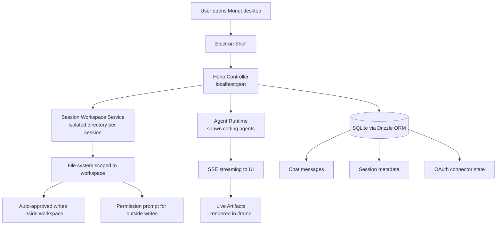
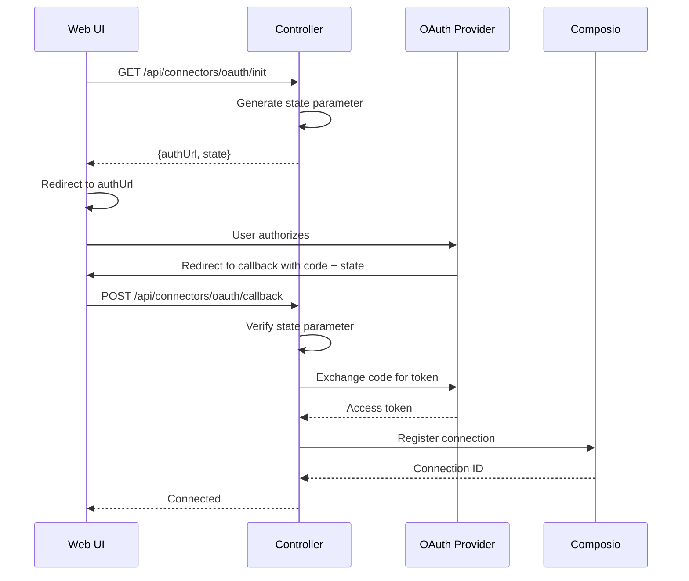

# 13 — Monet — Desktop Scaffold, Session Workspaces, Live Artifacts, Connectors

Monet is an Electron desktop scaffold with a Hono local controller, Next.js UI, Drizzle ORM, and SQLite. It provides session workspaces with scoped file access and auto-approved writes inside the session workspace.

Source: `/home/darkvoid/Boxxed/@formulas/src.rust/src.AI/src.Opendesign/monet/`

## Monorepo Structure

```
monet/
  apps/
    controller/          ← Hono controller + Next.js
      src/
        index.ts         ← Entry point
        app.ts           ← App setup and route registration
        config.ts        ← Configuration management
        chat-context.ts  ← Chat context building
        chat-storage.ts  ← Chat message persistence
        chat-stream.ts   ← Chat SSE streaming with Vercel AI SDK
        agent-runtime.ts ← Agent runtime (spawn, stream, budget)
        provider-runtime.ts ← Model provider management
        logger.ts        ← Logging infrastructure
        request-context.ts ← Request context middleware
        openapi.ts       ← OpenAPI spec generation
        run-registry.ts  ← Run tracking and budget management
        session-workspace-service.ts ← Session workspace management
        middleware/
          local-auth.ts  ← Local authentication middleware
        routes/
          chat.ts        ← Chat endpoints (SSE streaming)
          sessions.ts    ← Session CRUD
          settings.ts    ← Settings management
          tools.ts       ← Tool registry
          runs.ts        ← Run management
          health.ts      ← Health check
          connectors.ts  ← Connector OAuth flows
          providers.ts   ← Provider management
          live-artifacts.ts ← Live artifact endpoints
        tools/           ← Tool definitions
          registry.ts    ← Tool registry
        connectors/      ← Third-party integrations
          catalog.ts     ← Connector catalog
          service.ts     ← Connector service
          provider.ts    ← OAuth provider
          composio-provider.ts ← Composio integration
          oauth-state.ts ← OAuth state management
          errors.ts      ← Connector error types
        live-artifacts/
          render.ts      ← Artifact rendering
          schema.ts      ← Artifact data schema
          refresh.ts     ← Artifact refresh
          provenance.ts  ← Provenance tracking
          source.ts      ← Source tracking
  packages/              ← Shared packages
  openapi-ts.config.ts   ← OpenAPI TypeScript config
  scripts/               ← Build scripts
  specs/                 ← Design specs
  docs/                  ← Documentation
```

## Monet Session Architecture



## Chat Streaming with Vercel AI SDK

Monet uses the Vercel AI SDK for chat streaming:

Source: `monet/apps/controller/src/chat-stream.ts:1-80`

```typescript
import { consumeStream, convertToModelMessages, stepCountIs, streamText, type UIMessage } from "ai";
```

The chat stream handles:
- Converting UI messages to model messages
- Token counting and budget enforcement
- Tool call redaction for sensitive data
- Wall clock budget tracking
- Step-based usage tracking

### ChatStreamRequest

Source: `monet/apps/controller/src/chat-stream.ts:24-35`

```typescript
export interface ChatStreamRequest {
  readonly sessionId: string;
  readonly providerId: string;
  readonly modelId: string;
  readonly runId: string;
  readonly currentStep?: number;
  readonly consumedTokens?: number;
  readonly consumedToolCalls?: number;
  readonly maxSteps: number;
  readonly maxTokensPerRun: number | null;
  readonly wallClockDeadlineAt: string | null;
}
```

### Budget Enforcement

Source: `monet/apps/controller/src/chat-stream.ts:56-69`

```typescript
export function isExpiredWallClockBudget(wallClockDeadlineAt: number, startedAt: number) {
  return Number.isFinite(wallClockDeadlineAt) && wallClockDeadlineAt <= startedAt;
}

export function isToolCallBudgetExhausted(observedToolCallCount: number, maxToolCallsPerRun: number) {
  return observedToolCallCount >= maxToolCallsPerRun;
}
```

**Aha:** Monet enforces **three types of budget** simultaneously: token budget (max tokens per run), tool call budget (max tool calls per run), and wall clock budget (deadline-based). The `shouldInterruptRunForFinishReason` and `shouldCompleteRunForFinishReason` functions determine when to stop a run based on which budget was exhausted.

## Agent Runtime

The agent runtime manages coding agent processes:

Source: `monet/apps/controller/src/agent-runtime.ts`

It handles:
- Agent detection (same PATH-scanning pattern as open-design)
- Agent spawning with configured model
- Stream parsing (JSONL, text)
- Process lifecycle management
- Token usage counting

### RunFinishReason

Source: `monet/apps/controller/src/agent-runtime.ts` — Finish reason types.

| Reason | Description |
|--------|-------------|
| `stop` | Normal completion |
| `length` | Token limit reached |
| `content-filter` | Content filter triggered |
| `tool-calls` | Tool call budget exhausted |
| `wall-clock` | Wall clock deadline reached |
| `error` | Agent error |
| `interrupted` | User interrupted |

## Session Workspace Service

The session workspace service manages isolated workspaces:

Source: `monet/apps/controller/src/session-workspace-service.ts`

Key operations:
- Create workspace for session
- Resolve file paths within workspace
- Check if path is within workspace bounds
- Auto-approve writes within workspace

The service enforces the security boundary: writes inside the session workspace are auto-approved, writes outside require explicit permission.

## Run Registry

The run registry tracks active and completed runs:

Source: `monet/apps/controller/src/run-registry.ts`

It manages:
- Active run tracking
- Run budget state
- Run completion callbacks

## Live Artifacts

The live artifacts system manages generated artifacts during agent runs:

Source: `monet/apps/controller/src/live-artifacts/`

| File | Purpose |
|------|---------|
| `schema.ts` | Artifact data schema (Zod) |
| `render.ts` | Artifact rendering logic |
| `refresh.ts` | Artifact refresh on agent update |
| `provenance.ts` | Provenance tracking (which tool created which artifact) |
| `source.ts` | Source code tracking |

Artifacts are rendered in sandboxed iframes with provenance tracking that shows which tool call generated each artifact.

## Connectors

The connector system manages third-party integrations:

Source: `monet/apps/controller/src/connectors/`

| File | Purpose |
|------|---------|
| `catalog.ts` | Connector catalog (Composio, etc.) |
| `service.ts` | Connector lifecycle management |
| `provider.ts` | OAuth provider abstraction |
| `composio-provider.ts` | Composio-specific integration |
| `oauth-state.ts` | OAuth state parameter management |
| `errors.ts` | Connector error types |

Connectors use OAuth for authentication and Composio for tool access. The OAuth flow uses state parameters to prevent CSRF attacks.

## Local Auth Middleware

The local auth middleware authenticates requests:

Source: `monet/apps/controller/src/middleware/local-auth.ts`

Since the controller binds to localhost, auth is based on:
- Origin header verification
- Local IP address verification
- Optional token-based auth for remote access

## Tool Registry

The tool registry manages available tools for agents:

Source: `monet/apps/controller/src/tools/registry.ts`

Tools include:
- File read/write
- Terminal execution
- Web browsing
- Artifact generation

Sensitive tool calls are redacted before being sent to the client:

Source: `monet/apps/controller/src/tool-call-redaction.ts` — `redactSensitiveToolCallText()`.

## Chat Routes

## Connector OAuth Flow



The chat endpoint handles SSE streaming:

Source: `monet/apps/controller/src/routes/chat.ts`

Request flow:
1. Receive chat message with session ID
2. Load conversation history from chat storage
3. Build chat context with previous messages
4. Start agent runtime with prompt
5. Stream tokens via SSE
6. Persist messages to chat storage
7. Track token usage against budget

## Health Check

Source: `monet/apps/controller/src/routes/health.ts`

The health endpoint returns:
- Controller status
- Database connectivity
- Agent runtime status

## OpenAPI Generation

Source: `monet/apps/controller/src/openapi.ts`

The controller generates an OpenAPI spec from Zod-validated routes, which is used to generate TypeScript SDK types for the frontend.

## Next

- [14 — Data Flow](14-data-flow.md) — End-to-end data flows
- [02 — Nexu Platform](02-nexu-platform.md) — Nexu controller architecture
