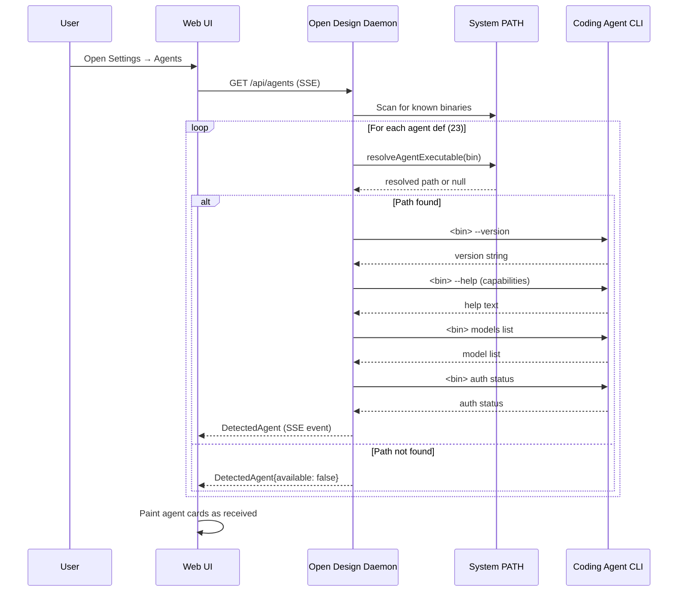
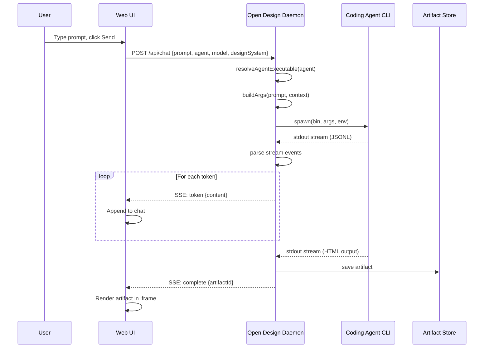
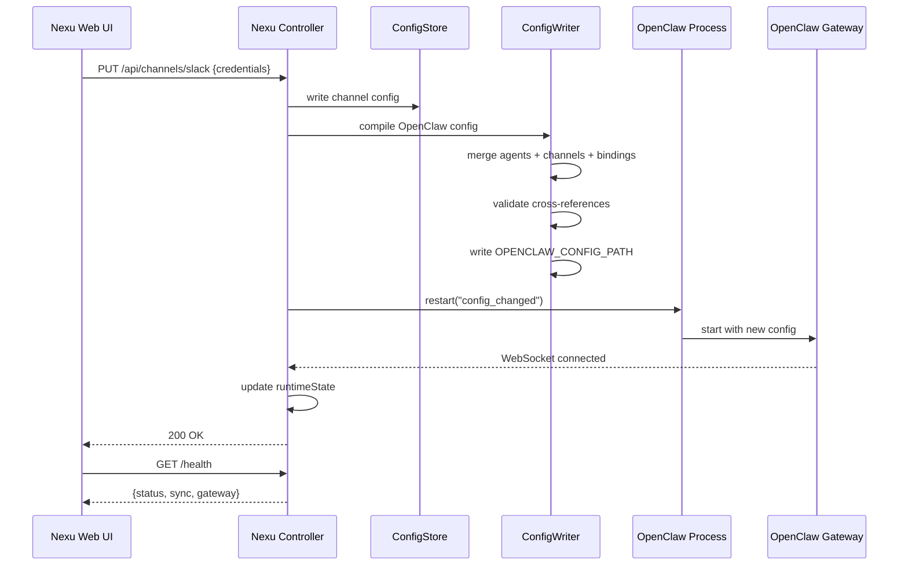
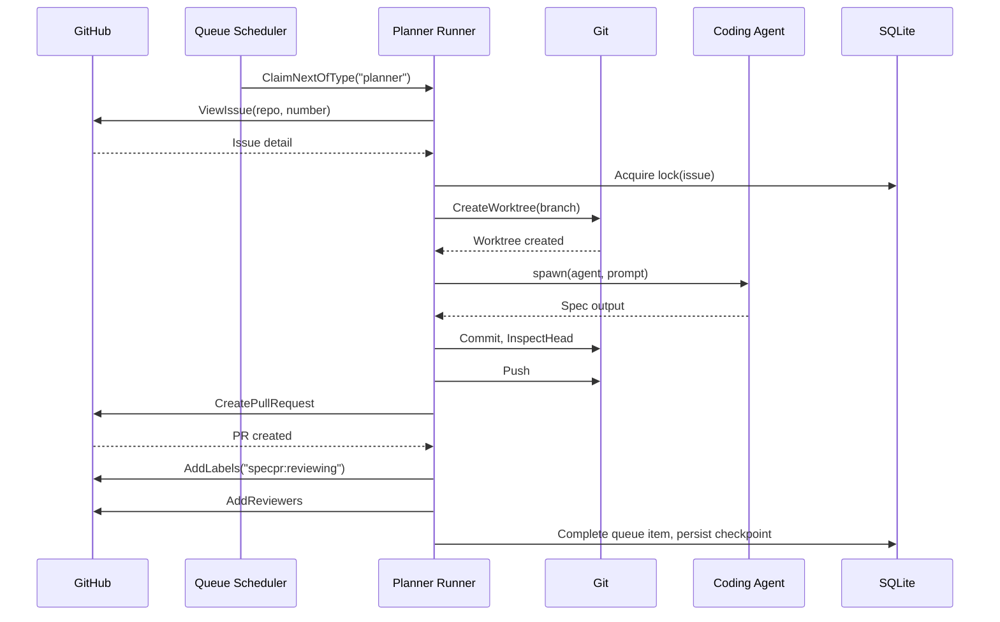
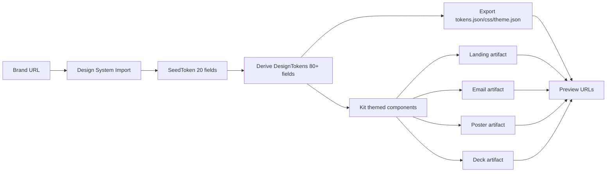
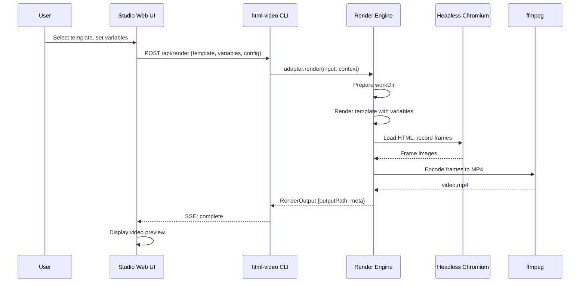

# 14 — Data Flow — End-to-End Flows, State Machines, Request/Response Shapes

This document traces the key data flows across the nexu ecosystem, from agent detection through artifact generation.

## Agent Detection Flow



Source: `open-design/apps/daemon/src/runtimes/detection.ts:346-363` — detectAgentsStream().

## Chat Flow



Source: `open-design/apps/daemon/src/runtimes/claude-stream.ts` — Claude stream parser.

## Nexu Config → OpenClaw Flow



Source: `nexu/apps/controller/src/lib/openclaw-config-compiler.ts` — Config compiler.

## Looper Planner Flow



Source: `looper/internal/planner/runner.go:632-777` — ProcessClaimedItem().

## Design System → Artifact Flow



Source: `open-design/apps/daemon/src/brands/engine/types.ts:7-11` — Pipeline comment.

## HTML Video Render Flow



Source: `html-video/packages/adapter-hyperframes/src/render.ts` — HyperFrames render.

## SSE Event Shapes

### Chat Token Event

```json
{
  "event": "token",
  "data": "{\"content\": \"<div class=\\\"hero\\\">...\"}"
}
```

### Chat Complete Event

```json
{
  "event": "complete",
  "data": "{\"artifactId\": \"art_abc123\", \"status\": \"done\"}"
}
```

### Agent Detection Event

```json
{
  "event": "agent",
  "data": "{\"id\": \"claude\", \"name\": \"Claude Code\", \"available\": true, \"version\": \"2025.1.0\", ...}"
}
```

## State Machines

### Loop Status (Looper)

```
queued → running → completed
                → failed → queued (retry)
                → paused → queued (resume)
                → terminated
```

Source: `looper/internal/loops/service.go` — TransitionStatus().

### Queue Item Status

```
queued → downloading → installing-deps → done
                                       → failed
```

Source: `nexu/apps/controller/src/services/skillhub/types.ts:36-42` — QueueItemStatus.

## Request/Response Shapes

### POST /api/chat (Open Design)

**Request:**
```typescript
{
  prompt: string;
  agentId: string;
  model: string;
  designSystem?: string;
  imagePaths?: string[];
  sessionId?: string;
}
```

**Response:** SSE stream

### GET /api/agents (Open Design)

**Response:** `DetectedAgent[]` or SSE stream of `DetectedAgent`

### POST /api/skillhub/install (Nexu)

**Request:**
```typescript
{
  slug: string;
  source: SkillSource;
}
```

**Response:** `QueueItem`

### GET /health (Nexu)

**Response:**
```typescript
{
  status: string;
  controlPlane: { ok: boolean; ... };
  sync: { config: string; skills: string; templates: string };
  gateway: { status: string; lastProbeAt: string; lastError: string };
}
```

Source: `nexu/apps/controller/src/app/create-app.ts:61-82` — Health endpoint.

**Aha:** Every major project uses the same SSE event pattern for streaming agent output. The event names differ (`token`, `agent`, `complete`), but the structure is consistent: JSON-encoded data field with event type. This consistency means the web UI can reuse the same SSE client code across open-design, html-anything, and nexu.

## Next

- [15 — Developer Tooling](15-developer-tooling.md) — CLI, testing, CI/CD, deployment
- [01 — Architecture](01-architecture.md) — Full ecosystem architecture
