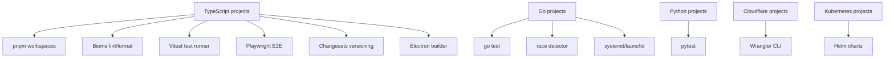

# 15 — Developer Tooling — CLI, Testing, CI/CD, Deployment, Monitoring

This document covers the developer tooling across the nexu ecosystem: build systems, testing strategies, CI/CD pipelines, deployment configurations, and monitoring.

## CI/CD Pipeline

```mermaid
flowchart LR
    Push[Git Push] --> GHA[GitHub Actions]
    GHA --> Install[pnpm install]
    Install --> Lint[biome check]
    Lint --> Typecheck[pnpm typecheck]
    Typecheck --> Test[pnpm test]
    Test --> Build[pnpm build]
    Build --> E2E[Playwright E2E]
    E2E --> Deploy[Deploy artifacts]
    Deploy --> Dist[macOS/Windows packages]
```



## Build Systems

### pnpm Workspaces

All TypeScript projects use pnpm workspaces for monorepo management:

```yaml
# open-design/pnpm-workspace.yaml
packages:
  - "apps/*"
  - "packages/*"
  - "tools/*"
```

Common scripts:
```bash
pnpm -r build          # Build all workspaces
pnpm -r typecheck      # Type check all workspaces
pnpm -r test           # Run all test suites
biome check .          # Lint entire workspace
biome check --write .  # Format entire workspace
```

### Build Commands by Project

| Project | Build Command | Output |
|---------|--------------|--------|
| open-design | `pnpm -r build` | Daemon JS, web Next.js bundle |
| nexu | `pnpm -r build` | Controller JS, web Vite bundle |
| design | `pnpm build:packages` | Tokens JS, UI Web JS |
| html-anything | `pnpm -r build` | CLI JS, web bundle |
| html-video | `pnpm -r build` | CLI JS, adapters |
| monet | `pnpm -r build` | Controller JS, web bundle |

### Go Build (Looper)

```bash
go build ./cmd/looper     # Build CLI
go build ./cmd/looperd    # Build daemon
go build ./cmd/loopernet  # Build network daemon
go test ./...             # Run all tests
```

Source: `looper/go.mod` — Go 1.22.

## Testing

### TypeScript Testing

Projects use Vitest for unit and integration testing:

```bash
pnpm test                    # Run all tests
pnpm test:coverage           # Run with coverage
pnpm vitest run src/foo.test.ts  # Run specific test
```

Test files follow the `*.test.ts` naming convention.

### Go Testing

Looper uses Go's standard testing framework:

```bash
go test ./...                # Run all tests
go test ./internal/planner   # Run package tests
go test -race ./...          # Run with race detector
go test -cover ./...         # Run with coverage
```

Test files follow the `*_test.go` naming convention.

Source: `looper/internal/planner/runner_test.go` — Planner tests.

### End-to-End Testing

Playwright is used for E2E testing:

```bash
# html-anything
npx playwright test

# open-design
npx playwright test
```

Source: `html-anything/e2e/playwright.config.ts` — Playwright configuration.

### Coverage

Projects configure coverage reporting via Vitest:

```json
{
  "coverage": {
    "reporter": "lcov"
  }
}
```

## Tool Chain by Project



Source: `nexu/package.json:21` — test:coverage script.

## Linting and Formatting

### Biome

All TypeScript projects use Biome for linting and formatting:

```bash
biome check .          # Check (read-only)
biome check --write .  # Format + fix
biome check --write --unsafe .  # Unsafe fixes
```

Configuration: `biome.json` in each project root.

### Knip

The design project uses Knip for dead code detection:

```bash
pnpm knip              # Check for unused exports
pnpm knip --production # Production mode
```

Source: `design/knip.json` — Knip configuration.

## CI/CD

### GitHub Actions

Projects use GitHub Actions for CI:

| Project | Workflow | Triggers |
|---------|----------|----------|
| open-design | CI pipeline | Push, PR |
| nexu | CI pipeline | Push, PR |
| looper | CI pipeline | Push, PR |
| html-video | CI pipeline | Push, PR |

### Pre-commit Hooks

Git hooks are set up via scripts:

Source: `nexu/scripts/setup-git-hooks.mjs` — Git hook setup.

### Changesets

The design project uses Changesets for version management:

```bash
pnpm changeset              # Create a changeset
pnpm changeset version      # Apply changesets, bump versions
pnpm changeset status       # Check changeset status
pnpm release                # Publish packages
```

Source: `design/package.json:42-47` — Changesets scripts.

## Deployment

### Open Design Desktop

macOS signing and notarization:
```bash
pnpm dist:mac              # Build for macOS
pnpm dist:mac:arm64        # Build for macOS ARM64
pnpm dist:mac:x64          # Build for macOS x64
```

Windows NSIS packaging:
```bash
pnpm dist:win:local        # Build for Windows
```

Source: `nexu/package.json:27-33` — Distribution scripts.

### Looper Deployment

Deployment configurations:
```
looper/deploy/
  ├── systemd/    ← Systemd service files
  └── launchd/    ← macOS launchd plists
```

### Cloudflare Workers

Bot sandbox and contributor card deploy to Cloudflare Workers:

Source: `open-design-bot-sandbox/wrangler.toml` — Cloudflare configuration.
Source: `open-design-contributor-card/wrangler.jsonc` — Cloudflare configuration.

### Helm Charts

Open Design includes Helm charts for Kubernetes deployment:

Source: `open-design/charts/` — Helm chart definitions.

### AWS Lambda / GCP Cloud Run

HyperFrames supports cloud deployment:
- AWS Lambda for serverless rendering
- GCP Cloud Run for container-based rendering

## Monitoring

### Health Checks

Every project exposes a health endpoint:

| Project | Endpoint | Purpose |
|---------|----------|---------|
| nexu | `GET /health` | Control plane health |
| open-design | `GET /health` | Daemon health |
| monet | `GET /health` | Controller health |

### Analytics

The nexu controller runs an analytics loop:

Source: `nexu/apps/controller/src/services/analytics-service.ts` — Analytics collection.

### Telemetry

Open Design includes a telemetry worker:

Source: `open-design/apps/telemetry-worker/` — Telemetry collection.

### Event Logging

Looper uses an event log for audit trails:

Source: `looper/internal/eventlog/` — Event logging system.

Events include:
- `loop.created` — Loop creation
- `loop.started` — Loop start
- `loop.step.started` — Step start
- `loop.step.completed` — Step completion
- `loop.step.failed` — Step failure
- `run.completed` — Run completion
- `run.failed` — Run failure

## Development Utilities

### Dev Scripts

The `tools/dev` directory contains development utilities:

Source: `open-design/tools/` — Development tools.

### Probes

The nexu project includes probe scripts for testing:

```bash
pnpm probe:slack    # Test Slack integration
pnpm probe:model    # Test model API call
```

Source: `nexu/package.json:35-36` — Probe scripts.

### Desktop Check

```bash
pnpm check:dev      # Check dev build
pnpm check:dist     # Check distribution build
```

Source: `nexu/package.json:25-26` — Check scripts.

**Aha:** The ecosystem's consistent use of Biome, pnpm workspaces, and Vitest means developers can move between projects without learning new tooling. The `pnpm -r` pattern for running commands across workspaces is used uniformly, and the `biome.json` configuration is nearly identical across projects.

## Next

- [16 — Smaller Projects](16-smaller-projects.md) — Bots, skills, manim, hyprframes, motion canvas
- [01 — Architecture](01-architecture.md) — Full ecosystem architecture
