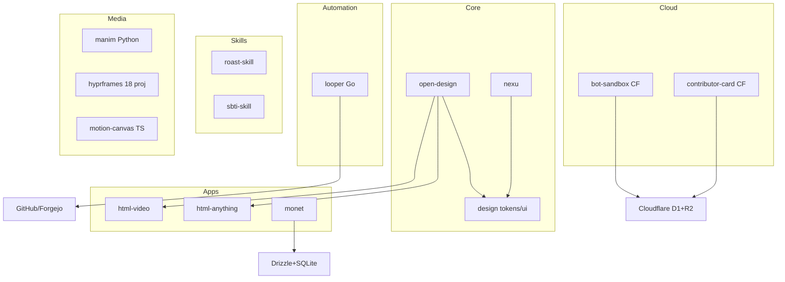
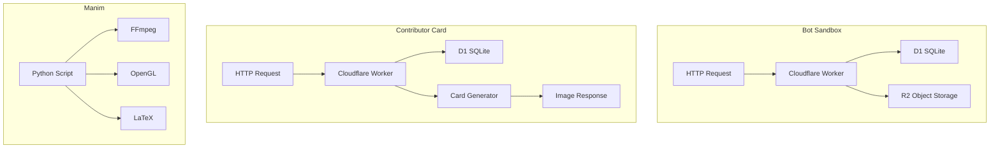

# 16 — Smaller Projects — Bots, Skills, Manim, Hyprframes, Motion Canvas

## Ecosystem Project Map



This document covers the smaller projects in the nexu ecosystem that complement the main platforms.

## Open Design Bot Sandbox

A Cloudflare Worker that provides a sandboxed environment for bot interactions.

Source: `/home/darkvoid/Boxxed/@formulas/src.rust/src.AI/src.Opendesign/open-design-bot-sandbox/`

### Structure

```
open-design-bot-sandbox/
  src/              ← Worker source code
  data/             ← Data files
  assets/           ← Static assets
  scripts/          ← Build scripts
  wrangler.toml     ← Cloudflare Workers configuration
```

### Technology

- **Runtime:** Cloudflare Workers
- **Storage:** D1 (SQLite database)
- **Assets:** R2 (object storage)
- **Configuration:** `wrangler.toml`

## Cloudflare Project Architecture



Source: `open-design-bot-sandbox/wrangler.toml` — Cloudflare configuration.

## Open Design Contributor Card

A Cloudflare Worker that generates contributor cards for the open-design project.

Source: `/home/darkvoid/Boxxed/@formulas/src.rust/src.AI/src.Opendesign/open-design-contributor-card/`

### Structure

```
open-design-contributor-card/
  src/              ← Worker source code
  tests/            ← Vitest tests
  migrations/       ← D1 migrations
  scripts/          ← Build scripts
  wrangler.jsonc    ← Cloudflare Workers configuration
  vitest.config.ts  ← Vitest configuration
```

### Technology

- **Runtime:** Cloudflare Workers
- **Storage:** D1 (SQLite database)
- **Testing:** Vitest
- **Migrations:** D1 SQL migrations

Source: `open-design-contributor-card/wrangler.jsonc` — Cloudflare configuration.

## Roast Skill

A personality test skill for agents — the "roast" personality test.

Source: `/home/darkvoid/Boxxed/@formulas/src.rust/src.AI/src.Opendesign/roast-skill/`

### Structure

```
roast-skill/
  SKILL.md          ← Skill definition with frontmatter
  README.md         ← Documentation
  README_EN.md      ← English documentation
  assets/           ← Skill assets
  scripts/          ← Build scripts
  deploy/           ← Deployment configuration
  examples/         ← Example outputs
```

### SKILL.md Format

```yaml
---
name: roast
description: Personality test - roast edition
---
```

The skill defines a personality test that agents can administer to users.

## SBTI Skill

A personality test skill for agents — the SBTI (Something Brilliant Type Indicator) personality test.

Source: `/home/darkvoid/Boxxed/@formulas/src.rust/src.AI/src.Opendesign/sbti-skill/`

### Structure

```
sbti-skill/
  SKILL.md          ← Skill definition with frontmatter
  README.md         ← Documentation
  README_EN.md      ← English documentation
  assets/           ← Skill assets
  templates/        ← Result templates
  references/       ← Reference materials
  deploy/           ← Deployment configuration
```

## Harness Engineering Guide

An engineering guide with changelogs, skills, and documentation site.

Source: `/home/darkvoid/Boxxed/@formulas/src.rust/src.AI/src.Opendesign/harness-engineering-guide/`

### Structure

```
harness-engineering-guide/
  README.md         ← Documentation
  README.zh-CN.md   ← Chinese documentation
  CONTRIBUTING.md   ← Contribution guidelines
  guide/            ← Guide content
  zh-guide/         ← Chinese guide content
  changelog/        ← Changelog entries
  zh-changelog/     ← Chinese changelog entries
  skills/           ← Skills
  site/             ← Documentation site
  LICENSE           ← License
```

## Manim

3Blue1Brown's math animation engine — a Python library for creating mathematical animations.

Source: `/home/darkvoid/Boxxed/@formulas/src.rust/src.AI/src.Opendesign/manim/`

### Structure

```
manim/
  manimlib/         ← Core library
    animation/      ← Animation classes
    camera/         ← Camera classes
    mobject/        ← Mathematical objects
    scene/          ← Scene management
    utils/          ← Utility functions
  example_scenes.py ← Example scenes
  pyproject.toml    ← Python package configuration
  requirements.txt  ← Python dependencies
  setup.py          ← Package setup
  README.md         ← Documentation
```

### Technology

- **Language:** Python
- **Package:** `manimgl` on PyPI
- **Dependencies:** FFmpeg, OpenGL, LaTeX, Pango
- **Community Fork:** `ManimCommunity/manim`

Source: `manim/pyproject.toml` — Python package configuration.

## src.hyprframes

A collection of 18 HyperFrames-related subprojects:

Source: `/home/darkvoid/Boxxed/@formulas/src.rust/src.AI/src.Opendesign/src.hyprframes/`

### Subprojects

| Subproject | Description |
|-----------|-------------|
| `hyperframes` | Core HyperFrames engine |
| `hyperframes-cloudflare-template` | Cloudflare Workers template |
| `hyperframes-gemini-agent` | Gemini agent integration |
| `hyperframes-launches` | Launch configurations |
| `hyperframes-launch-video` | Launch video project |
| `hyperframes-vercel-template` | Vercel deployment template |
| `heygen-cli` | HeyGen CLI |
| `heygen-stack` | HeyGen stack configuration |
| `heygen-gemini-agent` | HeyGen + Gemini agent |
| `facedetection-devops` | Face detection DevOps |
| `auto-model-optim` | Auto model optimization |
| `liveavatar-agent-skills` | LiveAvatar agent skills |
| `liveavatar-hyperframes-demo` | LiveAvatar + HyperFrames demo |
| `liveavatar-starter-livekit-agent-python` | LiveKit starter agent |
| `liveavatar-web-sdk` | LiveAvatar web SDK |
| `mcp-shrimp-task-manager` | MCP Shrimp task manager |
| `mediadevices` | Media devices integration |
| `n8n-integration-heygen-node` | n8n + HeyGen integration |
| `openclaw-plugin-heygen` | OpenClaw HeyGen plugin |
| `posthog` | PostHog analytics integration |

## src.motion-canvas

Motion Canvas — a generator-based animation tool with live preview.

Source: `/home/darkvoid/Boxxed/@formulas/src.rust/src.AI/src.Opendesign/src.motion-canvas/`

### Structure

```
src.motion-canvas/
  motion-canvas/            ← Core library
  motion-canvas.github.io/  ← Documentation website
  examples/                 ← Example projects
  exporters/                ← Export plugins
```

### Technology

- **Language:** TypeScript
- **Rendering:** Canvas API
- **Features:** Generator-based animation, live preview, code editor

## Nexu Site

The landing page for the nexu project, built with Astro.

Source: `/home/darkvoid/Boxxed/@formulas/src.rust/src.AI/src.Opendesign/nexu-site/`

### Structure

```
nexu-site/
  src/              ← Astro source
  public/           ← Static assets
  assets/           ← Additional assets
  astro.config.ts   ← Astro configuration
  biome.json        ← Biome configuration
  tsconfig.json     ← TypeScript configuration
  package.json      ← Package configuration
  index.html        ← Static fallback
  script.js         ← Client-side scripts
  styles.css        ← Styles
```

### Technology

- **Framework:** Astro
- **Language:** TypeScript
- **Linting:** Biome

## Agentic Design

Documentation and specifications for the next-gen vision: chat-first, agent-native product lifecycle.

Source: `/home/darkvoid/Boxxed/@formulas/src.rust/src.AI/src.Opendesign/agentic-design/`

### Structure

```
agentic-design/
  docs/             ← Documentation
  examples/         ← Example implementations
  README.md         ← Overview
  README.zh-CN.md   ← Chinese overview
  LICENSE           ← License
```

This project captures the vision of a chat-first, agent-native product lifecycle spanning PRD to pixel to production.

**Aha:** The ecosystem spans multiple languages (TypeScript, Go, Python) and deployment targets (desktop, web, cloud, edge), yet shares common architectural patterns. The agent detection system, SSE streaming, and controller-first architecture appear across projects, creating a cohesive platform despite the technological diversity.

## Next

- [00 — Ecosystem Overview](00-overview.md) — Return to overview
- [01 — Architecture](01-architecture.md) — Full ecosystem architecture
