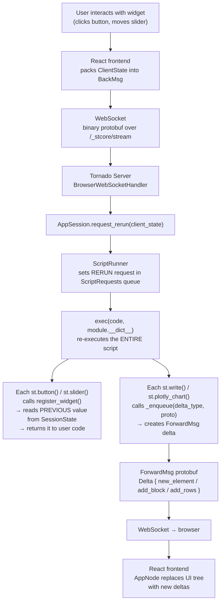
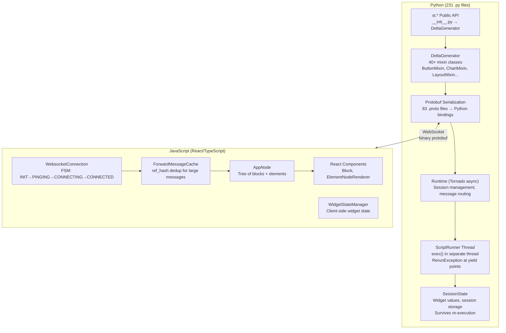

# Streamlit — Python to Interactive Web App Engine

**Streamlit turns Python scripts into interactive web apps with no frontend experience.** The core model is deceptively simple: every `st.foo()` call (button, slider, chart, text) generates a Protobuf `Delta` message sent over WebSocket to a React frontend that renders it. Widget interactions trigger full-script re-execution with preserved `SessionState` — the script runs from the top, but widget values survive. The entire Python↔JavaScript contract is defined by 83 `.proto` files.

Source: `lib/streamlit/` — 231 Python files, `frontend/` — React/TypeScript, v1.45.1, Apache 2.0

## The Rerun Model — How It Actually Works



**Aha:** Streamlit does NOT use fine-grained reactivity. It re-executes the ENTIRE script from top to bottom on every interaction. The magic is that widget calls (`st.button()`, `st.slider()`) don't re-render with default values — they read the user's previous value from `SessionState` via `register_widget()`. This means you write imperative code as if it runs once, and Streamlit makes it reactive by preserving state across re-executions.

## Architecture Layers



## DeltaGenerator — The 40-Mixin Monolith

**Aha:** `DeltaGenerator` is a single class that inherits from 40+ mixin classes — one per element/widget family. Every `st.foo()` call eventually lands in a mixin method:

```python
# Conceptual structure
class DeltaGenerator(
    AlertMixin,      # st.success(), st.warning(), st.error(), st.info()
    ButtonMixin,     # st.button(), st.download_button()
    ChatMixin,       # st.chat_message(), st.chat_input()
    CheckboxMixin,   # st.checkbox(), st.toggle()
    LayoutsMixin,    # st.columns(), st.container(), st.expander()
    MarkdownMixin,   # st.markdown(), st.code(), st.latex()
    PlotlyMixin,     # st.plotly_chart()
    VegaChartsMixin, # st.vega_lite_chart(), st.altair_chart()
    WriteMixin,      # st.write() — the universal adapter
    SliderMixin,     # st.slider(), st.select_slider()
    InputMixin,      # st.text_input(), st.text_area(), st.number_input()
    DataframeMixin,  # st.dataframe(), st.data_editor()
    ...40+ total
)
```

Every mixin method calls `self._enqueue(delta_type, element_proto)` which:
1. Gets the active `DeltaGenerator` from the `with` block context stack
2. Creates a `ForwardMsg` containing a `Delta` with the element protobuf
3. Enqueues it via `ScriptRunContext.enqueue()`
4. Returns a new `DeltaGenerator` with a **locked cursor** pointing to the new element

### Cursor System

| Cursor | Behavior |
|--------|----------|
| **RunningCursor** | Auto-increments index per element |
| **LockedCursor** | Fixed position — subsequent calls REPLACE the element |

```python
# Running cursor: each call appends
st.text("A")  # element at path [0, 0]
st.text("B")  # element at path [0, 1]

# Locked cursor: subsequent calls replace
dg = st.text("Loading...")  # returns DG with LockedCursor
dg.text("Done!")            # REPLACES "Loading..." with "Done!"
```

### Four Root Containers

| Container | `st.*` method |
|-----------|--------------|
| `_main_dg` (RootContainer.MAIN) | All normal `st.foo()` calls |
| `_sidebar_dg` (RootContainer.SIDEBAR) | `st.sidebar.foo()` |
| `_event_dg` (RootContainer.EVENT) | `st.toast()` — transient, not in main flow |
| `_bottom_dg` (RootContainer.BOTTOM) | Fixed-position elements |

## The Protobuf Bridge — 83 .proto Files

The entire Python↔JavaScript contract is defined by Protocol Buffers:

### ForwardMsg (Python → Browser)
```protobuf
message ForwardMsg {
  oneof type {
    NewSession new_session = 4;           // Initialize session
    Delta delta = 5;                     // UI tree changes
    ScriptFinishedStatus script_finished = 6;
    SessionStatus session_status_changed = 9;
    PageNotFound page_not_found = 15;
  }
}

message Delta {
  oneof type {
    Element new_element = 3;    // Add new element
    Block add_block = 6;        // Add block (column, expander)
    NamedDataSet add_rows = 5;  // Append rows to existing element
  }
}
```

### BackMsg (Browser → Python)
```protobuf
message BackMsg {
  oneof type {
    ClientState rerun_script = 11;   // Widget state → trigger rerun
    bool clear_cache = 5;
    bool stop_script = 7;
  }
}

message ClientState {
  string query_string = 1;
  WidgetStates widget_states = 2;    // ALL widget values
  string page_script_hash = 3;
  string fragment_id = 5;            // If fragment rerun
}
```

**Aha:** `ClientState` carries ALL widget values on every rerun, not just the changed one. This is deliberately simple: the server merges widget states and the script re-executes with the full state. No incremental state tracking, no diffing — just "here's everything, run the script."

### Message Cache — Bandwidth Optimization

Large immutable messages (dataframes) are MD5-hashed on the Python side. If the client already has the hash cached, the server sends a lightweight `ref_hash` reference instead of the full message. The frontend `ForwardMessageCache` resolves references from its local cache.

### Arrow for Dataframes

Dataframe data uses **Apache Arrow IPC format** (`ArrowNamedDataSet`) rather than JSON. This avoids parsing overhead for large tables — the bytes are directly usable by the frontend.

## SessionState — Surviving Re-Execution

```python
# Widget registration (conceptual)
def register_widget(element_id, deserializer, default_value):
    # 1. Compute deterministic element_id from parameter hash
    # 2. Look up existing value in SessionState (from previous run)
    # 3. If found → return deserialized value
    # 4. If not found → return default_value
    # 5. Store current value for next run
```

Each widget type provides a **serde pair** (serializer/deserializer) that converts between Python types and protobuf:
- `ButtonSerde` serializes `bool`
- `SliderSerde` serializes `int`/`float`/`datetime`
- `DataFrameSerde` handles pandas DataFrames

### Callbacks

Widget callbacks (`on_change`, `on_click`) execute at script START (before user code), if the widget's value changed since the last run. This ensures state updates happen before the script reads updated values.

### @st.fragment — Partial Rerun

```python
@st.fragment
def search_results():
    query = st.text_input("Search")
    results = run_search(query)
    st.dataframe(results)
```

Fragments can rerun independently of the main script. Fragment reruns:
- Only regenerate deltas with matching `fragment_id`
- Replace only their section of the UI without clearing the whole page
- Queue behind full script runs (fragments don't preempt)

## ScriptRunner — The Execution Thread

User code runs in a **separate thread** (`ScriptRunner.scriptThread`). The execution loop:

```
ScriptRequests queue → _run_script(RerunData) → exec(code, module.__dict__)
```

At every `st.foo()` call (yield point), the runner checks `_maybe_handle_execution_control_request()`:
- If a `RERUN` request is pending → throw `RerunException` → caught by `_run_script` → restart with new RerunData
- If a `STOP` request is pending → throw `StopException` → clean shutdown

**Aha:** `st.foo()` calls are implicit yield points. The script can be interrupted between ANY two Streamlit calls, but not mid-Python-statement. This means long-running pure-Python computation (no `st.*` calls) blocks reruns — the solution is `st.status()` or explicit `time.sleep(0)` to create yield points.

## Runtime — Asyncio Event Loop

```python
# lib/streamlit/runtime/runtime.py
class Runtime:
    async def _loop_coroutine(self):
        while True:
            await has_connection_event.wait()
            for session in active_sessions:
                session.flush_forward_msg_queue()  # Send pending deltas
            await need_send_data_event.wait()      # Block until new messages
```

State machine: `INITIAL → NO_SESSIONS_CONNECTED ↔ ONE_OR_MORE_SESSIONS_CONNECTED → STOPPING → STOPPED`

## Tornado WebSocket

The WebSocket handler at `/_stcore/stream`:
1. Receives binary protobuf (`BackMsg`)
2. Deserializes and forwards to `Runtime.handle_backmsg()`
3. Sends binary protobuf (`ForwardMsg`) via `write_forward_msg()`

Uses the `"streamlit"` WebSocket subprotocol with auth tokens and session IDs for reconnection.

## Frontend — React Rendering Pipeline

1. `ForwardMsg` arrives via WebSocket
2. `ForwardMessageCache` resolves `ref_hash` references
3. `SessionEventDispatcher` processes messages
4. `AppNode` maintains the frontend element/block tree from `Delta` messages
5. `Block` and `ElementNodeRenderer` render each element as React components
6. `WidgetStateManager` manages client-side widget state
7. User interactions produce `BackMsg` instances sent via `ConnectionManager.sendMessage()`

## Key Design Decisions

1. **Full re-execution, not reactivity:** Simple mental model — write top-down scripts, Streamlit handles state preservation
2. **Protobuf, not JSON:** Binary protocol for performance; 83 `.proto` files as the source of truth for the Python↔JS contract
3. **Separate script thread:** User code runs in its own thread; yield points at every `st.foo()` enable clean interruption
4. **40-mixin DeltaGenerator:** Each element family is a mixin; `st.write()` is the universal adapter
5. **Arrow for data:** Large tables use Apache Arrow IPC format, avoiding JSON serialization overhead

## Cross-References

- [TEN Framework](../src.TenFramework/markdown/00-overview.md) — Real-time conversational AI (similar extension model)
- [Mirage VFS](../src.strukto-ai/markdown/00-overview.md) — VFS for agents (similar "unified interface" philosophy)
