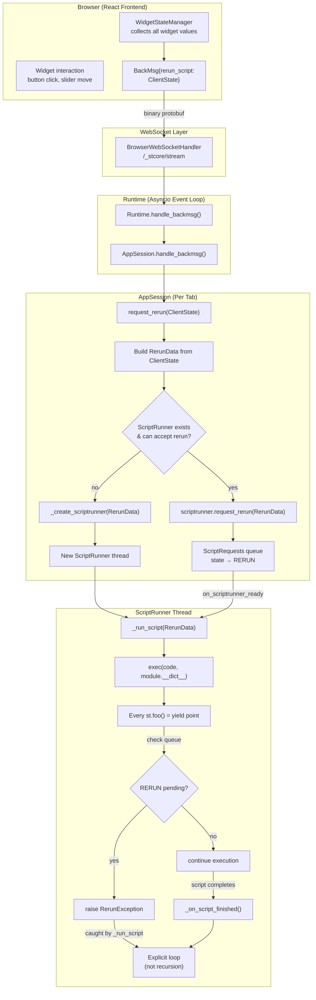
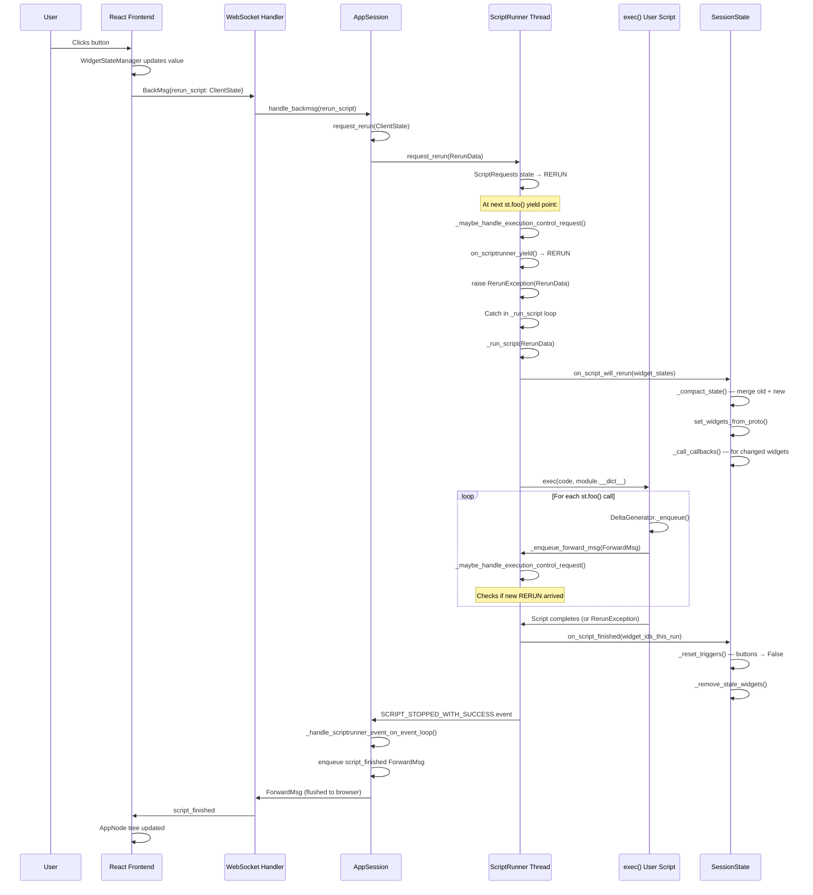

# Rerun Execution Model — How Streamlit Re-executes Scripts

The rerun model is the single most important concept in Streamlit. Every user interaction — clicking a button, moving a slider, typing text — triggers a complete re-execution of the user's script from top to bottom. There is no fine-grained reactive binding like React's virtual DOM diff or Vue's signal tracking. Instead, Streamlit preserves widget values across reruns via `SessionState`, so the script "sees" the user's input even though it runs from line 1 again.

Source: `lib/streamlit/runtime/scriptrunner/` — 4 Python files; `lib/streamlit/runtime/scriptrunner_utils/` — 3 Python files; `lib/streamlit/runtime/app_session.py`; `lib/streamlit/runtime/runtime.py`

## Architecture Overview



**Aha:** The script runner uses an **explicit `while True:` loop** in `_run_script()` instead of recursion. This avoids stack overflows when `st.rerun()` is called repeatedly. When a `RerunException` is caught, the loop restarts with the new `RerunData` rather than recursively calling itself. See `script_runner.py:483` — the loop body compiles the script, sets up the module context, runs `exec()`, handles cleanup, and either breaks (normal completion) or loops again (rerun triggered).

## The Three Request Types

Source: `lib/streamlit/runtime/scriptrunner_utils/script_requests.py:30-41`

```python
class ScriptRequestType(Enum):
    CONTINUE = "CONTINUE"  # ScriptRunner should continue running
    STOP = "STOP"          # Terminal — ScriptRunner should shut down
    RERUN = "RERUN"        # Interrupt at next yield point and restart
```

The `ScriptRequests` class (`script_requests.py:157-311`) is a thread-safe state machine that mediates communication between the asyncio event loop (main thread) and the script runner thread. It uses a `threading.Lock` to protect state transitions.

## RerunData — The Payload

Source: `lib/streamlit/runtime/scriptrunner_utils/script_requests.py:44-66`

```python
@dataclass(frozen=True)
class RerunData:
    """Data attached to RERUN requests. Immutable."""
    query_string: str = ""
    widget_states: WidgetStates | None = None
    page_script_hash: str = ""
    page_name: str = ""
    fragment_id: str | None = None
    fragment_id_queue: list[str] = field(default_factory=list)
    is_fragment_scoped_rerun: bool = False
    is_auto_rerun: bool = False
    cached_message_hashes: set[str] = field(default_factory=set)
    context_info: ContextInfo | None = None
```

Every rerun carries the full `WidgetStates` protobuf (all widget values), the query string, the target page, and fragment information. The `cached_message_hashes` set enables the ForwardMsg cache — if the client already has a message with a given hash, the server sends a lightweight reference instead of the full payload.

## Widget State Coalescence

When multiple rerun requests arrive while a script is running, they are coalesced into a single `RerunData`. The critical function is `_coalesce_widget_states()` (`script_requests.py:100-154`):

```python
def _coalesce_widget_states(
    old_states: WidgetStates | None, new_states: WidgetStates | None
) -> WidgetStates | None:
    """Coalesce an older WidgetStates into a newer one."""
    # For most widget values, take the latest version.
    # BUT: trigger_values (buttons) that are True in old_states
    # are preserved in the coalesced result, so button presses
    # don't go missing.
```

**Key insight:** Button presses use `trigger_value` which auto-resets to `False` after each run. If a button press is coalesced away, the press is lost. The coalescence logic specifically preserves `trigger_value=True` and `chat_input_value` from older states even when newer states don't have them, because the client deletes trigger values immediately after sending the rerun request.

## ScriptRunner — The Execution Engine

Source: `lib/streamlit/runtime/scriptrunner/script_runner.py:168-783`

The `ScriptRunner` class is initialized with:

```python
class ScriptRunner:
    def __init__(
        self,
        session_id: str,
        main_script_path: str,
        session_state: SessionState,
        uploaded_file_mgr: UploadedFileManager,
        script_cache: ScriptCache,
        initial_rerun_data: RerunData,
        user_info: dict[str, str | bool | None],
        fragment_storage: FragmentStorage,
        pages_manager: PagesManager,
    ) -> None:
```

The script thread entry point (`_run_script_thread`, line 339):

```python
def _run_script_thread(self) -> None:
    # Create and attach the thread's ScriptRunContext
    ctx = ScriptRunContext(
        session_id=self._session_id,
        _enqueue=self._enqueue_forward_msg,
        script_requests=self._requests,
        query_string="",
        session_state=self._session_state,
        uploaded_file_mgr=self._uploaded_file_mgr,
        main_script_path=self._main_script_path,
        user_info=self._user_info,
        gather_usage_usage_stats=bool(config.get_option("browser.gatherUsageStats")),
        fragment_storage=self._fragment_storage,
        pages_manager=self._pages_manager,
        context_info=None,
    )
    add_script_run_ctx(threading.current_thread(), ctx)

    request = self._requests.on_scriptrunner_ready()
    while request.type == ScriptRequestType.RERUN:
        self._run_script(request.rerun_data)
        request = self._requests.on_scriptrunner_ready()
```

## The Rerun Loop — `_run_script`

Source: `lib/streamlit/runtime/scriptrunner/script_runner.py:467-724`

The `_run_script()` method is the heart of Streamlit's execution model. It follows this sequence:

1. **Page resolution** (lines 488-507): Uses `PagesManager` to determine which script/page to run based on `page_script_hash`.
2. **Widget state cleanup** (lines 513-528): If the page changed, reset widget state to only the widget IDs in the rerun data.
3. **Context reset** (lines 532-538): Clears cursors, widget tracking sets, and sets up query params for the new run.
4. **Emit SCRIPT_STARTED** (lines 540-546): Sends a `ForwardMsg` to the frontend.
5. **Compile** (lines 551-580): Gets bytecode from `ScriptCache`. On compile error, sends error event and returns.
6. **Module setup** (lines 586-602): Creates a fake `__main__` module, sets `__file__`, prepends script directory to `sys.path`.
7. **Execute** (lines 604-671): Runs `exec(code, module.__dict__)` inside `exec_func_with_error_handling`.
8. **Cleanup** (lines 715-719): Calls `_on_script_finished()`, runs GC if configured, cleans problem modules (Keras, matplotlib).
9. **Loop or exit** (lines 721-724): If there was a `RerunException`, loop with the new data. Otherwise, break.

### Execution Control at Yield Points

Source: `lib/streamlit/runtime/scriptrunner/script_runner.py:415-450`

```python
def _maybe_handle_execution_control_request(self) -> None:
    """Check our current ScriptRequestState to see if we have a
    pending STOP or RERUN request.

    This function is called every time the app script enqueues a
    ForwardMsg, which means that most `st.foo` commands act as implicit
    yield points in the script's execution.
    """
    if not self._is_in_script_thread():
        return
    if not self._execing:
        return

    request = self._requests.on_scriptrunner_yield()
    if request is None:
        return

    if request.type == ScriptRequestType.RERUN:
        raise RerunException(request.rerun_data)
    if request.type != ScriptRequestType.STOP:
        raise RuntimeError(...)
    raise StopException()
```

**Aha:** `RerunException` and `StopException` both inherit from `BaseException` (not `Exception`), defined in `lib/streamlit/runtime/scriptrunner_utils/exceptions.py:22-48`. This is deliberate: if they inherited from `Exception`, user code like `try: st.button("X"); except: pass` would catch them silently, breaking the rerun mechanism. By inheriting from `BaseException`, they bypass ordinary `except Exception` handlers — only a bare `except:` would catch them.

## ScriptRunContext — Thread-Local State

Source: `lib/streamlit/runtime/scriptrunner_utils/script_run_context.py:68-222`

`ScriptRunContext` is a dataclass attached to the script thread via `add_script_run_ctx()`. It contains:

| Field | Purpose |
|-------|---------|
| `session_id` | Unique session identifier |
| `_enqueue` | Callback to send ForwardMsg up to ScriptRunner |
| `query_string` | Current URL query string |
| `session_state` | SafeSessionState wrapper |
| `uploaded_file_mgr` | File upload manager |
| `main_script_path` | Path to the user's script |
| `user_info` | Current user info (email) |
| `fragment_storage` | Fragment function registry |
| `pages_manager` | Multi-page navigation |
| `cached_message_hashes` | Hashes of messages cached in client |
| `widget_ids_this_run` | Widget IDs encountered during this run |
| `widget_user_keys_this_run` | User-provided keys seen this run |
| `form_ids_this_run` | Form IDs seen this run |
| `cursors` | Dict of RunningCursor per root container |
| `tracked_commands` | Telemetry: commands invoked |
| `current_fragment_id` | Currently executing fragment (if any) |
| `new_fragment_ids` | Fragments registered during this run |
| `has_dialog_opened` | Flag: dialog rendered this run |

The `enqueue()` method (`script_run_context.py:187-205`) is called by every `st.foo()`:

```python
def enqueue(self, msg: ForwardMsg) -> None:
    msg.metadata.active_script_hash = self.active_script_hash
    populate_hash_if_needed(msg)
    msg_to_send = msg
    if msg.metadata.cacheable and msg.hash and msg.hash in self.cached_message_hashes:
        msg_to_send = create_reference_msg(msg)  # Send ref_hash instead
    self._enqueue(msg_to_send)
```

## AppSession — Session Lifecycle

Source: `lib/streamlit/runtime/app_session.py:74-1000`

`AppSession` represents a single browser tab. Key responsibilities:

- **Browser queue management** (`_browser_queue: ForwardMsgQueue`): Deltas are enqueued here and flushed periodically by the Runtime.
- **BackMsg handling** (`handle_backmsg`, line 283): Dispatches `rerun_script`, `clear_cache`, `stop_script`, `app_heartbeat`, `file_urls_request` messages.
- **ScriptRunner lifecycle** (`_create_scriptrunner`, line 435): Creates a new ScriptRunner, connects its event signal, and starts the thread.
- **File watching** (`register_file_watchers`, line 180): Watches source files, config.toml, secrets.toml for changes.
- **Fast reruns** (line 400-416): When `runner.fastReruns` is enabled (default), a rerun request stops the existing ScriptRunner and creates a fresh one instead of asking the running one to interrupt.

```python
def request_rerun(self, client_state: ClientState | None) -> None:
    if self._state == AppSessionState.SHUTDOWN_REQUESTED:
        return

    rerun_data = RerunData(
        query_string=client_state.query_string,
        widget_states=client_state.widget_states,
        page_script_hash=client_state.page_script_hash,
        page_name=client_state.page_name,
        fragment_id=client_state.fragment_id if client_state.fragment_id else None,
        is_auto_rerun=client_state.is_auto_rerun,
        cached_message_hashes=set(client_state.cached_message_hashes),
        context_info=client_state.context_info,
    )

    if self._scriptrunner is not None:
        if config.get_option("runner.fastReruns") and not rerun_data.fragment_id:
            self._scriptrunner.request_stop()   # Kill old one
            self._scriptrunner = None
        else:
            success = self._scriptrunner.request_rerun(rerun_data)
            if success:
                return

    self._create_scriptrunner(rerun_data)  # Create new one
```

**Key insight:** Fast reruns work by **killing the old ScriptRunner thread** and creating a new one. This is faster than waiting for the old thread to reach a yield point, process the RERUN request, and clean up. The tradeoff is that the old thread's partial output is discarded.

## Full Execution Sequence Diagram



## Module Isolation — Fake `__main__`

Source: `lib/streamlit/runtime/scriptrunner/script_runner.py:586-602`

Streamlit creates a fresh module object for each script run:

```python
module = self._new_module("__main__")
sys.modules["__main__"] = module
module.__dict__["__file__"] = script_path
```

This means `import __main__` from the user's script gets the fake module. Streamlit explicitly documents that `if __name__ == "__main__"` blocks **will not execute** because the fake module is already registered as `__main__` before `exec()` runs.

After execution, `_clean_problem_modules()` (line 756) clears Keras sessions and closes matplotlib figures to prevent state leakage between runs.

## `exec_func_with_error_handling`

Source: `lib/streamlit/runtime/scriptrunner/exec_code.py:75-166`

This wrapper catches all exceptions from user code and returns a structured tuple:

```python
def exec_func_with_error_handling(
    func: Callable[[], Any], ctx: ScriptRunContext
) -> tuple[Any | None, bool, RerunData | None, bool, Exception | None]:
    """Returns: (result, run_without_errors, rerun_exception_data, premature_stop, uncaught_exception)"""
```

It distinguishes between:
- **`RerunException`**: Not an error — the script is being rerun. Resets cursors and DG stack.
- **`StopException`**: Not an error — `st.stop()` was called.
- **`FragmentHandledException`**: Error — fragment errored, error already rendered.
- **Other `Exception`**: Error — calls `handle_uncaught_app_exception()` and returns the exception.

## Post-Run Cleanup

Source: `lib/streamlit/runtime/scriptrunner/script_runner.py:726-749`

```python
def _on_script_finished(
    self, ctx: ScriptRunContext, event: ScriptRunnerEvent, premature_stop: bool
) -> None:
    self._session_state.on_script_finished(ctx.widget_ids_this_run)
    self.on_event.send(self, event=event)
    runtime.get_instance().media_file_mgr.remove_orphaned_files()
    if config.get_option("runner.postScriptGC"):
        gc.collect(2)
```

Four cleanup steps:
1. **SessionState cleanup**: Reset trigger values (buttons → False), remove stale widget state.
2. **Event emission**: Tell AppSession the script finished.
3. **Media cleanup**: Remove orphaned media files no longer referenced by any element.
4. **Garbage collection**: Force GC pass 2 if `runner.postScriptGC` is enabled (default: true).

## Cross-References

- [SessionState Management](04-session-state.md) — How widget values survive re-execution
- [DeltaGenerator System](02-deltagenerator-system.md) — How `st.foo()` calls create deltas
- [Fragment Partial Reruns](07-fragments.md) — How fragments avoid full-script reruns
- [Caching Mechanisms](06-caching.md) — How cached functions skip re-execution

## Next

Continue to [DeltaGenerator System](02-deltagenerator-system.md) to understand how `st.foo()` calls generate protobuf deltas and position elements in the frontend tree.
