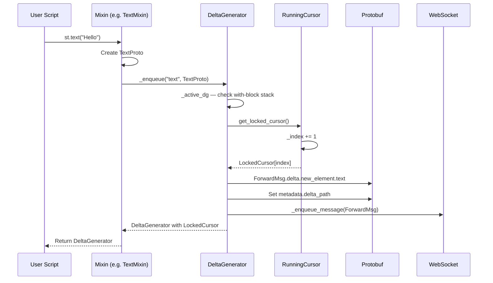
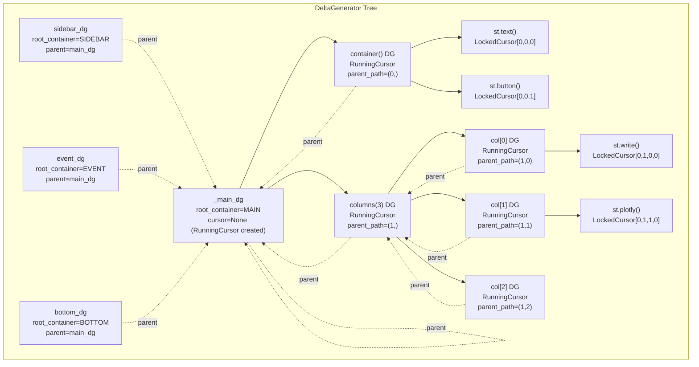

# DeltaGenerator System — The 40-Mixin UI Builder

Every `st.foo()` call in Streamlit flows through the `DeltaGenerator` class — a single class that inherits from 40+ mixin classes, one per element or widget family. The DeltaGenerator is responsible for creating UI elements, tracking their position in the frontend tree via cursors, and serializing them as protobuf `Delta` messages sent over WebSocket.

Source: `lib/streamlit/delta_generator.py` (609 lines); `lib/streamlit/delta_generator_singletons.py` (205 lines); `lib/streamlit/cursor.py` (211 lines); `lib/streamlit/elements/layouts.py`

## DeltaGenerator — The Mixin Monolith

Source: `lib/streamlit/delta_generator.py:166-213`

```python
class DeltaGenerator(
    AlertMixin,          # st.success(), st.warning(), st.error(), st.info()
    AudioInputMixin,     # st.audio_input()
    BalloonsMixin,       # st.balloons()
    BokehMixin,          # st.bokeh_chart()
    ButtonMixin,         # st.button(), st.download_button(), st.link_button()
    ButtonGroupMixin,    # st.button_group()
    CameraInputMixin,    # st.camera_input()
    ChatMixin,           # st.chat_message(), st.chat_input()
    CheckboxMixin,       # st.checkbox(), st.toggle()
    CodeMixin,           # st.code()
    ColorPickerMixin,    # st.color_picker()
    EmptyMixin,          # st.empty()
    ExceptionMixin,      # Exception display
    FileUploaderMixin,   # st.file_uploader()
    FormMixin,           # st.form(), st.form_submit_button()
    GraphvizMixin,       # st.graphviz_chart()
    HeadingMixin,        # st.title(), st.header(), st.subheader()
    HelpMixin,           # st.help()
    HtmlMixin,           # st.html()
    IframeMixin,         # st.components.v1.iframe()
    ImageMixin,          # st.image()
    LayoutsMixin,        # st.container(), st.columns(), st.expander(), st.popover(), st.tabs()
    MarkdownMixin,       # st.markdown(), st.latex()
    MapMixin,            # st.map()
    MediaMixin,          # st.audio(), st.video()
    MetricMixin,         # st.metric()
    MultiSelectMixin,    # st.multiselect()
    NumberInputMixin,    # st.number_input()
    PlotlyMixin,         # st.plotly_chart()
    ProgressMixin,       # st.progress()
    PydeckMixin,         # st.pydeck_chart()
    PyplotMixin,         # st.pyplot()
    RadioMixin,          # st.radio()
    SelectboxMixin,      # st.selectbox()
    SelectSliderMixin,   # st.select_slider()
    SliderMixin,         # st.slider()
    SnowMixin,           # st.snow()
    JsonMixin,           # st.json()
    TextMixin,           # st.text(), st.caption()
    TextWidgetsMixin,    # st.text_input(), st.text_area()
    TimeWidgetsMixin,    # st.date_input(), st.time_input()
    ToastMixin,          # st.toast()
    WriteMixin,          # st.write() — the universal adapter
    ArrowMixin,          # st.dataframe(), st.table()
    VegaChartsMixin,     # st.vega_lite_chart(), st.altair_chart()
    DataEditorMixin,     # st.data_editor()
):
```

**Aha:** The mixin pattern solves a circular dependency problem. Each mixin lives in its own file under `lib/streamlit/elements/` (e.g., `elements/widgets/slider.py`, `elements/arrow.py`). The mixins import `DeltaGenerator` for type hints, but `DeltaGenerator` imports the mixins. The `delta_generator_singletons.py` module breaks this cycle by providing a `DeltaGeneratorSingleton` class that both sides can import without creating a circular dependency.

## Constructor and Core State

Source: `lib/streamlit/delta_generator.py:245-297`

```python
def __init__(
    self,
    root_container: int | None = RootContainer.MAIN,
    cursor: Cursor | None = None,
    parent: DeltaGenerator | None = None,
    block_type: str | None = None,
) -> None:
    self._root_container = root_container       # MAIN, SIDEBAR, EVENT, or BOTTOM
    self._provided_cursor = cursor              # RunningCursor or LockedCursor
    self._parent = parent                       # Parent DG in the tree
    self._block_type = block_type               # "vertical", "horizontal", "column", "tab", etc.
    self._form_data: FormData | None = None     # If this DG is inside a form
```

Every DeltaGenerator knows:
- Which **root container** it belongs to (MAIN, SIDEBAR, EVENT, BOTTOM)
- Its **cursor** position in the frontend tree
- Its **parent** DeltaGenerator (for `with` block support)
- Its **block type** (to prevent nested columns/expanders)

## The Cursor System — Tracking Position

Source: `lib/streamlit/cursor.py:56-211`

The cursor system is how Streamlit knows where each element should appear in the frontend. There are two cursor types:

### RunningCursor

Auto-increments its index each time an element is created:

```python
class RunningCursor(Cursor):
    def __init__(self, root_container: int, parent_path: tuple[int, ...] = ()) -> None:
        self._root_container = root_container
        self._parent_path = parent_path
        self._index = 0

    def get_locked_cursor(self, **props: Any) -> LockedCursor:
        locked_cursor = LockedCursor(
            root_container=self._root_container,
            parent_path=self._parent_path,
            index=self._index,
            **props,
        )
        self._index += 1  # Auto-increment!
        return locked_cursor
```

Used for top-level containers (MAIN, SIDEBAR) and blocks (columns, tabs, expanders). Each element appended increments the index.

### LockedCursor

Fixed position — subsequent operations REPLACE the element:

```python
class LockedCursor(Cursor):
    def __init__(self, root_container: int, parent_path: tuple[int, ...] = (),
                 index: int = 0, **props: Any) -> None:
        self._root_container = root_container
        self._index = index
        self._parent_path = parent_path
        self._props = props

    def get_locked_cursor(self, **props: Any) -> LockedCursor:
        self._props = props  # Update props but don't change position
        return self
```

Used for elements returned by `st.foo()` calls. When you do `dg = st.text("Loading...")` then `dg.text("Done!")`, the second call replaces the first because `dg` has a `LockedCursor`.

### Delta Path

Every cursor computes a `delta_path` — a list of integers identifying the element's position in the frontend tree:

```python
def make_delta_path(root_container: int, parent_path: tuple[int, ...], index: int) -> list[int]:
    delta_path = [root_container]
    delta_path.extend(parent_path)
    delta_path.append(index)
    return delta_path
```

Example: `[0, 2, 0, 3]` means RootContainer.MAIN (0), third child (2), first sub-block (0), fourth element (3).

## The `_enqueue` Method — Creating Deltas

Source: `lib/streamlit/delta_generator.py:436-542`

This is the core method that every mixin calls to send an element to the frontend:

```python
def _enqueue(
    self,
    delta_type: str,           # e.g., "text", "button", "arrow"
    element_proto: Message,     # The protobuf message
    add_rows_metadata: AddRowsMetadata | None = None,
    layout_config: LayoutConfig | None = None,
) -> DeltaGenerator:
    dg = self._active_dg  # Get the DG from the current `with` block

    # Create ForwardMsg with the element
    msg = ForwardMsg_pb2.ForwardMsg()
    msg_el_proto = getattr(msg.delta.new_element, delta_type)
    msg_el_proto.CopyFrom(element_proto)

    # Set the delta path
    msg.metadata.delta_path[:] = dg._cursor.delta_path
    _enqueue_message(msg)

    # Return a new DG with a locked cursor
    new_cursor = dg._cursor.get_locked_cursor(delta_type=delta_type, ...)
    output_dg = DeltaGenerator(
        root_container=dg._root_container,
        cursor=new_cursor,
        parent=dg,
    )
    # Set form data
    output_dg._form_data = FormData(current_form_id(dg))

    # Save for cache replay
    caching.save_element_message(delta_type, element_proto, ...)

    return output_dg
```

The returned `DeltaGenerator` has a **locked cursor** pointing to the new element, allowing chained modifications like `st.text("X").markdown("Y")`.

## Element Creation Flow



## Context Stack — The `with` Block Mechanism

Source: `lib/streamlit/delta_generator_singletons.py:170-204`

The `with st.container()` / `with st.columns()[0]` pattern is implemented via a `contextvars.ContextVar` stack:

```python
context_dg_stack: ContextVarWithLazyDefault[tuple[DeltaGenerator, ...]] = (
    ContextVarWithLazyDefault(
        "context_dg_stack", default=lambda: (get_dg_singleton_instance().main_dg,)
    )
)
```

When you enter a `with` block:

```python
def __enter__(self) -> None:
    context_dg_stack.set((*context_dg_stack.get(), self))

def __exit__(self, typ, exc, tb) -> Literal[False]:
    context_dg_stack.set(context_dg_stack.get()[:-1])
    return False  # Re-raise any exceptions
```

The `_active_dg` property (`delta_generator.py:318-334`) reads from this stack:

```python
@property
def _active_dg(self) -> DeltaGenerator:
    if self == self._main_dg:
        # We're being invoked via `st.foo` — use the top of the `with` stack
        last_context_stack_dg = get_last_dg_added_to_context_stack()
        if last_context_stack_dg is not None:
            return last_context_stack_dg
    # We're being invoked via `st.sidebar.foo` — ignore the `with` stack
    return self
```

**Key insight:** `st.sidebar.foo()` intentionally bypasses the `with` block stack. This means `with st.container(): st.sidebar.text("X")` places "X" in the sidebar, NOT in the container. The sidebar has its own root container (`RootContainer.SIDEBAR`) and its own cursor hierarchy.

## Four Root Containers

Source: `lib/streamlit/delta_generator_singletons.py:76-85`

```python
self._main_dg = delta_generator_cls(root_container=_RootContainer.MAIN)
self._sidebar_dg = delta_generator_cls(root_container=_RootContainer.SIDEBAR, parent=self._main_dg)
self._event_dg = delta_generator_cls(root_container=_RootContainer.EVENT, parent=self._main_dg)
self._bottom_dg = delta_generator_cls(root_container=_RootContainer.BOTTOM, parent=self._main_dg)
```

| RootContainer | Purpose | DeltaGenerator |
|---|---|---|
| `MAIN` (0) | Main app area | `st._main`, `st.foo()` |
| `SIDEBAR` (1) | Sidebar panel | `st.sidebar.foo()` |
| `EVENT` (2) | Transient events | `st.toast()` |
| `BOTTOM` (3) | Fixed bottom area | `st._bottom` |

The `RootContainer` enum is defined in `proto/RootContainer.proto`:

```protobuf
message RootContainer {
  enum Type {
    MAIN = 0;
    SIDEBAR = 1;
    EVENT = 2;
    BOTTOM = 3;
  }
}
```

## The `_block` Method — Creating Containers

Source: `lib/streamlit/delta_generator.py:544-602`

Blocks (containers, columns, tabs, expanders) are created via `_block()`:

```python
def _block(self, block_proto: Block_pb2.Block | None = None,
           dg_type: type | None = None) -> DeltaGenerator:
    dg = self._active_dg

    # Prevent nested columns & expanders
    block_type = block_proto.WhichOneof("type")

    # Create a new RunningCursor for the block
    block_cursor = cursor.RunningCursor(
        root_container=dg._root_container,
        parent_path=(*dg._cursor.parent_path, dg._cursor.index),
    )

    # Create a new DeltaGenerator for the block
    block_dg = dg_type(
        root_container=dg._root_container,
        cursor=block_cursor,
        parent=dg,
        block_type=block_type,
    )
    block_dg._form_data = FormData(current_form_id(dg))

    # Increment parent's cursor
    dg._cursor.get_locked_cursor(add_rows_metadata=None)
    _enqueue_message(msg)

    return block_dg
```

**Key insight:** A block DG gets a **new RunningCursor** (not a LockedCursor), so elements added to the block auto-increment. The parent's cursor is incremented to mark the block's position.

## LayoutsMixin — Columns, Tabs, Expanders

Source: `lib/streamlit/elements/layouts.py`

```python
class LayoutsMixin:
    def container(self, *, height=None, border=None, key=None) -> DeltaGenerator:
        """Insert a multi-element container."""

    def columns(self, spec: SpecType, *, gap="small", border=None,
                vertical_alignment="top", horizontal_alignment="left") -> list[DeltaGenerator]:
        """Insert containers in a row."""

    def tabs(self, tabs: Sequence[str]) -> list[DeltaGenerator]:
        """Insert tab containers."""

    def expander(self, label: str, expanded: bool = False, *, icon=None) -> DeltaGenerator:
        """Insert a multi-element expandable container."""

    def popover(self, label: str, *, help=None, disabled=False, use_container_width=True,
                icon=":material/add_circle:") -> DeltaGenerator:
        """Insert a popover container."""
```

The Block proto defines the block types:

```protobuf
// Block.proto
message Block {
  oneof type {
    VerticalBlockProto vertical = 1;
    HorizontalBlockProto horizontal = 2;
    ColumnBlockProto column = 3;
    ExpandableBlockProto expandable = 4;
    FormBlockProto form = 5;
    TabBlockProto tab_container = 6;
    TabBlockProto tab = 7;
    // ... more block types
  }
}
```

## `__getattr__` — Helpful Error Messages

Source: `lib/streamlit/delta_generator.py:344-369`

```python
def __getattr__(self, name: str) -> Callable[..., NoReturn]:
    streamlit_methods = [method_name for method_name in dir(st) if callable(getattr(st, method_name))]

    def wrapper(*args, **kwargs) -> NoReturn:
        if name in streamlit_methods:
            if self._root_container == RootContainer.SIDEBAR:
                message = f"Method `{name}()` does not exist for `st.sidebar`. Did you mean `st.{name}()`?"
            else:
                message = f"Method `{name}()` does not exist for DeltaGenerator. Did you mean `st.{name}()`?"
        else:
            message = f"`{name}()` is not a valid Streamlit command."
        raise StreamlitAPIException(message)

    return wrapper
```

This catches typos like `st.buton()` and suggests `st.button()`.

## DeltaGenerator Singleton Pattern

Source: `lib/streamlit/delta_generator_singletons.py:33-88`

```python
class DeltaGeneratorSingleton:
    _instance: DeltaGeneratorSingleton | None = None

    def __init__(
        self,
        delta_generator_cls: type[DeltaGenerator],
        status_container_cls: type[StatusContainer],
        dialog_container_cls: type[Dialog],
    ) -> None:
        self._main_dg = delta_generator_cls(root_container=_RootContainer.MAIN)
        self._sidebar_dg = delta_generator_cls(root_container=_RootContainer.SIDEBAR, parent=self._main_dg)
        self._event_dg = delta_generator_cls(root_container=_RootContainer.EVENT, parent=self._main_dg)
        self._bottom_dg = delta_generator_cls(root_container=_RootContainer.BOTTOM, parent=self._main_dg)
```

In `__init__.py`, this is instantiated at import time:

```python
_dg_singleton = _DeltaGeneratorSingleton(
    delta_generator_cls=_DeltaGenerator,
    status_container_cls=_StatusContainer,
    dialog_container_cls=_Dialog,
)
_main = _dg_singleton._main_dg
sidebar = _dg_singleton._sidebar_dg
_event = _dg_singleton._event_dg
_bottom = _dg_singleton._bottom_dg
```

The `ContextVarWithLazyDefault` wrapper (`delta_generator_singletons.py:132-167`) allows the `context_dg_stack` to lazily resolve to `main_dg` even though `main_dg` doesn't exist when the module is first imported.

## Mermaid: DG Tree Structure



## Cross-References

- [Rerun Execution Model](01-rerun-execution-model.md) — How the script runner processes DeltaGenerator calls
- [Protobuf Bridge](03-protobuf-bridge.md) — How Delta messages are serialized
- [Widget Protocol](05-widget-protocol.md) — How widget mixins register with SessionState

## Next

Continue to [Protobuf Bridge](03-protobuf-bridge.md) to understand the 83 `.proto` files that define the Python-to-JavaScript contract.
