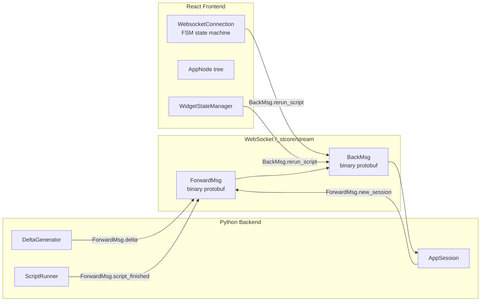
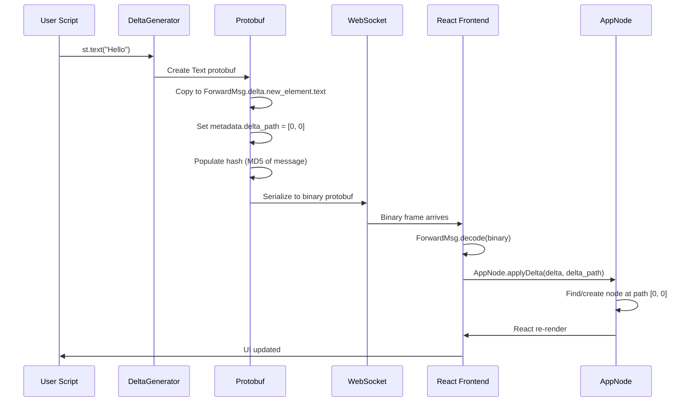

# Protobuf Bridge — The 83 .proto Files Defining Python to JavaScript

The entire Python-to-JavaScript contract in Streamlit is defined by Protocol Buffers. Every UI element, widget value, layout directive, and control signal is serialized as a protobuf message, sent over WebSocket, and deserialized on the React frontend. There are **83 `.proto` files** in the source (as of this version), organized under the `streamlit/proto/` namespace.

Source: `proto/streamlit/proto/` — 83 `.proto` files; `lib/streamlit/proto/` — generated Python bindings; `component-lib/` — TypeScript component library

## The Two Message Channels

Streamlit communication is bidirectional over a single WebSocket connection (`/_stcore/stream`):

| Direction | Protocol Buffer | Purpose |
|-----------|----------------|---------|
| Python → Browser | `ForwardMsg` | UI updates, session lifecycle, script status |
| Browser → Python | `BackMsg` | User interactions, rerun requests, control signals |



## ForwardMsg — The Umbrella Message

Source: `proto/streamlit/proto/ForwardMsg.proto`

```protobuf
message ForwardMsg {
  string hash = 1;                          // Unique hash for caching
  ForwardMsgMetadata metadata = 2;          // Non-cached metadata

  enum ScriptFinishedStatus {
    FINISHED_SUCCESSFULLY = 0;
    FINISHED_WITH_COMPILE_ERROR = 1;
    FINISHED_EARLY_FOR_RERUN = 2;
    FINISHED_FRAGMENT_RUN_SUCCESSFULLY = 3;
  }

  oneof type {
    // App lifecycle messages
    NewSession new_session = 4;
    Delta delta = 5;
    ScriptFinishedStatus script_finished = 6;
    SessionStatus session_status_changed = 9;
    SessionEvent session_event = 10;

    // Page/navigation messages
    PageInfo page_info_changed = 12;
    PageConfig page_config_changed = 13;
    PageNotFound page_not_found = 15;
    PagesChanged pages_changed = 16 [deprecated = true];
    Navigation navigation = 23;

    // Status and info messages
    GitInfo git_info_changed = 14;
    PageProfile page_profile = 18;
    Logo logo = 22;

    // File and auth messages
    FileURLsResponse file_urls_response = 19;
    AuthRedirect auth_redirect = 24;

    // Auto-rerun (fragment polling)
    AutoRerun auto_rerun = 21;

    // Platform host message
    ParentMessage parent_message = 20;

    // Cache reference
    string ref_hash = 11;
  }

  string debug_last_backmsg_id = 17;  // Debug only
}
```

**Aha:** The `ref_hash` field (`ForwardMsg.proto:96`) is the key to Streamlit's bandwidth optimization. When a large message (like a dataframe) was already sent to the client and cached, the server sends a tiny `ref_hash` string instead of the full message bytes. The frontend `ForwardMessageCache` resolves the reference locally. This is controlled by `ForwardMsgMetadata.cacheable` and the hash comparison in `ScriptRunContext.enqueue()`.

## ForwardMsgMetadata

Source: `proto/streamlit/proto/ForwardMsg.proto:108-128`

```protobuf
message ForwardMsgMetadata {
  bool cacheable = 1;                 // Marks message as cacheable
  repeated uint32 delta_path = 2;     // Location in the frontend tree
  string active_script_hash = 4;      // Which script this belongs to
}
```

The `delta_path` is the most critical field — it tells the frontend exactly where in the AppNode tree to insert the element. For example, `[0, 2, 1, 3]` means: RootContainer.MAIN, third block, second sub-element, fourth position.

**Key insight:** Metadata is cleared before caching. This means the same element protobuf (e.g., a large dataframe) can appear in different positions across reruns without re-sending the bytes. Only the `delta_path` in the `ForwardMsgMetadata` changes, and that's not part of the cache hash.

## Delta — UI Tree Changes

Source: `proto/streamlit/proto/Delta.proto`

```protobuf
message Delta {
  oneof type {
    Element new_element = 3;          // Add a new element
    Block add_block = 6;              // Add a block (container, column, tab)
    NamedDataSet add_rows = 5;        // Append rows to existing element
    ArrowNamedDataSet arrow_add_rows = 7;  // Arrow-format append rows
  }

  string fragment_id = 8;  // Tagged for fragment reruns
}
```

The three delta types:
1. **`new_element`**: Adds a text, button, chart, or any single UI element.
2. **`add_block`**: Adds a container, columns, tabs, expander, or form.
3. **`add_rows`**: Appends rows to an existing dataframe element (incremental updates).

## Element — The Union of All UI Elements

Source: `proto/streamlit/proto/Element.proto`

The Element message contains a `oneof` union of every possible element type:

```protobuf
message Element {
  oneof type {
    Alert alert = 1;
    Audio audio = 2;
    Balloons balloons = 3;
    BokehChart bokeh_chart = 4;
    Button button = 5;
    Checkbox checkbox = 6;
    // ... 50+ element types
    Arrow arrow = 40;
    // ... etc
  }
}
```

Each element type has its own `.proto` file. For example, `Button.proto`:

```protobuf
message Button {
  string id = 1;           // Widget ID
  string label = 2;
  bool is_form_submitter = 3;
  string form_id = 4;
  bool use_container_width = 5;
  // ... more fields
}
```

## BackMsg — Browser to Python

Source: `proto/streamlit/proto/BackMsg.proto`

```protobuf
message BackMsg {
  oneof type {
    // Control messages
    bool clear_cache = 5;
    bool set_run_on_save = 6;
    bool stop_script = 7;
    bool load_git_info = 12;
    bool app_heartbeat = 17;

    // Rerun with widget state
    ClientState rerun_script = 11;

    // File operations
    FileURLsRequest file_urls_request = 16;

    // Debug (dev mode only)
    bool debug_disconnect_websocket = 14;
    bool debug_shutdown_runtime = 15;
  }

  string debug_last_backmsg_id = 13;
}
```

**Key insight:** Most deprecated fields (1-4, 8-10) in BackMsg are `reserved` — they were used in older Streamlit versions but are now handled differently. The current primary message type is `ClientState rerun_script = 11`, which carries all widget state in a single protobuf.

## ClientState — The Widget State Carrier

Source: `proto/streamlit/proto/ClientState.proto`

```protobuf
message ClientState {
  string query_string = 1;
  WidgetStates widget_states = 2;
  string page_script_hash = 3;
  string page_name = 4;
  string fragment_id = 5;
  bool is_auto_rerun = 6;
  repeated string cached_message_hashes = 7;
  ContextInfo context_info = 8;
}
```

`ClientState` is the single most important BackMsg payload. Every widget interaction triggers a `rerun_script` BackMsg containing the complete state of ALL widgets. The `fragment_id` field is set when a fragment-specific rerun is needed.

## WidgetStates — Individual Widget Values

Source: `proto/streamlit/proto/WidgetStates.proto`

```protobuf
message WidgetStates {
  repeated WidgetState widgets = 1;
}

message WidgetState {
  string id = 1;

  oneof value {
    bool trigger_value = 2;                    // Button presses (auto-reset)
    bool bool_value = 3;                       // Checkbox, toggle
    double double_value = 4;                   // Slider (float)
    sint64 int_value = 5;                      // Slider (int)
    string string_value = 6;                   // Text input, selectbox
    DoubleArray double_array_value = 7;        // Multiselect (float)
    SInt64Array int_array_value = 8;           // Multiselect (int)
    StringArray string_array_value = 9;        // Multiselect (string)
    string json_value = 10;                    // JSON-serialized complex values
    ArrowTable arrow_value = 11;               // Data editor table
    bytes bytes_value = 12;                    // Raw binary
    FileUploaderState file_uploader_state_value = 13;
    ChatInputValue chat_input_value = 15;      // Chat input (auto-reset)
  }
}
```

**Key insight:** The `oneof value` union means each widget can only hold ONE type of value at a time. `trigger_value` is special — it auto-resets after each script run. This is why `st.button()` returns `True` only once per click. The `chat_input_value` similarly auto-resets, so the chat input clears after submission.

## Complete Proto File Inventory

All 83 `.proto` files in `proto/streamlit/proto/`:

| Category | Files |
|----------|-------|
| **Core Protocol** | `ForwardMsg.proto`, `BackMsg.proto`, `Delta.proto`, `Element.proto`, `Block.proto` |
| **Session/Navigation** | `NewSession.proto`, `ClientState.proto`, `WidgetStates.proto`, `SessionStatus.proto`, `SessionEvent.proto`, `Navigation.proto`, `PageInfo.proto`, `PageConfig.proto`, `PageNotFound.proto`, `PagesChanged.proto`, `PageProfile.proto`, `AppPage.proto` |
| **Text Elements** | `Text.proto`, `Markdown.proto`, `Code.proto`, `Json.proto`, `Heading.proto`, `DocString.proto`, `Html.proto` |
| **Data Elements** | `Arrow.proto`, `DataFrame.proto`, `ArrowNamedDataSet.proto`, `ArrowVegaLiteChart.proto`, `VegaLiteChart.proto`, `NamedDataSet.proto` |
| **Chart Elements** | `PlotlyChart.proto`, `GraphVizChart.proto`, `BokehChart.proto`, `DeckGlJsonChart.proto` |
| **Media Elements** | `Image.proto`, `Audio.proto`, `Video.proto` |
| **Widgets** | `Button.proto`, `Checkbox.proto`, `Slider.proto`, `Radio.proto`, `Selectbox.proto`, `MultiSelect.proto`, `NumberInput.proto`, `TextInput.proto`, `TextArea.proto`, `ColorPicker.proto`, `DateInput.proto`, `TimeInput.proto`, `FileUploader.proto`, `CameraInput.proto`, `AudioInput.proto`, `ChatInput.proto`, `DataEditor.proto` |
| **Layout Blocks** | `Block.proto`, `GapSize.proto`, `HeightConfig.proto`, `WidthConfig.proto` |
| **Widgets (Buttons)** | `DownloadButton.proto`, `LinkButton.proto`, `ButtonGroup.proto` |
| **Other Elements** | `Alert.proto`, `Balloons.proto`, `Snow.proto`, `Progress.proto`, `Spinner.proto`, `Skeleton.proto`, `Metric.proto`, `Empty.proto`, `Exception.proto`, `IFrame.proto`, `Map.proto` |
| **Features** | `AutoRerun.proto`, `Components.proto`, `Favicon.proto`, `Logo.proto`, `PageLink.proto`, `Toast.proto`, `AuthRedirect.proto` |
| **Infrastructure** | `RootContainer.proto`, `Common.proto`, `ParentMessage.proto`, `GitInfo.proto`, `MetricsEvent.proto`, `Openmetrics_data_model.proto` |
| **Labels/Config** | `LabelVisibilityMessage.proto` |

## The Component System — Custom Components

Source: `component-lib/` directory

Custom components bridge the gap between Streamlit's built-in elements and arbitrary JavaScript/React components. The component library provides:

```typescript
// component-lib/src/Streamlit.tsx
class Streamlit {
  static setComponentMessage(msg: object): void;
  static setFrameHeight(height: number): void;
  static ready: boolean;
}
```

The Python side uses `st.components.v1.declare_component()` to load a component:

```python
# Python side
my_component = st.components.v1.declare_component("my_component", path="./frontend/build")
result = my_component(value=42)  # Returns value from JS
```

The component proto:

```protobuf
// Components.proto
message ComponentInstance {
  string id = 1;
  string json = 2;          // JSON-serialized args from Python
  string json_args = 3;     // Which args are JSON-serialized
  string value = 4;         // Value returned from JS
}
```

## Message Serialization Flow



**Aha:** The protobuf encoding is **binary, not JSON**. This matters for performance: a 10MB dataframe encoded as JSON would be ~15MB of text requiring parsing, while Arrow IPC bytes can be mapped directly into memory. The `Arrow.proto` message carries Apache Arrow IPC bytes that the frontend can use directly without deserialization.

## Message Cache — The ref_hash Mechanism

Source: `lib/streamlit/runtime/forward_msg_cache.py`

```python
def populate_hash_if_needed(msg: ForwardMsg) -> None:
    """Populate the hash field if the message is cacheable and doesn't have one."""
    if not msg.metadata.cacheable or msg.hash:
        return
    # Compute MD5 of the serialized message
    msg.hash = hashlib.md5(msg.SerializeToString()).hexdigest()

def create_reference_msg(msg: ForwardMsg) -> ForwardMsg:
    """Create a new ForwardMsg that references an existing cached message."""
    ref = ForwardMsg()
    ref.ref_hash = msg.hash
    ref.metadata.CopyFrom(msg.metadata)
    return ref
```

When `ScriptRunContext.enqueue()` sends a message:

```python
if msg.metadata.cacheable and msg.hash and msg.hash in self.cached_message_hashes:
    msg_to_send = create_reference_msg(msg)  # Send ref_hash instead
```

The client-side `ForwardMessageCache` maintains a map of `hash -> ForwardMsg`. On receiving a `ref_hash`, it substitutes the cached message. Cache entries are evicted based on `global.maxCachedMessageAge` config.

## Common.proto — Shared Types

Source: `proto/streamlit/proto/Common.proto`

Defines shared message types used across multiple protos:

```protobuf
message DoubleArray { repeated double data = 1; }
message SInt64Array { repeated sint64 data = 1; }
message StringArray { repeated string data = 1; }

message ArrowTable {
  bytes data = 1;      // Arrow IPC bytes
  bytes index = 2;     // Index Arrow IPC bytes
  bytes columns = 3;   // Column names Arrow IPC bytes
}

message FileURLsRequest {
  string request_id = 1;
  repeated string file_names = 2;
}

message FileURLsResponse {
  string response_id = 1;
  repeated FileURLs file_urls = 2;
}
```

## NewSession.proto — Session Initialization

Source: `proto/streamlit/proto/NewSession.proto`

Sent at the start of every script run:

```protobuf
message NewSession {
  string script_run_id = 1;
  string name = 2;
  string main_script_path = 3;
  string main_script_hash = 4;
  string page_script_hash = 5;

  Config config = 6;
  CustomThemeConfig custom_theme = 7;
  Initialize initialize = 8;
  repeated AppPage app_pages = 9;
  repeated string fragment_ids_this_run = 10;
}

message Initialize {
  UserInfo user_info = 1;
  EnvironmentInfo environment_info = 2;
  SessionStatus session_status = 3;
  bool is_hello = 4;
  string session_id = 5;
}
```

## Cross-References

- [Rerun Execution Model](01-rerun-execution-model.md) — How ForwardMsg and BackMsg drive reruns
- [DeltaGenerator System](02-deltagenerator-system.md) — How Delta messages are created
- [Widget Protocol](05-widget-protocol.md) — How WidgetStates carry widget values

## Next

Continue to [SessionState Management](04-session-state.md) to understand how widget values and user data persist across script reruns.
