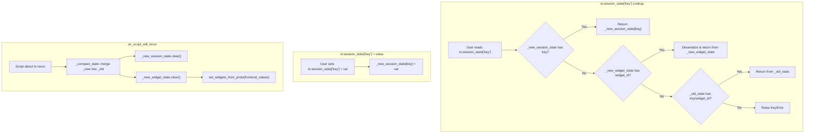
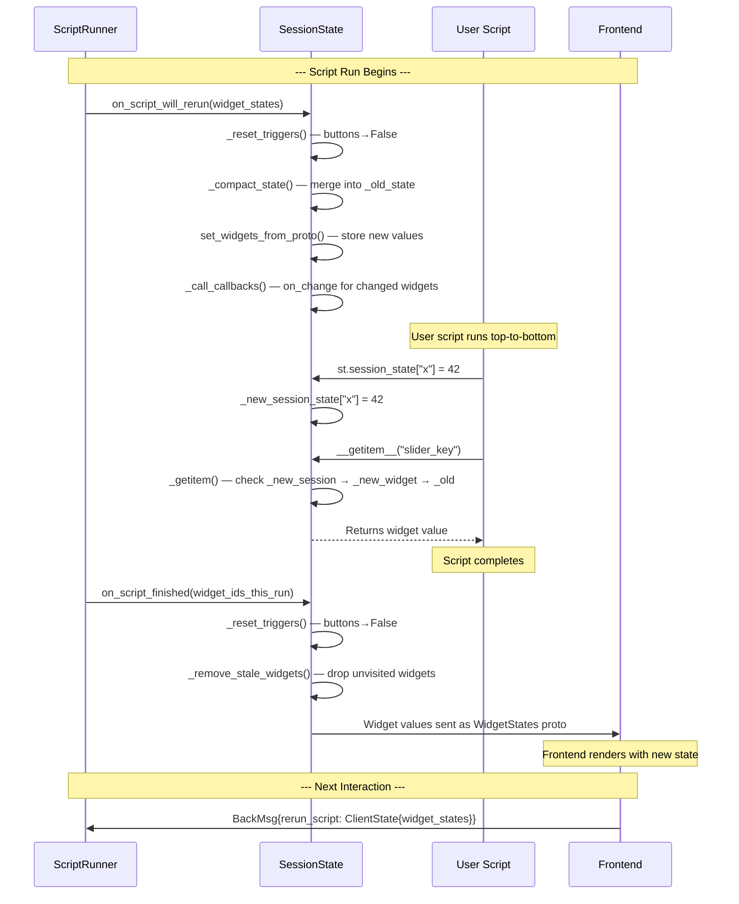

# SessionState Management — Surviving Re-execution

`SessionState` is the mechanism that allows data to persist across Streamlit's full-script re-execution model. When a user interacts with a widget, the entire script runs again from the top — but `SessionState` ensures that widget values, user-stored variables, and query parameters survive the rerun. Without SessionState, every interaction would reset every value to its default.

Source: `lib/streamlit/runtime/state/session_state.py` (792 lines); `lib/streamlit/runtime/state/safe_session_state.py`; `lib/streamlit/runtime/state/session_state_proxy.py`; `lib/streamlit/runtime/state/common.py`; `lib/streamlit/runtime/state/query_params.py`

## SessionState Data Structure

Source: `lib/streamlit/runtime/state/session_state.py:341-375`

```python
@dataclass
class SessionState:
    """SessionState allows users to store values that persist between app reruns."""

    # All values from previous script runs, squished together
    _old_state: dict[str, Any] = field(default_factory=dict)

    # Values set during current script run (by user code: st.session_state["x"] = 1)
    _new_session_state: dict[str, Any] = field(default_factory=dict)

    # Widget values from the frontend, usually one changing prompted the rerun
    _new_widget_state: WStates = field(default_factory=WStates)

    # Maps user-provided keys to element IDs (and vice versa)
    _key_id_mapper: KeyIdMapper = field(default_factory=KeyIdMapper)

    # Query params — tied with widget state
    query_params: QueryParams = field(default_factory=QueryParams)
```

**Aha:** SessionState uses a **three-tier storage model** — `_old_state`, `_new_session_state`, and `_new_widget_state` — rather than a single dict. This is the key to understanding how it survives re-execution:

1. **`_old_state`**: Contains values from the previous script run (both user-set values and widget values). This is the "persisted" layer.
2. **`_new_session_state`**: Contains values set by the user during the current run (`st.session_state["x"] = 1`).
3. **`_new_widget_state`**: Contains widget values received from the frontend in the latest rerun request.

When you read `st.session_state["key"]`, it checks all three stores in order: `_new_session_state` → `_new_widget_state` → `_old_state`. This means user-set values in the current run take priority over frontend values, which take priority over persisted values.

## The Lookup Chain — `__getitem__`

Source: `lib/streamlit/runtime/state/session_state.py:455-511`

```python
def __getitem__(self, key: str) -> Any:
    wid_key_map = self._key_id_mapper.id_key_mapping
    widget_id = self._get_widget_id(key)

    if widget_id in wid_key_map and widget_id == key:
        # The "key" is a raw widget id, get its associated user key
        key = wid_key_map[widget_id]
    try:
        return self._getitem(widget_id, key)
    except KeyError:
        raise KeyError(_missing_key_error_message(key))

def _getitem(self, widget_id: str | None, user_key: str | None) -> Any:
    # Priority 1: Current run user-set values
    if user_key is not None:
        try:
            return self._new_session_state[user_key]
        except KeyError:
            pass

    # Priority 2: Current run widget values
    if widget_id is not None:
        try:
            return self._new_widget_state[widget_id]
        except KeyError:
            pass

    # Priority 3: Old state (widget_id)
    if widget_id is not None:
        try:
            return self._old_state[widget_id]
        except KeyError:
            pass

    # Priority 4: Old state (user_key)
    if user_key is not None:
        try:
            return self._old_state[user_key]
        except KeyError:
            pass

    raise KeyError
```

## Three-Tier Storage Lookup



## WStates — Widget State Mapping

Source: `lib/streamlit/runtime/state/session_state.py:77-282`

`WStates` is a `MutableMapping[str, Any]` that stores widget values in either serialized (protobuf) or deserialized (Python) form:

```python
@dataclass
class WStates(MutableMapping[str, Any]):
    states: dict[str, WState] = field(default_factory=dict)
    widget_metadata: dict[str, WidgetMetadata[Any]] = field(default_factory=dict)

    def __getitem__(self, k: str) -> Any:
        wstate = self.states.get(k)
        if isinstance(wstate, Value):
            return wstate.value  # Already deserialized

        # Deserialize from protobuf
        metadata = self.widget_metadata.get(k)
        value_field_name = wstate.value.WhichOneof("value")
        value = wstate.value.__getattribute__(value_field_name)

        if is_array_value_field_name(value_field_name):
            value = value.data
        elif value_field_name == "json_value":
            value = json.loads(value)

        deserialized = metadata.deserializer(value)
        self.states[k] = Value(deserialized)  # Cache deserialized value
        return deserialized
```

The dual `WState` type:

```python
@dataclass(frozen=True)
class Serialized:
    value: WidgetStateProto  # Stored as protobuf

@dataclass(frozen=True)
class Value:
    value: Any  # Stored as Python object
```

**Key insight:** `WStates` lazily deserializes. When a widget value arrives from the frontend as a protobuf, it's stored as `Serialized`. The first time user code reads it, it's deserialized and stored as `Value`. This avoids unnecessary deserialization for widgets the user never reads.

## KeyIdMapper — Bridging User Keys to Widget IDs

Source: `lib/streamlit/runtime/state/session_state.py:291-339`

```python
@dataclass
class KeyIdMapper:
    _key_id_mapping: dict[str, str] = field(default_factory=dict)  # user_key → widget_id
    _id_key_mapping: dict[str, str] = field(default_factory=dict)  # widget_id → user_key

    def __setitem__(self, key: str, widget_id: Any) -> None:
        self._key_id_mapping[key] = widget_id
        self._id_key_mapping[widget_id] = key
```

When a widget is registered with a user key (e.g., `st.slider("X", key="my_slider")`), the mapper stores both directions. This allows:
- `st.session_state["my_slider"]` to look up the widget by user key
- `st.session_state["<widget_id>"]` to look up by widget ID

## The Script Lifecycle — on_script_will_rerun

Source: `lib/streamlit/runtime/state/session_state.py:560-585`

Called by `ScriptRunner` before the script runs:

```python
def on_script_will_rerun(self, latest_widget_states: WidgetStatesProto) -> None:
    """Update widget data and call callbacks on widgets whose value changed."""
    self._reset_triggers()               # Reset button triggers to False
    self._compact_state()                # Merge current state into _old_state
    self.set_widgets_from_proto(latest_widget_states)  # Store new widget values
    self._call_callbacks()               # Invoke on_change for changed widgets
```

### Step 1: Reset Triggers

```python
def _reset_triggers(self) -> None:
    for state_id in self._new_widget_state:
        metadata = self._new_widget_state.widget_metadata.get(state_id)
        if metadata is not None:
            if metadata.value_type == "trigger_value":
                self._new_widget_state[state_id] = Value(False)
            elif metadata.value_type in {"string_trigger_value", "chat_input_value"}:
                self._new_widget_state[state_id] = Value(None)
```

Buttons and chat inputs auto-reset because their `trigger_value` or `chat_input_value` is set back to `False`/`None`.

### Step 2: Compact State

```python
def _compact_state(self) -> None:
    """Copy all current session_state and widget_state values into _old_state."""
    for key_or_wid in self:
        try:
            self._old_state[key_or_wid] = self[key_or_wid]
        except KeyError:
            pass  # Handle missing metadata gracefully
    self._new_session_state.clear()
    self._new_widget_state.clear()
```

This is the critical persistence step. All values from `_new_session_state` and `_new_widget_state` are merged into `_old_state`, then the "new" stores are cleared for the upcoming run.

### Step 3: Set New Widget Values

```python
def set_widgets_from_proto(self, widget_states: WidgetStatesProto) -> None:
    for state in widget_states.widgets:
        self._new_widget_state.set_widget_from_proto(state)
```

The latest widget values from the frontend are stored in `_new_widget_state`.

### Step 4: Call Callbacks

```python
def _call_callbacks(self) -> None:
    changed_widget_ids = [wid for wid in self._new_widget_state if self._widget_changed(wid)]
    for wid in changed_widget_ids:
        try:
            self._new_widget_state.call_callback(wid)
        except RerunException:
            st.warning("Calling st.rerun() within a callback is a no-op.")

def _widget_changed(self, widget_id: str) -> bool:
    new_value = self._new_widget_state.get(widget_id)
    old_value = self._old_state.get(widget_id)
    return new_value != old_value
```

**Key insight:** Callbacks fire BEFORE user code runs. This means if you have `st.slider("X", on_change=handler)`, the handler runs during `on_script_will_rerun`, before the first line of your script. The callback can modify session state, and those changes will be visible when the script starts.

## The Script Finished Lifecycle

Source: `lib/streamlit/runtime/state/session_state.py:596-658`

```python
def on_script_finished(self, widget_ids_this_run: set[str]) -> None:
    """Updates widgets to prepare for the next script run."""
    self._reset_triggers()
    self._remove_stale_widgets(widget_ids_this_run)
```

`_remove_stale_widgets()` removes widget state for widgets that were NOT encountered during the script run:

```python
def _remove_stale_widgets(self, active_widget_ids: set[str]) -> None:
    self._new_widget_state.remove_stale_widgets(active_widget_ids, ctx.fragment_ids_this_run)
    self._old_state = {
        k: v for k, v in self._old_state.items()
        if not is_element_id(k) or not _is_stale_widget(...)
    }
```

A widget is "stale" if its ID is not in `active_widget_ids` AND it's not related to a fragment being run. This prevents orphaned widget state from accumulating indefinitely.

## Stale Widget Detection

Source: `lib/streamlit/runtime/state/session_state.py:765-779`

```python
def _is_stale_widget(
    metadata: WidgetMetadata[Any] | None,
    active_widget_ids: set[str],
    fragment_ids_this_run: list[str] | None,
) -> bool:
    if not metadata:
        return True
    return not (
        metadata.id in active_widget_ids
        or (fragment_ids_this_run and metadata.fragment_id not in fragment_ids_this_run)
    )
```

A widget is NOT stale if:
1. It was encountered during this run (`metadata.id in active_widget_ids`), OR
2. We're running fragments and this widget belongs to a fragment NOT being run (preserve its state for when that fragment DOES run)

## SafeSessionState — The Yield Callback Wrapper

Source: `lib/streamlit/runtime/state/safe_session_state.py`

```python
class SafeSessionState:
    def __init__(self, session_state: SessionState, yield_callback=None):
        self._state = session_state
        self._yield_callback = yield_callback

    def __setitem__(self, key: str, value: Any) -> None:
        self._state.__setitem__(key, value)
        if self._yield_callback:
            self._yield_callback()

    def __getitem__(self, key: str) -> Any:
        return self._state.__getitem__(key)
```

**Key insight:** `SafeSessionState` wraps `SessionState` with a yield callback that's invoked after every `__setitem__`. This callback calls `_maybe_handle_execution_control_request()` in the ScriptRunner, checking if a rerun request arrived while setting session state. This means `st.session_state["x"] = value` is itself an implicit yield point — a rerun can be triggered mid-assignment.

## SessionStateProxy — The `st.session_state` Magic

Source: `lib/streamlit/runtime/state/session_state_proxy.py`

```python
class SessionStateProxy:
    """A proxy object that forwards attribute and item access to SessionState."""

    def __getitem__(self, key: str) -> Any:
        ctx = get_script_run_ctx()
        if ctx is None:
            return self._get_fallback(key)
        return ctx.session_state[key]

    def __setitem__(self, key: str, value: Any) -> None:
        ctx = get_script_run_ctx()
        if ctx is not None:
            ctx.session_state[key] = value
```

This is what makes `st.session_state["key"] = value` work. It's a proxy that delegates to the current thread's `ScriptRunContext.session_state`.

## QueryParams

Source: `lib/streamlit/runtime/state/query_params.py`

Query parameters are stored within SessionState because they're tied to widget state:

```python
class QueryParams:
    def __init__(self):
        self._query_params: dict[str, list[str]] = {}

    def get_all(self, key: str) -> list[str]:
        return self._query_params.get(key, [])

    def set(self, key: str, value: str | list[str]) -> None:
        ...

    def clear(self) -> None:
        self._query_params.clear()
```

Query params are set during `ScriptRunContext.reset()` (`script_run_context.py:173-182`):

```python
parsed_query_params = parse.parse_qs(query_string, keep_blank_values=True)
with self.session_state.query_params() as qp:
    qp.clear_with_no_forward_msg()
    for key, val in parsed_query_params.items():
        if len(val) == 1:
            qp.set_with_no_forward_msg(key, val=val[-1])
        else:
            qp.set_with_no_forward_msg(key, val)
```

## Mermaid: SessionState Lifecycle



## Widget Registration — Connecting Widgets to SessionState

When a widget is created (e.g., `st.slider()`), it registers with SessionState:

Source: `lib/streamlit/runtime/state/widgets.py:36-135`

```python
def register_widget(
    element_id: str,
    *,
    deserializer: WidgetDeserializer[T],
    serializer: WidgetSerializer[T],
    ctx: ScriptRunContext | None,
    on_change_handler: WidgetCallback | None = None,
    args: WidgetArgs | None = None,
    kwargs: WidgetKwargs | None = None,
    value_type: ValueFieldName,
) -> RegisterWidgetResult[T]:
    metadata = WidgetMetadata(
        element_id, deserializer, serializer, value_type=value_type,
        callback=on_change_handler, callback_args=args, callback_kwargs=kwargs,
        fragment_id=ctx.current_fragment_id if ctx else None,
    )
    return register_widget_from_metadata(metadata, ctx)

def register_widget_from_metadata(metadata, ctx):
    if ctx is None:
        return RegisterWidgetResult.failure(deserializer=metadata.deserializer)
    widget_id = metadata.id
    user_key = user_key_from_element_id(widget_id)
    return ctx.session_state.register_widget(metadata, user_key)
```

The `SessionState.register_widget()` method (`session_state.py:678-715`):

```python
def register_widget(self, metadata: WidgetMetadata[T], user_key: str | None
) -> RegisterWidgetResult[T]:
    widget_id = metadata.id
    self._set_widget_metadata(metadata)
    if user_key is not None:
        self._set_key_widget_mapping(widget_id, user_key)

    if widget_id not in self and (user_key is None or user_key not in self):
        # First time seeing this widget — initialize with default value
        deserializer = metadata.deserializer
        initial_widget_value = deepcopy(deserializer(None))
        self._new_widget_state.set_from_value(widget_id, initial_widget_value)

    widget_value = deepcopy(self[widget_id])
    widget_value_changed = user_key is not None and self.is_new_state_value(user_key)
    return RegisterWidgetResult(widget_value, widget_value_changed)
```

**Aha:** The `deepcopy` on return values (`deepcopy(widget_value)`) prevents user code from accidentally mutating shared state. If you do `val = st.session_state["my_list"]; val.append(1)`, the append affects your local copy, not the stored value. This is a deliberate safety measure.

## Serializable Session State Enforcement

Source: `lib/streamlit/runtime/state/session_state.py:732-758`

When `runner.enforceSerializableSessionState` is enabled:

```python
def _check_serializable(self) -> None:
    for k in self:
        try:
            pickle.dumps(self[k])
        except Exception as e:
            raise UnserializableSessionStateError(
                f"Cannot serialize the value (of type `{type(self[k])}`) of '{k}'"
            ) from e
```

This ensures all session state values can be pickled, which is required for disk-based cache storage and session persistence.

## Cross-References

- [Rerun Execution Model](01-rerun-execution-model.md) — When on_script_will_rerun and on_script_finished are called
- [Widget Protocol](05-widget-protocol.md) — How widget values flow through SessionState
- [Caching Mechanisms](06-caching.md) — How cache persistence interacts with session state

## Next

Continue to [Widget Protocol](05-widget-protocol.md) to understand the full widget registration flow, forms, and value synchronization between Python and JavaScript.
