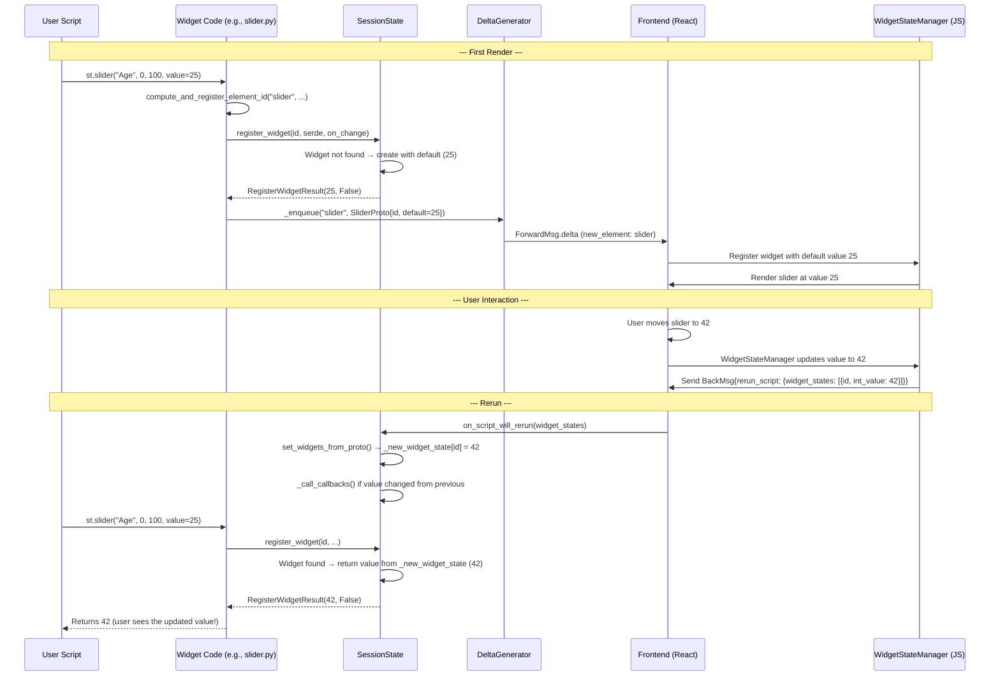
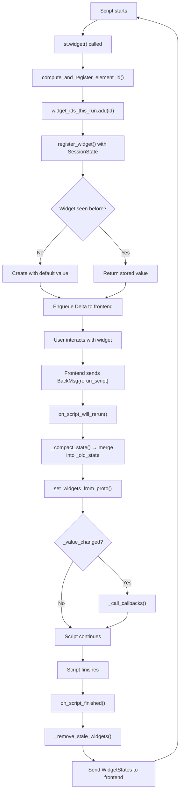

# Widget Protocol — Registration, Value Sync, and Forms

The widget protocol defines how Streamlit widgets (buttons, sliders, text inputs, etc.) register themselves with the runtime, synchronize values between the Python backend and JavaScript frontend, handle callbacks, and batch updates through forms. Every widget follows the same pattern: create a protobuf, register with SessionState, enqueue the delta, and return the current value.

Source: `lib/streamlit/runtime/state/widgets.py`; `lib/streamlit/runtime/state/common.py`; `lib/streamlit/elements/form.py`; `lib/streamlit/elements/lib/form_utils.py`; widget files in `lib/streamlit/elements/widgets/`

## The Widget Registration Pattern

Every widget follows the same four-step pattern. Let's trace `st.slider()` as an example:

Source: `lib/streamlit/elements/widgets/slider.py` (representative pattern)

```python
@gather_metrics("slider")
def slider(
    self,
    label: str,
    min_value=None, max_value=None, value=None, step=None,
    format=None, key=None, help=None, on_change=None,
    args=None, kwargs=None, disabled=False, horizontal=False,
    label_visibility="visible",
) -> float | int | tuple[float, ...]:
    # 1. Compute the deterministic widget ID
    element_id = compute_and_register_element_id(
        "slider",
        user_key=key,
        form_id=current_form_id(self),
        label=label,
        # ... all parameters that affect identity
    )

    # 2. Create the protobuf
    slider_proto = SliderProto()
    slider_proto.id = element_id
    slider_proto.label = label
    slider_proto.default[:] = [...]
    # ... fill in all fields

    # 3. Register with SessionState
    ctx = get_script_run_ctx()
    serde = SliderSerde(...)
    widget_state = register_widget(
        element_id,
        deserializer=serde.deserialize,
        serializer=serde.serialize,
        ctx=ctx,
        on_change_handler=on_change,
        args=args,
        kwargs=kwargs,
        value_type="double_value" | "int_value",
    )

    # 4. Enqueue the delta
    return self._enqueue("slider", slider_proto, ...)
```

## Widget ID Generation — Deterministic Identity

Source: `lib/streamlit/elements/lib/utils.py` — `compute_and_register_element_id()`

Widget IDs are deterministically computed from the element type, user key, and all parameters that affect the element's identity. This ensures that the same `st.slider("Age", 0, 100)` call produces the same widget ID on every rerun:

```python
def compute_and_register_element_id(
    element_type: str,
    *,
    user_key: str | None,
    form_id: str,
    **kwargs: Any,  # All element-specific parameters
) -> str:
    """Compute a deterministic element ID from its parameters."""
    # Hash the element type, user_key, form_id, and all kwargs
    hasher = hashlib.md5()
    hasher.update(element_type.encode("utf-8"))
    if user_key:
        hasher.update(user_key.encode("utf-8"))
    hasher.update(form_id.encode("utf-8"))
    for key in sorted(kwargs.keys()):
        hasher.update(str(kwargs[key]).encode("utf-8"))
    element_id = hasher.hexdigest()

    # Track that this ID was seen in this run
    ctx.widget_ids_this_run.add(element_id)
    if user_key:
        ctx.widget_user_keys_this_run.add(user_key)

    return element_id
```

**Aha:** The ID includes **all parameters that affect the element's identity** — not just the user key. This means if you change `st.slider("Age", 0, 100)` to `st.slider("Age", 0, 200)`, it gets a NEW widget ID, and the old value is discarded. The user key alone doesn't determine identity; the full parameter signature does. This is why changing a widget's parameters can reset its value.

## Widget Serde — Serialization/Deserialization

Source: `lib/streamlit/runtime/state/common.py`

Each widget type defines a serde pair:

```python
WidgetSerializer = Callable[[T], Any]     # Python → protobuf value
WidgetDeserializer = Callable[[Any], T]   # protobuf value → Python

class WidgetMetadata(NamedTuple):
    id: str
    deserializer: WidgetDeserializer[T]
    serializer: WidgetSerializer[T]
    value_type: ValueFieldName
    callback: WidgetCallback | None = None
    callback_args: WidgetArgs | None = None
    callback_kwargs: WidgetKwargs | None = None
    fragment_id: str | None = None
```

Example serde for a slider:

```python
class SliderSerde:
    @staticmethod
    def deserialize(value: Any) -> float | int | tuple[float, ...]:
        # Convert protobuf value back to Python type
        if isinstance(value, (list, tuple)):
            return tuple(value) if len(value) > 1 else value[0]
        return value

    @staticmethod
    def serialize(value: float | int | tuple[float, ...]) -> Any:
        # Convert Python value to protobuf-compatible form
        if isinstance(value, (list, tuple)):
            return list(value)
        return value
```

## RegisterWidgetResult — The Return Value

Source: `lib/streamlit/runtime/state/common.py`

```python
@dataclass(frozen=True)
class RegisterWidgetResult(Generic[T]):
    value: T           # The widget's current value
    value_changed: bool  # True if frontend has a newer value than what we return
```

The widget function returns this value to the user:

```python
widget_state = register_widget(...)
if widget_state.value_changed:
    # The frontend has a value that our script hasn't processed yet.
    # We need to rerun to get the latest value.
    raise RerunException(
        RerunData(widget_states=ctx.session_state.get_widget_states())
    )
return widget_state.value
```

**Key insight:** The `value_changed` flag triggers an immediate rerun when the widget value from the frontend hasn't been processed yet. This is how Streamlit ensures that the first render of a widget (with its default value) is followed by a rerun once the user interacts with it.

## Widget Value Flow — End to End



## The Form System — Batching Widget Updates

Source: `lib/streamlit/elements/form.py`; `lib/streamlit/elements/lib/form_utils.py`

Forms allow users to batch multiple widget interactions into a single rerun. Without forms, changing a slider triggers an immediate rerun. With forms, all widget changes are queued until the user clicks the submit button.

### FormMixin

```python
class FormMixin:
    @gather_metrics("form")
    def form(self, key: str, *, clear_on_submit: bool = False, border: bool = True) -> DeltaGenerator:
        """Create a form."""
        block_proto = BlockProto()
        block_proto.form.form_id = key
        return self._block(block_proto)

    @gather_metrics("form_submit_button")
    def form_submit_button(self, label: str = "Submit", form_id: str | None = None, ...) -> bool:
        """Display a submit button for the current form."""
```

### Form State Tracking

Source: `lib/streamlit/elements/lib/form_utils.py`

```python
@dataclass
class FormData:
    """Data attached to a form block or elements inside a form."""
    form_id: str
```

When a widget is inside a form, its `element_id` computation includes the `form_id`:

```python
def current_form_id(dg: DeltaGenerator) -> str:
    if dg._form_data:
        return dg._form_data.form_id
    return ""
```

### Form Submission Flow

1. User modifies widgets inside a form — no rerun is triggered
2. User clicks `form_submit_button`
3. Frontend sends `BackMsg{rerun_script: {widget_states}}` with all form widget values
4. The form submit button's `trigger_value` is set to `True`
5. `st.form_submit_button()` returns `True`, allowing user code to conditionally run logic

```python
with st.form("my_form"):
    name = st.text_input("Name")
    age = st.slider("Age")
    submitted = st.form_submit_button("Submit")

if submitted:  # True only when form is submitted
    process_data(name, age)
```

**Key insight:** Form widgets still get registered with SessionState on every render. The difference is that the `value_changed` flag doesn't trigger a rerun for widgets inside a form — only the submit button's `trigger_value` can trigger one. This is implemented in the widget registration logic:

```python
def _get_cached_widget_result(...) -> RegisterWidgetResult[T]:
    """For form widgets, don't trigger rerun on value change."""
    if ctx and ctx.session_state._widget_in_form(widget_id):
        return RegisterWidgetResult(value, value_changed=False)
    return RegisterWidgetResult(value, value_changed)
```

## Widget State Types

Source: `proto/streamlit/proto/WidgetStates.proto`

| Value Type | Widget Types | Protobuf Field |
|-----------|-------------|----------------|
| `trigger_value` (bool) | `st.button()`, `st.download_button()`, `st.link_button()` | `bool trigger_value = 2` |
| `bool_value` (bool) | `st.checkbox()`, `st.toggle()` | `bool bool_value = 3` |
| `double_value` (float) | `st.slider()` (float) | `double double_value = 4` |
| `int_value` (int64) | `st.slider()` (int) | `sint64 int_value = 5` |
| `string_value` (str) | `st.text_input()`, `st.selectbox()`, `st.radio()` | `string string_value = 6` |
| `*_array_value` (list) | `st.multiselect()` | `DoubleArray/SInt64Array/StringArray` |
| `json_value` (str JSON) | `st.color_picker()`, `st.date_input()` | `string json_value = 10` |
| `arrow_value` (Arrow) | `st.data_editor()` | `ArrowTable arrow_value = 11` |
| `file_uploader_state_value` | `st.file_uploader()` | `FileUploaderState` |
| `chat_input_value` | `st.chat_input()` | `ChatInputValue` (auto-reset) |

## Widget Tracking — active_widget_ids

Source: `lib/streamlit/runtime/scriptrunner_utils/script_run_context.py`

```python
@dataclass
class ScriptRunContext:
    widget_ids_this_run: set[str] = field(default_factory=set)
    widget_user_keys_this_run: set[str] = field(default_factory=set)
    form_ids_this_run: set[str] = field(default_factory=set)
```

Every widget registration adds its ID to `widget_ids_this_run`. After the script finishes, `on_script_finished(widget_ids_this_run)` uses this set to identify stale widgets and remove their state.

## Widget Lifecycle Summary



## Cross-References

- [SessionState Management](04-session-state.md) — How widget values are stored and retrieved
- [DeltaGenerator System](02-deltagenerator-system.md) — How widget deltas are enqueued
- [Fragment Partial Reruns](07-fragments.md) — How fragment-scoped widget registration works

## Next

Continue to [Caching Mechanisms](06-caching.md) to understand how `@st.cache_data` and `@st.cache_resource` skip function re-execution.
