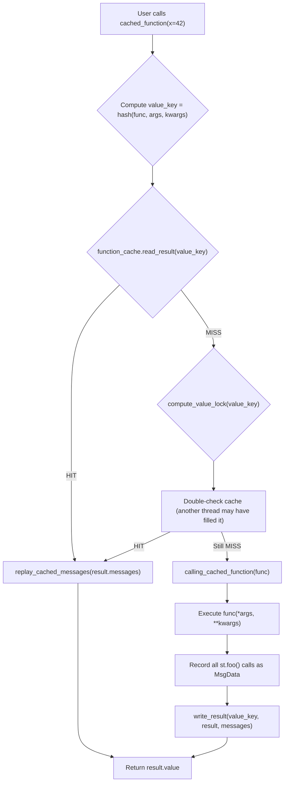

# Caching Mechanisms — @st.cache_data and @st.cache_resource

Streamlit provides two caching decorators that skip function re-execution when the same inputs are provided: `@st.cache_data` for serializable data (DataFrames, arrays, computed results) and `@st.cache_resource` for non-serializable resources (database connections, ML models, file handles). Both use pickle-based serialization and a sophisticated hashing system to detect cache hits. Additionally, they support **message replay** — when a cached function called `st.foo()` methods, those UI deltas are replayed on cache hits.

Source: `lib/streamlit/runtime/caching/cache_data_api.py`; `lib/streamlit/runtime/caching/cache_resource_api.py`; `lib/streamlit/runtime/caching/cache_utils.py`; `lib/streamlit/runtime/caching/hashing.py`; `lib/streamlit/runtime/caching/cached_message_replay.py`; `lib/streamlit/runtime/caching/storage/`

## Two Cache Types

Source: `lib/streamlit/runtime/caching/cache_type.py`

```python
class CacheType(Enum):
    DATA = "data"        # @st.cache_data — for serializable data
    RESOURCE = "resource"  # @st.cache_resource — for non-serializable resources
    LEGACY = "legacy"    # @st.cache (deprecated)
```

### @st.cache_data

For functions that return serializable data (DataFrames, arrays, primitives, dicts):

```python
@st.cache_data
def load_data():
    return pd.read_csv("data.csv")
```

- **Storage**: In-memory (default) or disk (`persist="disk"`)
- **TTL**: Optional time-to-live (`ttl=3600`)
- **Max entries**: Optional limit (`max_entries=100`)
- **Value hashing**: Return values are pickled for disk persistence
- **Message replay**: UI elements called inside are replayed

### @st.cache_resource

For functions that return non-serializable resources:

```python
@st.cache_resource
def get_model():
    return load_ml_model("model.pkl")
```

- **Storage**: In-memory only (cannot persist to disk)
- **TTL**: Not supported (resources live for the server lifetime)
- **Max entries**: Not supported
- **Value hashing**: Return values are NOT pickled (stored by reference)
- **Message replay**: UI elements called inside are replayed

**Key insight:** `@st.cache_resource` stores the actual Python object reference, not a pickled copy. This means all sessions share the same object instance. `@st.cache_data` pickles and unpickles on each hit, so each session gets its own copy. This is why you use `@st.cache_resource` for database connections (shared connection pool) and `@st.cache_data` for DataFrames (each session should have its own copy to avoid mutation bugs).

## Cache Decorator Implementation

Source: `lib/streamlit/runtime/caching/cache_data_api.py:83-145`

```python
class CachedDataFuncInfo(CachedFuncInfo):
    persist: CachePersistType  # "disk" or None
    max_entries: int | None
    ttl: float | timedelta | str | None

    def __init__(
        self,
        func: types.FunctionType,
        show_spinner: bool | str,
        persist: CachePersistType,
        max_entries: int | None,
        ttl: float | timedelta | str | None,
        hash_funcs: HashFuncsDict | None = None,
    ) -> None:
        self.persist = persist
        self.max_entries = max_entries
        self.ttl = ttl
        # ...

    def get_function_cache(self, function_key: str) -> DataCache:
        return _data_caches.get_cache(
            key=function_key, persist=self.persist, max_entries=self.max_entries, ttl=self.ttl,
            display_name=self.display_name,
        )
```

## The CachedFunc Wrapper

Source: `lib/streamlit/runtime/caching/cache_utils.py:191-350`

```python
class CachedFunc:
    def __init__(self, info: CachedFuncInfo) -> None:
        self._info = info
        self._function_key = _make_function_key(info.cache_type, info.func)

    def __call__(self, *args, **kwargs) -> Any:
        return self._call_with_internal_values(args, kwargs)

    def _call_with_internal_values(self, args, kwargs) -> Any:
        # Resolve args/kwargs to their parameter names
        function_cache = self._info.get_function_cache(self._function_key)

        # Hash the function + args + kwargs to get value_key
        value_key = _make_value_key(
            cache_type=self._info.cache_type,
            func=self._info.func,
            args=args, kwargs=kwargs,
        )

        try:
            # Try to read from cache
            cached_result = function_cache.read_result(value_key)
            return replay_cached_messages(
                cached_result, self._info.cache_type,
                self._info.cached_message_replay_ctx,
            )
        except CacheKeyNotFoundError:
            # Cache miss — compute and store
            return self._handle_cache_miss(
                function_cache, value_key, args, kwargs,
            )

    def _handle_cache_miss(self, function_cache, value_key, args, kwargs) -> Any:
        with function_cache.compute_value_lock(value_key):
            try:
                # Check again (another thread may have computed it)
                return function_cache.read_result(value_key)
            except CacheKeyNotFoundError:
                # Actually compute
                return self._compute_and_write(function_cache, value_key, args, kwargs)
```

## Cache Miss — Computation and Write

Source: `lib/streamlit/runtime/caching/cache_utils.py`

```python
def _compute_and_write(self, function_cache, value_key, args, kwargs) -> Any:
    with self._info.cached_message_replay_ctx.calling_cached_function(self._info.func):
        result = self._info.func(*args, **kwargs)

    messages = self._info.cached_message_replay_ctx._most_recent_messages

    if self._info.cache_type == CacheType.DATA:
        # Serialize the return value
        serialized = pickle.dumps(result, protocol=pickle.HIGHEST_PROTOCOL)
        function_cache.write_result(value_key, serialized, messages)
        return result
    else:
        # CacheType.RESOURCE — store by reference
        function_cache.write_result(value_key, result, messages)
        return result
```

**Aha:** The `calling_cached_function()` context manager tracks all `st.foo()` calls made during the function execution. These messages are saved alongside the return value and replayed on cache hits. This means if your cached function calls `st.write("Loading...")`, that text element is replayed even when the cached result is returned — the function body doesn't execute, but its UI side effects do.

## Hashing System

Source: `lib/streamlit/runtime/caching/hashing.py`

The cache key is computed by hashing the function bytecode + all arguments:

```python
def _make_value_key(cache_type, func, args, kwargs) -> str:
    hasher = hashlib.new("md5", usedforsecurity=False)
    update_hash(func, hasher, cache_type, hash_source=func)
    for arg in args:
        update_hash(arg, hasher, cache_type, hash_source=func)
    for key, val in sorted(kwargs.items()):
        update_hash(key, hasher, cache_type, hash_source=func)
        update_hash(val, hasher, cache_type, hash_source=func)
    return hasher.hexdigest()
```

The `_CacheFuncHasher` class handles different types:

```python
class _CacheFuncHasher:
    """Hashes values for cache keys."""

    # Special handling for large dataframes (sample, don't hash all rows)
    _PANDAS_ROWS_LARGE = 50_000
    _PANDAS_SAMPLE_SIZE = 10_000
    _NP_SIZE_LARGE = 500_000
    _NP_SAMPLE_SIZE = 100_000

    # Cycle detection for self-referencing objects
    _CYCLE_PLACEHOLDER = b"streamlit-57R34ML17-hesamagicalponyflyingthroughthesky-CYCLE"
```

**Key insight:** Large DataFrames (>50,000 rows) are sampled (10,000 rows) for hashing, not fully hashed. This prevents hashing a 1GB DataFrame every time you call the cached function. The hash is still deterministic but much faster to compute.

### Custom Hash Functions

Users can provide custom hash functions for types Streamlit doesn't know how to hash:

```python
@st.cache_data(hash_funcs={MyClass: lambda x: x.id})
def process(obj: MyClass):
    ...
```

Source: `lib/streamlit/runtime/caching/hashing.py:61`

```python
HashFuncsDict: TypeAlias = dict[Union[str, type[Any]], Callable[[Any], Any]]
```

### Circular Reference Detection

Source: `lib/streamlit/runtime/caching/hashing.py:173-200`

```python
class _HashStack:
    """Stack of what has been hashed, for circular reference detection."""

    def push(self, val: Any) -> None:
        self._stack[id(val)] = val

    def pop(self) -> None:
        self._stack.popitem()

    def __contains__(self, val: Any) -> bool:
        return id(val) in self._stack
```

When hashing an object that references itself (e.g., a linked list with a cycle), the hasher detects the cycle via `id()` comparison and inserts `_CYCLE_PLACEHOLDER` instead of recursing infinitely.

## Cached Message Replay

Source: `lib/streamlit/runtime/caching/cached_message_replay.py`

When a cached function is called and hits the cache, its UI side effects are replayed:

```python
def replay_cached_messages(
    cached_result: CachedResult,
    cache_type: CacheType,
    cached_message_replay_ctx: CachedMessageReplayContext,
) -> Any:
    # Replay each st.foo() call that was recorded during original execution
    for msg_data in cached_result.messages:
        _replay_cached_message(msg_data, cached_result, cache_type)

    return cached_result.value
```

The `CachedMessageReplayContext` class tracks which DeltaGenerator instances were "seen" during the original execution and determines whether to replay a message:

```python
class CachedMessageReplayContext(threading.local):
    def __init__(self, cache_type: CacheType) -> None:
        self._cached_message_stack: list[list[MsgData]] = []
        self._seen_dg_stack: list[set[str]] = []
        self._most_recent_messages: list[MsgData] = []
        self._media_data: list[MediaMsgData] = []
```

### DG Save Logic

```python
def select_dg_to_save(self, invoked_dg_id: str, used_dg_id: str) -> str:
    """Decide which DG ID to save for replay."""
    # Implicit invocation on a known DG -> save that DG
    # Implicit invocation on an unknown DG -> save as main
    # Explicit invocation on a known DG -> save that DG
    # Explicit invocation on an unknown DG -> raise error
```

**Key insight:** The replay system has to handle four cases of how `st.foo()` was called during the cached function (see the "Note [DeltaGenerator method invocation]" comment in `cached_message_replay.py:85-113`). If a function called `st.write()` implicitly but the target container doesn't exist in the current layout, it falls back to the main DG. If it called `st.sidebar.write()` and the sidebar doesn't exist in the current context, it raises an error.

## Cache Storage Layers

Source: `lib/streamlit/runtime/caching/storage/`

### CacheStorage Protocol

```python
class CacheStorage(Protocol):
    def get(self, key: str) -> tuple[Any, list[MsgData]]: ...
    def set(self, key: str, value: Any, messages: list[MsgData], expire_at: float | None) -> None: ...
    def clear(self) -> None: ...
    def close(self) -> None: ...
```

### Implementations

| Implementation | File | Purpose |
|---|---|---|
| `MemoryCacheStorageManager` | `storage/dummy_cache_storage.py` | In-memory storage (default) |
| `LocalDiskCacheStorageManager` | `storage/local_disk_cache_storage.py` | Disk-persistent storage |
| `InMemoryCacheStorageWrapper` | `storage/in_memory_cache_storage_wrapper.py` | LRU + TTL wrapper |

### DataCache vs ResourceCache

Source: `lib/streamlit/runtime/caching/cache_data_api.py` (DataCache) and `cache_resource_api.py` (ResourceCache)

**DataCache** stores pickled values:

```python
class DataCache(Cache):
    def __init__(self, key, persist, max_entries, ttl_seconds, display_name):
        self.storage = get_storage_manager().create_storage(
            namespace=f"cache_data/{key}",
            max_entries=max_entries,
            ttl=ttl_seconds,
            persist_storage=persist == "disk",
        )
```

**ResourceCache** stores object references:

```python
class ResourceCache(Cache):
    """In-memory only — no disk persistence."""
    def __init__(self, key, display_name):
        self._results: dict[str, Any] = {}
```

## Cache Clearing

Source: `lib/streamlit/runtime/caching/cache_data_api.py`

```python
@st.cache_data
def my_func():
    ...

# Clear all entries
my_func.clear()

# Clear specific entry
my_func.clear(arg1, arg2, kwarg1=value1)

# Clear by key
my_func.clear()
```

The `clear()` method delegates to `Cache.clear()`:

```python
def clear(self, key: str | None = None) -> None:
    with self._value_locks_lock:
        if not key:
            self._value_locks.clear()
        elif key in self._value_locks:
            del self._value_locks[key]
    self._clear(key=key)
```

## Cache Lifecycle Diagram



## Legacy Cache

Source: `lib/streamlit/runtime/caching/legacy_cache_api.py`

The deprecated `@st.cache` decorator is still supported but shows a deprecation warning:

```python
@st.cache(
    show_spinner=True,
    suppress_st_warning=False,
    hash_funcs=None,
    max_entries=None,
    ttl=None,
    allow_output_mutation=False,  # Deprecated
    hash_source_code=True,        # Deprecated
    persist=None,
)
```

The `allow_output_mutation` and `hash_source_code` parameters are no longer used but kept for backward compatibility.

## @st.cache_data vs @st.cache_resource — Comparison

```mermaid
flowchart TD
    subgraph Data["@st.cache_data"]
        A["User calls load_data()"] --> B["Hash function + args → value_key"]
        B --> C{"value_key in cache?"}
        C -->|"HIT"| D["Unpickle return value"]
        D --> E["Replay st.foo() messages"]
        E --> F["Return value (new copy)"]
        C -->|"MISS"| G["Execute function"]
        G --> H["Pickle return value"]
        H --> I["Store: (pickle, messages)"]
        I --> F
    end

    subgraph Resource["@st.cache_resource"]
        A2["User calls get_model()"] --> B2["Hash function + args → value_key"]
        B2 --> C2{"value_key in cache?"}
        C2 -->|"HIT"| D2["Get object reference"]
        D2 --> E2["Replay st.foo() messages"]
        E2 --> F2["Return reference (same object)"]
        C2 -->|"MISS"| G2["Execute function"]
        G2 --> H2["Store reference directly"]
        H2 --> F2
    end

    style Data fill:#e1f5fe
    style Resource fill:#fce4ec
```



**Key differences:**

| Aspect | @st.cache_data | @st.cache_resource |
|--------|---------------|-------------------|
| Storage | In-memory or disk (`persist="disk"`) | In-memory only |
| Value handling | Pickled (copy on retrieval) | Reference (shared object) |
| TTL | Supported (`ttl=3600`) | Not supported |
| Max entries | Supported (`max_entries=100`) | Not supported |
| Best for | DataFrames, arrays, computed results | DB connections, ML models, file handles |

## Cross-References

- [Rerun Execution Model](01-rerun-execution-model.md) — How cached functions skip script re-execution
- [Widget Protocol](05-widget-protocol.md) — Why widgets are disallowed in cached functions
- [SessionState Management](04-session-state.md) — How `st.clear_cache` clears session state

## Next

Continue to [Fragment Partial Reruns](07-fragments.md) to understand how `@st.fragment` enables partial script re-execution.
