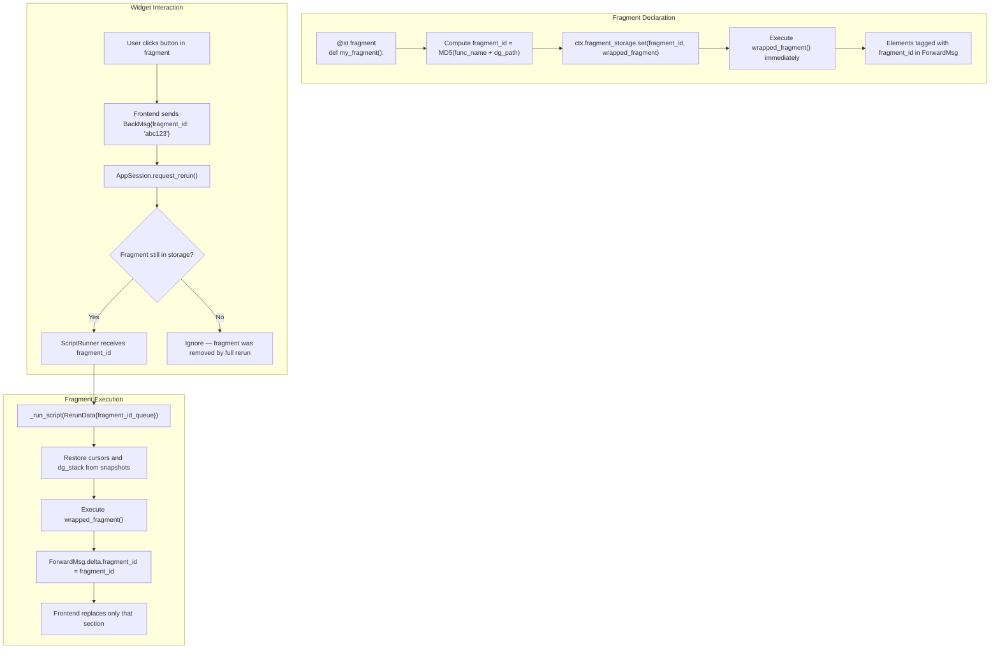
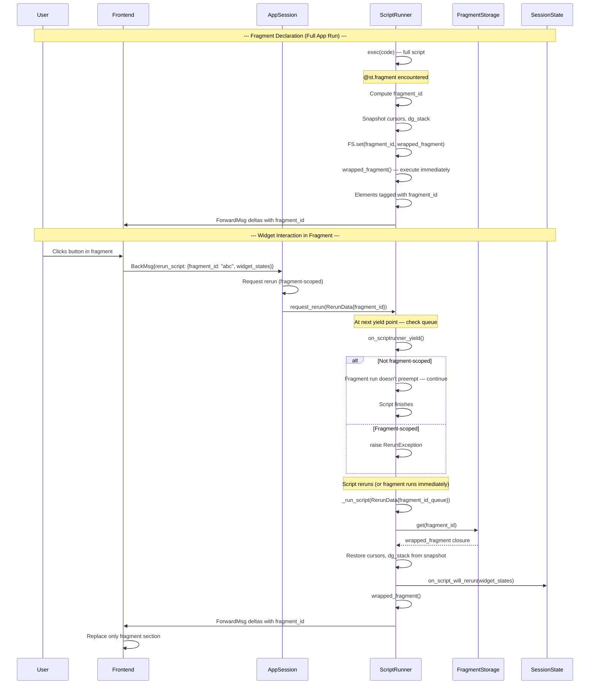

# Fragment Partial Reruns — @st.fragment

The `@st.fragment` decorator allows parts of a Streamlit app to rerun independently of the full script. When a user interacts with a widget inside a fragment, only that fragment's code re-executes — not the entire script. This is crucial for apps with slow computations: the slow part runs once, and fast interactive parts rerun on demand.

Source: `lib/streamlit/runtime/fragment.py` (479 lines); `lib/streamlit/runtime/scriptrunner_utils/script_requests.py` (fragment coalescence); `lib/streamlit/runtime/scriptrunner/script_runner.py` (fragment execution)

## Fragment Architecture



**Aha:** Fragments are **not** implemented as separate threads or async tasks. They execute within the same script thread as the main script, but the script runner's `_run_script()` method detects when `fragment_id_queue` is non-empty and executes only the stored fragment function instead of `exec(code, module.__dict__)`. The fragment function is a closure captured at declaration time, stored in `FragmentStorage`.

## FragmentStorage Protocol

Source: `lib/streamlit/runtime/fragment.py:48-87`

```python
class FragmentStorage(Protocol):
    """A key-value store for Fragments."""

    def clear(self, new_fragment_ids: set[str] | None = None) -> None:
        """Remove all fragments unless listed in new_fragment_ids."""

    def get(self, key: str) -> Fragment:
        """Returns the stored fragment for the given key."""

    def set(self, key: str, value: Fragment) -> None:
        """Saves a fragment under the given key."""

    def delete(self, key: str) -> None:
        """Delete the fragment corresponding to the given key."""

    def contains(self, key: str) -> bool:
        """Return whether the given key is present."""
```

### MemoryFragmentStorage

The default implementation (`fragment.py:94-132`):

```python
class MemoryFragmentStorage(FragmentStorage):
    def __init__(self) -> None:
        self._fragments: dict[str, Fragment] = {}

    def clear(self, new_fragment_ids: set[str] | None = None) -> None:
        if new_fragment_ids is None:
            new_fragment_ids = set()
        fragment_ids = list(self._fragments.keys())
        for fid in fragment_ids:
            if fid not in new_fragment_ids:
                del self._fragments[fid]

    def get(self, key: str) -> Fragment:
        try:
            return self._fragments[key]
        except KeyError as e:
            raise FragmentStorageKeyError(str(e))
```

Fragments are stored as Python closures in memory. When a full script rerun happens, fragments that are re-registered update their closures, and fragments that are NOT re-registered are removed by `clear()`.

## The @st.fragment Decorator

Source: `lib/streamlit/runtime/fragment.py:135-285`

```python
def _fragment(
    func: F | None = None,
    *,
    run_every: int | float | timedelta | str | None = None,
    additional_hash_info: str = "",
    should_show_deprecation_warning: bool = False,
) -> Callable[[F], F] | F:
```

### Fragment ID Computation

The fragment ID is computed from the function's module, qualified name, and its position in the DG tree:

```python
fragment_id = calc_md5(
    f"{non_optional_func.__module__}.{non_optional_func.__qualname__}"
    f"{dg_stack_snapshot[-1]._get_delta_path_str()}"
    f"{additional_hash_info}"
)
```

This means the same function decorated with `@st.fragment` gets different IDs depending on where it's called in the UI layout.

### Cursor and DG Stack Snapshots

When a fragment is declared, the current cursor and DG stack state is snapshotted:

```python
cursors_snapshot = deepcopy(ctx.cursors)
dg_stack_snapshot = deepcopy(context_dg_stack.get())
```

When the fragment executes (during a rerun), these snapshots are restored:

```python
def wrapped_fragment() -> Any:
    ctx = get_script_run_ctx(suppress_warning=True)
    if ctx.fragment_ids_this_run:
        # Restore state for fragment execution
        ctx.cursors = deepcopy(cursors_snapshot)
        context_dg_stack.set(deepcopy(dg_stack_snapshot))
```

**Key insight:** The snapshot/restore mechanism ensures that fragment elements appear in the same position in the UI tree regardless of how the main script has changed between runs. The fragment's `delta_path` is fixed at declaration time.

### Delta Path Trimming

```python
active_dg = context_dg_stack.get()[-1]
ctx.current_fragment_delta_path = active_dg._cursor.delta_path[:-1]
```

The fragment's delta path is the parent's path (all elements created inside the fragment start with this prefix). This is why elements created inside a fragment don't interfere with elements outside it.

### Auto-Rerun with `run_every`

When `run_every` is specified:

```python
if run_every:
    msg = ForwardMsg()
    msg.auto_rerun.interval = time_to_seconds(run_every)
    msg.auto_rerun.fragment_id = fragment_id
    ctx.enqueue(msg)
```

The frontend receives an `AutoRerun` message and polls the server at the specified interval, sending `BackMsg{rerun_script: {fragment_id, is_auto_rerun: true}}`.

## Fragment Execution in ScriptRunner

Source: `lib/streamlit/runtime/scriptrunner/script_runner.py:620-670`

```python
if rerun_data.fragment_id_queue:
    for fragment_id in rerun_data.fragment_id_queue:
        try:
            wrapped_fragment = self._fragment_storage.get(fragment_id)
            wrapped_fragment()
        except FragmentStorageKeyError:
            if not rerun_data.is_auto_rerun:
                _LOGGER.warning(f"Couldn't find fragment with id {fragment_id}.")
        except (RerunException, StopException):
            raise
        except Exception:
            pass  # Ignore errors in fragments
else:
    # Full app run
    if PagesManager.uses_pages_directory:
        _mpa_v1(self._main_script_path)
    else:
        exec(code, module.__dict__)
    self._fragment_storage.clear(new_fragment_ids=ctx.new_fragment_ids)
```

**Key insight:** Multiple fragments can be queued (`fragment_id_queue` is a list). They execute sequentially in order. If a fragment isn't found in storage (e.g., it was removed by a full rerun), it's silently skipped.

## Fragment Preemption — When Fragments Don't Interrupt

Source: `lib/streamlit/runtime/scriptrunner_utils/script_requests.py:86-97`

```python
def _fragment_run_should_not_preempt_script(
    fragment_id_queue: list[str],
    is_fragment_scoped_rerun: bool,
) -> bool:
    """Fragment runs that weren't caused by st.rerun(scope='fragment')
    should NOT cancel the current script run."""
    return bool(fragment_id_queue) and not is_fragment_scoped_rerun
```

When a widget inside a fragment triggers a rerun:
- If `is_fragment_scoped_rerun=True` (user called `st.rerun(scope="fragment")`): the current script run IS interrupted
- If `is_fragment_scoped_rerun=False` (normal widget interaction): the current script run continues, and the fragment rerun happens AFTER

This prevents fragment widget interactions from disrupting slow-running main script code.

## Fragment State Management

Fragments interact with SessionState in a special way:

### Widget Registration in Fragments

Widgets inside a fragment are registered with their `fragment_id` in their metadata:

```python
metadata = WidgetMetadata(
    element_id, deserializer, serializer, value_type=value_type,
    callback=on_change_handler,
    fragment_id=ctx.current_fragment_id if ctx else None,  # Fragment association
)
```

### Stale Widget Handling for Fragments

Source: `lib/streamlit/runtime/state/session_state.py:765-779`

```python
def _is_stale_widget(metadata, active_widget_ids, fragment_ids_this_run) -> bool:
    return not (
        metadata.id in active_widget_ids
        or (fragment_ids_this_run and metadata.fragment_id not in fragment_ids_this_run)
    )
```

A widget is NOT removed as stale if it belongs to a fragment NOT currently being run. This preserves fragment widget state across fragment reruns.

### Fragment Callback Tracking

```python
ctx = get_script_run_ctx()
if ctx and metadata.fragment_id is not None:
    ctx.in_fragment_callback = True
    callback(*args, **kwargs)
    ctx.in_fragment_callback = False
```

The `in_fragment_callback` flag is used to warn users when they try to display elements inside a fragment callback, which is not officially supported.

## Fragment Rerun vs Full Rerun

| Aspect | Full Rerun | Fragment Rerun |
|--------|-----------|----------------|
| Script execution | `exec(code, module.__dict__)` | `wrapped_fragment()` closure |
| Cursor reset | Full reset | Restore from snapshot |
| DG stack reset | Full reset | Restore from snapshot |
| Widget state | All widgets updated | Fragment widgets only |
| Stale cleanup | All widgets checked | Fragment-unrelated widgets preserved |
| ForwardMsg | Full delta stream | Deltas tagged with `fragment_id` |
| Frontend | Full tree rebuild | Partial tree replacement |

## `st.rerun(scope="fragment")`

Users can programmatically trigger a fragment rerun:

```python
@st.fragment
def my_fragment():
    count = st.session_state.get("count", 0)
    st.write(f"Count: {count}")
    if st.button("Increment"):
        st.session_state["count"] = count + 1
        st.rerun(scope="fragment")  # Only rerun this fragment
```

This sets `is_fragment_scoped_rerun=True` in the `RerunData`, which means the fragment rerun WILL preempt the current script run.

## Fragment Execution Sequence



## Limitations

1. **No `st.sidebar` in fragments**: Calling `st.sidebar` inside a fragment raises `StreamlitAPIException`. To write to sidebar from a fragment, call the fragment inside `with st.sidebar:`.

2. **Widgets only in fragment main body**: Fragments can't render widgets to externally created containers. Widgets inside a fragment must be in the fragment's main body, not in containers created outside the fragment.

3. **SessionState is shared**: Changes to SessionState in a fragment affect the full app. Users must be careful to manage shared state properly.

4. **No concurrent fragment execution**: Fragments run sequentially in the same script thread. Multiple fragments are queued and executed one at a time.

## Cross-References

- [Rerun Execution Model](01-rerun-execution-model.md) — How fragment reruns fit into the script runner
- [SessionState Management](04-session-state.md) — How fragment widget state is preserved
- [Widget Protocol](05-widget-protocol.md) — How fragment widget registration includes fragment_id

## Next

Continue to [Frontend React Architecture](08-frontend-architecture.md) to understand how the React frontend processes protobuf messages and renders the UI tree.
