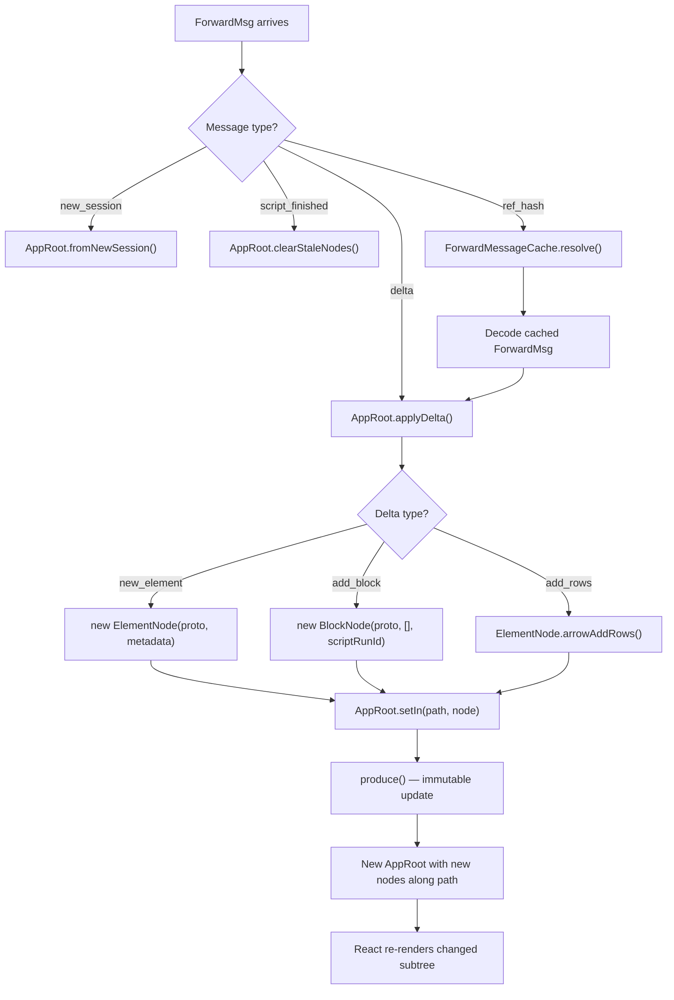
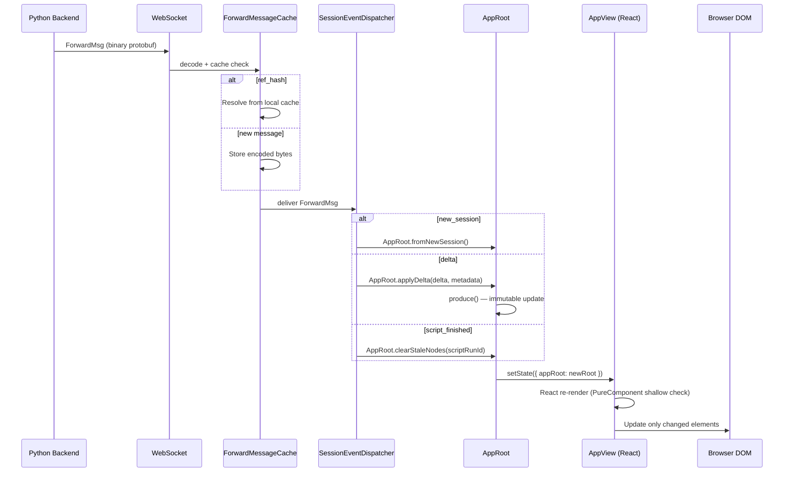

# Frontend React Architecture — From Protobuf to UI

The Streamlit frontend is a React/TypeScript application that receives protobuf `ForwardMsg` messages over WebSocket, builds an immutable `AppNode` tree from `Delta` messages, and renders it using React PureComponent components. The rendering pipeline is designed for high-frequency updates — every delta triggers a re-render, so immutability and shallow comparison are critical for performance.

Source: `frontend/app/src/` — React app components; `frontend/lib/src/` — shared library (AppNode, WidgetStateManager, dataframes); `frontend/connection/src/` — WebSocket/HTTP connections; `frontend/protobuf/` — generated protobuf TypeScript bindings

## Frontend Monorepo Structure

```
frontend/
├── app/                          # Main React application
│   └── src/
│       ├── App.tsx               # Root component
│       └── components/
│           ├── AppView/          # Main app view (renders AppNode tree)
│           ├── Sidebar/          # Sidebar navigation
│           ├── Header/           # Top bar
│           ├── StatusWidget/     # Connection status indicator
│           └── ...               # UI components
├── lib/                          # Shared library (published as @streamlit/lib)
│   └── src/
│       ├── AppNode.ts            # Immutable tree nodes (ElementNode, BlockNode, AppRoot)
│       ├── WidgetStateManager.ts # Client-side widget state management
│       ├── FileUploadClient.ts   # File upload handling
│       ├── dataframes/           # Arrow/Quiver dataframe utilities
│       ├── components/           # Element React components
│       └── hooks/                # React hooks
├── connection/                   # Connection layer (published as @streamlit/connection)
│   └── src/
│       ├── WebsocketConnection.tsx  # WebSocket FSM
│       ├── ForwardMessageCache.ts   # Message caching
│       └── ConnectionState.ts       # Connection state enum
├── protobuf/                     # Protobuf code generation
│   └── scripts/                  # Proto → TypeScript compilation
└── utils/                        # Shared utilities
```

## AppNode — The Immutable Data Tree

Source: `frontend/lib/src/AppNode.ts`

The frontend maintains an immutable tree of `AppNode` objects. There are three node types:

### ElementNode (Leaf)

```typescript
export class ElementNode implements AppNode {
  public readonly element: Element;           // Protobuf Element message
  public readonly metadata: ForwardMsgMetadata;
  public readonly scriptRunId: string;
  public readonly fragmentId?: string;
  public readonly activeScriptHash: string;

  // Lazy-parsed for performance
  private lazyQuiverElement?: Quiver;
  private lazyVegaLiteChartElement?: VegaLiteChartElement;
}
```

`ElementNode` is a leaf — it cannot have children. It wraps a protobuf `Element` message and lazily parses complex types (Arrow tables, VegaLite charts) on first access.

### BlockNode (Branch)

```typescript
export class BlockNode implements AppNode {
  public readonly children: AppNode[];
  public readonly deltaBlock: BlockProto;
  public readonly scriptRunId: string;
  public readonly fragmentId?: string;
  public readonly activeScriptHash: string;
}
```

`BlockNode` holds an array of children and a `BlockProto` that defines its layout (vertical, horizontal, column, expandable, form, tab, etc.).

### AppRoot (Root)

```typescript
export class AppRoot implements AppNode {
  public readonly main: BlockNode;       // RootContainer.MAIN children
  public readonly sidebar: BlockNode;    // RootContainer.SIDEBAR children
  public readonly event: BlockNode;      // RootContainer.EVENT children
  public readonly bottom: BlockNode;     // RootContainer.BOTTOM children
  public readonly scriptRunId: string;
}
```

`AppRoot` has four child `BlockNode`s — one per root container.

**Key insight:** Every tree mutation creates NEW nodes all the way to the root (immutable update pattern). When a delta arrives at path `[0, 2, 1]`, a new `ElementNode` is created, a new `BlockNode` for its parent at `[0, 2]`, a new `BlockNode` for `[0]`, and a new `AppRoot`. React's PureComponent shallow-comparison then efficiently identifies only the changed subtree for re-rendering.

## Tree Mutation — applyDelta

Source: `frontend/lib/src/AppRoot.ts` (conceptual)

```typescript
class AppRoot {
  public applyDelta(
    delta: Delta,
    metadata: ForwardMsgMetadata,
    scriptRunId: string
  ): AppRoot {
    const path = metadata.deltaPath;  // e.g., [0, 2, 1]

    switch (delta.type) {
      case "newElement":
        return this.setIn(path, new ElementNode(delta.newElement, metadata, scriptRunId));
      case "addBlock":
        return this.setIn(path, new BlockNode(delta.addBlock, [], scriptRunId));
      case "addRows":
        return this.arrowAddRows(path, delta.arrowAddRows, scriptRunId);
    }
  }

  public setIn(path: number[], node: AppNode, scriptRunId: string): AppRoot {
    // Immutable update: create new nodes along the path
    return produce(this, (draft) => {
      // ... recursive set using immer
    });
  }
}
```

The `setIn` method uses [immer](https://immerjs.github.io/immer/) for immutable updates. Instead of manually creating new objects, immer provides a draft proxy that tracks mutations and produces a new immutable state.



## WebsocketConnection — The State Machine

Source: `frontend/connection/src/WebsocketConnection.tsx`

The WebSocket connection is a finite state machine:

```
INITIAL
  │
  │               on ping succeed
  ▼               :
PINGING_SERVER ───────────────> CONNECTING
  ^  ^                            │  │
  │  │:on timeout/error/closed    │  │
  │  └────────────────────────────┘  │
  │                                  │
  │:on error/closed                  │:on conn succeed
CONNECTED<───────────────────────────┘


                   on fatal error or call to .disconnect()
                   :
<ANY_STATE> ──────────────> DISCONNECTED_FOREVER
```

### Connection Flow

1. **INITIAL → PINGING_SERVER**: Start pinging the server at `/_stcore/healthz`
2. **PINGING_SERVER → CONNECTING**: Health check succeeds, open WebSocket to `/_stcore/stream`
3. **CONNECTING → CONNECTED**: WebSocket open event fires
4. **CONNECTED → PINGING_SERVER**: WebSocket error/close — reconnect with exponential backoff

The ping retry period uses exponential backoff:

```typescript
PING_MINIMUM_RETRY_PERIOD_MS = 1_000    // 1 second
PING_MAXIMUM_RETRY_PERIOD_MS = 30_000   // 30 seconds
```

### Message Handling

```typescript
private handleMessageEvent = (event: MessageEvent): void => {
  const msg = ForwardMsg.decode(new Uint8Array(event.data));
  this.cache.processMessage(msg, (cachedMsg) => {
    this.args.onMessage(cachedMsg);
  });
};
```

Incoming binary frames are decoded as `ForwardMsg`, passed through `ForwardMessageCache`, and then delivered via the `onMessage` callback.

## ForwardMessageCache — Deduplication

Source: `frontend/connection/src/ForwardMessageCache.ts`

```typescript
export class ForwardMsgCache {
  private readonly messages = new Map<string, CacheEntry>();
  private scriptRunCount = 0;

  public processMessage(msg: ForwardMsg, onMessage: (msg: ForwardMsg) => void): void {
    if (msg.refHash) {
      // Reference to cached message
      const cached = this.messages.get(msg.refHash);
      if (cached) {
        onMessage(ForwardMsg.decode(cached.encodedMsg));
      }
      return;
    }

    // New message — cache if marked cacheable
    if (msg.metadata?.cacheable && msg.hash) {
      this.messages.set(msg.hash, new CacheEntry(
        ForwardMsg.encode(msg).finish(),
        this.scriptRunCount,
        msg.delta?.fragmentId
      ));
    }

    onMessage(msg);
  }

  public incrementRunCount(maxMessageAge: number, fragmentIdsThisRun: string[]): void {
    this.scriptRunCount += 1;
    this.messages.forEach((entry, hash) => {
      if (entry.getAge(this.scriptRunCount) > maxMessageAge) {
        this.messages.delete(hash);
      }
    });
  }
}
```

**Key insight:** The cache stores the **encoded binary** (`Uint8Array`), not the decoded message. When a `ref_hash` is received, the binary is decoded fresh. This saves memory (encoded form is smaller) and ensures each consumer gets a fresh decoded instance (protobuf decode mutates the input).

## WidgetStateManager — Client-Side State

Source: `frontend/lib/src/WidgetStateManager.ts`

The `WidgetStateManager` tracks all widget values on the client side:

```typescript
export class WidgetStateManager {
  private readonly widgetState = new WidgetStateDict();
  private readonly forms = new Map<string, FormState>();
  private readonly formsData: FormsData;
  private readonly sendUpdate: (widgetStates: WidgetStates) => void;

  // Set a widget's value
  public setValue(widgetId: string, value: WidgetValue, source: Source): void {
    const state = this.widgetState.createState(widgetId);
    // Set the appropriate field based on value type
    state.boolValue = value; // or doubleValue, stringValue, etc.
  }

  // Submit a form
  public submitForm(formId: string): void {
    const form = this.forms.get(formId);
    if (form) {
      const msg = this.widgetState.createWidgetStatesMsg();
      // Merge form widget states
      form.widgetStates.forEach(ws => msg.widgets.push(ws));
      this.sendUpdate(msg);
      form.clearOnSubmit && this.clearForm(formId);
    }
  }

  // Non-form widget: send immediately
  private maybeSendUpdate(widgetId: string): void {
    if (!this.isInForm(widgetId)) {
      const msg = this.widgetState.createWidgetStatesMsg();
      this.sendUpdate(msg);
    }
  }
}
```

### Form Handling

Forms batch widget changes without triggering reruns:

```typescript
class FormState {
  public readonly widgetStates = new WidgetStateDict();  // Buffered values
  public clearOnSubmit = false;
  public enterToSubmit = true;
}
```

When a widget inside a form changes, its value is stored in the form's `WidgetStateDict` rather than the main dict. Only when the user clicks the submit button are all form values merged and sent.

### Trigger Value Handling

Buttons use `trigger_value` which auto-resets after being sent:

```typescript
// For buttons, the trigger value is deleted after sending
// because the server resets it after each run
public setTriggerValue(widgetId: string): void {
  const state = this.widgetState.createState(widgetId);
  state.triggerValue = true;
  this.maybeSendUpdate(widgetId);
  // Delete immediately - server will reset it
  this.widgetState.deleteState(widgetId);
}
```

## React Rendering — AppView

Source: `frontend/app/src/components/AppView/AppView.tsx`

`AppView` is the React component that renders the `AppRoot` tree:

```tsx
class AppView extends React.PureComponent<Props> {
  render(): React.ReactNode {
    const { appRoot } = this.props;
    return (
      <div>
        <BlockNodeRenderer block={appRoot.main} />
        <Sidebar>
          <BlockNodeRenderer block={appRoot.sidebar} />
        </Sidebar>
        <EventContainer>
          <BlockNodeRenderer block={appRoot.event} />
        </EventContainer>
      </div>
    );
  }
}
```

`BlockNodeRenderer` recursively renders blocks and their children:

```tsx
function BlockNodeRenderer({ block }: Props): React.ReactNode {
  return (
    <div className={`block-${block.deltaBlock.type}`}>
      {block.children.map((child, index) => (
        <AppChild key={index} node={child} />
      ))}
    </div>
  );
}
```

`ElementNodeRenderer` renders individual elements based on their type:

```tsx
function ElementNodeRenderer({ element }: Props): React.ReactNode {
  switch (element.type) {
    case "text": return <Text element={element.text} />;
    case "button": return <Button element={element.button} />;
    case "slider": return <Slider element={element.slider} />;
    case "arrow": return <ArrowTable element={element.arrow} />;
    case "plotlyChart": return <PlotlyChart element={element.plotlyChart} />;
    // ... 50+ element types
  }
}
```

## Performance — PureComponent and Immutability

All React components in the Streamlit frontend are `PureComponent` (or use `React.memo` for function components). This means React performs shallow equality comparison on props to decide whether to re-render.

Because `AppNode` objects are immutable, a shallow comparison is sufficient to detect changes:

```
Old tree: AppRoot → BlockNode A → BlockNode B → ElementNode C
New tree: AppRoot' → BlockNode A' → BlockNode B → ElementNode C
                              (same ref)   (same ref)

React sees: AppRoot' ≠ AppRoot (different ref) → re-render
            BlockNode A' ≠ BlockNode A (different ref) → re-render
            BlockNode B === BlockNode B (same ref) → SKIP
            ElementNode C === ElementNode C (same ref) → SKIP
```

This makes re-rendering efficient even for large apps with many elements — only the changed subtree and its ancestors are re-rendered.

## Fragment-Aware Stale Node Clearing

Source: `frontend/lib/src/AppNode.ts:267-287`

When a fragment reruns, only nodes belonging to that fragment are cleared:

```typescript
clearStaleNodes(
  currentScriptRunId: string,
  fragmentIdsThisRun?: Array<string>,
  fragmentIdOfBlock?: string
): ElementNode | undefined {
  if (fragmentIdsThisRun && fragmentIdsThisRun.length) {
    // If running a fragment, don't clear nodes unrelated to it
    if (
      !this.fragmentId ||                    // Not a fragment element
      !fragmentIdOfBlock ||                   // Not in the modified block
      this.scriptRunId === currentScriptRunId // Already current
    ) {
      return this;  // Keep this node
    }
  }
  return this.scriptRunId === currentScriptRunId ? this : undefined;
}
```

This ensures that during a fragment rerun, elements outside the fragment are preserved on screen.

## The Full Rendering Pipeline



## Component Library — Custom Components

Source: `component-lib/` and `frontend/lib/src/components/widgets/CustomComponent/`

Custom components are loaded via iframes and communicate with the parent window through `postMessage`:

```typescript
// In the component's React code (running in iframe)
Streamlit.setComponentValue({ myData: 42 });
Streamlit.setFrameHeight(500);
```

```typescript
// In the parent Streamlit app
window.addEventListener("message", (event) => {
  if (event.data.type === "COMPONENT_READY") {
    // Set iframe height
  } else if (event.data.type === "COMPONENT_VALUE") {
    // Update widget state
    this.widgetManager.setValue(widgetId, event.data.value, { fromUi: true });
  }
});
```

The Python side declares components:

```python
import streamlit.components.v1 as components

my_component = components.declare_component("my_component", path="./frontend/build")
result = my_component(value=42)  # Blocks until JS sends value back
```

## Cross-References

- [Protobuf Bridge](03-protobuf-bridge.md) — The protobuf messages driving the frontend
- [Rerun Execution Model](01-rerun-execution-model.md) — When script_finished triggers stale node clearing
- [Widget Protocol](05-widget-protocol.md) — How frontend widget state syncs with backend SessionState

## Next

The frontend architecture completes the picture of Streamlit's Python-to-browser pipeline. All documents together describe the full system from `st.foo()` call to React rendering and back.
