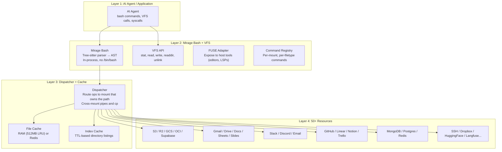

# Mirage — Unified Virtual File System for AI Agents

**Mirage is a Unified VFS that mounts 50+ heterogeneous services as a single filesystem tree.** AI agents use standard Unix commands (`cat`, `grep`, `ls`, `find`, `wc`, `jq`) across every backend — no new SDK, no new vocabulary. The shell is a tree-sitter bash parser running in-process (no `/bin/bash` spawned), providing sandboxed execution by construction. Built by Strukto.ai in Python (~2,000 files) and TypeScript (~2,500 files), Apache 2.0.

Source: `python/mirage/` + `typescript/packages/` — ~4,500 source files, v0.0.2-alpha

## The Problem It Solves

**Aha:** AI agents need to interact with N different services, each with its own SDK, API, and vocabulary. An agent must learn S3's `GetObject`, Slack's `conversations.history`, GitHub's `GET /repos/.../contents`, and Gmail's `users.messages.get` — each with different auth, pagination, and error handling. This is fragile, token-inefficient, and produces brittle pipelines.

Mirage's solution: **every service becomes a mount point under one root.** Agents use `cat /s3/bucket/file.json`, `grep "error" /slack/general/recent`, `ls /github/owner/repo/src/`. Since modern LLMs are extensively trained on bash semantics, they can use Mirage out of the box with zero new vocabulary.

## Architecture — Four Layers



## The In-Process Shell — Why No `/bin/bash`

**Aha:** Mirage does NOT spawn a real shell subprocess. Instead, it uses `tree-sitter-bash` to parse shell commands into an AST, then executes the AST through a custom executor. This means:

1. **Sandboxed by construction** — No access to the host filesystem unless explicitly mounted. `rm -rf /` does nothing.
2. **Cross-platform** — Works on macOS, Linux, Windows. No dependency on system shell.
3. **Observable** — Every command execution is recorded by the `Observer` for debugging and replay.
4. **Dry-run** — `provision=True` returns a cost/timing estimate without executing.

```
shell command → tree-sitter parse → AST → execute_node() → IOResult
                                        ↓
                              per-mount command dispatch
                              (cat on .parquet renders rows as JSON)
```

### Command Polymorphism

Commands are resolved per-mount AND per-filetype:

```
Resolution order:
1. (command, file_extension) — filetype-specific (cat on .parquet → JSON rows)
2. (command, None) — resource-specific (Slack's custom cat)
3. general_cmds[name] — fallback (echo, pwd)
```

This means `cat /s3/data.parquet` renders rows as JSON, while `cat /s3/data.txt` returns raw text — same command, filetype-aware behavior.

## Core Abstractions

### Resource

```python
# python/mirage/resource/base.py
class BaseResource:
    name: str            # "s3", "slack", "github"
    is_remote: bool      # Determines caching behavior
    accessor: Accessor   # Connection state (credentials, clients)
    PROMPT: str          # Help text injected into agent's system prompt
    index: IndexCacheStore
```

Each resource registers commands and low-level ops:
```python
resource.register_op("read", s3_read)
resource.register_op("write", s3_write)
resource.register(command(name="cat", resource="s3")(s3_cat))
```

### Mount + MountRegistry

```python
# python/mirage/workspace/mount/mount.py
Mount(path="/s3/", resource=S3Resource(bucket="my-bucket"))
Mount(path="/slack/", resource=SlackResource(workspace="my-org"))
```

`MountRegistry` resolves any path to the mount that owns it. Cross-mount operations (pipes between `/slack` and `/s3`, `cp` between mounts) are handled by the Dispatcher.

### Dispatcher

Routes VFS ops to the correct mount. Manages:
- **Cache coordination:** On read ops against remote resources, checks file cache first. On writes, invalidates affected cache entries.
- **Consistency:** `ConsistencyPolicy.ALWAYS` validates cached entries against remote fingerprints (ETags).
- **Cross-mount:** Pipelines that span multiple mounts.

### Workspace — The Central Orchestrator

```python
# python/mirage/workspace/workspace.py (696 lines)
workspace = Workspace()
workspace.mount("/s3/", S3Resource(bucket="my-bucket"))
workspace.mount("/slack/", SlackResource())
workspace.mount("/github/", GitHubResource())

result = workspace.execute("cat /s3/data.json | grep 'error'")
result = workspace.execute("cp /slack/general/msg.txt /github/issues/")

# Snapshot + replay
workspace.snapshot("session.tar")       # Serialize mounts, sessions, cache, fingerprints
Workspace.load("session.tar")           # Reconstruct with drift detection
```

## Two-Layer Cache System

| Cache | What | Backend | Default |
|-------|------|---------|---------|
| **File Cache** | Object bytes from reads | `RAMFileCacheStore` (512MB LRU) or `RedisFileCacheStore` | RAM |
| **Index Cache** | Directory listings | `RAMIndexCacheStore` (TTL-based) or `RedisIndexCacheStore` | RAM |

**Aha:** Redis backends enable cache sharing across workers/processes/machines. Multiple agent instances can share the same file and index caches, avoiding redundant API calls.

## Snapshot + Replay

Workspaces serialize to tar archives containing:
- Mount configurations
- Session history
- File cache content + fingerprints
- Index cache state

On load, drift detection verifies that fingerprinted data hasn't changed. Revision-pinned paths (e.g., S3 with `VersionId`) guarantee byte-exact replay.

## Supported Resources (50+)

| Category | Services |
|----------|----------|
| **Object Storage** | S3, R2, GCS, OCI, Supabase, MinIO, Ceph, Wasabi, Backblaze B2, DigitalOcean Spaces, Tencent COS, Alibaba OSS |
| **Google Workspace** | Gmail, Google Drive, Google Docs, Google Sheets, Google Slides |
| **Messaging** | Slack, Discord, Email |
| **Code & DevOps** | GitHub, GitHub CI, Linear, Langfuse |
| **Databases** | MongoDB, Postgres, Redis |
| **Cloud Files** | Dropbox, Box, Nextcloud, Databricks Volume |
| **Knowledge** | Notion, Dify, HuggingFace (Buckets, Datasets, Models, Spaces), Semantic Scholar |
| **Other** | SSH, Trello, PostHog, Vercel |

## Agent Framework Integrations

Mirage plugs into every major AI agent framework:

| Framework | Language | Integration |
|-----------|----------|-------------|
| OpenAI Agents SDK | Python + TS | `MirageSandboxClient`, `MirageShell`, `MirageEditor` |
| Vercel AI SDK | TypeScript | `mirageTools(ws)` typed tools |
| LangChain / deepagents | Python + TS | `LangchainWorkspace` backend |
| Pydantic AI | Python | For pydantic-ai and pydantic-deepagents |
| CAMEL | Python | `ChatAgent` integration |
| Mastra | TypeScript | `mirageTools()` |
| Claude Code / Codex | CLI | Via FUSE mount |

## Python Interop — Monkey-Patching

**Aha:** `Ops.make_open()` and `Ops.make_os_module()` replace Python's built-in `open()` and `os` module within the workspace context. Python code running inside the workspace sees the virtual filesystem transparently:

```python
with workspace.context():
    with open("/s3/bucket/data.json") as f:  # Actually reads from S3!
        data = json.load(f)
    os.listdir("/github/owner/repo/src/")     # Lists GitHub repo contents!
```

## Cross-References

- [Goose](../src.block/markdown/00-overview.md) — Block's AI agent (Mirage provides the filesystem backend)
- [TEN Framework](../src.TenFramework/markdown/00-overview.md) — Real-time multi-modal agent framework
