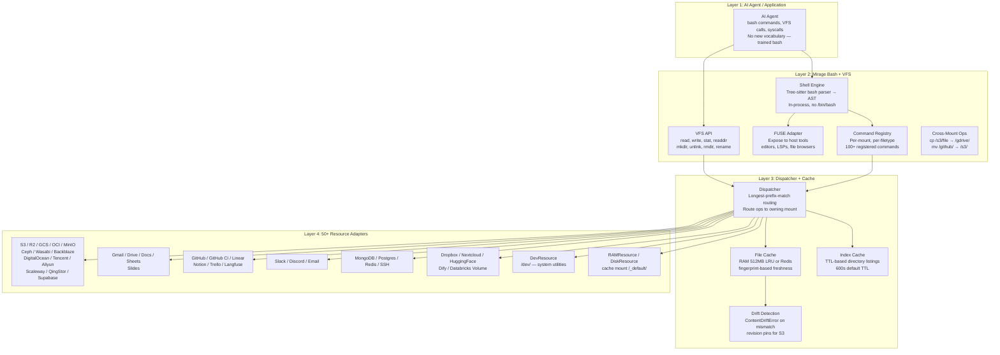
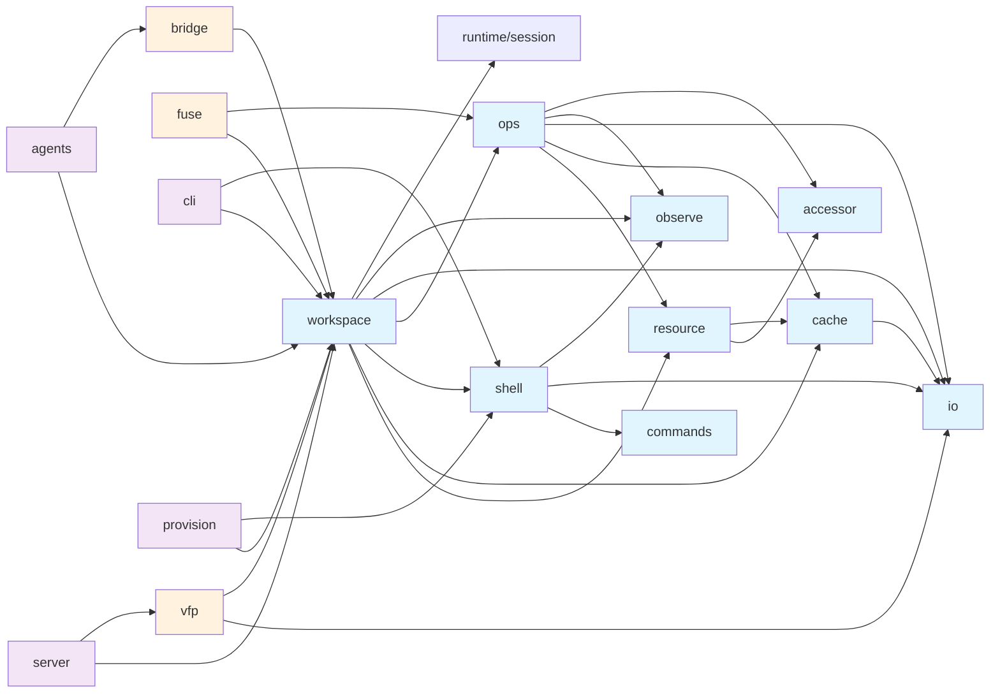
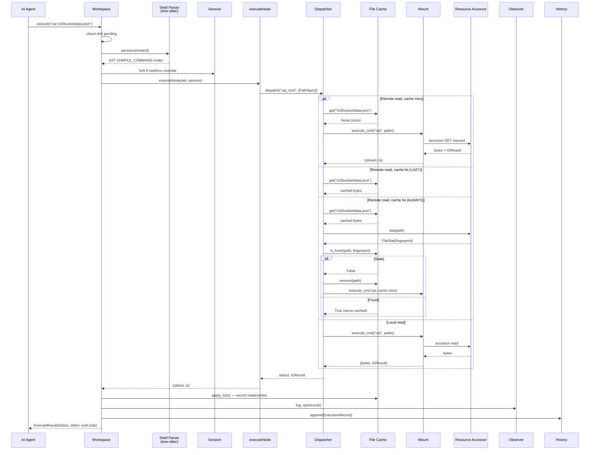
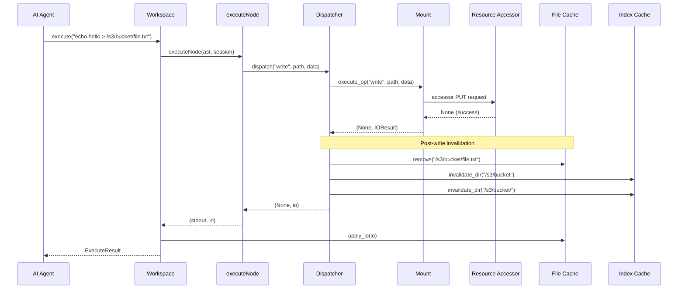

# Mirage Architecture — Layers, Packages, and Data Flow

Mirage's architecture is a four-layer stack that turns 50+ heterogeneous cloud services into a single Unix filesystem. An AI agent speaks bash, a tree-sitter shell parses it in-process, a dispatcher routes each operation to the correct mount, and 50+ resource adapters translate VFS calls into backend API calls. The entire system runs in-process — no subprocesses, no external daemons, no new vocabulary.

Source: `python/mirage/` (19 packages, ~2,000 files) and `typescript/packages/core/` (6 packages, ~2,500 files) — `https://github.com/strukto-ai/mirage`, v0.0.2-alpha, Apache 2.0.

**Cross-references:** [00-overview.md](00-overview.md) — what Mirage is and why it exists · [02-workspace-core.md](02-workspace-core.md) — Workspace class deep-dive · [03-shell-engine.md](03-shell-engine.md) — shell parser and command execution

## The Four-Layer Architecture



### Layer 1 — AI Agent / Application

The consumer layer. AI agents (Claude, GPT, etc.) issue bash commands like `cat /s3/data/file.json` or `grep "error" /slack/general/recent`. Modern LLMs are extensively trained on bash semantics, so they can use Mirage with zero new vocabulary. Agents can also call VFS methods directly (`ws.execute("ls /github")`) or use the FUSE mount to interact with host tools.

### Layer 2 — Mirage Bash + VFS

The shell engine and virtual filesystem API. Key components:

**Shell Engine** (`python/mirage/shell/`, `typescript/packages/core/src/shell/`): A tree-sitter bash parser runs in-process, producing an AST. There is no `/bin/bash` spawned — execution is sandboxed by construction. The parser handles pipes, redirects, compound commands (if/for/while), subshells, and variable expansion.

**VFS API** (`python/mirage/ops/ops.py`, `typescript/packages/core/src/workspace/fs.ts`): Provides standard POSIX operations — `read`, `write`, `stat`, `readdir`, `mkdir`, `unlink`, `rmdir`, `rename`, `truncate`, `create`, `append`. Each method resolves the virtual path to a mount and delegates to the resource.

**Command Registry** (`python/mirage/workspace/mount/mount.py`, `typescript/packages/core/src/workspace/mount/mount.ts`): Each mount maintains its own command lookup tables with a three-level resolution hierarchy: (1) filetype-specific handler `(name, extension)`, (2) resource-specific handler `(name, None)`, (3) general fallback `general[name]`. This lets `cat /s3/file.parquet` use a Parquet-aware handler while `cat /github/README.md` uses the default text handler.

**FUSE Adapter** (`python/mirage/fuse/`): Exposes the virtual filesystem to host tools — editors can open files, LSPs can read directories, and file browsers can navigate the mount tree.

### Layer 3 — Dispatcher + Cache

The routing and coordination layer:

**Dispatcher** (`python/mirage/workspace/dispatcher.py`): Resolves each VFS operation to the mount that owns the path via longest-prefix-match. For remote reads, checks the file cache first. Under `ConsistencyPolicy.ALWAYS`, validates freshness against the remote fingerprint before serving cached data. After writes, evicts the file cache entry and dirties the parent directory index.

**File Cache** (`python/mirage/cache/file/`): LRU cache with a 512MB default limit (configurable). Supports RAM and Redis backends. Each entry carries a `fingerprint` field (ETag-equivalent) for freshness validation. The `max_drain_bytes` setting limits how much data a single command can drain from the cache.

**Index Cache** (`python/mirage/cache/index/`): TTL-based cache for directory listings (default 600s). Remote `readdir` calls are expensive; the index cache avoids repeated API calls when listing the same directory.

**Drift Detection** (`python/mirage/workspace/snapshot.py`): After loading a snapshot, Mirage compares recorded fingerprints against live remote state. Paths with stable revision pins (e.g., S3 `VersionId`) skip the check entirely — the pin guarantees byte-for-byte match.

### Layer 4 — 50+ Resource Adapters

Each resource adapter implements `BaseResource` with an `Accessor` that translates VFS calls into backend-specific API calls. Resources are registered in `python/mirage/resource/registry.py` with lazy loading — only the resources actually mounted get their dependencies imported.

| Resource Category | Backends | Key File |
|---|---|---|
| Object Storage | S3, R2, GCS, OCI, MinIO, Ceph, Wasabi, Backblaze, DigitalOcean, Tencent, Aliyun, Scaleway, QingStor, Supabase | `mirage.resource.s3`, etc. |
| Google Workspace | Gmail, Drive, Docs, Sheets, Slides | `mirage.resource.gdrive`, etc. |
| Developer Tools | GitHub, GitHub CI, Linear, Notion, Trello, Langfuse | `mirage.resource.github`, etc. |
| Communication | Slack, Discord, Email | `mirage.resource.slack`, etc. |
| Databases | MongoDB, Postgres, Redis | `mirage.resource.mongodb`, etc. |
| Other | SSH, Dropbox, Nextcloud, HuggingFace (buckets/models/datasets/spaces), Dify, Databricks Volume | `mirage.resource.*` |
| System | DevResource (`/dev/`), RAMResource, DiskResource | `mirage.resource.dev`, `mirage.resource.ram`, `mirage.resource.disk` |

## Python Package Structure (19 Packages)

The Python codebase lives under `python/mirage/` and is organized into 19 packages. Each package has a focused responsibility:

```
python/mirage/
├── accessor/          # Backend-specific API clients (S3, GitHub, GDrive, etc.)
├── agents/            # AI agent integrations and tool definitions
├── bridge/            # Python↔TypeScript bridge for cross-language operations
├── cache/             # File cache (RAM/Redis) and index cache (directory listings)
├── cli/               # Command-line interface for workspace management
├── commands/          # Shell command implementations (cat, ls, grep, find, etc.)
├── core/              # Core types, configuration, and shared utilities
├── fuse/              # FUSE adapter for host filesystem exposure
├── io/                # I/O types, ByteSource, IOResult, async iterators
├── observe/           # Operation recording, logging, and audit trail
├── ops/               # VFS operations (read, write, stat, etc.) + OS patching
├── provision/         # Infrastructure provisioning commands
├── resource/          # BaseResource, registry, loader, and 50+ resource adapters
├── runtime/           # Session context management, mount access control
├── server/            # MCP server and HTTP server implementations
├── shell/             # Tree-sitter bash parser, command executor, job table
├── utils/             # Shared helpers (glob, pattern matching)
├── vfp/               # Virtual File Protocol — capability declarations for LLMs
└── workspace/         # Workspace, Mount, MountRegistry, Dispatcher, Session, History
```

### Package Dependency Map



### Package Responsibilities

**`accessor/`** — Backend-specific API clients. The `Accessor` base class (`python/mirage/accessor/base.py`) is a thin wrapper. Each resource has a concrete accessor (e.g., `S3Accessor`, `GitHubAccessor`) that holds credentials and performs HTTP calls.

**`agents/`** — AI agent integrations. Defines tool schemas and agent workflows that let external AI systems interact with Mirage workspaces.

**`bridge/`** — Python↔TypeScript bridge. Enables the TS workspace to call Python backends (Pyodide runtime) for resources that only have Python implementations.

**`cache/`** — Two-tier caching. `cache/file/` implements `RAMFileCacheStore` and `RedisFileCacheStore` with LRU eviction and fingerprint-based freshness. `cache/index/` implements `RAMIndexCacheStore` and `RedisIndexCacheStore` for directory listing caching with TTL expiry.

**`cli/`** — Command-line interface for workspace lifecycle operations (snapshot, load, mount management).

**`commands/`** — Shell command implementations. Over 100 commands registered via the `@command` decorator: `cat`, `ls`, `grep`, `find`, `head`, `tail`, `wc`, `jq`, `sed`, `cp`, `mv`, `echo`, `pwd`, `man`, etc. Commands support filetype-specific handlers via `CommandSpec`.

**`core/`** — Core types and configuration. Shared dataclasses and enums used across packages.

**`fuse/`** — FUSE adapter (`python/mirage/fuse/`). Uses `FuseManager` to expose the virtual filesystem to host tools via the `setup()` method.

**`io/`** — I/O types. `IOResult` captures stdout, stderr, exit code, and I/O tracking (reads/writes dictionaries). `ByteSource` is a union type for `bytes`, `bytearray`, or async byte iterators. `AsyncLineIterator` provides line-by-line streaming.

**`observe/`** — Operation recording and audit. `Observer` logs every VFS operation to a resource (default `RAMResource` at `/.sessions/`). `OpRecord` captures op name, path, source, bytes, timestamp, and duration. Context management (`start_recording`/`stop_recording`) scopes recording to specific execution blocks.

**`ops/`** — VFS operation layer. `Ops` class (`python/mirage/ops/ops.py:31-297`) provides the file-like API (`read`, `write`, `stat`, `readdir`, `mkdir`, `unlink`, `rmdir`, `rename`, `create`, `truncate`, `append`). `OpsRegistry` (`python/mirage/ops/registry.py:55-137`) resolves ops by `(name, filetype, resource)` triple. `os_patch.py` patches `builtins.open` and `sys.modules["os"]` so standard Python code works transparently against the VFS.

**`provision/`** — Infrastructure provisioning. Commands that create or configure backend resources before they can be mounted.

**`resource/`** — Resource adapter layer. `BaseResource` (`python/mirage/resource/base.py:31-130`) defines the interface: `name`, `is_remote`, `accessor`, `_ops`, `SUPPORTS_SNAPSHOT`, `index`, `fingerprint()`, `get_state()`, `load_state()`. `registry.py` (`python/mirage/resource/registry.py:28-171`) maps resource names to lazy-loaded class paths. `loader.py` (`python/mirage/resource/loader.py:20-56`) supports both module dotpaths and script file paths.

**`runtime/`** — Session context and access control. `assert_mount_allowed()` checks session permissions. `set_current_session`/`get_current_session`/`reset_current_session` manage thread-local session state.

**`server/`** — MCP server and HTTP server implementations that expose Mirage workspaces to external clients.

**`shell/`** — Shell execution engine. Tree-sitter bash parser, command executor, job table for background processes. `parse()` produces an AST, `find_syntax_error()` validates it.

**`utils/`** — Shared utilities including glob pattern matching and other helpers.

**`vfp/`** — Virtual File Protocol (`python/mirage/vfp/`). Defines capability declarations (`CapabilityDeclaration`, `ServerCapabilities`) that describe what operations, commands, and mounts a workspace supports. Used to generate LLM-facing skill descriptions via `render()`. Protocol version 1, with 15 method types (`initialize`, `fs/read`, `fs/readdir`, `fs/stat`, `fs/write`, `fs/unlink`, `fs/mkdir`, `fs/rmdir`, `fs/rename`, `fs/glob`, `command/exec`, `workspace/snapshot`, `workspace/load`, `workspace/list`, `workspace/delete`, `workspace/info`).

**`workspace/`** — The central package. `Workspace` class (`python/mirage/workspace/workspace.py:69-697`) manages mounts, cache, sessions, execution, and snapshot/lifecycle. `Mount` and `MountRegistry` (`python/mirage/workspace/mount/`) handle mount registration and longest-prefix-match resolution. `Dispatcher` (`python/mirage/workspace/dispatcher.py:28-141`) routes ops to mounts with cache coordination. `Session` and `SessionManager` (`python/mirage/workspace/session/`) manage per-session state (cwd, env, allowed mounts). `ExecutionHistory` (`python/mirage/workspace/history.py:21-47`) maintains a bounded deque of execution records.

## TypeScript Package Structure (6 Packages)

```
typescript/packages/
├── core/              # Workspace, resources, commands, shell parser, VFS ops
├── node/              # Node.js-specific integration (native bash via tree-sitter WASM)
├── browser/           # Browser-specific integration (WASM constraints, no native FS)
├── server/            # MCP server and HTTP endpoints
├── agents/            # AI agent integrations
└── cli/               # Command-line tools
```

### Core Package Internal Structure

The `core` package is the bulk of the TS codebase, mirroring the Python architecture:

```
typescript/packages/core/src/
├── accessor/          # Backend API clients (TS implementations)
├── cache/             # File cache and index cache
│   ├── file/          # RAMFileCacheStore, cache entry, I/O apply
│   └── index/         # Directory listing cache
├── commands/          # Shell command implementations
│   └── builtin/       # Built-in commands (general, history)
├── core/              # Core workspace types and configuration
├── io/                # I/O types, ByteSource, IOResult
├── observe/           # Operation recording and context
├── ops/               # VFS operations and OpsRegistry
├── provision/         # Infrastructure provisioning
├── resource/          # BaseResource interface and adapters
│   └── ram/           # RAMResource
├── runtime/           # Session context management
├── shell/             # Shell parser, command executor, barrier, job table
├── snapshot/          # Snapshot encoding/decoding, state serialization
├── workspace/         # Workspace class, Mount, MountRegistry, Session, History
│   ├── executor/      # Command executor, cross-mount operations
│   │   └── python/    # Pyodide bridge for Python backend calls
│   ├── mount/         # Mount and MountRegistry
│   ├── node/          # Command tree execution
│   ├── session/       # Session and SessionManager
│   └── snapshot/      # Drift detection for workspace loading
└── types.ts           # Shared enums and types (MountMode, FileType, etc.)
```

## Cross-Language Parity

Mirage implements the same architecture in both Python and TypeScript. Here is the parity map:

| Concept | Python | TypeScript |
|---|---|---|
| Workspace class | `python/mirage/workspace/workspace.py:69` | `typescript/packages/core/src/workspace/workspace.ts:223` |
| Mount | `python/mirage/workspace/mount/mount.py:76` | `typescript/packages/core/src/workspace/mount/mount.ts` |
| MountRegistry | `python/mirage/workspace/mount/registry.py:26` | `typescript/packages/core/src/workspace/mount/registry.ts` |
| Dispatcher | `python/mirage/workspace/dispatcher.py:28` | Inline in `Workspace.execute()` dispatch closure (line 755) |
| Session | `python/mirage/workspace/session/session.py:22` | `typescript/packages/core/src/workspace/session/session.ts` |
| SessionManager | `python/mirage/workspace/session/manager.py:20` | `typescript/packages/core/src/workspace/session/manager.ts` |
| ExecutionHistory | `python/mirage/workspace/history.py:21` | `typescript/packages/core/src/workspace/history.ts` |
| ExecutionNode | `python/mirage/workspace/types.py:22` | `typescript/packages/core/src/workspace/types.ts` |
| ExecutionRecord | `python/mirage/workspace/types.py:57` | `typescript/packages/core/src/workspace/types.ts` |
| Ops | `python/mirage/ops/ops.py:31` | `typescript/packages/core/src/ops/registry.ts` |
| OpsRegistry | `python/mirage/ops/registry.py:55` | `typescript/packages/core/src/ops/registry.ts` |
| Observer | `python/mirage/observe/observer.py` | `typescript/packages/core/src/observe/observer.ts` |
| OpRecord | `python/mirage/observe/record.py` | `typescript/packages/core/src/observe/record.ts` |
| JobTable | `python/mirage/shell/job_table.py` | `typescript/packages/core/src/shell/job_table.ts` |
| Resource base | `python/mirage/resource/base.py:31` | `typescript/packages/core/src/resource/base.ts` |
| RAMResource | `python/mirage/resource/ram.py` | `typescript/packages/core/src/resource/ram/ram.ts` |
| FileCache | `python/mirage/cache/file/ram.py` | `typescript/packages/core/src/cache/file/ram.ts` |
| IndexCache | `python/mirage/cache/index/` | `typescript/packages/core/src/cache/index/` |
| VFP types | `python/mirage/vfp/types.py` | `typescript/packages/core/src/vfp/types.ts` |
| VFP methods | `python/mirage/vfp/methods.py` | `typescript/packages/core/src/vfp/methods.ts` |
| VFP capabilities | `python/mirage/vfp/capability.py` | `typescript/packages/core/src/vfp/capability.ts` |
| MountMode enum | `python/mirage/types.py:64` | `typescript/packages/core/src/types.ts` |
| ConsistencyPolicy | `python/mirage/types.py:70` | `typescript/packages/core/src/types.ts` |
| DriftPolicy | `python/mirage/types.py:209` | `typescript/packages/core/src/types.ts` |
| PathSpec | `python/mirage/types.py:133` | `typescript/packages/core/src/types.ts` |

### Key Divergences

**Dispatcher pattern.** Python uses a dedicated `Dispatcher` class (`python/mirage/workspace/dispatcher.py:28`). TypeScript inlines the dispatch logic as a closure inside `Workspace.execute()` (line 755-788), capturing `this.cache`, `this.opsRegistry`, and `this.registry` from the enclosing scope. Both implementations follow the same algorithm: resolve mount, check cache for remote reads, validate freshness under ALWAYS policy, execute op, invalidate after writes.

**OS patching.** Python patches `builtins.open` and `sys.modules["os"]` via `make_open()` and `make_os_module()` (`python/mirage/ops/os_patch.py`), enabling transparent VFS access for standard Python code. TypeScript has no direct equivalent — browser/Node.js environments have different filesystem semantics.

**Pyodide bridge.** TypeScript has a `PyodideRuntime` (`typescript/packages/core/src/workspace/executor/python/runtime.ts`) that can call Python backends when a resource only has a Python implementation. The `buildWorkspaceBridge()` method (line 322-347) creates a `BridgeDispatchFn` that routes `READ`, `WRITE`, and `LIST` operations to the VFS. Python has no equivalent TS bridge.

**Parser initialization.** Python bundles the tree-sitter parser directly. TypeScript uses lazy parser initialization via `shellParserFactory` (line 349-359), deferring WASM load until first execution. The `@struktoai/mirage-node` and `@struktoai/mirage-browser` packages provide auto-configured factories.

## Data Flow: Command Execution



## Data Flow: Write Operations



## Aha: Resolution Hierarchy Makes Every Resource a First-Class Shell Citizen

The three-level command resolution hierarchy — `(name, extension) → (name, None) → general[name]` — is the key design that makes heterogeneous resources feel uniform. Consider `cat`:

1. `cat /s3/bucket/data.parquet` → `("cat", ".parquet")` → Parquet-aware handler that serializes to CSV text
2. `cat /s3/bucket/notes.txt` → `("cat", None)` → S3-specific cat that handles S3's pagination
3. `cat /dev/null` → `general["cat"]` → Generic cat that works on any resource

The same resource can have different command behavior for different filetypes, and general commands (`echo`, `pwd`, `man`) work everywhere because they are registered on every mount. This means an agent can `grep /s3/bucket/*.json` and `grep /slack/general/recent` with the exact same syntax — the mount's command registry handles the filetype dispatch transparently.

## Aha: The Dispatcher Is a Cache Coordinator, Not Just a Router

The `Dispatcher` class (`python/mirage/workspace/dispatcher.py:28-141`) does not just route operations to mounts. It owns the complete cache coordination protocol:

1. **Pre-read cache lookup**: For remote mounts, check the file cache before hitting the network
2. **Freshness validation**: Under `ALWAYS` policy, stat the remote and compare fingerprints
3. **Post-write invalidation**: After any write, evict the file cache entry AND dirty the parent directory index
4. **Cross-mount I/O application**: `apply_io()` records all reads/writes from command execution back into the cache

This means the cache lifecycle is centralized — every write path (whether through `Workspace.dispatch()`, `Ops._call()`, or command execution) hits the same `invalidate_after_write_by_path()` method. There is no "forgot to invalidate the cache" bug.

## Aha: Revision Pins Eliminate Drift for Versioned Backends

When loading a snapshot, paths with a stable revision pin (e.g., S3 `VersionId`) are installed directly into `mount.revisions` and skip the drift check entirely. The `revision_for` contextvar lookup in the accessor ensures reads pin to the exact recorded revision. This means:

- Pinned paths: guaranteed byte-for-byte match, zero drift risk
- Fingerprint-only paths: drift-checked on first access (`STRICT` raises, `OFF` evicts)
- No-revision paths: serve live state, no drift detection

This is critical for reproducibility: an agent's workspace snapshot can be replayed months later with original S3 object versions, even if the live objects have been updated.

## Cross-Reference Map

- **For the Workspace class deep-dive**: [02-workspace-core.md](02-workspace-core.md) — constructor params, mount lifecycle, execute() flow, session management, snapshot/load/copy
- **For the shell and command engine**: [03-shell-engine.md](03-shell-engine.md) — tree-sitter parser, command registration, execution tree, pipe handling
- **For the cache system**: [06-cache-system.md](06-cache-system.md) — file cache, index cache, Redis backend, cache invalidation protocol
- **For the overview**: [00-overview.md](00-overview.md) — what Mirage is, problem statement, quick start
- **For the VFP protocol**: [05-virtual-file-protocol.md](05-virtual-file-protocol.md) — capability declarations, LLM skill rendering
