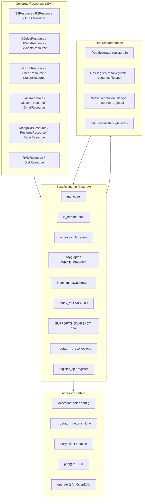
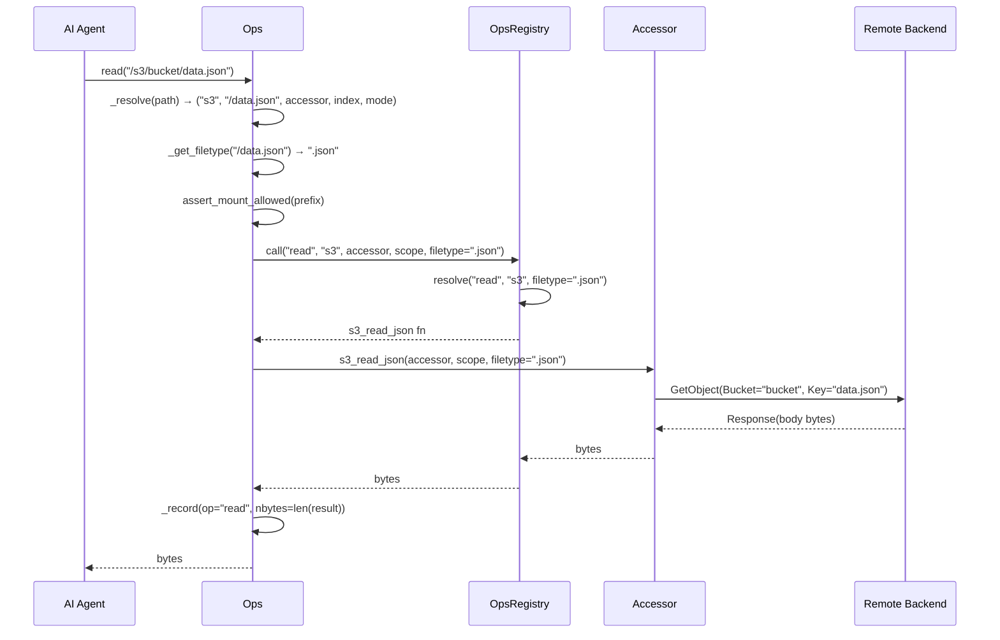

# Resource Model & Ops — How Every Service Becomes a File

The resource model is the foundation that makes Mirage's central claim possible: **50+ heterogeneous services (S3, Slack, GitHub, MongoDB, Google Drive...) behave identically under standard Unix commands.** Every service is a `BaseResource` subclass with an `Accessor` holding its connection state, a set of registered ops that implement filesystem semantics, and filetype-aware command dispatch. The `__getattr__` magic method on `BaseResource` resolves ops at runtime, so `resource.read(...)` dynamically becomes the correct backend implementation without inheritance hierarchies.

Source: `python/mirage/resource/` + `python/mirage/accessor/` + `python/mirage/ops/` + `python/mirage/vfp/` — the resource, accessor, operation, and protocol layers.

## Resource Hierarchy Architecture

Every resource in Mirage follows the same structural pattern: a `BaseResource` subclass with an `Accessor` that holds credentials and client state, ops registered via the `@op` decorator, and commands registered via the `@command` decorator.



## BaseResource — The Abstract Foundation

**File:** `python/mirage/resource/base.py`

`BaseResource` is the abstract base class every resource extends. It defines the contract: a name, a remoteness flag, an accessor for connection state, prompt strings for LLM injection, an index cache, and optional snapshot support.

```python
# python/mirage/resource/base.py:31-49
class BaseResource:

    name: str = "base"
    is_remote: bool = False
    accessor: Accessor = Accessor()
    _ops: dict[str, Callable[..., Any]] = {}
    PROMPT: str = ""
    WRITE_PROMPT: str = ""

    index_ttl: float = 600

    SUPPORTS_SNAPSHOT: bool = False
```

### Class Attributes

| Attribute | Type | Default | Purpose |
|-----------|------|---------|---------|
| `name` | `str` | `"base"` | Registry key like `"s3"`, `"slack"`, `"github"` |
| `is_remote` | `bool` | `False` | Determines caching: remote resources validate against the backend; local resources (ram, disk) do not |
| `accessor` | `Accessor` | `Accessor()` | Holds credentials, API clients, connection pools |
| `_ops` | `dict[str, Callable]` | `{}` | Class-level op name → function mapping |
| `PROMPT` | `str` | `""` | Help text injected into the agent's system prompt for read operations |
| `WRITE_PROMPT` | `str` | `""` | Help text for write operations |
| `index_ttl` | `float` | `600` | Default TTL (seconds) for directory listing cache |
| `SUPPORTS_SNAPSHOT` | `bool` | `False` | Whether the resource provides stable fingerprints for drift detection |

### Constructor and Index Setup

```python
# python/mirage/resource/base.py:51-74
def __init__(
    self,
    index: IndexConfig | None = None,
    **kwargs,
) -> None:
    super().__init__(**kwargs)
    self._commands: list = []
    self._ops_list: list = []
    self.set_index(index)

def set_index(self, config: IndexConfig | None = None) -> None:
    cfg = config or IndexConfig(ttl=self.index_ttl)
    if isinstance(cfg, RedisIndexConfig):
        if RedisIndexCacheStore is None:
            raise ImportError(
                "RedisIndexConfig requires the 'redis' extra. "
                "Install with: pip install mirage-ai[redis]")
        self._index = RedisIndexCacheStore(
            ttl=cfg.ttl,
            url=cfg.url,
            key_prefix=cfg.key_prefix,
        )
    else:
        self._index = RAMIndexCacheStore(ttl=cfg.ttl)
```

Every resource initializes with an empty command list and op list. The `set_index` method creates either a `RAMIndexCacheStore` (default) or `RedisIndexCacheStore` (when `RedisIndexConfig` is provided) for caching directory listings. The Redis backend is lazily imported to avoid the dependency unless explicitly configured.

### The `__getattr__` Magic Method — Dynamic Op Resolution

**This is the core mechanism that makes `resource.read(...)` work without inheritance.**

```python
# python/mirage/resource/base.py:83-88
def __getattr__(self, name: str) -> Any:
    fn = type(self)._ops.get(name)
    if fn is not None:
        return partial(fn, self.accessor)
    raise AttributeError(
        f"'{type(self).__name__}' has no attribute '{name}'")
```

When Python cannot find an attribute on a `BaseResource` instance through normal lookup (e.g., `resource.read`), `__getattr__` is invoked. It looks up the name in the class-level `_ops` dictionary. If found, it returns a `functools.partial` that pre-binds the resource's accessor as the first argument. This means:

1. `resource.read("/path")` becomes `read_op(resource.accessor, "/path")`
2. The actual `read_op` function is registered at class load time by the resource's `__init__.py`
3. Different resources register different implementations for the same op name

**Aha:** This is the **dependency injection without frameworks** pattern. Instead of building a complex inheritance hierarchy or using a service locator, Mirage uses Python's `__getattr__` to dynamically bind ops to accessors at call time. The resource class doesn't need to know about its ops at definition time — ops are registered externally and resolved at runtime. This is why adding a new resource backend is as simple as creating an Accessor, registering ops with `@op`, and calling `register_op` in `__init__`.

### Fingerprint Method

```python
# python/mirage/resource/base.py:90-99
async def fingerprint(self, path: str) -> str | None:
    """Return current remote fingerprint for freshness comparison.

    Args:
        path (str): Backend-relative path.

    Returns:
        str | None: Fingerprint string, or None if always fresh.
    """
    return None
```

The base implementation returns `None` (no fingerprinting). Resources that support snapshot/replay override this to return stable identifiers like S3 ETags or GitHub commit SHAs.

### Registration Methods

```python
# python/mirage/resource/base.py:101-113
def register_op(self, fn) -> None:
    for ro in fn._registered_ops:
        self._ops_list.append(ro)

def register(self, fn) -> None:
    for rc in fn._registered_commands:
        self._commands.append(rc)
```

- `register_op(fn)` — collects ops from a function decorated with `@op` into the resource's `_ops_list`
- `register(fn)` — collects commands from a function decorated with `@command` into `_commands`

Both are called in the resource's `__init__` to wire up the resource's capabilities.

### State Serialization

```python
# python/mirage/resource/base.py:115-129
def get_state(self) -> dict:
    return {"type": self.name}

def config_state(self, config: BaseModel, **extra: Any) -> dict:
    cfg = redacted_config_dump(config)
    return {"type": self.name, "config": cfg, **extra}

def load_state(self, state: dict) -> None:
    pass
```

- `get_state()` — minimal serialization (just the resource type)
- `config_state()` — serializes the Pydantic config with secrets redacted via `redacted_config_dump`
- `load_state()` — no-op in the base class; overridden by resources that need to restore state

See [05-resource-model.md](05-resource-model.md) for how secrets are redacted.

## The Resource Registry — 39+ Registered Backends

**File:** `python/mirage/resource/registry.py`

The registry maps short names to lazy-loadable class specifications. Resources are loaded on-demand via `importlib`, so importing `mirage.resource.registry` does not pull in every backend's dependencies.

```python
# python/mirage/resource/registry.py:28-140 (abbreviated)
class ResourceEntry(NamedTuple):
    resource_path: str
    config_path: str | None

REGISTRY: dict[str, ResourceEntry] = {
    "ram": ResourceEntry("mirage.resource.ram:RAMResource", None),
    "disk": ResourceEntry("mirage.resource.disk:DiskResource", None),
    "redis": ResourceEntry("mirage.resource.redis:RedisResource", None),
    "s3": ResourceEntry("mirage.resource.s3:S3Resource", "mirage.resource.s3:S3Config"),
    "r2": ResourceEntry("mirage.resource.r2:R2Resource", "mirage.resource.r2:R2Config"),
    "gcs": ResourceEntry("mirage.resource.gcs:GCSResource", "mirage.resource.gcs:GCSConfig"),
    "minio": ResourceEntry("mirage.resource.minio:MinIOResource", "mirage.resource.minio:MinIOConfig"),
    "ceph": ResourceEntry("mirage.resource.ceph:CephResource", "mirage.resource.ceph:CephConfig"),
    "wasabi": ResourceEntry("mirage.resource.wasabi:WasabiResource", "mirage.resource.wasabi:WasabiConfig"),
    "backblaze": ResourceEntry("mirage.resource.backblaze:BackblazeResource", "mirage.resource.backblaze:BackblazeConfig"),
    "digitalocean": ResourceEntry("mirage.resource.digitalocean:DigitalOceanResource", "mirage.resource.digitalocean:DigitalOceanConfig"),
    "tencent": ResourceEntry("mirage.resource.tencent:TencentResource", "mirage.resource.tencent:TencentConfig"),
    "aliyun": ResourceEntry("mirage.resource.aliyun:AliyunResource", "mirage.resource.aliyun:AliyunConfig"),
    "scaleway": ResourceEntry("mirage.resource.scaleway:ScalewayResource", "mirage.resource.scaleway:ScalewayConfig"),
    "qingstor": ResourceEntry("mirage.resource.qingstor:QingStorResource", "mirage.resource.qingstor:QingStorConfig"),
    "oci": ResourceEntry("mirage.resource.oci:OCIResource", "mirage.resource.oci:OCIConfig"),
    "supabase": ResourceEntry("mirage.resource.supabase:SupabaseResource", "mirage.resource.supabase:SupabaseConfig"),
    "hf_buckets": ResourceEntry("mirage.resource.hf_buckets:HfBucketsResource", "mirage.resource.hf_buckets:HfBucketsConfig"),
    "github": ResourceEntry("mirage.resource.github:GitHubResource", "mirage.resource.github:GitHubConfig"),
    "github_ci": ResourceEntry("mirage.resource.github_ci:GitHubCIResource", "mirage.resource.github_ci:GitHubCIConfig"),
    "linear": ResourceEntry("mirage.resource.linear:LinearResource", "mirage.resource.linear:LinearConfig"),
    "langfuse": ResourceEntry("mirage.resource.langfuse:LangfuseResource", "mirage.resource.langfuse:LangfuseConfig"),
    "gdocs": ResourceEntry("mirage.resource.gdocs:GDocsResource", "mirage.resource.gdocs:GDocsConfig"),
    "gsheets": ResourceEntry("mirage.resource.gsheets:GSheetsResource", "mirage.resource.gsheets:GSheetsConfig"),
    "gslides": ResourceEntry("mirage.resource.gslides:GSlidesResource", "mirage.resource.gslides:GSlidesConfig"),
    "gdrive": ResourceEntry("mirage.resource.gdrive:GoogleDriveResource", "mirage.resource.gdrive:GoogleDriveConfig"),
    "slack": ResourceEntry("mirage.resource.slack:SlackResource", "mirage.resource.slack:SlackConfig"),
    "discord": ResourceEntry("mirage.resource.discord:DiscordResource", "mirage.resource.discord:DiscordConfig"),
    "gmail": ResourceEntry("mirage.resource.gmail:GmailResource", "mirage.resource.gmail:GmailConfig"),
    "trello": ResourceEntry("mirage.resource.trello:TrelloResource", "mirage.resource.trello:TrelloConfig"),
    "mongodb": ResourceEntry("mirage.resource.mongodb:MongoDBResource", "mirage.resource.mongodb:MongoDBConfig"),
    "postgres": ResourceEntry("mirage.resource.postgres:PostgresResource", "mirage.resource.postgres:PostgresConfig"),
    "notion": ResourceEntry("mirage.resource.notion:NotionResource", "mirage.resource.notion:NotionConfig"),
    "ssh": ResourceEntry("mirage.resource.ssh:SSHResource", "mirage.resource.ssh:SSHConfig"),
    "email": ResourceEntry("mirage.resource.email:EmailResource", "mirage.resource.email:EmailConfig"),
    "dify": ResourceEntry("mirage.resource.dify:DifyResource", "mirage.resource.dify:DifyConfig"),
    "databricks_volume": ResourceEntry("mirage.resource.databricks_volume:DatabricksVolumeResource", "mirage.resource.databricks_volume:DatabricksVolumeConfig"),
    "nextcloud": ResourceEntry("mirage.resource.nextcloud:NextcloudResource", "mirage.resource.nextcloud:NextcloudConfig"),
}
```

The `build_resource` factory constructs instances:

```python
# python/mirage/resource/registry.py:143-170
def build_resource(name: str, config: dict | None = None) -> "BaseResource":
    if name not in REGISTRY:
        raise KeyError(f"unknown resource {name!r}; known: {sorted(REGISTRY)}")
    entry = REGISTRY[name]
    resource_cls = load_backend_class(entry.resource_path)
    cfg_dict = dict(config or {})
    if entry.config_path is None:
        return resource_cls(**cfg_dict)
    config_cls = load_backend_class(entry.config_path)
    return resource_cls(config_cls(**cfg_dict))
```

### Lazy Loading via `load_backend_class`

**File:** `python/mirage/resource/loader.py`

```python
# python/mirage/resource/loader.py:20-56
def load_backend_class(spec: str) -> type[Any]:
    """Load a backend class from a spec string.

    Supports two formats (auto-detected):
    - Script file: ``"./my_backend.py:MyClass"``
    - Module dotpath: ``"mypackage.backends:MyClass"``
    """
    source, class_name = spec.rsplit(":", 1)

    if "/" in source or source.endswith(".py"):
        module_spec = importlib.util.spec_from_file_location(
            "_mirage_user_backend", source)
        module = importlib.util.module_from_spec(module_spec)
        module_spec.loader.exec_module(module)
    else:
        module = importlib.import_module(source)

    return getattr(module, class_name)
```

This loader supports both built-in module dotpaths (`"mirage.resource.s3:S3Resource"`) and user-provided script files (`"./my_backend.py:MyClass"`), enabling users to write custom resource backends without modifying the Mirage source tree.

## Accessor Pattern — Connection State per Resource

**File:** `python/mirage/accessor/base.py`

The Accessor is a lightweight container for connection state. The base class is intentionally minimal:

```python
# python/mirage/accessor/base.py:16-23
class Accessor:
    def __getattr__(self, name: str):
        return None

class NOOPAccessor(Accessor):
    pass
```

The `__getattr__` returning `None` means any attribute access on an unknown accessor silently returns `None` rather than raising. This prevents errors when ops access accessor attributes that may or may not exist on different backends.

### Accessor Variants Across Resource Categories

The accessor pattern varies based on what the backend needs:

**Object Storage (S3-compatible):** Accessor stores the config; ops use `opendal.AsyncOperator` to interact with the storage.
```python
# python/mirage/accessor/s3.py:21-45
class S3Config(BaseModel):
    model_config = ConfigDict(frozen=True)
    bucket: str
    region: str | None = None
    endpoint_url: str | None = None
    aws_access_key_id: SecretStr | None = None
    aws_secret_access_key: SecretStr | None = None
    # ... more fields

class S3Accessor(Accessor):
    def __init__(self, config: S3Config) -> None:
        self.config = config
```

**Databases (PostgreSQL):** Accessor manages a connection pool with lazy initialization.
```python
# python/mirage/accessor/postgres.py:22-41
class PostgresAccessor(Accessor):
    def __init__(self, config: PostgresConfig) -> None:
        self.config = config
        self._pool: asyncpg.Pool | None = None

    async def pool(self) -> asyncpg.Pool:
        if self._pool is None:
            self._pool = await asyncpg.create_pool(
                reveal_secret(self.config.dsn),
                server_settings={"default_transaction_read_only": "on"},
                min_size=1,
                max_size=4,
            )
        return self._pool
```

**Google Services:** Accessor holds both config and a `TokenManager` for OAuth token lifecycle.
```python
# python/mirage/accessor/gdrive.py:19-23
class GDriveAccessor(Accessor):
    def __init__(self, config, token_manager: TokenManager) -> None:
        self.config = config
        self.token_manager = token_manager
```

**API-based Services (GitHub, Slack):** Accessor stores API-relevant state like owner/repo/ref.
```python
# python/mirage/accessor/github.py:18-32
class GitHubAccessor(Accessor):
    def __init__(self, config, owner, repo, ref, default_branch, truncated=False):
        self.config = config
        self.owner = owner
        self.repo = repo
        self.ref = ref
        self.default_branch = default_branch
        self.truncated = truncated
```

**HuggingFace (shared base for 4 resources):**
```python
# python/mirage/accessor/_hf.py:23-55
class _HfAccessor(Accessor):
    REPO_TYPE: str = ""

    def operator(self):
        kwargs = {
            "repo_type": self.REPO_TYPE,
            "repo_id": self._repo_id(),
        }
        token = reveal_secret(self.config.token)
        if token:
            kwargs["token"] = token
        return opendal.AsyncOperator("hf", **kwargs)
```

### Complete Accessor Inventory

| Accessor | Config Class | Client Mechanism |
|----------|-------------|-----------------|
| `S3Accessor` | `S3Config` | OpenDAL `AsyncOperator("s3", ...)` |
| `R2Accessor` | `R2Config` | OpenDAL (S3-compatible) |
| `GCSAccessor` | `GCSConfig` | OpenDAL `AsyncOperator("gcs", ...)` |
| `MinIOAccessor` | `MinIOConfig` | OpenDAL (S3-compatible) |
| `CephAccessor` | `CephConfig` | OpenDAL (S3-compatible) |
| `WasabiAccessor` | `WasabiConfig` | OpenDAL (S3-compatible) |
| `BackblazeAccessor` | `BackblazeConfig` | OpenDAL (S3-compatible) |
| `DigitalOceanAccessor` | `DigitalOceanConfig` | OpenDAL (S3-compatible) |
| `TencentAccessor` | `TencentConfig` | OpenDAL (S3-compatible) |
| `AliyunAccessor` | `AliyunConfig` | OpenDAL (S3-compatible) |
| `ScalewayAccessor` | `ScalewayConfig` | OpenDAL (S3-compatible) |
| `QingStorAccessor` | `QingStorConfig` | OpenDAL (S3-compatible) |
| `OCIAccessor` | `OCIConfig` | OpenDAL `AsyncOperator("oci", ...)` |
| `SupabaseAccessor` | `SupabaseConfig` | OpenDAL (S3-compatible) |
| `HfBucketsAccessor` | `HfBucketsConfig` | OpenDAL `AsyncOperator("hf", ...)` |
| `HfDatasetsAccessor` | `HfDatasetsConfig` | OpenDAL `AsyncOperator("hf", ...)` |
| `HfModelsAccessor` | `HfModelsConfig` | OpenDAL `AsyncOperator("hf", ...)` |
| `HfSpacesAccessor` | `HfSpacesConfig` | OpenDAL `AsyncOperator("hf", ...)` |
| `GDriveAccessor` | `GoogleDriveConfig` | Google API + `TokenManager` |
| `GDocsAccessor` | `GDocsConfig` | Google API + `TokenManager` |
| `GSheetsAccessor` | `GSheetsConfig` | Google API + `TokenManager` |
| `GSlidesAccessor` | `GSlidesConfig` | Google API + `TokenManager` |
| `GitHubAccessor` | `GitHubConfig` | GitHub REST API |
| `GitHubCIAccessor` | `GitHubCIConfig` | GitHub Actions API |
| `SlackAccessor` | `SlackConfig` | Slack Web API |
| `DiscordAccessor` | `DiscordConfig` | Discord API |
| `GmailAccessor` | `GmailConfig` | Google API + `TokenManager` |
| `EmailAccessor` | `EmailConfig` | IMAP/SMTP |
| `MongoDBAccessor` | `MongoDBConfig` | Motor async client |
| `PostgresAccessor` | `PostgresConfig` | `asyncpg.Pool` |
| `RedisAccessor` | `RedisConfig` | Redis async client |
| `NotionAccessor` | `NotionConfig` | Notion API |
| `LinearAccessor` | `LinearConfig` | Linear GraphQL API |
| `LangfuseAccessor` | `LangfuseConfig` | Langfuse API |
| `TrelloAccessor` | `TrelloConfig` | Trello REST API |
| `DifyAccessor` | `DifyConfig` | Dify API |
| `DatabricksVolumeAccessor` | `DatabricksVolumeConfig` | Databricks Volumes API |
| `NextcloudAccessor` | `NextcloudConfig` | WebDAV |
| `SSHAccessor` | `SSHConfig` | OpenDAL `AsyncOperator("ssh", ...)` |
| `DiskAccessor` | None | Local filesystem |
| `RAMAccessor` | None | In-memory dict |

## Ops System — VFS Operation Dispatch

**Files:** `python/mirage/ops/ops.py`, `python/mirage/ops/registry.py`, `python/mirage/ops/config.py`

The Ops layer translates filesystem operations (read, write, stat, readdir, unlink, mkdir, rmdir, rename, create, truncate, append) into backend-specific implementations.

### OpsRegistry — Three-Level Resolution

**File:** `python/mirage/ops/registry.py`

```python
# python/mirage/ops/registry.py:20-26
@dataclass
class RegisteredOp:
    name: str          # "read", "write", "stat", etc.
    resource: str      # "s3", "slack", or None for global
    filetype: str | None  # ".parquet", ".json", or None
    fn: Callable
    write: bool = False
```

The `@op` decorator registers functions:

```python
# python/mirage/ops/registry.py:29-52
def op(
    name: str,
    *,
    resource: str | list[str],
    filetype: str | None = None,
    write: bool = False,
) -> Callable:
    def decorator(fn: Callable) -> Callable:
        resources = (resource if isinstance(resource, list) else [resource])
        if not hasattr(fn, "_registered_ops"):
            fn._registered_ops = []
        for p in resources:
            ro = RegisteredOp(name=name, resource=p, filetype=filetype, fn=fn, write=write)
            fn._registered_ops.append(ro)
        return fn
    return decorator
```

The resolution order is critical — three levels from most specific to least:

```python
# python/mirage/ops/registry.py:82-101
def resolve(self, name: str, resource: str, filetype: str | None = None) -> Callable:
    # Level 1: (op_name, filetype, resource) — most specific
    if filetype:
        key = (name, filetype, resource)
        if key in self._registered:
            return self._registered[key].fn

    # Level 2: (op_name, None, resource) — resource-specific
    key = (name, None, resource)
    if key in self._registered:
        return self._registered[key].fn

    # Level 3: (op_name, None, None) — global fallback
    key = (name, None, None)
    if key in self._registered:
        return self._registered[key].fn

    raise KeyError(f"no op registered: {name!r} for resource {resource!r}")
```

The `call` method chains through all matching levels, returning the first non-None result:

```python
# python/mirage/ops/registry.py:103-138
async def call(self, name, resource, accessor, path, *args, filetype=None, **kwargs):
    levels = []
    if filetype:
        key = (name, filetype, resource)
        if key in self._registered:
            levels.append(self._registered[key].fn)

    key = (name, None, resource)
    if key in self._registered:
        levels.append(self._registered[key].fn)

    key = (name, None, None)
    if key in self._registered:
        levels.append(self._registered[key].fn)

    if not levels:
        raise KeyError(f"no op registered: {name!r} for resource {resource!r}")

    for fn in levels:
        result = fn(accessor, path, *args, **kwargs)
        if inspect.isawaitable(result):
            result = await result
        if result is not None:
            return result
    return None
```

**Aha:** The chained resolution in `call()` means a single operation can delegate through multiple handlers. For example, a `.parquet` read on S3 might first try a filetype-specific parquet reader, fall back to the S3-specific binary reader, then fall back to a generic binary reader. The first handler that returns a non-None result wins. This enables **progressive specialization**: backends provide generic implementations and override only the specific cases that need different behavior.

### Ops — The Central Dispatcher

**File:** `python/mirage/ops/ops.py`

The `Ops` class is the entry point for all VFS operations. It holds the mount table, the registry, and handles path resolution, permission checking, filetype detection, observability, and cache invalidation.

```python
# python/mirage/ops/ops.py:31-51
class Ops:
    def __init__(self,
                 mounts: list[OpsMount],
                 on_write: Callable[[str], Awaitable[None]] | None = None,
                 observer: Any | None = None,
                 agent_id: str = "default",
                 session_id: str = "default") -> None:
        self._mounts = sorted(mounts, key=lambda m: len(m.prefix), reverse=True)
        self._locks: dict[str, asyncio.Lock] = {}
        self._on_write = on_write
        self._observer = observer
        self._agent_id = agent_id
        self._session_id = session_id
        self._registry = OpsRegistry()
        for m in self._mounts:
            for ro in m.ops:
                self._registry.register(ro)
        self.records: list[OpRecord] = []
```

Key methods:

| Method | Purpose |
|--------|---------|
| `_resolve(path)` | Returns `(resource_type, rel_path, accessor, index, mode)` for any virtual path |
| `_call(op, path, *args, write=False)` | Core dispatch: resolve path, check permissions, detect filetype, call registry, record, invalidate |
| `read(path, offset=0, size=None)` | Read bytes with optional range |
| `write(path, data)` | Write bytes (triggers cache invalidation) |
| `append(path, data)` | Append bytes |
| `stat(path)` | Return `FileStat` |
| `readdir(path)` | Return list of entry names |
| `mkdir(path)` | Create directory |
| `unlink(path)` | Delete file |
| `rmdir(path)` | Delete directory |
| `rename(src, dst)` | Rename/move |
| `create(path)` | Create empty file |
| `truncate(path, length)` | Truncate to size |

The `_call` method is the heart of dispatch:

```python
# python/mirage/ops/ops.py:128-166
async def _call(self, op: str, path: str, *args, write: bool = False, **kwargs):
    start = int(time.monotonic() * 1000)
    resource_type, rel_path, accessor, index, mode = self._resolve(path)
    mount_prefix = self._mount_prefix(path)
    assert_mount_allowed(mount_prefix)
    if write and mode == MountMode.READ:
        raise PermissionError(f"mount at {path!r} is read-only")
    prev_prefix = push_mount_prefix(mount_prefix)
    filetype = self._get_filetype(rel_path)
    scope = PathSpec(
        original=path,
        directory=path.rsplit("/", 1)[0] or "/",
        prefix=mount_prefix,
    )
    try:
        result = await self._registry.call(op, resource_type, accessor, scope,
                                           *args, filetype=filetype, index=index, **kwargs)
    finally:
        push_mount_prefix(prev_prefix)
    # ... recording and invalidation
    if write:
        await self._invalidate(path)
    return result
```

### OpsMount — Mount Configuration for Ops

**File:** `python/mirage/ops/config.py`

```python
# python/mirage/ops/config.py:22-29
@dataclass
class OpsMount:
    prefix: str            # "/s3/", "/slack/"
    resource_type: str     # "s3", "slack"
    accessor: Accessor     # connection state
    index: IndexCacheStore # directory listing cache
    mode: MountMode        # READ, WRITE, EXEC
    ops: list = field(default_factory=list)
```

### Filetype Detection

**File:** `python/mirage/ops/ops.py:83-92`

```python
@staticmethod
def _get_filetype(path: str) -> str | None:
    basename = path.rsplit("/", 1)[-1]
    for ext in COMPOUND_EXTENSIONS:
        if basename.endswith(ext):
            return ext
    dot = path.rfind(".")
    if dot == -1 or "/" in path[dot:]:
        return None
    return path[dot:]
```

Filetype detection handles both simple extensions (`.json`, `.parquet`) and compound extensions (`.tar.gz`). The result is passed to the ops registry for filetype-aware resolution.

### Op Recording and Observability

```python
# python/mirage/ops/ops.py:65-81
def _record(self, op: str, path: str, source: str, nbytes: int, start_ms: int) -> None:
    elapsed = int(time.monotonic() * 1000) - start_ms
    rec = OpRecord(op=op, path=path, source=source.value if hasattr(source, 'value') else str(source),
                   bytes=nbytes, timestamp=int(time.time() * 1000), duration_ms=elapsed)
    self.records.append(rec)
    if self._observer is not None and not path.startswith(self._observer.prefix):
        asyncio.ensure_future(self._observer.log_op(rec, self._agent_id, self._session_id))
```

### Cache/Network Metrics

```python
# python/mirage/ops/ops.py:264-282
@property
def network_records(self) -> list[OpRecord]:
    return [r for r in self.records if not r.is_cache]

@property
def network_bytes(self) -> int:
    return sum(r.bytes for r in self.records if not r.is_cache)

@property
def cache_records(self) -> list[OpRecord]:
    return [r for r in self.records if r.is_cache]

@property
def cache_bytes(self) -> int:
    return sum(r.bytes for r in self.records if r.is_cache)
```

These properties provide real-time metrics for observability: bytes served from cache vs. network, enabling cost tracking and performance analysis.

## MirageFile — File-Like Semantics on Non-File Resources

**File:** `python/mirage/ops/file.py`

`MirageFile` implements a Python file-like interface (`read()`, `write()`, `readline()`, `seek()`, etc.) on top of async ops, enabling `with open("/s3/bucket/file.txt") as f:` to work transparently.

```python
# python/mirage/ops/file.py:22-145 (key sections)
class MirageFile:
    def __init__(self, ops: Ops, path: str, mode: str = "r",
                 loop: asyncio.AbstractEventLoop | None = None, **kwargs) -> None:
        self._ops = ops
        self._path = path
        self._mode = mode
        self._loop = loop
        self._encoding = kwargs.get("encoding", "utf-8")
        self._binary = "b" in mode
        self._closed = False
        self._buf: io.BytesIO | io.StringIO | None = None

    def _load(self) -> None:
        if self._buf is not None:
            return
        if "w" in self._mode:
            self._buf = io.BytesIO() if self._binary else io.StringIO()
            return
        if "a" in self._mode:
            try:
                data = self._run(self._ops.read(self._path))
            except FileNotFoundError:
                data = b""
            if self._binary:
                self._buf = io.BytesIO(data)
            else:
                self._buf = io.StringIO(data.decode(self._encoding))
            self._buf.seek(0, 2)  # seek to end for append
            return
        data = self._run(self._ops.read(self._path))
        if self._binary:
            self._buf = io.BytesIO(data)
        else:
            self._buf = io.StringIO(data.decode(self._encoding))

    def close(self) -> None:
        if self._closed:
            return
        self._closed = True
        if "w" in self._mode or "a" in self._mode:
            if self._buf is not None:
                val = self._buf.getvalue()
                if not self._binary:
                    val = val.encode(self._encoding)
                self._run(self._ops.write(self._path, val))
```

The buffer-based approach means:
- **Read modes:** Load entire content into an `io.BytesIO` or `io.StringIO`, then delegate all read/seek operations to the buffer
- **Write modes:** Buffer all writes locally, then flush to the backend on `close()`
- **Append modes:** Load existing content, seek to end, buffer appends, flush on `close()`

## Python Interop — Monkey-Patching `open()` and `os`

**Files:** `python/mirage/ops/open.py`, `python/mirage/ops/os_patch.py`

Mirage provides seamless Python interop by replacing the built-in `open()` and creating a patched `os` module.

### `make_open()` — Patching `builtins.open`

```python
# python/mirage/ops/open.py:22-39
def make_open(ops: Ops, loop: asyncio.AbstractEventLoop | None = None):
    original = builtins.open

    def patched_open(file, mode="r", **kwargs):
        if isinstance(file, str) and ops.is_mounted(file):
            return MirageFile(ops, file, mode, loop=loop, **kwargs)
        return original(file, mode, **kwargs)

    return patched_open
```

When called within a workspace context, `open("/s3/bucket/data.json")` returns a `MirageFile` that reads from S3, while `open("/home/user/local.txt")` delegates to the real `builtins.open`.

### `make_os_module()` — Patching `os`

```python
# python/mirage/ops/os_patch.py:51-93
def make_os_module(ops: Ops, loop: asyncio.AbstractEventLoop | None = None):
    patched = types.ModuleType("os")
    patched.__dict__.update(_real_os.__dict__)

    patched.listdir = (
        lambda p: [e.rstrip("/").rsplit("/", 1)[-1] for e in _run(ops.readdir(p))]
        if ops.is_mounted(p) else _real_os.listdir(p))
    patched.remove = lambda p: _run(ops.unlink(p)) if ops.is_mounted(p) else _real_os.remove(p)
    patched.rmdir = lambda p: _run(ops.rmdir(p)) if ops.is_mounted(p) else _real_os.rmdir(p)
    patched.makedirs = lambda p, **kw: _run(ops.mkdir(p)) if ops.is_mounted(p) else _real_os.makedirs(p, **kw)
    patched.rename = lambda s, d: _run(ops.rename(s, d)) if ops.is_mounted(s) else _real_os.rename(s, d)
    patched.stat = lambda p: _run(ops.stat(p)) if ops.is_mounted(p) else _real_os.stat(p)

    patched.path.exists = lambda p: _ops_exists(ops, p, loop) if ops.is_mounted(p) else _real_os.path.exists(p)
    patched.path.isfile = lambda p: _ops_isfile(ops, p, loop) if ops.is_mounted(p) else _real_os.path.isfile(p)
    patched.path.isdir = lambda p: _ops_isdir(ops, p, loop) if ops.is_mounted(p) else _real_os.path.isdir(p)
    patched.path.getsize = lambda p: _run(ops.stat(p)).size if ops.is_mounted(p) else _real_os.path.getsize(p)

    return patched
```

The patched module inherits all of `_real_os.__dict__` and overrides only the filesystem operations. Non-mounted paths fall through to the real `os` module.

### Op Dispatch Flow



## FileType System — Extension-Aware Command Behavior

**File:** `python/mirage/resource/filetype.py`

The FileType system enables commands to behave differently based on file extensions:

```python
# python/mirage/resource/filetype.py:17-52
EXTENSION_MAP: dict[str, FileType] = {
    "json": FileType.JSON,
    "jsonl": FileType.JSON,
    "csv": FileType.CSV,
    "tsv": FileType.CSV,
    "txt": FileType.TEXT,
    "md": FileType.TEXT,
    "py": FileType.TEXT,
    "js": FileType.TEXT,
    "ts": FileType.TEXT,
    "yaml": FileType.TEXT,
    "yml": FileType.TEXT,
    "toml": FileType.TEXT,
    "png": FileType.IMAGE_PNG,
    "jpg": FileType.IMAGE_PNG,
    "jpeg": FileType.IMAGE_JPEG,
    "gif": FileType.IMAGE_GIF,
    "zip": FileType.ZIP,
    "gz": FileType.GZIP,
    "pdf": FileType.PDF,
}

DEFAULT_TYPE = FileType.BINARY

def guess_type(path: str) -> FileType:
    ext = path.rsplit(".", 1)[-1].lower() if "." in path else ""
    return EXTENSION_MAP.get(ext, DEFAULT_TYPE)
```

The `FileType` enum (defined in `python/mirage/types.py` and `python/mirage/vfp/types.py`) includes types like `PARQUET`, `ORC`, `FEATHER`, `HDF5` for data science formats, enabling `cat /s3/data.parquet` to render rows as JSON instead of raw binary.

### Complete FileType Enum

From `python/mirage/vfp/types.py:22-39`:

```python
class FileType(str, Enum):
    DIRECTORY = "directory"
    TEXT = "text"
    BINARY = "binary"
    JSON = "json"
    CSV = "csv"
    MARKDOWN = "markdown"
    IMAGE_PNG = "image/png"
    IMAGE_JPEG = "image/jpeg"
    IMAGE_GIF = "image/gif"
    PDF = "application/pdf"
    ZIP = "application/zip"
    GZIP = "application/gzip"
    GDOC = "application/vnd.google-apps.document"
    PARQUET = "parquet"
    ORC = "orc"
    FEATHER = "feather"
    HDF5 = "hdf5"
```

## VFP — Virtual File Protocol

**Files:** `python/mirage/vfp/` — `methods.py`, `types.py`, `capability.py`, `skill.py`, `__init__.py`

VFP (Virtual File Protocol) defines the wire protocol for Mirage's filesystem operations. It is the JSON-RPC-like interface that external tools use to interact with a workspace.

### Protocol Methods

**File:** `python/mirage/vfp/methods.py`

The protocol defines 16 methods with typed request/response pairs:

| Method | Request | Response | Purpose |
|--------|---------|----------|---------|
| `initialize` | `InitializeRequest` | `InitializeResponse` | Protocol handshake |
| `fs/read` | `FsReadRequest(path)` | `FsReadResponse(bytes)` | Read file content |
| `fs/readdir` | `FsReaddirRequest(path)` | `FsReaddirResponse(entries)` | List directory |
| `fs/stat` | `FsStatRequest(path)` | `FsStatResponse(stat)` | Get file metadata |
| `fs/write` | `FsWriteRequest(path, bytes)` | `FsWriteResponse` | Write file content |
| `fs/unlink` | `FsUnlinkRequest(path)` | `FsUnlinkResponse` | Delete file |
| `fs/mkdir` | `FsMkdirRequest(path)` | `FsMkdirResponse` | Create directory |
| `fs/rmdir` | `FsRmdirRequest(path)` | `FsRmdirResponse` | Delete directory |
| `fs/rename` | `FsRenameRequest(src, dst)` | `FsRenameResponse` | Rename/move |
| `fs/glob` | `FsGlobRequest(pattern)` | `FsGlobResponse(paths)` | Glob pattern match |
| `command/exec` | `CommandExecRequest(name, argv, stdin, cwd)` | `CommandExecResponse(stdout, stderr, exit_code)` | Execute command |
| `workspace/snapshot` | `WorkspaceSnapshotRequest(name, description)` | `WorkspaceSnapshotResponse(snapshot)` | Create snapshot |
| `workspace/load` | `WorkspaceLoadRequest(id)` | `WorkspaceLoadResponse(snapshot)` | Load snapshot |
| `workspace/list` | `WorkspaceListRequest(limit, offset)` | `WorkspaceListResponse(snapshots)` | List snapshots |
| `workspace/delete` | `WorkspaceDeleteRequest(id)` | `WorkspaceDeleteResponse(deleted)` | Delete snapshot |
| `workspace/info` | `WorkspaceInfoRequest` | `WorkspaceInfoResponse(workspace_id, snapshot_id, capabilities)` | Get workspace info |

The `METHODS` dict maps method names to request/response type tuples:

```python
# python/mirage/vfp/methods.py:223-244
METHODS: dict[str, tuple[type[_Msg], type[_Msg]]] = {
    InitializeRequest.METHOD: (InitializeRequest, InitializeResponse),
    FsReadRequest.METHOD: (FsReadRequest, FsReadResponse),
    # ... 14 more
}
```

### Capability System

**File:** `python/mirage/vfp/capability.py`

The capability system declares what operations and commands each mount supports, enabling LLM agents to understand what they can do before attempting operations.

```python
# python/mirage/vfp/capability.py:47-96 (key types)
class PosixCapabilities(BaseModel):
    read: PosixOpSupport = False
    readdir: bool = False
    stat: bool = False
    write: PosixOpSupport = False
    unlink: bool = False
    mkdir: bool = False
    rmdir: bool = False
    rename: bool = False
    glob: bool = False

class CommandCapabilities(BaseModel):
    ls: CommandSupport = False
    cat: CommandSupport = False
    head: CommandSupport = False
    tail: CommandSupport = False
    wc: CommandSupport = False
    grep: CommandSupport = False
    find: CommandSupport = False
    jq: CommandSupport = False
    sed: CommandSupport = False
    cp: CommandSupport = False
    mv: CommandSupport = False
```

`PosixOpSupport` can be `bool | FileTypeFilter`, allowing fine-grained control: `read: FileTypeFilter(filetypes=[FileType.TEXT, FileType.JSON])` means only text and JSON files support the read operation.

The `CapabilityBuilder` constructs per-mount capabilities:

```python
# python/mirage/vfp/capability.py:106-136
class CapabilityBuilder:
    def __init__(self, mount_type: MountType | str = MountType.FILESYSTEM,
                 writable: bool = False) -> None:
        self.mount_type = mount_type
        self.writable = writable
        self.posix = PosixCapabilities()
        self.commands = CommandCapabilities()
        self.workspace = WorkspaceCapabilities()

    def advertised_filetypes(self) -> list[FileType]:
        types: set[FileType] = set()
        for op in (self.posix.read, self.posix.write):
            if isinstance(op, FileTypeFilter):
                types.update(op.filetypes)
        # ... also from command capabilities
        return sorted(types, key=lambda t: t.value)

    def to_mount(self, path: str) -> Mount:
        return Mount(path=path, type=self.mount_type, writable=self.writable,
                     filetypes=self.advertised_filetypes())
```

The `merge_posix` and `merge_commands` functions union capabilities across multiple mounts, aggregating filetype support.

### Skill Rendering — LLM-Facing Descriptions

**File:** `python/mirage/vfp/skill.py`

The `render()` function converts a `CapabilityDeclaration` into a text description suitable for an LLM's system prompt:

```python
# python/mirage/vfp/skill.py:24-82
def render(declaration: CapabilityDeclaration, *, format: SkillFormat = "markdown") -> str:
    # Produces sections like:
    # - Mounts: /s3/ — object-store (writable). Filetypes: any
    # - Filesystem operations: fs/read — any filetype, fs/stat, ...
    # - Commands: cat, ls, grep, ...
    # - Workspace lifecycle: workspace/snapshot, workspace/load, ...
    # - Path rules
```

This is how Mirage communicates its capabilities to AI agents: the workspace renders its capabilities as a skill description and injects it into the agent's system prompt.

### PathSpec — Path Resolution Context

**File:** `python/mirage/types.py:132-172`

```python
@dataclass(frozen=True)
class PathSpec:
    original: str       # Full original path
    directory: str      # Parent directory
    pattern: str | None = None
    resolved: bool = True
    prefix: str = ""

    @property
    def strip_prefix(self) -> str:
        # Returns path without mount prefix
        ...

    @property
    def key(self) -> str:
        return self.strip_prefix.strip("/")

    def child(self, name: str) -> str:
        return self.original.rstrip("/") + "/" + name
```

`PathSpec` carries path context through op dispatch, including the original path, parent directory, mount prefix, and glob pattern.

### FileStat — File Metadata

**File:** `python/mirage/vfp/types.py:77-86`

```python
class FileStat(BaseModel):
    model_config = ConfigDict(frozen=True, populate_by_name=True)
    name: str
    type: FileType
    size: int | None = None
    modified: datetime | None = None
    fingerprint: str | None = None  # ETag, MD5, commit SHA
    extra: dict[str, Any] = Field(default_factory=dict)
    meta: dict[str, Any] = Field(default_factory=dict, alias="_meta")
```

The `fingerprint` field is critical for cache validation and snapshot drift detection. Resources that support it populate this with stable identifiers (S3 ETags, GitHub commit SHAs, Google Drive modification hashes).

### Error Codes

**File:** `python/mirage/vfp/types.py:42-52`

```python
class ErrorCode(str, Enum):
    NOT_FOUND = "NotFound"
    DENIED = "Denied"
    CONFLICT = "Conflict"
    IS_A_DIRECTORY = "IsADirectory"
    NOT_A_DIRECTORY = "NotADirectory"
    UNSUPPORTED_FILE_TYPE = "UnsupportedFileType"
    INVALID_PATH = "InvalidPath"
    NOT_IMPLEMENTED = "NotImplemented"
    RATE_LIMITED = "RateLimited"
    NETWORK = "Network"
```

## Secret Redaction for Snapshots

**File:** `python/mirage/resource/secrets.py`

When serializing workspace state for snapshots, secrets must be redacted to prevent credential leakage:

```python
# python/mirage/resource/secrets.py:23-44
REDACTED_SECRET = "<REDACTED>"

def reveal_secret(value: Any) -> Any:
    if isinstance(value, (SecretStr, SecretBytes)):
        return value.get_secret_value()
    return value

def redacted_config_dump(config: BaseModel) -> dict[str, Any]:
    data = config.model_dump(mode="json")
    for name in secret_field_names(config):
        if getattr(config, name) is None:
            continue
        data[name] = REDACTED_SECRET
    return data

def secret_field_names(config: type[BaseModel] | BaseModel) -> list[str]:
    # Introspects Pydantic model_fields for SecretStr/SecretBytes annotations
    ...
```

The `redacted_config_dump` function is called by `BaseResource.config_state()` to produce a safe snapshot representation. When loading a snapshot, the `has_redacted_secret` function detects if credentials need to be re-provided.

## Complete Resource Catalog by Category

| Category | Resources | Accessor Pattern | Ops Coverage |
|----------|-----------|-----------------|-------------|
| **Object Storage (S3-compatible)** | `s3`, `r2`, `gcs`, `minio`, `ceph`, `wasabi`, `backblaze`, `digitalocean`, `tencent`, `aliyun`, `scaleway`, `qingstor` | OpenDAL AsyncOperator | read, write, stat, readdir, mkdir, unlink, rmdir, rename, create, truncate |
| **Object Storage (Native)** | `oci`, `supabase` | OpenDAL (native operators) | Same as S3-compatible |
| **HuggingFace** | `hf_buckets`, `hf_datasets`, `hf_models`, `hf_spaces` | `_HfAccessor` + OpenDAL `AsyncOperator("hf", ...)` | read, stat, readdir, unlink, mkdir, create, write |
| **Google Workspace** | `gdrive`, `gdocs`, `gsheets`, `gslides`, `gmail` | Google API + TokenManager | read, stat, readdir (varies by service) |
| **Developer Tools** | `github`, `github_ci`, `linear`, `langfuse` | API clients | read, stat, readdir (read-heavy) |
| **Messaging** | `slack`, `discord`, `email` | API clients | read, stat, readdir (read-only) |
| **Databases** | `mongodb`, `postgres`, `redis` | Connection pools | read, stat, readdir |
| **Collaboration** | `notion`, `trello`, `dify` | API clients | read, stat, readdir (read-only) |
| **Cloud Storage** | `databricks_volume`, `nextcloud` | API/WebDAV clients | read, write, stat, readdir, mkdir, unlink, rmdir, rename |
| **Local** | `disk`, `ram` | None (direct access) | Full POSIX: read, write, stat, readdir, mkdir, unlink, rmdir, rename, create, truncate, append |
| **Remote Shell** | `ssh` | OpenDAL `AsyncOperator("ssh", ...)` | Full POSIX |

## Cross-References

- [04-command-system.md](04-command-system.md) — Command registry, polymorphic per-mount/per-filetype command resolution
- [07-object-storage.md](07-object-storage.md) — Deep dive into S3, R2, GCS, and S3-compatible object storage resources
- [02-workspace-core.md](02-workspace-core.md) — Workspace, Mount, MountRegistry, Dispatcher orchestration
- [06-cache-system.md](06-cache-system.md) — Two-layer cache system (file cache + index cache) that resources use
- [11-snapshot-replay.md](11-snapshot-replay.md) — Workspace serialization, drift detection, revision pins

See also the [VFP protocol document (18-vfp-protocol.md)](18-vfp-protocol.md) for the complete wire protocol specification.
