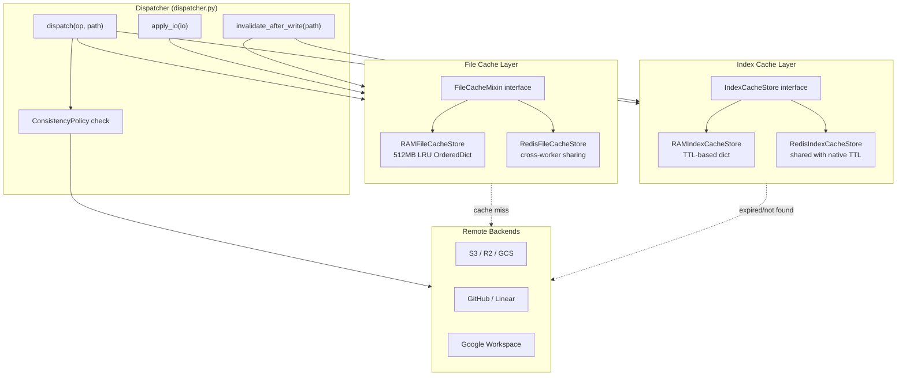
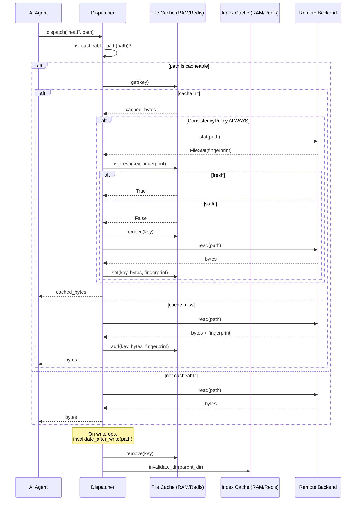
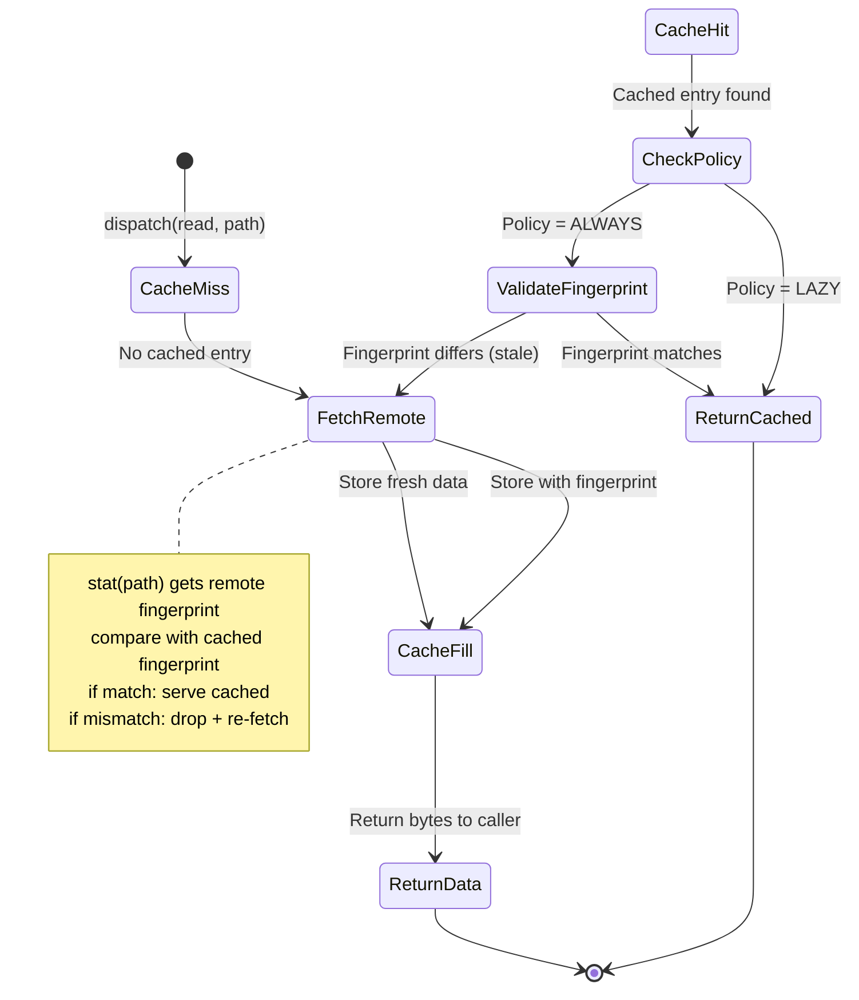

# Cache Architecture — Two-Layer Caching with RAM and Redis Backends

Mirage uses a **two-layer cache architecture** to minimize redundant API calls to remote backends: the **File Cache** stores actual file content (object bytes) with LRU eviction and fingerprint validation, while the **Index Cache** stores directory listing metadata (entry names, sizes, modification times) with TTL-based expiration. Both layers support two backends — in-process RAM for single-worker use, and Redis for cross-worker and cross-machine cache sharing. The Dispatcher coordinates cache lookups before hitting remote backends, and writes automatically invalidate affected cache entries.

Source: `python/mirage/cache/` (file cache + index cache), `python/mirage/types.py` (ConsistencyPolicy), `python/mirage/workspace/dispatcher.py` (cache coordination). TypeScript equivalents: `typescript/packages/core/src/cache/`, `typescript/packages/node/src/cache/`.

## Cache Architecture Overview



## Two-Layer Cache: Why Both?

The file cache and index cache serve fundamentally different purposes:

| Layer | What It Caches | Key Size | Eviction | Backend |
|-------|---------------|----------|----------|---------|
| **File Cache** | Raw file bytes (`bytes`/`Uint8Array`) | 512MB default (configurable) | LRU when limit exceeded | RAM (OrderedDict/Map) or Redis (key-value) |
| **Index Cache** | Directory listings (`IndexEntry` per path) | Unbounded, TTL-governed | TTL expiration | RAM (dict with expiry) or Redis (keys with native EXPIRE) |

The file cache avoids re-fetching file content that hasn't changed. The index cache avoids re-listing directories whose contents are stable. Both are independently configurable and independently invalidated.

## File Cache Layer

### FileCacheMixin — The Abstract Interface

**File:** `python/mirage/cache/file/mixin.py`

`FileCacheMixin` defines the interface that all file cache backends implement. It is a mixin class with abstract methods, designed to be combined with a resource class (RAMResource or RedisResource).

```python
# python/mirage/cache/file/mixin.py:18-92
class FileCacheMixin:
    """LRU file cache mixin for resources.

    Adds cache tracking (sizes, fingerprints, TTL, LRU order)
    on top of any resource. Data lives in the resource's storage —
    subclass implements the cache methods using resource's store.
    """

    async def get(self, key: str) -> bytes | None:
        raise NotImplementedError

    async def set(self, key: str, data: bytes,
                  fingerprint: str | None = None, ttl: int | None = None) -> None:
        raise NotImplementedError

    async def add(self, key: str, data: bytes,
                  fingerprint: str | None = None, ttl: int | None = None) -> bool:
        raise NotImplementedError

    async def remove(self, key: str) -> None:
        raise NotImplementedError

    async def exists(self, key: str) -> bool:
        raise NotImplementedError

    async def is_fresh(self, key: str, remote_fingerprint: str) -> bool:
        raise NotImplementedError

    async def clear(self) -> None:
        raise NotImplementedError

    def evict_paths(self, paths: Iterable[str]) -> None:
        raise NotImplementedError

    async def all_cached(self, keys: list[str]) -> bool:
        for k in keys:
            if not await self.exists(k):
                return False
        return True

    async def multi_get(self, keys: list[str]) -> list[bytes | None]:
        return [await self.get(k) for k in keys]

    async def multi_set(self, items: list[tuple[str, bytes]],
                        fingerprint: str | None = None, ttl: int | None = None) -> None:
        for key, data in items:
            await self.set(key, data, fingerprint=fingerprint, ttl=ttl)

    @property
    def cache_size(self) -> int:
        raise NotImplementedError

    @property
    def cache_limit(self) -> int:
        raise NotImplementedError
```

The `set` vs `add` distinction is important:
- `set()` — always writes the entry (replaces existing)
- `add()` — only writes if the key doesn't exist or is expired; returns `bool` indicating success

Both accept an optional `fingerprint` parameter for cache validation. If not provided, `default_fingerprint(data)` computes an MD5 hash of the data.

### CacheEntry — Metadata per Cached Item

**File:** `python/mirage/cache/file/entry.py`

```python
# python/mirage/cache/file/entry.py:20-30
class CacheEntry(BaseModel):
    size: int                # bytes
    cached_at: int           # unix timestamp (seconds)
    fingerprint: str | None = None  # MD5 or remote fingerprint (ETag, SHA)
    ttl: int | None = None   # time-to-live in seconds

    @property
    def expired(self) -> bool:
        if self.ttl is None:
            return False
        return (int(time.time()) - self.cached_at) >= self.ttl
```

The `CacheEntry` tracks size for LRU accounting, `cached_at` for TTL expiration, `fingerprint` for freshness validation, and optional `ttl` for per-entry expiration overrides.

### CacheConfig — File Cache Configuration

**File:** `python/mirage/cache/file/config.py`

```python
# python/mirage/cache/file/config.py:20-29
class CacheConfig(BaseModel):
    type: CacheType = CacheType.RAM
    limit: str | int = "512MB"
    max_drain_bytes: int | None = None

class RedisCacheConfig(CacheConfig):
    type: CacheType = CacheType.REDIS
    url: str = "redis://localhost:6379/0"
    key_prefix: str = "mirage:cache:"
```

| Field | Type | Default | Purpose |
|-------|------|---------|---------|
| `type` | `CacheType` | `RAM` | Backend selection |
| `limit` | `str | int` | `"512MB"` | Maximum cache size; parsed by `parse_limit()` |
| `max_drain_bytes` | `int | None` | `None` | Background drain budget; unconsumed streams are drained up to this limit |
| `url` (Redis only) | `str` | `"redis://localhost:6379/0"` | Redis connection URL |
| `key_prefix` (Redis only) | `str` | `"mirage:cache:"` | Redis key namespace prefix |

### RAMFileCacheStore — 512MB In-Process LRU Cache

**File:** `python/mirage/cache/file/ram.py`

`RAMFileCacheStore` is the default file cache backend. It inherits from `RAMResource` (for in-memory file storage), `FileCacheMixin` (for the cache interface), and `KeyLockMixin` (for per-key async locking).

```python
# python/mirage/cache/file/ram.py:27-46
class RAMFileCacheStore(RAMResource, FileCacheMixin, KeyLockMixin):
    """RAMResource with LRU cache tracking.

    Data lives in inherited _store.files (RAMStore).
    _entries tracks LRU metadata only.
    All RAM commands (cat, grep, head, ...) inherited.
    """

    def __init__(
        self,
        cache_limit: str | int = "512MB",
        max_drain_bytes: int | None = None,
    ) -> None:
        super().__init__()
        self._cache_limit: int = parse_limit(cache_limit)
        self._cache_size: int = 0
        self._entries: OrderedDict[str, CacheEntry] = OrderedDict()
        self._drain_tasks: dict[str, asyncio.Task] = {}
        self._clear_lock: asyncio.Lock = asyncio.Lock()
        self.max_drain_bytes: int | None = max_drain_bytes
```

#### Key Internal State

| Field | Type | Purpose |
|-------|------|---------|
| `_cache_limit` | `int` | Byte limit (e.g., `512 * 1024 * 1024 = 536870912`) |
| `_cache_size` | `int` | Current total bytes in cache |
| `_entries` | `OrderedDict[str, CacheEntry]` | LRU tracking — order matters, front = oldest |
| `_drain_tasks` | `dict[str, asyncio.Task]` | Background drain tasks for unconsumed streams |
| `_clear_lock` | `asyncio.Lock` | Serialize `clear()` operations |
| `max_drain_bytes` | `int | None` | Maximum bytes to drain for background caching |

#### LRU Eviction

```python
# python/mirage/cache/file/ram.py:147-156
async def _evict(self) -> None:
    while self._cache_size > self._cache_limit and self._entries:
        evicted_key = next(iter(self._entries))
        async with self._lock_for(evicted_key):
            if evicted_key not in self._entries:
                continue
            evicted = self._entries.pop(evicted_key)
            self._cache_size -= evicted.size
            self._store.files.pop(evicted_key, None)
        self._discard_lock(evicted_key)
```

Eviction pops from the front of the `OrderedDict` (oldest entry, least recently used) and removes the data from the inherited `RAMStore._store.files`. This runs after every `set()` and `add()`.

#### Get with LRU Bump

```python
# python/mirage/cache/file/ram.py:48-59
async def get(self, key: str) -> bytes | None:
    async with self._lock_for(key):
        entry = self._entries.get(key)
        if entry is None:
            return None
        if entry.expired:
            self._cache_size -= entry.size
            del self._entries[key]
            self._store.files.pop(key, None)
            return None
        self._entries.move_to_end(key)
        return self._store.files.get(key)
```

`get()` performs lazy TTL expiration: if the entry's TTL has elapsed, it is removed immediately. On cache hit, `move_to_end()` bumps the entry to the most-recently-used position in the `OrderedDict`.

#### Add vs Set

```python
# python/mirage/cache/file/ram.py:83-107
async def add(self, key: str, data: bytes,
              fingerprint: str | None = None, ttl: int | None = None) -> bool:
    async with self._lock_for(key):
        existing = self._entries.get(key)
        if existing is not None and not existing.expired:
            return False
        if key in self._entries:
            self._cache_size -= self._entries[key].size
            del self._entries[key]
        if fingerprint is None:
            fingerprint = default_fingerprint(data)
        entry = CacheEntry(size=len(data), cached_at=int(time.time()),
                           fingerprint=fingerprint, ttl=ttl)
        self._entries[key] = entry
        self._store.files[key] = data
        self._cache_size += entry.size
    await self._evict()
    return True
```

`add()` returns `False` immediately if an unexpired entry already exists. This is the cache-fill path: the Dispatcher calls `add()` after fetching from a remote backend, and `add()` prevents duplicate fetches when multiple concurrent reads target the same key.

### RedisFileCacheStore — Cross-Worker Cache Sharing

**File:** `python/mirage/cache/file/redis.py`

`RedisFileCacheStore` extends `RedisResource` and stores file content in Redis, enabling multiple workers/processes/machines to share the same cache.

```python
# python/mirage/cache/file/redis.py:22-36
class RedisFileCacheStore(RedisResource, FileCacheMixin):

    def __init__(
        self,
        cache_limit: str | int = "512MB",
        url: str = "redis://localhost:6379/0",
        key_prefix: str = "mirage:cache:",
        max_drain_bytes: int | None = None,
    ) -> None:
        super().__init__(url=url, key_prefix=key_prefix)
        self._cache_limit: int = parse_limit(cache_limit)
        self._cache_client = self._store._client
        self._data_prefix = f"{key_prefix}data:"
        self._meta_prefix = f"{key_prefix}meta:"
        self.max_drain_bytes: int | None = max_drain_bytes
```

#### Redis Key Layout

| Key Pattern | Value | TTL |
|-------------|-------|-----|
| `{key_prefix}data:{key}` | Raw file bytes | Optional (set on `set()`/`add()`) |
| `{key_prefix}meta:{key}` | Fingerprint string | Optional (same as data key) |

#### Atomic Set with Pipeline

```python
# python/mirage/cache/file/redis.py:41-58
async def set(self, key: str, data: bytes,
              fingerprint: str | None = None, ttl: int | None = None) -> None:
    if fingerprint is None:
        fingerprint = default_fingerprint(data)
    pipe = self._cache_client.pipeline()
    dk = f"{self._data_prefix}{key}"
    mk = f"{self._meta_prefix}{key}"
    pipe.set(dk, data)
    pipe.set(mk, fingerprint)
    if ttl is not None:
        pipe.expire(dk, ttl)
        pipe.expire(mk, ttl)
    await pipe.execute()
```

Data and metadata are set atomically via a Redis pipeline. If TTL is specified, both keys expire simultaneously.

#### Freshness Check

```python
# python/mirage/cache/file/redis.py:84-90
async def is_fresh(self, key: str, remote_fingerprint: str) -> bool:
    fp = await self._cache_client.get(f"{self._meta_prefix}{key}")
    if fp is None:
        return False
    if isinstance(fp, bytes):
        fp = fp.decode()
    return fp == remote_fingerprint
```

`is_fresh()` compares the cached fingerprint against the remote fingerprint. This is the core of the consistency validation mechanism.

#### Notable: `cache_size` Always Returns 0

```python
# python/mirage/cache/file/redis.py:111-117
@property
def cache_size(self) -> int:
    return 0

@property
def cache_limit(self) -> int:
    return self._cache_limit
```

Redis tracks its own memory usage, so `cache_size` always returns 0. The `_cache_limit` is still tracked for informational purposes.

#### `evict_paths()` Is a No-Op

```python
# python/mirage/cache/file/redis.py:103-109
def evict_paths(self, paths: Iterable[str]) -> None:
    # No-op: Redis cache holds nothing restored from the snapshot
    # (only RAM caches are repopulated by _restore_cache), and the
    # snapshot load path is sync so we cannot await redis deletes
    # here.
    pass
```

This is intentional: the Redis cache is independent of snapshot restore. When a snapshot is loaded, RAM caches are repopulated but Redis caches are not. `evict_paths()` is a synchronous method called during `Workspace.load` (sync context), and deleting from Redis requires async I/O.

### Cache Lookup Flow



## Index Cache Layer

### IndexCacheStore — The Abstract Interface

**File:** `python/mirage/cache/index/store.py`

```python
# python/mirage/cache/index/store.py:21-53
class IndexCacheStore:
    """Per-resource metadata index for remote resources.

    Abstract base. Maps resource paths to IndexEntry metadata.
    Subclasses implement storage and concurrency.
    """

    async def get(self, resource_path: str) -> LookupResult:
        raise NotImplementedError

    async def put(self, resource_path: str, entry: IndexEntry) -> None:
        raise NotImplementedError

    async def list_dir(self, resource_path: str) -> ListResult:
        raise NotImplementedError

    async def set_dir(self, resource_path: str,
                      entries: list[tuple[str, IndexEntry]],
                      expired_at: datetime | None = None) -> None:
        raise NotImplementedError

    async def invalidate_dir(self, resource_path: str) -> None:
        raise NotImplementedError

    async def clear(self) -> None:
        raise NotImplementedError
```

### IndexEntry — Metadata per Path

**File:** `python/mirage/cache/index/config.py`

```python
# python/mirage/cache/index/config.py:32-51
class ResourceType(str, Enum):
    FILE = "file"
    FOLDER = "folder"

class LookupStatus(str, Enum):
    EXPIRED = "expired"
    NOT_FOUND = "not_found"

class IndexEntry(BaseModel):
    id: str                        # Backend identifier (SHA, ETag, etc.)
    name: str                      # Entry name (basename)
    resource_type: str             # "file" or "folder"
    remote_time: str = ""          # Remote modification time
    index_time: str = ""           # Time cached (ISO format)
    vfs_name: str = ""             # VFS-mapped name (may differ from name)
    size: int | None = None        # Size in bytes
    extra: dict = Field(default_factory=dict)

class LookupResult(BaseModel):
    entry: IndexEntry | None = None
    status: LookupStatus | None = None

class ListResult(BaseModel):
    entries: list[str] | None = None
    status: LookupStatus | None = None
```

### IndexConfig — Index Cache Configuration

```python
# python/mirage/cache/index/config.py:53-61
class IndexConfig(BaseModel):
    type: IndexType = IndexType.RAM
    ttl: float = 600  # 10 minutes default

class RedisIndexConfig(IndexConfig):
    type: IndexType = IndexType.REDIS
    url: str = "redis://localhost:6379/0"
    key_prefix: str = "mirage:index:"
```

### RAMIndexCacheStore — TTL-Based Directory Cache

**File:** `python/mirage/cache/index/ram.py`

```python
# python/mirage/cache/index/ram.py:23-31
class RAMIndexCacheStore(IndexCacheStore, KeyLockMixin):
    """In-memory index cache using plain dicts + asyncio locks."""

    def __init__(self, ttl: float = 600) -> None:
        super().__init__()
        self._ttl = ttl
        self._entries: dict[str, IndexEntry] = {}
        self._children: dict[str, list[str]] = {}
        self._expiry: dict[str, datetime] = {}
```

Three parallel dictionaries:
- `_entries` maps full paths to `IndexEntry` objects
- `_children` maps directory paths to lists of child full paths
- `_expiry` maps directory paths to expiration timestamps

#### set_dir — Batch Directory Storage

```python
# python/mirage/cache/index/ram.py:61-80
async def set_dir(self, resource_path: str,
                  entries: list[tuple[str, IndexEntry]],
                  expired_at: datetime | None = None) -> None:
    async with self._lock_for(resource_path):
        now = datetime.now(timezone.utc)
        exp = expired_at or (now + timedelta(seconds=self._ttl))
        now_iso = now.isoformat()
        prefix = "/" if resource_path == "/" else resource_path + "/"
        child_keys: list[str] = []
        for name, entry in entries:
            full_path = prefix + name
            if not entry.index_time:
                entry = entry.model_copy(update={"index_time": now_iso})
            self._entries[full_path] = entry
            child_keys.append(full_path)
        self._children[resource_path] = child_keys
        self._expiry[resource_path] = exp
```

`set_dir` stores all entries in the directory atomically (within the same lock), builds the children list, and sets the expiration time. Each child entry gets an `index_time` if not already set.

#### list_dir — TTL-Aware Directory Listing

```python
# python/mirage/cache/index/ram.py:52-59
async def list_dir(self, resource_path: str) -> ListResult:
    exp = self._expiry.get(resource_path)
    if exp is None:
        return ListResult(status=LookupStatus.NOT_FOUND)
    if datetime.now(timezone.utc) > exp:
        return ListResult(status=LookupStatus.EXPIRED)
    children = self._children.get(resource_path)
    return ListResult(entries=children or [])
```

`list_dir` checks the expiration dictionary first. If the TTL has elapsed, it returns `EXPIRED`, signaling the caller to re-fetch from the remote backend.

#### invalidate_dir — Cascade Invalidation

```python
# python/mirage/cache/index/ram.py:82-86
async def invalidate_dir(self, resource_path: str) -> None:
    for child in self._children.get(resource_path, []):
        self._entries.pop(child, None)
    self._expiry.pop(resource_path, None)
    self._children.pop(resource_path, None)
```

When a file is written, its parent directory's index is invalidated. This cascades: all child entries are removed, the directory's expiry is cleared, and the children list is deleted. The next `list_dir` or `get` will be a cache miss, forcing a re-fetch from the remote.

### RedisIndexCacheStore — Shared Index Cache

**File:** `python/mirage/cache/index/redis.py`

```python
# python/mirage/cache/index/redis.py:31-66
class RedisIndexCacheStore(IndexCacheStore):
    """Redis-backed index cache for remote resource metadata.

    Stores IndexEntry objects as JSON strings and directory children as
    Redis lists. Directory TTL is managed via native Redis key expiration.
    All writes within set_dir are batched in a single pipeline for efficiency.

    Multiple stores can share one Redis server by using distinct key_prefix
    values (e.g. "gdrive:", "s3:"). The full key layout is::

        {key_prefix}mirage:idx:entry:{resource_path}     -> JSON string
        {key_prefix}mirage:idx:children:{resource_path}  -> Redis list
    """

    def __init__(self, ttl: float = 600, url: str = "redis://localhost:6379/0",
                 client: Redis | None = None, key_prefix: str = "") -> None:
        self._ttl = ttl
        self._client = client or Redis.from_url(url, decode_responses=True)
        self._owns_client = client is None
        p = key_prefix or ""
        self._entry_prefix = f"{p}{ENTRY_PREFIX}"
        self._children_prefix = f"{p}{CHILDREN_PREFIX}"
```

#### Atomic set_dir with Pipeline

```python
# python/mirage/cache/index/redis.py:104-134
async def set_dir(self, resource_path: str,
                  entries: list[tuple[str, IndexEntry]],
                  expired_at: datetime | None = None) -> None:
    now = datetime.now(timezone.utc)
    now_iso = now.isoformat()
    prefix = "/" if resource_path == "/" else resource_path + "/"

    pipe = self._client.pipeline()
    child_keys: list[str] = []
    for name, entry in entries:
        full_path = prefix + name
        if not entry.index_time:
            entry = entry.model_copy(update={"index_time": now_iso})
        pipe.set(self._entry_key(full_path), entry.model_dump_json())
        child_keys.append(full_path)

    children_key = self._children_key(resource_path)
    pipe.delete(children_key)
    if child_keys:
        pipe.rpush(children_key, *child_keys)

    if expired_at:
        ttl_seconds = max(1, int((expired_at - now).total_seconds()))
    else:
        ttl_seconds = max(1, int(self._ttl))
    pipe.expire(children_key, ttl_seconds)

    await pipe.execute()
```

All operations are batched in a single pipeline: set each entry as JSON, delete and rebuild the children list, set TTL on the children key. The children key's TTL drives expiration; when it expires, `list_dir` returns `NOT_FOUND`.

#### list_dir with Native TTL Check

```python
# python/mirage/cache/index/redis.py:93-102
async def list_dir(self, resource_path: str) -> ListResult:
    key = self._children_key(resource_path)
    exists = await self._client.exists(key)
    if not exists:
        return ListResult(status=LookupStatus.NOT_FOUND)
    ttl_remaining = await self._client.ttl(key)
    if ttl_remaining == -2:
        return ListResult(status=LookupStatus.EXPIRED)
    raw = await self._client.lrange(key, 0, -1)
    return ListResult(entries=raw)
```

Redis TTL is checked via `TTL` command. `-2` means the key does not exist (expired), `-1` means no TTL set.

## ConsistencyPolicy — Cache Validation Strategies

**File:** `python/mirage/types.py:70-72`

```python
class ConsistencyPolicy(str, Enum):
    LAZY = "lazy"
    ALWAYS = "always"
```

The `ConsistencyPolicy` enum controls how aggressively the Dispatcher validates cached entries against remote backends.

| Policy | Behavior | When to Use | Trade-off |
|--------|----------|-------------|-----------|
| `LAZY` | Validate only on cache miss (check fingerprint). If cached, trust it. | Default. Good for most workloads where files change infrequently. | May serve stale data if the remote changes between reads. |
| `ALWAYS` | Validate every read against the remote fingerprint. If stale, drop cache and re-fetch. | When data freshness is critical (e.g., CI/CD pipelines, collaborative editing). | Every read requires a `stat()` call to the remote, adding latency. |

### How Fingerprints Enable Cache Validation

Fingerprints are stable identifiers that distinguish content versions:

| Resource | Fingerprint Source | Example |
|----------|-------------------|---------|
| S3 / R2 / GCS | ETag from `stat().extra["etag"]` | `"d41d8cd98f00b204e9800998ecf8427e"` |
| GitHub | Git commit SHA | `"a1b2c3d4e5f6..."` |
| Google Drive | `remote_time` from index cache | `"2026-07-08T15:30:00Z"` |
| HuggingFace | File hash from HF API | `"sha256:abc123..."` |
| Local (disk/ram) | MD5 of content | `"d41d8cd98f00b204e9800998ecf8427e"` |

The `default_fingerprint` function (in `cache/file/utils.py`) computes MD5 for data without a remote fingerprint:

```python
# python/mirage/cache/file/utils.py:28-29
def default_fingerprint(data: bytes) -> str:
    return hashlib.md5(data).hexdigest()
```

### Consistency Policy State Machine



### DriftPolicy — Snapshot Replay Validation

**File:** `python/mirage/types.py:209-218`

```python
class DriftPolicy(StrEnum):
    """Behaviour when a remote resource's live fingerprint differs from
    the value recorded at snapshot time.

    Values:
        STRICT: raise ContentDriftError on mismatch (default).
        OFF: skip drift checks entirely.
    """
    STRICT = "strict"
    OFF = "off"
```

`DriftPolicy` is related to but distinct from `ConsistencyPolicy`. While `ConsistencyPolicy` governs runtime cache validation, `DriftPolicy` governs what happens when a snapshot is loaded and the remote resource's current fingerprint differs from what was recorded at snapshot time. `STRICT` raises an error (ensuring byte-exact replay), while `OFF` allows drift (returning current remote content).

## Cache Invalidation on Writes

### Dispatcher: `invalidate_after_write_by_path`

**File:** `python/mirage/workspace/dispatcher.py`

The Dispatcher coordinates cache invalidation after write operations:

```python
# Dispatch constants
_DISPATCH_READ_OPS = frozenset({"read", "read_bytes"})
_DISPATCH_WRITE_OPS = frozenset({"write", "write_bytes", "append", "unlink", "create", "truncate"})
```

The write invalidation flow:

1. **File cache invalidation:** `cache.remove(key)` drops the cached bytes for the written path
2. **Index cache invalidation:** `index_cache.invalidate_dir(parent_dir)` drops the parent directory's cached listing

This ensures that after a write:
- The next read of the same path fetches fresh content from the remote
- The next listing of the parent directory re-fetches the directory listing (reflecting any renames, creations, or deletions)

### ops.py: `_invalidate` Callback

**File:** `python/mirage/ops/ops.py:124-126`

```python
async def _invalidate(self, path: str) -> None:
    if self._on_write is not None:
        await self._on_write(path)
```

The `Ops` class accepts an `on_write` callback that is invoked after every write operation. The Dispatcher wires this callback to trigger cache invalidation.

## Drain Tasks — Async Streaming of Large Files

**File:** `python/mirage/cache/file/io.py`

When a large file is read but not fully consumed (e.g., the agent reads the first 100 lines of a 10MB log file), the remaining content can be drained asynchronously and cached for future reads:

```python
# python/mirage/cache/file/io.py:25-59
async def apply_io(
    cache: FileCacheMixin,
    io: IOResult,
    is_cacheable: Callable[[str], bool] | None = None,
) -> None:
    cache_set = set(io.cache)
    max_bytes = getattr(cache, "max_drain_bytes", None)
    for path in io.cache:
        if is_cacheable is not None and not is_cacheable(path):
            continue
        data = io.reads.get(path)
        if data is None:
            data = io.writes.get(path)
        if data is None:
            continue
        if isinstance(data, bytes):
            await cache.set(path, data)
        elif isinstance(data, CachableAsyncIterator):
            if data.exhausted:
                await cache.set(path, b"".join(data._buffer))
            else:
                if (hasattr(cache, "_drain_tasks")
                        and path not in cache._drain_tasks
                        and not await cache.exists(path)):
                    task = asyncio.create_task(
                        _background_drain(cache, path, data, max_bytes))
                    cache._drain_tasks[path] = task
                    task.add_done_callback(
                        lambda t, p=path: cache._drain_tasks.pop(p, None))
    for path in io.writes:
        if path in cache_set:
            continue
        if is_cacheable is not None and not is_cacheable(path):
            continue
        await cache.remove(path)
```

### `_background_drain`

```python
# python/mirage/cache/file/io.py:62-90
async def _background_drain(
    cache: FileCacheMixin,
    path: str,
    it: CachableAsyncIterator,
    max_bytes: int | None = None,
) -> None:
    """Drain an unconsumed stream and write to cache.

    Cancelled by workspace.close() if the stream is still draining at
    shutdown. If max_bytes is set and the drain exceeds it without
    exhausting the source, the partial buffer is discarded and the path
    is not cached (next read will fetch fresh from the resource).
    """
    try:
        if max_bytes is None:
            materialized = await it.drain()
            await cache.add(path, materialized)
            return
        materialized, fully_drained = await it.drain_bounded(max_bytes)
        if fully_drained:
            await cache.add(path, materialized)
        else:
            logger.info("cache drain budget exceeded for %s "
                        "(>%d bytes), skipping cache fill", path, max_bytes)
    except asyncio.CancelledError:
        logger.warning("background drain cancelled for %s", path)
    except Exception:
        logger.warning("background drain failed for %s", path, exc_info=True)
```

The drain mechanism is important for performance:
- If an agent reads a 100MB file but only consumes the first 1MB, the remaining 99MB is drained asynchronously
- `max_drain_bytes` prevents unbounded background caching: if the unconsumed portion exceeds the budget, it is discarded rather than cached
- Drain tasks are tracked in `_drain_tasks` and cancelled on `clear()` or `workspace.close()`
- Python has background drain support; the TypeScript version does not (simpler `applyIo` materializes and caches without async draining)

**Aha:** The background drain mechanism is a brilliant example of **speculative caching with bounded risk**. Instead of forcing the agent to consume the entire stream to benefit from caching (or caching nothing), Mirage caches whatever is unconsumed up to a configurable budget. The risk is bounded: at most `max_drain_bytes` of extra data per path is fetched asynchronously. The reward is significant: the next read of the same path is served from cache with zero remote API calls. The partial drain discard policy (`fully_drained` check) prevents caching incomplete data that could confuse the agent on subsequent reads.

## Dispatcher — Cache Coordination Before Remote Hits

**File:** `python/mirage/workspace/dispatcher.py`

The Dispatcher is the central coordinator that decides whether to serve from cache or hit the remote backend. Its `dispatch` method:

1. **Resolves the mount** for the given path
2. **Checks cacheability**: Only remote mounts with cacheable paths are cached
3. **For read ops**: Checks the file cache first
4. **For `ALWAYS` policy**: Validates fingerprint against remote `stat()`
5. **For cache miss or stale**: Fetches from remote and populates cache
6. **For write ops**: Invalidates affected cache entries after the operation
7. **Records I/O** in an `IOResult` for snapshot tracking

### `is_cacheable_path`

The Dispatcher filters which paths should be cached. Temporary files, log files, and certain patterns may be excluded to prevent cache pollution.

### `invalidate_index_dirs`

After write operations, the Dispatcher calls `invalidate_index_dirs(io)` to drop the parent directory's cached listing from the index cache. This ensures subsequent `readdir` calls return fresh directory listings reflecting the write.

## Cross-Worker Cache Sharing via Redis

Both the file cache and index cache support Redis backends, enabling multiple Mirage instances (different workers, processes, or machines) to share cached data:

| Cache Layer | Redis Key Pattern | Sharing Benefit |
|-------------|------------------|-----------------|
| File Cache | `{key_prefix}data:{path}` → bytes, `{key_prefix}meta:{path}` → fingerprint | Worker A's cached file content is available to Worker B without a remote API call |
| Index Cache | `{key_prefix}mirage:idx:entry:{path}` → JSON, `{key_prefix}mirage:idx:children:{path}` → list | Worker A's cached directory listing is available to Worker B |

The `key_prefix` parameter allows multiple workspaces or resource types to share a single Redis instance without key collisions. For example:
- Workspace 1 uses `key_prefix="ws1:s3:"`
- Workspace 2 uses `key_prefix="ws2:gdrive:"`

### Python vs TypeScript Cache Differences

| Feature | Python | TypeScript |
|---------|--------|------------|
| File locking | `asyncio.Lock` per key (`KeyLockMixin`) | Promise-chain tail pattern (`KeyLock` class) |
| Background drain | Yes (`_background_drain`, `_drain_tasks`) | No (simpler `applyIo`) |
| LRU bump in `get()` | `OrderedDict.move_to_end()` | delete + reinsert in `Map` |
| Index child sorting | Not sorted | Sorted in `set_dir` and `list_dir` |
| Redis index `invalidate_dir` | Deletes children entries + key | Deletes children key only |
| Snapshot restore helpers | None on `RAMFileCacheStore` | `snapshotEntries()` + `loadEntry()` on TS `RAMFileCacheStore` |
| Redis file cache location | `cache/file/redis.py` | `node/src/cache/redis/file.ts` |
| Lazy Redis client | Eager in constructor | Lazy via `client()` + `loadOptionalPeer` |
| `cache_size` (Redis) | Returns 0 | Returns 0 (readonly property) |

## KeyLockMixin — Per-Key Async Locking

**File:** `python/mirage/cache/lock.py`

```python
# python/mirage/cache/lock.py:18-41
class KeyLockMixin:
    """Per-key async locking for RAM-backed cache stores.

    Provides fine-grained locking so operations on different keys
    run concurrently while same-key operations are serialized.

    Only for in-process RAM stores. Redis/SQLite backends handle
    concurrency natively and do not need this mixin.
    """

    def __init__(self, **kwargs) -> None:
        super().__init__(**kwargs)
        self._key_locks: dict[str, asyncio.Lock] = {}

    def _lock_for(self, key: str) -> asyncio.Lock:
        if key not in self._key_locks:
            self._key_locks[key] = asyncio.Lock()
        return self._key_locks[key]

    def _discard_lock(self, key: str) -> None:
        self._key_locks.pop(key, None)

    def _clear_locks(self) -> None:
        self._key_locks.clear()
```

Per-key locking is critical for the RAM cache: it allows concurrent operations on different keys (e.g., reading `/a.txt` and `/b.txt` simultaneously) while serializing operations on the same key (e.g., two concurrent reads of `/a.txt` both check the cache, one misses and fetches, the other waits and finds the populated entry).

## parse_limit — Human-Readable Size Parsing

**File:** `python/mirage/cache/file/utils.py`

```python
# python/mirage/cache/file/utils.py:18-25
def parse_limit(limit: str | int) -> int:
    if isinstance(limit, int):
        return limit
    s = limit.strip().upper()
    for suffix, mult in [("GB", 1 << 30), ("MB", 1 << 20), ("KB", 1 << 10)]:
        if s.endswith(suffix):
            return int(s[:-len(suffix)]) * mult
    return int(s)
```

Supports `"512MB"`, `"1GB"`, `"256KB"`, or raw integers. This is used to parse the `CacheConfig.limit` field.

## Cache State Keys

**File:** `python/mirage/types.py:237-246`

```python
class CacheKey(StrEnum):
    LIMIT = "limit"
    MAX_DRAIN_BYTES = "max_drain_bytes"
    ENTRIES = "entries"
    KEY = "key"
    DATA = "data"
    FINGERPRINT = "fingerprint"
    TTL = "ttl"
    CACHED_AT = "cached_at"
    SIZE = "size"
```

These keys are used when serializing cache state for snapshot/replay operations.

## Cache Integration with Resources

Each `BaseResource` has its own `IndexCacheStore` instance, configured via `set_index()`:

**File:** `python/mirage/resource/base.py:61-74`

```python
def set_index(self, config: IndexConfig | None = None) -> None:
    cfg = config or IndexConfig(ttl=self.index_ttl)
    if isinstance(cfg, RedisIndexConfig):
        if RedisIndexCacheStore is None:
            raise ImportError(
                "RedisIndexConfig requires the 'redis' extra. "
                "Install with: pip install mirage-ai[redis]")
        self._index = RedisIndexCacheStore(
            ttl=cfg.ttl, url=cfg.url, key_prefix=cfg.key_prefix)
    else:
        self._index = RAMIndexCacheStore(ttl=cfg.ttl)
```

The default TTL is `index_ttl = 600` (10 minutes). Resources can override this (e.g., `RAMResource` uses `index_ttl = 0` since local resources don't need caching).

The file cache is separate from the index cache. The file cache is provided by the Dispatcher/workspace layer, not by the resource itself. This separation allows the workspace to control file caching globally (RAM vs Redis, limit, drain budget) while each resource controls its own index caching (TTL, RAM vs Redis).

## Cross-References

- [02-workspace-core.md](02-workspace-core.md) — Workspace, Dispatcher, and Mount orchestration that coordinates cache lookups
- [05-resource-model.md](05-resource-model.md) — Resource model: how each resource configures its index cache via `set_index()` and `index_ttl`
- [11-snapshot-replay.md](11-snapshot-replay.md) — Snapshot serialization includes cache state; drift detection uses fingerprints
- [07-object-storage.md](07-object-storage.md) — Object storage resources populate ETags as fingerprints for cache validation
