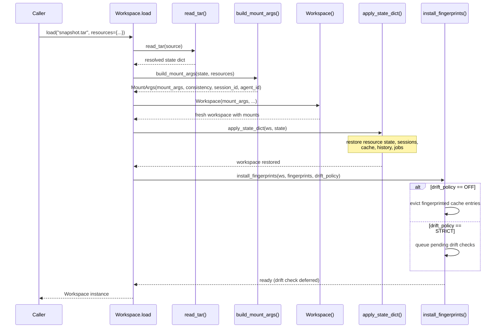
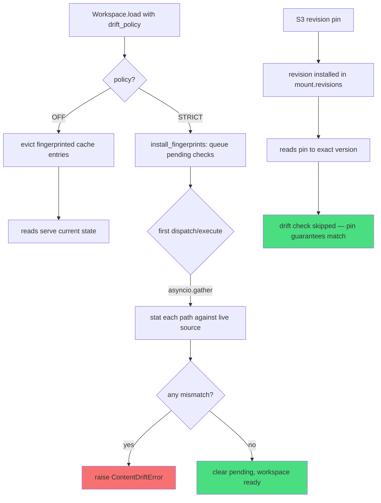

# 11 — Snapshot & Replay: Workspace Serialization, Drift Detection, and Revision Pins

Mirage workspaces are ephemeral in-process objects — until they are not. The snapshot system captures a complete serialized representation of a workspace (mounts, sessions, cache, history, fingerprints) into a single tar archive, then reconstructs it faithfully with drift detection to guarantee the replayed agent sees the same bytes the original did. This document covers every public API, the tar format, drift policies, revision pins for S3, and the copy() path for branching workspace state.

Source: `python/mirage/workspace/snapshot/` (8 files) and `typescript/packages/core/src/snapshot/` (2 files).

---

## 11.1 The Snapshot Lifecycle

A snapshot is not a backup. It is a replayable reconstruction of everything an AI agent touched during a session. The lifecycle has four stages: capture, serialize, load, and validate.

```mermaid
flowchart TD
    A[Workspace with live mounts] -->|to_state_dict(ws)| B[State dict]
    B -->|split_manifest_and_blobs| C{manifest + blobs}
    C -->|write_tar| D[tar archive]
    D -->|read_tar| E[resolved state dict]
    E -->|build_mount_args| F[mount constructor inputs]
    F -->|Workspace()| G[fresh Workspace]
    G -->|apply_state_dict| H[restored workspace]
    H -->|install_fingerprints| I{drift_policy}
    I -->|STRICT| J[pending drift checks]
    I -->|OFF| K[evict fingerprinted cache entries]
    J -->|first dispatch/execute| L[asyncio.gather stat calls]
    L -->|mismatch| M[ContentDriftError]
    L -->|all match| N[workspace ready]
    K --> N
```

The critical design decision: **snapshot() does not construct a Workspace, and load() does the construction**. This keeps the dependency direction unidirectional: `workspace -> snapshot`, never the reverse. The snapshot module is pure data transformation.

---

## 11.2 to_state_dict(): What Gets Serialized

Source: `python/mirage/workspace/snapshot/state.py:38-94`

```python
def to_state_dict(ws) -> dict:
    auto_prefixes = {"/dev/"}
    if ws.observer is not None:
        auto_prefixes.add(norm_mount_prefix(ws.observer.prefix))

    mounts_state = []
    for idx, m in enumerate(mt for mt in ws._registry.mounts()
                            if mt.prefix not in auto_prefixes):
        mounts_state.append({
            MountKey.INDEX: idx,
            MountKey.PREFIX: m.prefix,
            MountKey.MODE: m.mode.value,
            MountKey.CONSISTENCY: m.consistency.value,
            MountKey.RESOURCE_CLASS:
            f"{type(m.resource).__module__}.{type(m.resource).__name__}",
            MountKey.RESOURCE_STATE: m.resource.get_state(),
        })

    # ... cache, history, jobs, fingerprints ...
    return {
        StateKey.VERSION: FORMAT_VERSION,          # 2
        StateKey.MIRAGE_VERSION: _mirage_version(),
        StateKey.MOUNTS: mounts_state,
        StateKey.SESSIONS: [s.to_dict() for s in ws._session_mgr.list()],
        StateKey.DEFAULT_SESSION_ID: ws._session_mgr.default_id,
        StateKey.DEFAULT_AGENT_ID: ws._default_agent_id,
        StateKey.CURRENT_AGENT_ID: ws._current_agent_id,
        StateKey.CACHE: { ... cache_entries ... },
        StateKey.HISTORY: history_records,
        StateKey.JOBS: finished_jobs,
        StateKey.FINGERPRINTS: fingerprints,
        StateKey.LIVE_ONLY_MOUNTS: live_only_mounts,
    }
```

### Serialized Components

| Key | Contents | Notes |
|---|---|---|
| `version` | Format version (currently `2`) | Backwards compatibility gate |
| `mirage_version` | `importlib.metadata.version("mirage")` | Audit trail |
| `mounts` | Per-mount: prefix, mode, consistency, resource class, resource state | Auto-mounts (`/dev/`, observer) excluded |
| `sessions` | All sessions with `session_id`, `cwd`, `env`, `created_at` | See [Session Serialization](#116-session-serialization) |
| `default_session_id` | The default session identifier | |
| `default_agent_id` / `current_agent_id` | Agent identifiers | |
| `cache` | Cache limit, max_drain_bytes, entries with data/fingerprint/ttl/size | Only RAM cache entries; Redis backends skip |
| `history` | Execution records with command, stdout/stdin, exit_code, tree, timestamp | `bytes` replaced with blob refs |
| `jobs` | Finished jobs only (status != `RUNNING`) | Running jobs are inherently non-serializable |
| `fingerprints` | Per-read fingerprint/revision entries | From `ws._ops.records`, not live stat |
| `live_only_mounts` | Prefixes of mounts with `SUPPORTS_SNAPSHOT=False` | Gmail, Slack, Linear, etc. |

### What Does NOT Get Captured

- **Live-only mounts** (`SUPPORTS_SNAPSHOT=False`): Gmail, Slack, Linear, Discord. Their prefixes are listed in `live_only_mounts` so load can log a warning. At replay time, reads against these mounts serve current state with no drift detection.
- **Untouched files**: If the agent never read or wrote a file on a RAM/Disk mount, it is not in the snapshot. The tar contains only what the agent touched.
- **Original remote bytes**: The snapshot does not fetch and store the raw bytes of every remote object. Recovery of original bytes works only when the resource accepts a revision pin (S3 VersionId today) and the recorded revision still exists on the source.
- **Running jobs**: Only finished jobs are serialized. Running processes cannot be checkpointed.
- **`/dev/` mount and observer mount**: These are infrastructure, not user data.

---

## 11.3 snapshot(): The Entry Point

Source: `python/mirage/workspace/snapshot/api.py:20-41`

```python
async def snapshot(ws, target, *, compress: str | None = None) -> None:
    """Serialize a Workspace to a tar archive.

    Fingerprints come from ``ws._ops.records`` (each read carries the
    backend's version marker captured at the moment of the read), so
    no live network round-trips are needed at snapshot time. Kept as
    ``async def`` for API stability and future-proofing.
    """
    state = to_state_dict(ws)
    manifest, blobs = split_manifest_and_blobs(state)
    write_tar(target, manifest, blobs, compress=compress)
```

**Key design**: `snapshot()` is `async def` but performs no `await`. Fingerprints are already captured in `ws._ops.records` at read time — no live stat calls are needed. The async signature is for API stability and future-proofing (if fingerprint capture ever needs network calls, the signature won't break).

### Compression Options

Source: `python/mirage/workspace/snapshot/tar_io.py:24`

```python
_COMPRESS_MODES = {None: "w", "gz": "w:gz", "bz2": "w:bz2", "xz": "w:xz"}
```

| Value | Tar mode | Use case |
|---|---|---|
| `None` | `w` (uncompressed) | Fastest, largest. Good for local replay. |
| `"gz"` | `w:gz` (gzip) | Balance of speed and size. Default choice. |
| `"bz2"` | `w:bz2` (bzip2) | Better compression, slower. |
| `"xz"` | `w:xz` (LZMA) | Best compression, slowest. For archival. |

The `target` parameter accepts either a filesystem path (str/Path) or a writable file-like object (BytesIO). This enables in-memory snapshots for testing or network upload.

---

## 11.4 Manifest and Blob Separation

Source: `python/mirage/workspace/snapshot/manifest.py:38-85`

Large binary data (cache entries, job stdout/stderr, history stdout, RAM file contents) are split out of the JSON manifest into separate blob files inside the tar. The manifest references them with `{__file: "tar/path"}` markers.

```python
BLOB_REF_KEY = "__file"   # python/mirage/workspace/snapshot/utils.py:17
```

### Blob Allocation

Source: `python/mirage/workspace/snapshot/manifest.py:20-35`

```python
class _BlobAllocator:
    """Mints unique blob filenames per category and collects their bytes.

    `alloc("_cache") -> "_cache/0.bin"` on first call, "_cache/1.bin" next.
    """
    def alloc(self, category: str) -> str:
        i = self._counters.get(category, 0)
        self._counters[category] = i + 1
        return f"{category}/{i}.bin"
```

### Blob Categories and Tar Layout

```
manifest.json                    # JSON manifest (all metadata, blob refs)
cache/blobs/0.bin                # RAM cache entry data
cache/blobs/1.bin
history/blobs/0.bin              # History stdout/stdin/stderr
history/blobs/1.bin
jobs/blobs/0.bin                 # Job stdout/stderr
jobs/blobs/1.bin
mounts/0/files/0.bin             # RAM mount #0 file data (flat naming)
mounts/0/files/1.bin
mounts/1/files/src/main.py       # DISK mount #1 files (tree-preserving)
mounts/1/files/src/utils.py
mounts/2/data/0.bin              # Redis mount #2 key-value data
```

**RAM mounts** use flat naming (`0.bin`, `1.bin`) because RAM resources are key-value stores without directory structure. **DISK mounts** preserve the real directory tree because files at `mounts/1/files/src/main.py` can be extracted directly by external tools. **Redis mounts** use flat naming under `data/`.

### _stash_blobs: Replacing Bytes with References

Source: `python/mirage/workspace/snapshot/manifest.py:117-126`

```python
def _stash_blobs(files: dict, a: _BlobAllocator, category: str,
                 tar_dir: str) -> dict:
    """Replace each {key: bytes} with {key: {__file: tar-path}}."""
    out: dict[str, dict] = {}
    for k, data in files.items():
        slot = a.alloc(category).split("/")[-1]
        tar_path = f"{tar_dir}/{slot}"
        a.blobs[tar_path] = data
        out[k] = {BLOB_REF_KEY: tar_path}
    return out
```

This function is called for RAM files, Redis data, history tree stderr, and job stdout/stderr. Every `bytes` value in the state dict is replaced with `{__file: "path/inside/tar"}` so the manifest stays JSON-serializable.

---

## 11.5 Tar I/O: write_tar and read_tar

### write_tar

Source: `python/mirage/workspace/snapshot/tar_io.py:27-56`

```python
def write_tar(target, manifest: dict, blobs: dict[str, bytes],
              *, compress: str | None = None) -> None:
    mode = _COMPRESS_MODES[compress]  # None -> "w", "gz" -> "w:gz", etc.
    if hasattr(target, "write"):
        tar = tarfile.open(fileobj=target, mode=mode)
    else:
        tar = tarfile.open(str(target), mode)
    with tar:
        manifest_bytes = json.dumps(manifest, indent=2,
                                    default=_json_default).encode("utf-8")
        _add(tar, _MANIFEST_NAME, manifest_bytes)
        for tar_path, data in blobs.items():
            _add(tar, tar_path, data)
```

The `_json_default` function (line 103) raises `TypeError` if any `bytes` object leaks into the manifest — a programmer error guard that catches incomplete blob splitting.

### read_tar

Source: `python/mirage/workspace/snapshot/tar_io.py:58-93`

```python
def read_tar(source) -> dict:
    """Read a tar produced by write_tar; return a resolved state dict."""
    if hasattr(source, "read"):
        tar = tarfile.open(fileobj=source, mode="r:*")  # auto-detect compression
    else:
        tar = tarfile.open(str(source), "r:*")
    with tar:
        member = tar.getmember(_MANIFEST_NAME)
        f = tar.extractfile(member)
        manifest = json.loads(f.read().decode("utf-8"))
        return resolve_manifest(manifest, _make_reader(tar))
```

`mode="r:*"` auto-detects compression. The reader function (`_make_reader`, line 78) validates blob paths against `is_safe_blob_path` before extraction, preventing path traversal attacks.

### Path Traversal Protection

Source: `python/mirage/workspace/snapshot/utils.py:20-37`

```python
def is_safe_blob_path(path: str) -> bool:
    """Reject path-traversal and absolute references inside the tar.

    - rejects empty strings
    - rejects absolute paths (leading "/")
    - rejects ".." segments
    - rejects NUL byte (forbidden in tar)
    """
    if not isinstance(path, str) or not path:
        return False
    if path.startswith("/"):
        return False
    if "\x00" in path:
        return False
    return ".." not in path.split("/")
```

---

## 11.6 load(): Reconstructing from Tar

Source: `python/mirage/workspace/workspace.py:330-365`

```python
@classmethod
def load(cls, source, *, resources: dict | None = None,
         drift_policy: DriftPolicy = DriftPolicy.STRICT) -> "Workspace":
    """Reconstruct a Workspace from a tar.

    For every recorded read:
    1. If the manifest entry carries a ``revision`` (e.g. S3 VersionId),
       install it into ``mount.revisions``. Replay reads pin to that revision.
    2. If the entry carries only a ``fingerprint`` (no stable revision),
       queue a drift check. STRICT raises ContentDriftError on mismatch.

    Drift check is eager (fires once on the first dispatch or execute).
    """
    return cls.from_state(read_tar(source),
                          resources=resources,
                          drift_policy=drift_policy)
```

### Load Flow (Step by Step)



### _from_state: Internal Construction

Source: `python/mirage/workspace/workspace.py:425-436`

```python
@classmethod
def _from_state(cls, state: dict, *, resources: dict | None = None) -> "Workspace":
    args = build_mount_args(state, resources)
    ws = cls(args.mount_args,
             consistency=args.consistency,
             session_id=args.default_session_id,
             agent_id=args.default_agent_id)
    apply_state_dict(ws, state)
    return ws
```

---

## 11.7 build_mount_args(): Translating State to Constructor Inputs

Source: `python/mirage/workspace/snapshot/state.py:97-139`

```python
def build_mount_args(state: dict, resources: dict | None = None) -> MountArgs:
    """Translate a state dict into Workspace constructor inputs.

    Validates that every mount with redacted secrets has a resource override.
    Does NOT construct a Workspace — that's the caller's job.

    Raises:
        ValueError: if any redacted mount lacks an override, or
            if the snapshot is from an unsupported format version.
    """
    saved_version = state.get(StateKey.VERSION)
    if saved_version is not None and saved_version < FORMAT_VERSION:
        raise ValueError(f"snapshot format v{saved_version} not supported "
                         f"(loader expects v{FORMAT_VERSION}); "
                         "regenerate via `mirage workspace snapshot`")

    overrides = {norm_mount_prefix(k): v for k, v in (resources or {}).items()}

    missing = [
        m[MountKey.PREFIX] for m in state[StateKey.MOUNTS]
        if requires_resource_override(m)
        and norm_mount_prefix(m[MountKey.PREFIX]) not in overrides
    ]
    if missing:
        raise ValueError(
            "Workspace.load: resources= must include overrides for: "
            f"{missing}. These mounts were saved with redacted creds "
            "or transient connection state and need fresh resources.")
```

### Resource Override Validation

Source: `python/mirage/workspace/snapshot/state.py:325-329`

```python
def requires_resource_override(mount_state: dict) -> bool:
    resource_state = mount_state[MountKey.RESOURCE_STATE]
    config = resource_state.get(ResourceStateKey.CONFIG)
    config_cls = _config_class_for(_resource_class_for(mount_state))
    return has_redacted_secret(config, config_cls)
```

This checks whether the saved config contains `<REDACTED>` markers (from Pydantic `SecretStr`/`SecretBytes` fields). If so, the caller must provide a fresh resource instance.

### Secret Redaction

Source: `python/mirage/resource/secrets.py:20,29-35`

```python
REDACTED_SECRET = "<REDACTED>"

def redacted_config_dump(config: BaseModel) -> dict[str, Any]:
    data = config.model_dump(mode="json")
    for name in secret_field_names(config):
        if getattr(config, name) is None:
            continue
        data[name] = REDACTED_SECRET
    return data
```

Secrets are redacted at save time via `redacted_config_dump()` (called by each resource's `get_state()`). At load time, `has_redacted_secret()` detects the `<REDACTED>` marker and demands a fresh override. This prevents credentials from leaking into tar files.

### Resource Construction (Fallback)

If no override is provided for a non-secret mount, `_construct_resource()` (line 302-322) builds one:

- **RAM**: `cls()` — empty RAM resource
- **DISK**: `cls(root=tempfile.mkdtemp(prefix="mirage-disk-"))` — fresh temp directory
- **REDIS**: raises `ValueError` — always requires override (connection state is transient)
- **Others**: `cls(config_cls(**config))` if a Config class is found, else `cls()`

---

## 11.8 apply_state_dict(): Restoring Post-Construction State

Source: `python/mirage/workspace/snapshot/state.py:142-168`

```python
def apply_state_dict(ws, state: dict) -> None:
    """Restore post-construction state into an already-built Workspace.

    Restores: resource load_state (content, fresh disk root, etc.),
    sessions, cache entries, history, finished jobs.

    Workspace must already have its mounts constructed via the args
    from build_mount_args. This function is purely additive.
    """
    # load_state runs for ALL mounts
    for m in state[StateKey.MOUNTS]:
        try:
            mount = ws._registry.mount_for_prefix(m[MountKey.PREFIX])
        except ValueError:
            continue
        mount.resource.load_state(m[MountKey.RESOURCE_STATE])

    _restore_sessions(ws, state)
    ws._current_agent_id = state.get(StateKey.CURRENT_AGENT_ID, ws._default_agent_id)
    _restore_cache(ws, state)
    _restore_history(ws, state)
    _restore_jobs(ws, state)
```

### Session Restoration

Source: `python/mirage/workspace/snapshot/state.py:171-184`

```python
def _restore_sessions(ws, state: dict) -> None:
    default_sid = state.get(StateKey.DEFAULT_SESSION_ID)
    for s_data in state.get(StateKey.SESSIONS, []):
        sid = s_data[SessionKey.SESSION_ID]
        if sid == default_sid:
            session = ws._session_mgr.get(sid)  # reuse existing default
        else:
            try:
                session = ws._session_mgr.create(sid)
            except ValueError:
                continue
        session.cwd = s_data.get(SessionKey.CWD, "/")
        session.env = s_data.get(SessionKey.ENV, {})
```

The default session already exists (created in `Workspace.__init__`), so it is reused. Other sessions are created fresh.

### Cache Restoration

Source: `python/mirage/workspace/snapshot/state.py:186-206`

```python
def _restore_cache(ws, state: dict) -> None:
    cache_state = state.get(StateKey.CACHE) or {}
    if hasattr(ws._cache, "max_drain_bytes"):
        ws._cache.max_drain_bytes = cache_state.get(CacheKey.MAX_DRAIN_BYTES)
    cache = ws._cache
    if not hasattr(cache, "_entries") or not hasattr(cache, "_store"):
        # Non-RAM cache backend (e.g. Redis) — skip
        return
    from mirage.cache.file.entry import CacheEntry
    for entry in cache_state.get(CacheKey.ENTRIES, []):
        key = entry[CacheKey.KEY]
        data = entry[CacheKey.DATA]
        cache._store.files[key] = data
        cache._entries[key] = CacheEntry(
            size=entry.get(CacheKey.SIZE, len(data)),
            cached_at=entry.get(CacheKey.CACHED_AT, 0),
            fingerprint=entry.get(CacheKey.FINGERPRINT),
            ttl=entry.get(CacheKey.TTL),
        )
        cache._cache_size += entry.get(CacheKey.SIZE, len(data))
```

Only RAM cache backends are restored. Redis cache entries are skipped because Redis is a shared external service — its content is not part of the snapshot.

### History Restoration

Source: `python/mirage/workspace/snapshot/state.py:209-214`

```python
def _restore_history(ws, state: dict) -> None:
    if not state.get(StateKey.HISTORY) or ws.history is None:
        return
    ws.history._entries = []
    for rec_d in state[StateKey.HISTORY]:
        ws.history.append(_record_from_dict(rec_d))
```

History entries are deserialized via `_record_from_dict()` (line 238-248) and `_node_from_dict()` (line 261-268), reconstructing `ExecutionRecord` and `ExecutionNode` trees.

### Job Restoration

Source: `python/mirage/workspace/snapshot/state.py:217-222`

```python
def _restore_jobs(ws, state: dict) -> None:
    max_id = 0
    for job_d in state.get(StateKey.JOBS, []):
        max_id = max(max_id, job_d.get(JobKey.ID, 0))
        ws.job_table._jobs[job_d[JobKey.ID]] = _job_from_dict(job_d)
    ws.job_table._next_id = max_id + 1
```

The `_next_id` counter is bumped past the highest restored ID so new jobs get unique IDs.

---

## 11.9 from_state(): Direct State Reconstruction (No Tar)

Source: `python/mirage/workspace/workspace.py:367-400`

```python
@classmethod
def from_state(cls, state: dict, *, resources: dict | None = None,
               drift_policy: DriftPolicy = DriftPolicy.STRICT) -> "Workspace":
    """Reconstruct a Workspace directly from a state dict (no tar).

    The in-process inverse of ``to_state_dict``: build the mounts,
    restore content/cache/history, then install drift fingerprints.
    ``load`` is this plus a tar read; callers that already hold a
    state dict (e.g. a version checkout) should use this and skip the
    tar round-trip.
    """
    ws = cls._from_state(state, resources=resources)
    install_fingerprints(ws, state.get(StateKey.FINGERPRINTS) or [], drift_policy)
    live_only = state.get(StateKey.LIVE_ONLY_MOUNTS) or []
    if live_only:
        logger.warning(
            "Workspace.from_state: %s mount(s) opt out of snapshot "
            "replay; reads against them will serve current state with "
            "no drift detection: %s", len(live_only), live_only)
    return ws
```

This is the internal entry point used by `load()` and by version-control systems that already hold a state dict in memory. The only difference from `load()` is the absence of the `read_tar()` step.

---

## 11.10 Drift Detection: STRICT vs OFF

Source: `python/mirage/types.py:209-218`

```python
class DriftPolicy(StrEnum):
    """Behaviour when a remote resource's live fingerprint differs from
    the value recorded at snapshot time.

    STRICT: raise ContentDriftError on mismatch (default).
    OFF: skip drift checks entirely.
    """
    STRICT = "strict"
    OFF = "off"
```

### Drift Detection Flow



### ContentDriftError

Source: `python/mirage/workspace/snapshot/drift.py:22-46`

```python
class ContentDriftError(Exception):
    """Raised at load time when a remote resource's live fingerprint
    differs from what was recorded in the snapshot.

    Indicates the underlying source has been modified since the snapshot
    was taken, so reading current bytes would silently diverge from what
    the original agent saw. Surface to the caller rather than mask.

    Attributes:
        path (str): Virtual path that drifted.
        snapshot_fingerprint (str): Recorded marker.
        live_fingerprint (str | None): Marker observed at load time.
    """

    def __init__(self, path: str, snapshot_fingerprint: str,
                 live_fingerprint: str | None) -> None:
        self.path = path
        self.snapshot_fingerprint = snapshot_fingerprint
        self.live_fingerprint = live_fingerprint
        live_repr = repr(live_fingerprint) if live_fingerprint is not None else "<missing>"
        super().__init__(
            f"{path}: snapshot fingerprint {snapshot_fingerprint!r}, "
            f"live {live_repr}; data on the underlying source has changed "
            "since the snapshot was taken")
```

The error message includes the path, the recorded fingerprint, and the live value (or `<missing>` if the resource no longer exists). This gives operators enough information to diagnose which upstream changed.

### capture_fingerprints: Reading from the Ops Log

Source: `python/mirage/workspace/snapshot/drift.py:49-95`

```python
def capture_fingerprints(ws) -> list[dict]:
    """Walk session ops and emit one entry per distinct read on a
    ``SUPPORTS_SNAPSHOT`` mount.

    Pure aggregation over ``ws._ops.records``. Each read ``OpRecord``
    carries the ``fingerprint`` and/or ``revision`` the backend
    returned at the moment the agent read the bytes.
    """
    seen: set[str] = set()
    out: list[dict] = []
    for rec in ws._ops.records:
        if rec.op != "read" or rec.path in seen:
            continue
        if rec.fingerprint is None and rec.revision is None:
            continue
        seen.add(rec.path)
        try:
            mount = ws._registry.mount_for(rec.path)
        except ValueError:
            continue
        if not getattr(mount.resource, "SUPPORTS_SNAPSHOT", False):
            continue
        entry = {
            FingerprintKey.PATH: rec.path,
            FingerprintKey.MOUNT_PREFIX: mount.prefix,
        }
        if rec.fingerprint is not None:
            entry[FingerprintKey.FINGERPRINT] = rec.fingerprint
        if rec.revision is not None:
            entry[FingerprintKey.REVISION] = rec.revision
        out.append(entry)
    return out
```

**Critical**: Fingerprints come from the ops log (`ws._ops.records`), not from live stat calls. Each `OpRecord` carries the `fingerprint` (ETag equivalent) and/or `revision` (S3 VersionId) that the backend returned at the moment the agent read the bytes. This avoids the race condition where the upstream changes between snapshot time and the read.

### install_fingerprints: Setting Up Drift Detection Post-Load

Source: `python/mirage/workspace/snapshot/drift.py:98-130`

```python
def install_fingerprints(ws, fingerprint_entries: list[dict],
                         drift_policy: DriftPolicy) -> None:
    """Install snapshot fingerprints/revisions onto a reconstructed ws.

    Revisions pin replay reads to exact backend versions; bare
    fingerprints queue an eager drift check. OFF evicts the snapshot
    cache for fingerprinted paths so reads serve current state.
    """
    ws._drift_policy = drift_policy
    if drift_policy == DriftPolicy.OFF:
        if fingerprint_entries:
            ws._cache.evict_paths(f[FingerprintKey.PATH]
                                  for f in fingerprint_entries)
        return
    for f in fingerprint_entries:
        path = f[FingerprintKey.PATH]
        try:
            mount = ws._registry.mount_for(path)
        except ValueError:
            continue
        revision = f.get(FingerprintKey.REVISION)
        if revision is not None:
            mount.revisions[path] = revision  # pin to exact version
            continue
        fingerprint = f.get(FingerprintKey.FINGERPRINT)
        if fingerprint is not None:
            ws._pending_drift.append((mount, path, fingerprint))
    ws._drift_check_pending = bool(ws._pending_drift)
```

**Revision pins** (e.g., S3 `VersionId`) are installed directly into `mount.revisions`. Replay reads use these pins to fetch the exact byte version. No drift check is needed because the pin guarantees byte-exact replay.

**Bare fingerprints** (ETag-like markers) are queued into `ws._pending_drift` for eager validation on first dispatch/execute.

### check_drift: Validating Fingerprints

Source: `python/mirage/workspace/snapshot/drift.py:149-178`

```python
async def check_drift(ws, path: str, recorded: str) -> None:
    """Stat `path` against its mount and raise ContentDriftError if the
    live fingerprint does not match `recorded`.
    """
    try:
        mount = ws._registry.mount_for(path)
    except ValueError:
        return
    if not getattr(mount.resource, "SUPPORTS_SNAPSHOT", False):
        return
    try:
        stat = await mount.execute_op("stat", path)
    except FileNotFoundError as exc:
        raise ContentDriftError(path, recorded, None) from exc
    live = getattr(stat, "fingerprint", None)
    if live is None:
        return  # resource cannot fingerprint — no observable mismatch
    if live != recorded:
        raise ContentDriftError(path, recorded, live)
```

### Eager Drift Check: First Dispatch/Execute

Source: `python/mirage/workspace/workspace.py:491-525`

```python
async def dispatch(self, op: str, path: PathSpec, **kwargs) -> tuple[Any, IOResult]:
    if self._drift_check_pending:
        await self._run_pending_drift_check()
    return await self._dispatcher.dispatch(op, path, **kwargs)

async def _run_pending_drift_check(self) -> None:
    """Drain the post-load drift check.

    Called once on the first async entry point after Workspace.load.
    Stats every queued (mount, path, expected_fingerprint) triple
    against the live source in parallel via asyncio.gather.
    """
    self._drift_check_pending = False
    if not self._pending_drift:
        return
    checks = [
        check_drift(self, path, fingerprint)
        for _, path, fingerprint in self._pending_drift
    ]
    self._pending_drift.clear()
    results = await asyncio.gather(*checks, return_exceptions=True)
    for r in results:
        if isinstance(r, BaseException):
            raise r
```

The drift check runs in parallel via `asyncio.gather`, so first-op latency does not scale linearly with the number of recorded reads. After the check completes, `_drift_check_pending` is `False` and subsequent dispatches are no-ops.

### Revision Pins: S3 VersionId Guarantees

**Aha:** Revision pins are the key to byte-exact replay. When an S3 mount reads an object, the backend captures both the ETag (`fingerprint`) and the `VersionId` (`revision`). At load time, the `VersionId` is installed into `mount.revisions[path]`. Subsequent reads use a `contextvars.ContextVar` (`revision_for`) to pass the pinned version to the S3 GET request, which returns the exact bytes the original agent saw — even if the object has been modified in the bucket since the snapshot. This is why drift checks are skipped for revision-pinned paths: the pin guarantees byte match by construction.

---

## 11.11 copy(): Async Workspace Cloning with Fingerprint Capture

Source: `python/mirage/workspace/workspace.py:402-423`

```python
async def copy(self) -> "Workspace":
    """Clone this workspace, reusing remote resources where safe."""
    state = to_state_dict(self)
    auto_prefixes = {"/dev/"}
    if self.observer is not None:
        auto_prefixes.add(norm_mount_prefix(self.observer.prefix))
    prefix_to_resource = {
        m.prefix: m.resource
        for m in self._registry.mounts() if m.prefix not in auto_prefixes
    }
    resources = {
        m["prefix"]: prefix_to_resource[m["prefix"]]
        for m in state["mounts"] if requires_resource_override(m)
        and m["prefix"] in prefix_to_resource
    }
    return type(self)._from_state(state, resources=resources)
```

**Key design decisions:**

1. **Remote resources are reused**: S3, Redis, GDrive backends stay shared between original and copy. This avoids creating duplicate connections and keeps credentials in one place.
2. **Local resources are reconstructed fresh**: RAM and Disk mounts get new instances with content restored via `load_state()`. The copy's writes don't clobber the original's data.
3. **Only resources with redacted secrets or transient state get overrides**: `_construct_resource()` creates fresh instances for RAM/Disk, while credential-only resources (S3) reuse the original.
4. **No tar round-trip**: `copy()` uses `to_state_dict()` + `_from_state()` directly, avoiding serialization overhead.

The `__deepcopy__` and `__copy__` methods raise `NotImplementedError` with a message directing users to `await ws.copy()`:

```python
def __deepcopy__(self, memo) -> "Workspace":
    raise NotImplementedError(
        "Workspace.copy is async (it captures fingerprints for replay). "
        "Call `await ws.copy()` directly instead of `copy.deepcopy(ws)`.")
```

---

## 11.12 live_only_mount_prefixes: Non-Replayable Mounts

Source: `python/mirage/workspace/snapshot/drift.py:133-146`

```python
def live_only_mount_prefixes(ws) -> list[str]:
    """Return mount prefixes whose resource opts out of snapshot replay.

    These mounts will serve current state at load time with no drift detection.
    """
    out: list[str] = []
    for m in ws._registry.mounts():
        if m.prefix in {"/dev/", "/.sessions/"}:
            continue
        if not getattr(m.resource, "SUPPORTS_SNAPSHOT", False):
            out.append(m.prefix)
    return out
```

Mounts with `SUPPORTS_SNAPSHOT=False` (Gmail, Slack, Linear, Discord, etc.) are inherently non-replayable because their content is transient and stateful. Their prefixes are listed in the manifest so load can log a warning. At replay time, reads against these mounts serve current state.

---

## 11.13 MirageAbortError: Cancellation During Snapshot Operations

Source: `python/mirage/workspace/abort.py:18-21`

```python
class MirageAbortError(RuntimeError):
    def __init__(self) -> None:
        super().__init__("execute aborted")
```

`MirageAbortError` is raised during `execute()` when a cancellation event is set:

```python
# python/mirage/workspace/workspace.py:617-618
if cancel is not None and cancel.is_set():
    raise MirageAbortError()
```

It is also raised by `cancellable_sleep()` (line 24-42) when an `asyncio.Event` is set during a blocking sleep. The error is caught and re-raised in `execute()` (line 685), bypassing the generic `except Exception` handler so it propagates to the caller.

---

## 11.14 TypeScript Snapshot: Cross-Language Parity

The TypeScript core has equivalent snapshot serialization in `typescript/packages/core/src/snapshot/`.

### persist.ts: JSON-Based Snapshot Encoding

Source: `typescript/packages/core/src/snapshot/persist.ts:59-77`

```typescript
export function encodeSnapshot(state: WorkspaceStateDict): Uint8Array {
  const encoded = encodeBlobs(state)
  const json = JSON.stringify(encoded, null, 2)
  return new TextEncoder().encode(json)
}

export function decodeSnapshot(bytes: Uint8Array): WorkspaceStateDict {
  const json = new TextDecoder().decode(bytes)
  const parsed = JSON.parse(json) as JsonValue
  const decoded = decodeBlobs(parsed) as Record<string, unknown>
  const version = decoded.version
  if (version !== FORMAT_VERSION) {
    throw new Error(
      `snapshot format v${String(version)} not supported ` +
        `(loader expects v${String(FORMAT_VERSION)})`,
    )
  }
  return decoded as unknown as WorkspaceStateDict
}
```

The TypeScript approach uses Base64 encoding for blobs (`__bytes_b64` marker) instead of the Python tar format. This is appropriate for the browser/Node.js environment where tar I/O is less common.

### state.ts: TypeScript State Types

Source: `typescript/packages/core/src/snapshot/state.ts:71-94`

```typescript
export interface FingerprintEntrySnapshot {
  path: string
  mountPrefix: string
  fingerprint?: string | null
  revision?: string | null
}

export interface WorkspaceStateDict {
  version: number
  mounts: MountSnapshot[]
  cache: CacheSnapshot
  history: ExecutionRecordSnapshot[]
  fingerprints?: FingerprintEntrySnapshot[]
  liveOnlyMounts?: string[]
}
```

The TypeScript types mirror the Python state dict structure exactly, ensuring cross-language compatibility.

---

## 11.15 Step-by-Step Walkthrough: Snapshot to Load to Replay

### Step 1: Agent Works in a Workspace

An AI agent interacts with a workspace that has S3 (`/s3/`), RAM (`/ram/`), and Slack (`/slack/`) mounts. It reads `/s3/bucket/config.yaml`, writes to `/ram/notes.md`, and reads a Slack channel.

### Step 2: Snapshot

```python
await ws.snapshot("workspace-snapshot.tar.gz", compress="gz")
```

This produces a tar containing:
- `manifest.json` — mount configs, sessions, history, job records, fingerprint entries
- `mounts/0/files/0.bin` — the RAM notes.md content
- `cache/blobs/0.bin` — cached content from /s3/bucket/config.yaml read
- `fingerprints` entry: `{path: "/s3/bucket/config.yaml", fingerprint: "abc123", revision: "v1-abcd"}`
- `live_only_mounts: ["/slack/"]`

### Step 3: Load (STRICT)

```python
ws = Workspace.load("workspace-snapshot.tar.gz", drift_policy=DriftPolicy.STRICT)
```

1. `read_tar()` extracts and resolves the manifest.
2. `build_mount_args()` validates format version, checks for redacted secrets, constructs mount args.
3. `Workspace()` creates fresh mounts (RAM gets new instance, S3 needs override if redacted).
4. `apply_state_dict()` restores RAM content, cache entries, history, jobs.
5. `install_fingerprints()` installs the S3 `revision: "v1-abcd"` into `mount.revisions["/s3/bucket/config.yaml"]` and logs a warning about `/slack/`.
6. The drift check for the S3 path is skipped (revision pin guarantees match).

### Step 4: Replay Execution

```python
result = await ws.execute("cat /s3/bucket/config.yaml")
```

1. `dispatch()` sees `_drift_check_pending = False` (no pending checks for revision-pinned paths).
2. The read goes through the S3 mount with the `revision` contextvar set to `"v1-abcd"`.
3. S3 GET includes `?versionId=v1-abcd`, returning the exact original bytes.
4. Result matches what the original agent saw.

If the S3 object was modified in the bucket after the snapshot, the revision pin still returns the original version. If the revision was deleted (e.g., bucket versioning disabled), the S3 GET would return a 404, which surfaces as a `FileNotFoundError` to the agent.

---

## 11.16 build_mount_args and MountArgs Dataclass

Source: `python/mirage/workspace/snapshot/config.py:20-30`

```python
@dataclass
class MountArgs:
    """Constructor inputs derived from a state dict.

    Workspace.load uses this to instantiate a fresh Workspace; snapshot
    code never constructs Workspace itself.
    """
    mount_args: dict
    consistency: ConsistencyPolicy
    default_session_id: str
    default_agent_id: str
```

`MountArgs` is the bridge between the snapshot layer and the workspace constructor. The snapshot module produces it; `Workspace._from_state()` consumes it.

---

## 11.17 Format Version and Backwards Compatibility

Source: `python/mirage/workspace/snapshot/utils.py:15`

```python
FORMAT_VERSION = 2
```

The format version is checked at load time:

```python
saved_version = state.get(StateKey.VERSION)
if saved_version is not None and saved_version < FORMAT_VERSION:
    raise ValueError(f"snapshot format v{saved_version} not supported "
                     f"(loader expects v{FORMAT_VERSION}); "
                     "regenerate via `mirage workspace snapshot`")
```

Older snapshots (v1) are not supported. The version bump from v1 to v2 added the `fingerprints` and `live_only_mounts` fields.

---

## Cross-References

- [02-workspace-core.md](02-workspace-core.md) — Workspace lifecycle, Mount, MountRegistry, Session management
- [06-cache-system.md](06-cache-system.md) — File cache (RAM/Redis), cache entries, eviction, drain
- [00-overview.md](00-overview.md) — Mirage architecture overview
