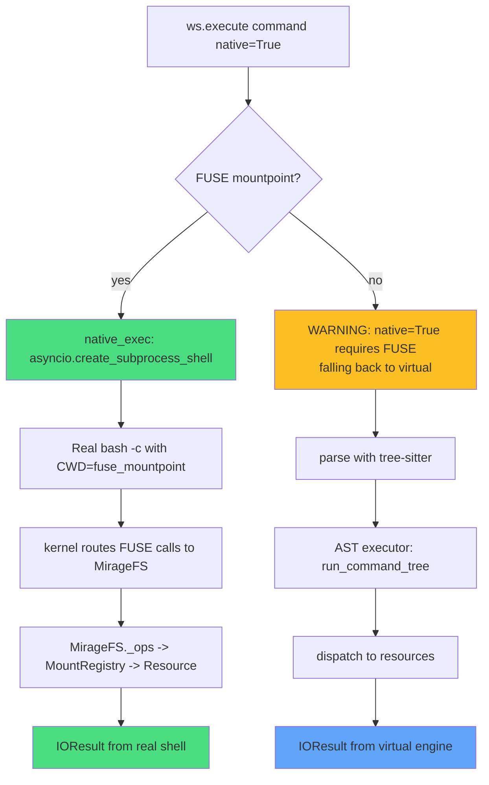
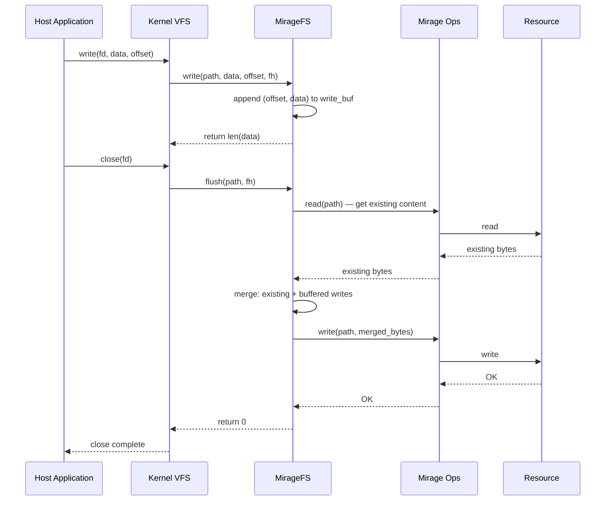

# 12 — FUSE Integration & Native Execution: Exposing VFS to Host Tools

Mirage's FUSE (Filesystem in Userspace) integration exposes the virtual filesystem to the host operating system, allowing editors, LSPs, Claude Code, Codex, and any other native tool to interact with mounted services (S3, Slack, Gmail, GitHub) as if they were real files and directories. When FUSE is available, commands execute against the real kernel filesystem; when unavailable, Mirage falls back to its in-process shell engine. This document covers the Python and TypeScript FUSE implementations, native execution, platform support, and the security implications of native vs virtual execution.

Source: `python/mirage/fuse/` (4 files), `python/mirage/workspace/fuse.py`, `python/mirage/workspace/native.py`, `typescript/packages/node/src/fuse/` (4 files).

---

## 12.1 FUSE Architecture: VFS-to-Host Bridge

FUSE is a kernel module on Linux and macOS (via macFUSE) that allows a userspace process to implement a filesystem. Mirage mounts its virtual filesystem at a host directory path, so any tool that reads/writes files on that path interacts with Mirage resources directly.

```mermaid
flowchart TD
    subgraph "Host Tools"
        A1[VS Code / Vim / Emacs]
        A2[Claude Code / Codex]
        A3[LSPs / grep / find]
        A4[cat / jq / sed / awk]
    end

    subgraph "Kernel VFS Layer"
        B[FUSE kernel module]
    end

    subgraph "Mirage FUSE Daemon"
        C[MirageFS Operations]
        D[_ops layer: stat, read, write]
        E[MountRegistry]
    end

    subgraph "Resources"
        F1[S3 / GCS / R2]
        F2[RAM / Disk]
        F3[Slack / Gmail / GitHub]
        F4[MongoDB / Postgres / Redis]
    end

    A1 --> B
    A2 --> B
    A3 --> B
    A4 --> B
    B -->|FUSE calls| C
    C -->|getattr, read, write| D
    D -->|dispatch| E
    E -->|mount_for(path)| F1
    E --> F2
    E --> F3
    E --> F4
```

The FUSE daemon runs as a background thread (Python) or async task (TypeScript) inside the Mirage process. It translates kernel FUSE calls (`getattr`, `readdir`, `read`, `write`, `create`, `unlink`, `rename`, `rmdir`, `truncate`, `open`, `release`, `flush`) into Mirage operations on the appropriate resource.

---

## 12.2 FuseManager: Setup, Mountpoint Management, and Close

Source: `python/mirage/workspace/fuse.py:19-61`

```python
class FuseManager:

    def __init__(self) -> None:
        self._mountpoint: str | None = None
        self._thread: Thread | None = None
        self._auto: bool = False

    @property
    def mountpoint(self) -> str | None:
        return self._mountpoint

    @mountpoint.setter
    def mountpoint(self, path: str | None) -> None:
        self._mountpoint = path

    def setup(self, ws: object) -> None:
        import tempfile
        from mirage.fuse.mount import mount_background
        self._mountpoint = tempfile.mkdtemp(prefix="mirage-")
        self._thread = mount_background(ws, self._mountpoint)
        self._auto = True

    def unmount(self) -> None:
        if not self._mountpoint:
            return
        import subprocess as _sp
        if sys.platform == "darwin":
            _sp.run(["diskutil", "unmount", "force", self._mountpoint],
                    capture_output=True)
        else:
            _sp.run(["fusermount", "-u", self._mountpoint],
                    capture_output=True)
        try:
            import os as _os
            _os.rmdir(self._mountpoint)
        except OSError:
            pass
        self._mountpoint = None

    def close(self) -> None:
        if self._mountpoint and self._auto:
            self.unmount()
```

### Setup Flow

When `fuse=True` is passed to `Workspace.__init__`:

```python
# python/mirage/workspace/workspace.py:165-166
if fuse:
    self._fuse.setup(self)
```

`setup()` creates a temporary directory (`tempfile.mkdtemp(prefix="mirage-")`) and starts a background thread running the FUSE daemon. The `_auto` flag marks it as automatically managed so `close()` will clean it up.

### Manual Mountpoint Setting

External code can set a specific mountpoint:

```python
ws.set_fuse_mountpoint("/tmp/my-mirage-mount")
```

This is used by the CLI and by integrations that want a predictable path. The `fuse_mountpoint` property exposes it read-only:

```python
# python/mirage/workspace/workspace.py:240-242
@property
def fuse_mountpoint(self) -> str | None:
    return self._fuse.mountpoint
```

---

## 12.3 MirageFS (Python): The FUSE Operations Handler

Source: `python/mirage/fuse/fs.py:36-340`

The Python FUSE handler uses `mfusepy` (a libfuse Python binding) and implements the `fuse.Operations` interface.

### Initialization

```python
class MirageFS(fuse.Operations):
    use_ns = True  # nanosecond timestamps

    def __init__(self, ws_or_ops, agent_id: str | None = None) -> None:
        if isinstance(ws_or_ops, Ops):
            self._ops = ws_or_ops
            self.ws = None
        else:
            self.ws = ws_or_ops
            self._ops = ws_or_ops.ops
        self.agent_id = (agent_id or os.environ.get("MIRAGE_AGENT_ID")
                         or f"agent-{uuid.uuid4().hex[:8]}")
        self._now = time.time_ns()
        self._prefixes = [m.prefix for m in self._ops._mounts]
        self._handles: dict[int, dict] = {}
        self._next_fh = 1
        self._loop = asyncio.new_event_loop()
        self._loop_thread = threading.Thread(target=self._loop.run_forever,
                                             daemon=True)
        self._loop_thread.start()

    def _run(self, coro):
        return run_async_from_sync(coro, self._loop)
```

**Key design**: FUSE operations are synchronous (kernel callbacks), but Mirage ops are async. The solution is a dedicated event loop running in a daemon thread. Each FUSE call uses `run_async_from_sync()` to bridge the synchronous callback into the async world.

### getattr: File/Directory Metadata

Source: `python/mirage/fuse/fs.py:124-150`

```python
def getattr(self, path: str, fh=None) -> dict:
    if path == "/":
        return self._dir_stat()
    if path == "/.mirage":
        return self._dir_stat()
    if path == "/.mirage/whoami":
        return self._file_stat(len(self._whoami_content()))
    # macOS Finder/Spotlight probes .DS_Store, ._*, .Spotlight-V100, etc.
    name = path.rsplit("/", 1)[-1]
    if is_macos_metadata(name):
        raise fuse.FuseOSError(errno.ENOENT)
    if self._is_virtual_dir(path):
        return self._dir_stat()
    try:
        s = self._run(self._ops.stat(path))
        if s.type == FileType.DIRECTORY:
            return self._dir_stat()
        size = s.size
        if size is None:
            size = self._cached_size(path)
        if size is None:
            size = 0
        return self._file_stat(size)
    except (FileNotFoundError, ValueError):
        pass
    raise fuse.FuseOSError(errno.ENOENT)
```

**macOS metadata filtering**: The `is_macos_metadata()` check (line 134) rejects macOS system files (`.DS_Store`, `._*`, `.Spotlight-V100`, `.fseventsd`, `.Trashes`) early to avoid hitting the ops layer. This is a performance optimization — macOS aggressively probes for these files.

**Size handling for API resources**: API-backed resources (Slack, Linear, Trello) return `size=None` from stat because the size is not known without fetching the content. The fallback to `0` is necessary for getattr to succeed; the actual size is determined during `read()` when the data is fetched.

### readdir: Directory Listing

Source: `python/mirage/fuse/fs.py:152-167`

```python
def readdir(self, path: str, fh) -> list:
    if path == "/.mirage":
        return [".", "..", "whoami"]
    names = set(self._virtual_children(path))
    if path == "/":
        names.add(".mirage")
    try:
        entries = self._run(self._ops.readdir(path))
        for e in entries:
            part = e.rstrip("/").rsplit("/", 1)[-1]
            if part and not is_macos_metadata(part):
                names.add(part)
    except (FileNotFoundError, ValueError):
        if not names:
            raise fuse.FuseOSError(errno.ENOENT)
    return [".", ".."] + sorted(names)
```

**Virtual directories**: Mount prefixes (like `/s3/`, `/slack/`) are virtual directories. `_virtual_children()` extracts the child segment from each prefix that falls under the requested path.

### read: File Content

Source: `python/mirage/fuse/fs.py:169-179`

```python
def read(self, path: str, size: int, offset: int, fh) -> bytes:
    if path == "/.mirage/whoami":
        data = self._whoami_content()
        return data[offset:offset + size]
    ctx = self._handles.get(fh, {})
    try:
        if "data" not in ctx:
            ctx["data"] = self._run(self._ops.read(path))
        return ctx["data"][offset:offset + size]
    except (FileNotFoundError, ValueError):
        raise fuse.FuseOSError(errno.ENOENT)
```

**Prefetch on open**: For API resources without known size, `open()` (line 305-327) prefetches the content immediately so that `getattr()` can find the real size via `_cached_size()` and `read()` has data available.

### open: File Handle Creation

Source: `python/mirage/fuse/fs.py:305-327`

```python
def open(self, path: str, flags) -> int:
    if path == "/.mirage/whoami":
        fh = self._next_fh
        self._next_fh += 1
        self._handles[fh] = {"path": path}
        return fh
    try:
        s = self._run(self._ops.stat(path))
    except (FileNotFoundError, ValueError):
        raise fuse.FuseOSError(errno.ENOENT)
    ctx = {"path": path}
    if s.size is None and s.type != FileType.DIRECTORY:
        # Prefetch: API resources don't report size, so fetch content
        # now. getattr() will find the cached data and return real size,
        # allowing cat/read to exit cleanly instead of waiting for 1GB.
        try:
            ctx["data"] = self._run(self._ops.read(path))
        except (FileNotFoundError, ValueError):
            pass
    fh = self._next_fh
    self._next_fh += 1
    self._handles[fh] = ctx
    return fh
```

### write: File Content Modification

Source: `python/mirage/fuse/fs.py:181-204`

```python
def write(self, path: str, data: bytes, offset: int, fh) -> int:
    ctx = self._handles.get(fh)
    if ctx is not None:
        try:
            buf = ctx.setdefault("write_buf", [])
            buf.append((offset, data))
            return len(data)
        except PermissionError:
            raise fuse.FuseOSError(errno.EACCES)
    # ... direct write path ...
```

Writes are buffered into `write_buf` per file handle. The actual write to the resource happens on `flush()`.

### flush: Committing Buffered Writes

Source: `python/mirage/fuse/fs.py:278-300`

```python
def flush(self, path: str, fh) -> None:
    ctx = self._handles.get(fh)
    if ctx is not None:
        buf = ctx.get("write_buf")
        if not buf:
            return
        try:
            existing = b""
            try:
                existing = self._run(self._ops.read(path))
            except FileNotFoundError:
                pass
            merged = bytearray(existing)
            for off, chunk in buf:
                end = off + len(chunk)
                if end > len(merged):
                    merged.extend(b"\0" * (end - len(merged)))
                merged[off:off + len(chunk)] = chunk
            self._run(self._ops.write(path, bytes(merged)))
            ctx["write_buf"] = []
        except PermissionError:
            raise fuse.FuseOSError(errno.EACCES)
```

The flush operation reads the existing content, merges the buffered writes at their offsets (handling sparse writes with zero-padding), and writes the merged result back to the resource.

### All Implemented FUSE Operations

| Operation | Source Line | Description |
|---|---|---|
| `getattr` | 124-150 | File/directory metadata (stat) |
| `readdir` | 152-167 | Directory listing |
| `read` | 169-179 | Read file content with offset/size |
| `write` | 181-204 | Buffered write (flushed later) |
| `create` | 206-217 | Create empty file, return file handle |
| `mkdir` | 219-225 | Create directory |
| `unlink` | 227-233 | Delete file |
| `rename` | 235-241 | Rename/move file |
| `rmdir` | 243-251 | Remove directory |
| `statfs` | 253-264 | Filesystem statistics (synthetic) |
| `chmod` | 266-267 | No-op (validates path exists) |
| `chown` | 269-270 | No-op (validates path exists) |
| `utimens` | 272-273 | No-op (validates path exists) |
| `access` | 275-276 | No-op (validates path exists) |
| `flush` | 278-300 | Commit buffered writes |
| `fsync` | 302-303 | Delegates to flush |
| `open` | 305-327 | Open file, prefetch if size unknown |
| `release` | 329-331 | Close file handle |
| `truncate` | 333-339 | Truncate file to length |

### Virtual Directory Detection

Source: `python/mirage/fuse/fs.py:94-110`

```python
def _is_virtual_dir(self, path: str) -> bool:
    normalized = path.rstrip("/") + "/"
    for p in self._prefixes:
        if p.startswith(normalized) or p.rstrip("/") == path.rstrip("/"):
            return True
    return False

def _virtual_children(self, path: str) -> list[str]:
    normalized = path.rstrip("/") + "/" if path != "/" else "/"
    children = set()
    for p in self._prefixes:
        if p.startswith(normalized) and p != normalized:
            rest = p[len(normalized):]
            child = rest.split("/")[0]
            if child:
                children.add(child)
    return sorted(children)
```

Virtual directories are derived from mount prefixes. If mounts exist at `/s3/`, `/slack/`, `/github/`, then the root `/` has children `s3`, `slack`, `github`, and `.mirage`.

### The /.mirage/whoami File

```python
_MIRAGE_DIR = "/.mirage"
_MIRAGE_WHOAMI = "/.mirage/whoami"

def _whoami_content(self) -> bytes:
    mounts = [m.prefix for m in self._ops._mounts]
    lines = [
        f"agent: {self.agent_id}",
        "cwd: /",
        f"mounts: {', '.join(mounts)}",
    ]
    return ("\n".join(lines) + "\n").encode()
```

This is a diagnostic file that shows the agent ID, current working directory, and all mounted prefixes. It is always available regardless of what resources are mounted.

### drain_ops: Collecting Operation Records

Source: `python/mirage/fuse/fs.py:112-114`

```python
def drain_ops(self) -> list[dict]:
    records = [asdict(r) for r in self._ops.records]
    self._ops.records.clear()
    return records
```

This allows the FUSE consumer to collect and process operation records (audit trail, observability) separately from the main workspace.

---

## 12.4 mount.py: Starting the FUSE Daemon

Source: `python/mirage/fuse/mount.py:27-86`

```python
def _run_fuse(fs: MirageFS, mountpoint: str, foreground: bool) -> None:
    fuse.FUSE(fs, mountpoint, nothreads=True, foreground=foreground, direct_io=True)

def mount_background(ws: Workspace, mountpoint: str,
                     agent_id: str | None = None) -> threading.Thread:
    fs = MirageFS(ws, agent_id=agent_id)
    t = threading.Thread(target=_run_fuse, args=(fs, mountpoint, True), daemon=True)
    t.start()
    time.sleep(0.3)  # brief pause for mount to initialize
    return t
```

### Key FUSE Options

| Option | Value | Purpose |
|---|---|---|
| `nothreads` | `True` | Single-threaded FUSE — avoids race conditions in the async bridge |
| `foreground` | `True` | Runs in foreground (daemon thread handles lifecycle) |
| `direct_io` | `True` | Kernel ignores reported file size; issues `read()` regardless. Critical for API resources that return `size=null`. |

The `direct_io` flag is crucial. Without it, the kernel trusts the size from `getattr()` and may skip `read()` calls entirely if the size is zero or unknown. With `direct_io`, every `read()` goes through Mirage's read handler, which fetches the actual content.

### mount() Function: Foreground and Daemon Modes

```python
def mount(ws: Workspace | None = None, mountpoint: str = "",
          foreground: bool = True, agent_id: str | None = None,
          fs: MirageFS | None = None, daemon: bool = False,
          post_fork=None) -> None:
```

- **foreground=True**: Blocks the calling thread. On KeyboardInterrupt, unmounts via `diskutil unmount force` (macOS) or `fusermount -u` (Linux).
- **daemon=True**: Forks a child process that runs FUSE in the background (Unix-only via `os.fork()`).
- **post_fork**: Callback executed after fork (useful for resource cleanup in the child).

---

## 12.5 native_exec: Real Shell Execution Through FUSE

Source: `python/mirage/workspace/native.py:20-42`

```python
async def native_exec(
    command: str,
    cwd: str | Path,
    env: dict[str, str] | None = None,
    timeout: float | None = None,
) -> tuple[bytes, bytes, int]:
    proc = await asyncio.create_subprocess_shell(
        command,
        cwd=str(cwd),
        stdout=asyncio.subprocess.PIPE,
        stderr=asyncio.subprocess.PIPE,
        env=env,
    )
    try:
        stdout, stderr = await asyncio.wait_for(
            proc.communicate(), timeout=timeout,
        )
    except asyncio.TimeoutError:
        proc.kill()
        await proc.wait()
        return b"", b"timeout\n", 124
    return stdout, stderr, proc.returncode or 0
```

`native_exec` runs a real shell command (via `bash -c`) with the working directory set to the FUSE mountpoint. The command interacts with Mirage resources through the kernel FUSE layer, which forwards operations to the MirageFS handler.

### When native=True vs native=False

Source: `python/mirage/workspace/workspace.py:620-630`

```python
use_native = native if native is not None else self._native
if use_native:
    if not self._fuse.mountpoint:
        logger.warning(
            "native=True requires FUSE. Install macFUSE (macOS) "
            "or libfuse (Linux). Falling back to virtual mode.")
    else:
        stdout, stderr, code = await native_exec(
            command, cwd=self._fuse.mountpoint)
        return IOResult(exit_code=code, stderr=stderr, stdout=stdout)
```

| Setting | Behavior |
|---|---|
| `native=False` (default) | Uses Mirage's in-process shell engine (tree-sitter parser, AST executor, virtual dispatch to resources). Fully sandboxed. |
| `native=True` (with FUSE) | Spawns a real shell process with CWD at the FUSE mountpoint. Can use any system binary, pipe, redirect. Less sandboxed but more compatible. |
| `native=True` (without FUSE) | Falls back to virtual mode with a warning. |

### Native vs Virtual Execution Flow



---

## 12.6 TypeScript FUSE Adapter: Cross-Language Parity

The TypeScript FUSE implementation mirrors the Python one, using `@zkochan/fuse-native` instead of `mfusepy`.

Source: `typescript/packages/node/src/fuse/fs.ts`

### MirageFS (TypeScript)

```typescript
export class MirageFS {
  private readonly ws: Workspace
  readonly agentId: string
  private readonly now: Date
  private readonly prefixes: string[]
  private readonly handles = new Map<number, Handle>()
  private readonly prefetchCache = new Map<string, PrefetchEntry>()
  private readonly prefetchInflight = new Map<string, Promise<Uint8Array | null>>()
  private nextFh = 1
  private readonly uid: number
  private readonly gid: number

  constructor(ws: Workspace, options: MirageFSOptions = {}) { ... }
  ops(): Record<string, unknown> { ... }
}
```

### Key Differences from Python

| Aspect | Python (mfusepy) | TypeScript (@zkochan/fuse-native) |
|---|---|---|
| Size for API files | `direct_io` makes kernel ignore size | Reports `UNKNOWN_SIZE_SENTINEL = 100 MiB` |
| Async bridge | Dedicated event loop thread | Native async (Node.js) |
| Prefetch | On `open()` for size-unknown files | On `open()` + 30s TTL cache |
| `read()` callback | Returns `bytes` directly | Uses Buffer + callback signature |
| Error classification | `fuse.FuseOSError(errno.ENOENT)` | Error code constants (`ENOENT = -2`) |

### Unknown Size Sentinel (TypeScript)

Source: `typescript/packages/node/src/fuse/fs.ts:74`

```typescript
const UNKNOWN_SIZE_SENTINEL = 100 * 1024 * 1024 // 100 MiB
```

**Aha:** Python uses libfuse's `direct_io` flag so the kernel ignores the reported size and always issues `read()` calls. TypeScript's `@zkochan/fuse-native` doesn't expose `direct_io`, so without a real size the kernel assumes the file is empty and never calls `read()`. The workaround: report a deliberately large size (100 MiB). The `read()` handler returns 0 bytes once the actual content is exhausted, which the kernel interprets as EOF. This keeps `ls -l` cheap (no API calls per file) while still letting `cat` work correctly. The 100 MiB cap is bounded by V8's ~512 MiB string limit for `fs/promises.readFile`.

### Prefetch with Inflight Deduplication

Source: `typescript/packages/node/src/fuse/fs.ts:205-223`

```typescript
private async prefetch(path: string): Promise<Uint8Array | null> {
  const cached = this.cachedData(path)
  if (cached !== null) return cached
  const inflight = this.prefetchInflight.get(path)
  if (inflight !== undefined) return inflight
  const promise = (async (): Promise<Uint8Array | null> => {
    try {
      const data = await this.ws.fs.readFile(path)
      this.prefetchCache.set(path, { data, expires: Date.now() + PREFETCH_TTL_MS })
      return data
    } catch { return null }
    finally { this.prefetchInflight.delete(path) }
  })()
  this.prefetchInflight.set(path, promise)
  return promise
}
```

The `prefetchInflight` map prevents duplicate concurrent fetches for the same path. If two `getattr()` calls race to open the same size-unknown file, only one actual API call is made.

### TypeScript mount.ts

Source: `typescript/packages/node/src/fuse/mount.ts:81-110`

```typescript
export async function mount(ws: Workspace, options: MountOptions = {}): Promise<FuseHandle> {
  const Fuse = await loadFuse()
  const mountpoint = options.mountpoint ?? mkdtempSync(join(tmpdir(), 'mirage-fuse-'))
  const mfs = new MirageFS(ws, agentId !== undefined ? { agentId } : {})
  const autoUnmount = options.autoUnmount ?? process.platform === 'linux'
  const fuseOpts: Record<string, unknown> = {
    force: true,
    mkdir: true,
    ...(autoUnmount ? { autoUnmount: true } : {}),
    ...(options.fuseOptions ?? {}),
  }
  const fuse = new Fuse(mountpoint, mfs.ops(), fuseOpts)
  await new Promise<void>((resolve, reject) => {
    fuse.mount((err) => { if (err === null) resolve(); else reject(err) })
  })
  return { mountpoint, unmount: () => new Promise(...) }
}
```

The `autoUnmount` flag defaults to `true` on Linux and `false` on darwin because macFUSE rejects the `auto_unmount` option. On macOS, the SIGINT handler in `mount()` (Python) and `forceUnmount()` (TypeScript) runs `diskutil unmount force` instead.

### forceUnmount

Source: `typescript/packages/node/src/fuse/mount.ts:69-79`

```typescript
export function forceUnmount(mountpoint: string): void {
  try {
    if (process.platform === 'darwin') {
      execSync(`diskutil unmount force ${JSON.stringify(mountpoint)}`, { stdio: 'ignore' })
    } else {
      execSync(`fusermount -u ${JSON.stringify(mountpoint)}`, { stdio: 'ignore' })
    }
  } catch { /* best-effort */ }
}
```

---

## 12.7 Platform Support

| Platform | FUSE Implementation | Unmount Command |
|---|---|---|
| macOS | macFUSE (`org.altermac.fuse4x` or `osxfuse`) | `diskutil unmount force <mountpoint>` |
| Linux | libfuse 2.x or 3.x | `fusermount -u <mountpoint>` |

Source: `python/mirage/fuse/platform/macos.py`

```python
_MACOS_METADATA = {".DS_Store", ".Spotlight-V100", ".fseventsd", ".Trashes"}

def is_macos_metadata(name: str) -> bool:
    return name in _MACOS_METADATA or name.startswith("._")
```

The same filtering logic exists in the TypeScript adapter (`typescript/packages/node/src/fuse/platform/macos.ts`), ensuring consistent behavior across both runtimes.

---

## 12.8 Security Implications: Sandboxed vs Native Execution

### Sandboxed (Virtual) Mode

- Commands are parsed by tree-sitter-bash (no real shell).
- Only Mirage-registered commands are available.
- Mount access is controlled by the MountRegistry (READ/WRITE/EXEC modes).
- No access to host filesystem outside the VFS.
- No access to system binaries or environment.
- Revision pins are enforced on replay reads.
- Drift detection catches upstream changes.

### Native Mode

- Real `bash -c` execution with access to system binaries.
- Can use pipes, redirects, background processes, job control.
- Can access host filesystem via absolute paths (outside FUSE mount).
- Can run arbitrary binaries present on the host system.
- No mount mode enforcement at the shell level (FUSE operations go through MirageFS, which does enforce modes, but shell builtins and system tools are unrestricted).
- No drift detection (the shell interacts with live resources through FUSE).
- Timeout support via `asyncio.wait_for` (exit code 124 on timeout).

**Recommendation**: Use virtual mode for AI agent interactions (safety, reproducibility). Use native mode for human-driven development workflows where real shell features are needed and the operator understands the security implications.

---

## 12.9 FUSE Error Handling and errno Mapping

### Python (mfusepy)

```python
raise fuse.FuseOSError(errno.ENOENT)   # No such file or directory
raise fuse.FuseOSError(errno.EACCES)   # Permission denied
raise fuse.FuseOSError(errno.ENOTEMPTY) # Directory not empty
```

### TypeScript (@zkochan/fuse-native)

Source: `typescript/packages/node/src/fuse/fs.ts:22-28`

```typescript
const ENOENT = -2
const EACCES = -13
const ENOTDIR = -20
const EEXIST = -17
const ENOTEMPTY = -66 // macOS; Linux is -39 — fuse-native normalizes.
const EIO = -5
```

Error classification maps exception messages to errno codes:

```typescript
function classifyError(err: unknown): number {
  const msg = (err instanceof Error ? err.message : String(err)).toLowerCase()
  if (msg.includes('not empty') || msg.includes('enotempty')) return ENOTEMPTY
  if (msg.includes('not a directory') || msg.includes('enotdir')) return ENOTDIR
  if (msg.includes('permission') || msg.includes('eacces') || msg.includes('read-only'))
    return EACCES
  if (msg.includes('file exists') || msg.includes('eexist')) return EEXIST
  if (msg.includes('not found') || msg.includes('no such') || msg.includes('enoent') ||
      msg.includes('no mount'))
    return ENOENT
  return EIO
}
```

**Aha:** `ENOTEMPTY` is platform-dependent: macOS uses `-66`, Linux uses `-39`. The `@zkochan/fuse-native` library normalizes this internally, but the TypeScript code documents both values for clarity. The Python code uses the standard library `errno.ENOTEMPTY` which handles the platform difference automatically.

---

## 12.10 The Fallback Path: Virtual Mode Without FUSE

When FUSE is unavailable (not installed, permission denied, or platform unsupported), Mirage operates entirely in virtual mode. The in-process shell engine handles all command execution:

1. `ws.execute("cat /s3/bucket/file.txt")` — parsed by tree-sitter.
2. `cat` command resolved via command registry.
3. `dispatch("read", "/s3/bucket/file.txt")` — routed through MountRegistry.
4. S3 resource fetches the file and returns content.
5. `IOResult` populated with stdout.

No kernel involvement, no external process, no filesystem mountpoint. The trade-off is that system binaries (`jq`, `grep -P`, `awk`) are unavailable — only Mirage-registered commands work.

---

## 12.11 Write Flow: Buffered Writes with Merge

The FUSE write flow is a two-phase process: buffer during `write()`, merge and commit on `flush()`.



The merge handles sparse writes (writes beyond EOF are zero-padded) and overlapping writes (later offsets overwrite earlier ones).

---

## Cross-References

- [02-workspace-core.md](02-workspace-core.md) — Workspace lifecycle, `fuse=True` constructor parameter, `set_fuse_mountpoint()`
- [03-shell-engine.md](03-shell-engine.md) — In-process shell engine (tree-sitter parser, AST executor) — the virtual execution path
- [00-overview.md](00-overview.md) — Mirage architecture overview, VFS concept
