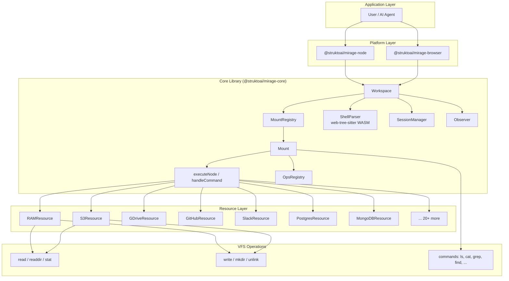
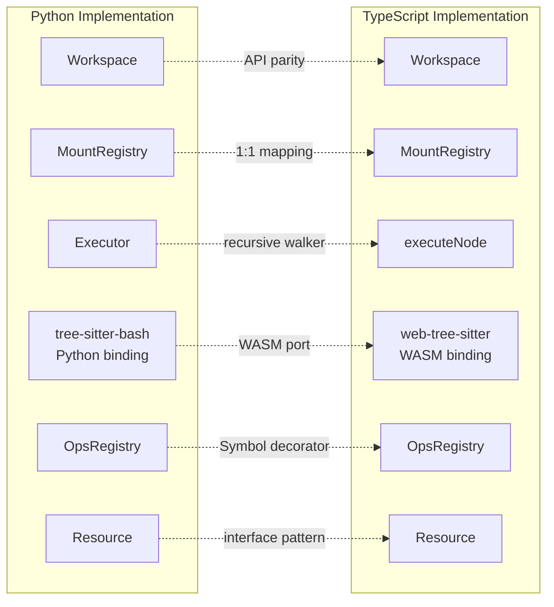

# TypeScript Core Package (`@struktoai/mirage-core`)

The TypeScript core package is a faithful port of the Python `mirage` library, providing a **unified virtual filesystem for AI agents** that executes shell commands against mounted remote resources (Google Drive, GitHub, S3, Slack, etc.) through a tree-sitter-bash shell parser and a mount-based dispatch system. It runs in both Node.js and browser environments, with `@struktoai/mirage-core` serving as the platform-agnostic foundation that `@struktoai/mirage-node` and `@struktoai/mirage-browser` extend with platform-specific features.

---

## Table of Contents

- [Package Overview](#package-overview)
- [Architecture: TypeScript vs Python Parity](#architecture-typescript-vs-python-parity)
- [Workspace Class](#workspace-class)
- [Mount and MountRegistry](#mount-and-mountregistry)
- [Shell Parser: tree-sitter-bash in TypeScript](#shell-parser-tree-sitter-bash-in-typescript)
- [Command System](#command-system)
- [Ops System: VFS Operations](#ops-system-vfs-operations)
- [Core Resources](#core-resources)
- [Accessor Pattern](#accessor-pattern)
- [Session Management](#session-management)
- [I/O and Streaming](#io-and-streaming)
- [Observability and Snapshots](#observability-and-snapshots)
- [TypeScript-Specific Features](#typescript-specific-features)
- [Differences from Python](#differences-from-python)
- [Aha Moments](#aha-moments)
- [Cross-References](#cross-references)

---

## Package Overview

**Package**: `@struktoai/mirage-core` v0.0.2-alpha.0

**Source**: `/home/darkvoid/Boxxed/@formulas/src.rust/src.AI/src.strukto-ai/mirage/typescript/packages/core/`

**Build system**: `tsup` for bundling, `vitest` for testing, `typescript` for type-checking.

**Key dependencies** (from `package.json` lines 62-70):

| Dependency | Purpose |
|---|---|
| `web-tree-sitter` ^0.26.8 | WASM-based bash parser (runs in browser and Node) |
| `pyodide` ^0.29.0 (peer, optional) | In-process Python REPL execution |
| `redis` ^5.0.0 (peer, optional) | Redis cache backend |
| `apache-arrow` ^21.1.0 | Parquet/Feather columnar data support |
| `hyparquet` ^1.25.6 | Parquet read support |
| `hyparquet-writer` ^0.13.0 | Parquet write support |
| `h5wasm` ^0.10.1 | HDF5 file support |
| `jq-wasm` 1.1.0-jq-1.8.1 | WASM jq for JSON processing |
| `zod` ^4.3.6 | Schema validation |
| `bson` ^6.10.4 | MongoDB document serialization |
| `@modelcontextprotocol/sdk` ^1.0.0 | MCP protocol support |

The package is published as ESM (`"type": "module"`) with `exports` pointing to `./dist/index.js` and `./dist/index.d.ts`.

---

## Architecture: TypeScript vs Python Parity

The TypeScript implementation mirrors the Python codebase at every layer: same Workspace API, same MountRegistry, same command dispatch, same ops registry, same session model. The key difference is the **parser layer**: Python uses `tree-sitter-bash` via a Python binding, while TypeScript uses `web-tree-sitter` (the WASM port of tree-sitter), which works identically in browsers and Node.js.



The TypeScript core package implements:

- **Workspace** -- the top-level API, identical in method signatures to Python
- **MountRegistry** -- manages prefix-to-resource mapping, longest-prefix-match resolution
- **Mount** -- per-resource command and op registration, command execution
- **ShellParser** -- wraps `web-tree-sitter` for bash AST parsing
- **executeNode** -- recursive AST walker that executes shell commands (mirrors Python's executor)
- **OpsRegistry** -- VFS operation dispatch (read, write, stat, etc.)
- **SessionManager / Session** -- shell session state (cwd, env, functions, shell options)
- **Observer** -- operation recording for audit trails
- **20+ Resource implementations** -- each with ops, commands, and accessors

### Python vs TypeScript Parity Map



---

## Workspace Class

**File**: `typescript/packages/core/src/workspace/workspace.ts`

The `Workspace` class is the primary entry point, providing shell-like command execution against mounted resources.

### Constructor and Options (lines 131-161)

```typescript
export interface WorkspaceOptions {
  mode?: MountMode                        // Default mount mode (read/write/exec)
  modeOverrides?: Record<string, MountMode>
  driftPolicy?: DriftPolicy               // STRICT | OFF for snapshot replay
  ops?: OpsRegistry
  shellParser?: ShellParser
  shellParserFactory?: () => Promise<ShellParser>
  agentId?: string
  sessionId?: string
  cacheLimit?: string | number            // e.g. "512MB"
  cache?: FileCache & Resource
  index?: IndexConfig
  observerResource?: Resource
  observerPrefix?: string
  python?: {                              // Pyodide configuration
    autoLoadFromImports?: boolean
    bootstrapCode?: string
    denyPackages?: readonly string[]
  }
}
```

### Key Properties (lines 223-250)

```typescript
export class Workspace {
  readonly registry: MountRegistry
  readonly sessionManager: SessionManager
  private readonly opsRegistry: OpsRegistry
  readonly jobTable = new JobTable()
  readonly cache: FileCache & Resource
  readonly history: ExecutionHistory
  readonly observer: Observer
  readonly records: OpRecord[]
  readonly fs: WorkspaceFS
  private readonly pythonRuntime: PyodideRuntime
}
```

### Core Methods

**`execute(command, options?)`** (lines 718-867): The main execution entry point. Parses the command with tree-sitter, detects syntax errors, and dispatches through `executeNode`:

```typescript
async execute(command: string, options: ExecuteOptions = {}): Promise<ExecuteResult | ProvisionResult> {
  // Abort signal check
  if (options.signal?.aborted === true) throw makeAbortError()

  // Drift check on loaded snapshots
  if (this.driftCheckPending) await this.runPendingDriftCheck()

  const parser = await this.getShellParser()
  const root = parser.parse(command)
  const offending = findSyntaxError(root)
  if (offending !== null) {
    // Return syntax error as ExecuteResult (exit code 2)
  }

  // Build dispatch function with caching
  const dispatch: DispatchFn = async (opName, path, args, kwargs) => {
    const [resource, scope, mode] = await this.resolve(path.original)
    // Cache lookup for remote resources on read ops
    // OpsRegistry.call with revision pinning
  }

  // Execute via runWithRecording + runWithSession
  const [[stdout, io], opRecords] = await runWithRecording(() =>
    runWithSession(effectiveSession, () =>
      executeNode(deps, rootNode, effectiveSession, stdin, null),
    ),
  )

  // Record in history, log to observer
  return new ExecuteResult(stdoutBytes, stderrBytes, io.exitCode)
}
```

**`dispatch(opName, path, args, kwargs)`** (lines 629-659): Direct VFS operation dispatch:

```typescript
async dispatch(opName: string, path: string, args: readonly unknown[] = [], kwargs: OpKwargs = {}): Promise<unknown> {
  // Drift check
  const [resource, spec, mode] = await this.resolve(path)
  // Read-only mount guard
  const mount = this.registry.mountFor(path)
  return runWithRevisions(mount?.revisions, async () =>
    this.opsRegistry.call(opName, resource.kind, resource.accessor ?? NOOP_ACCESSOR_INSTANCE, spec, args, fullKwargs),
  )
}
```

**`addMount(prefix, resource, mode)`** (lines 441-451): Dynamic mount addition with op registration and Python bridge forwarding.

**`unmount(prefix)`** (lines 470-503): Mount removal with resource cleanup, Python bridge sync, and protection for reserved prefixes (`/`, `/_default/`, `/dev/`, observer prefix).

**`snapshot(target)`** / **`load(source)`** / **`fromState(state)`** (lines 957-1013): Full workspace state serialization and restoration, including mount configs, cache entries, execution history, and fingerprint-based drift detection.

**`copy(options)`** (lines 1015-1039): Workspace cloning via snapshot round-trip, reusing remote-backed resources (Redis, S3, GDrive) while reconstructing local resources (RAM, Disk) from snapshot state.

### ExecuteResult (lines 163-181)

```typescript
export class ExecuteResult {
  readonly stdout: Uint8Array
  readonly stderr: Uint8Array
  readonly exitCode: number

  get stdoutText(): string { return new TextDecoder().decode(this.stdout) }
  get stderrText(): string { return new TextDecoder().decode(this.stderr) }
}
```

### WorkspaceRunner (lines 1-77 of `runner.ts`)

A lightweight wrapper that owns Workspace lifecycle:

```typescript
export class WorkspaceRunner {
  readonly ws: Workspace
  private stopped = false

  async call<T>(p: Promise<T>): Promise<T> {
    if (this.stopped) throw new Error('WorkspaceRunner is stopped')
    return p
  }

  async stop(): Promise<void> {
    if (this.stopped) return this.stopping ?? Promise.resolve()
    this.stopped = true
    this.stopping = this.ws.close()
    await this.stopping
  }
}
```

Unlike Python's `WorkspaceRunner` which pins the workspace to a background thread's asyncio loop, the TS version is simpler because Node.js has a single event loop per thread. The class provides API parity and lifecycle guardlines (reject after `stop()`).

---

## Mount and MountRegistry

### Mount Class

**File**: `typescript/packages/core/src/workspace/mount/mount.ts`

A Mount represents a resource mounted at a specific prefix path (e.g., `/github/`, `/gdrive/`). It holds four command/op registries:

```typescript
export class Mount {
  readonly prefix: string
  readonly resource: Resource
  readonly mode: MountMode  // 'read' | 'write' | 'exec'
  readonly consistency: ConsistencyPolicy  // 'lazy' | 'always'
  readonly revisions = new Map<string, string>()  // Snapshot revision pins

  private readonly cmds = new Map<CmdKey, RegisteredCommand>()    // Resource-specific commands
  private readonly generalCmds = new Map<string, RegisteredCommand>()  // Generic commands
  private readonly ops = new Map<OpKey, RegisteredOp>()           // Resource-specific ops
  private readonly generalOps = new Map<string, RegisteredOp>()   // Generic ops
  private readonly crossCmds = new Map<string, RegisteredCommand>()  // Cross-mount commands
}
```

**Command resolution cascade** (lines 113-128, `resolveCommand`):
1. Try filetype-specific command (e.g., `cat` for `.parquet`)
2. Try resource-specific command (e.g., `ls` for GitHub)
3. Try general command (e.g., `wc`, `head`, `grep`)
4. Fallback to any filetype variant of the command name

**`executeCmd`** (lines 311-403): Executes a named command with paths, texts, and flags. Handles path prefix injection, glob expansion via `resource.glob()`, accessor resolution, and revision-pinned execution through `runWithRevisions`.

**`registerFns`** (lines 234-289): Batch-registers commands and ops. Handles multi-resource entries where the same command name targets different resources -- filters to this mount's resource kind.

### MountRegistry

**File**: `typescript/packages/core/src/workspace/mount/registry.ts`

Manages the list of mounts with longest-prefix-match resolution:

```typescript
export class MountRegistry {
  private readonly mountList: Mount[]
  private defaultMountRef: Mount | null = null
  private consistency: ConsistencyPolicy = ConsistencyPolicy.LAZY

  resolve(path: string): [Resource, PathSpec, MountMode]  // Longest-prefix match
  mountFor(path: string): Mount | null                    // Find mount by path
  mount(prefix, resource, mode): Mount                    // Add mount dynamically
  unmount(prefix): Mount                                  // Remove mount
  resolveMount(cmdName, pathScopes, cwd): Promise<Mount | null>  // Find mount for command
}
```

**`resolve`** (lines 243-252): Iterates the mount list sorted by prefix length (longest first), returning the first match. This ensures `/github/strukto-ai/` wins over `/github/`.

**`resolveMount`** (lines 296-321): Multi-step resolution that considers path-based mount, command-based mount, and cache freshness under `ConsistencyPolicy.ALWAYS`.

**`evictStale`** (lines 323-352): Private method that compares cached fingerprints against remote fingerprints and evicts stale cache entries.

---

## Shell Parser: tree-sitter-bash in TypeScript

**File**: `typescript/packages/core/src/shell/parse.ts`

The shell parser uses `web-tree-sitter` -- the WASM port of tree-sitter -- rather than the native Python binding used in the Python implementation.

### Parser Creation (lines 28-42)

```typescript
export interface ShellParserConfig {
  engineWasm: Uint8Array | ArrayBuffer   // web-tree-sitter.wasm
  grammarWasm: Uint8Array | ArrayBuffer  // tree-sitter-bash.wasm
}

export async function createShellParser(config: ShellParserConfig): Promise<ShellParser> {
  await Parser.init({ wasmBinary: toArrayBuffer(config.engineWasm) })
  const language = await Language.load(toUint8(config.grammarWasm))
  const parser = new Parser()
  parser.setLanguage(language)
  return {
    parse(command: string): Node {
      const tree = parser.parse(command)
      return tree.rootNode
    },
  }
}
```

The parser is lazily loaded via `shellParserFactory` in the Workspace constructor. In Node.js, the `@struktoai/mirage-node` package resolves the WASM files from `node_modules` and caches the parser (lines 34-43 of `workspace.ts`).

### Node Types (lines 15-109 of `shell/types.ts`)

```typescript
export const NodeType = Object.freeze({
  COMMAND: 'command',
  PIPELINE: 'pipeline',
  LIST: 'list',
  REDIRECTED_STATEMENT: 'redirected_statement',
  SUBSHELL: 'subshell',
  IF_STATEMENT: 'if_statement',
  FOR_STATEMENT: 'for_statement',
  WHILE_STATEMENT: 'while_statement',
  CASE_STATEMENT: 'case_statement',
  FUNCTION_DEFINITION: 'function_definition',
  VARIABLE_ASSIGNMENT: 'variable_assignment',
  HEREDOC_REDIRECT: 'heredoc_redirect',
  PROCESS_SUBSTITUTION: 'process_substitution',
  // ... 60+ node types
} as const)
```

### Syntax Error Detection (lines 104-111 of `parse.ts`)

```typescript
export function findSyntaxError(node: Node): string | null {
  if (!node.hasError) return null
  for (const child of node.children) {
    if (child.isMissing) return child.text
    if (child.type === 'ERROR' && isStructuralError(child)) return child.text
  }
  return null
}
```

Tree-sitter recovers from many errors, so `findSyntaxError` only flags structural errors (those containing bash keywords, brackets, quotes, or recovered named subtrees) at the program level.

### Shell Builtins (lines 166-206 of `shell/types.ts`)

30+ builtins are defined: `pwd`, `cd`, `export`, `unset`, `eval`, `read`, `test`, `echo`, `sleep`, `source`, `trap`, `break`, `continue`, `return`, `python`, `python3`, `xargs`, `timeout`, `fg`, `kill`, `jobs`, `wait`, and more.

---

## Command System

### Command Resolution

**File**: `typescript/packages/core/src/workspace/executor/command.ts`

The command system dispatches shell commands to the appropriate mount's handler through a multi-stage pipeline:

1. **Prefix env variable detection** -- `FOO=bar cmd` sets env vars for single command
2. **Shell function lookup** -- `session.functions[name]` for user-defined functions
3. **Cross-mount detection** -- operations spanning multiple resources
4. **Mount resolution** -- `registry.resolveMount(cmdName, pathScopes, cwd)`
5. **Command spec parsing** -- `parseCommand(spec, argv, cwd)` using Zod-validated specs
6. **Flag parsing** -- `parseFlags(parts, mount, cmdName, cwd)` converts argv to paths/texts/kwargs
7. **Mount.executeCmd()** -- actual command execution

### Command Execution (lines 50-245 of `executor/command.ts`)

```typescript
export async function handleCommand(
  executeNode: ExecuteNodeFn,
  dispatch: DispatchFn,
  registry: MountRegistry,
  parts: readonly (string | PathSpec)[],
  session: Session,
  stdin: ByteSource | null = null,
  // ... more params
): Promise<Result> {
  // 1. Check for job builtins (wait, fg, kill, jobs, ps)
  // 2. Check for shell functions
  // 3. Mount root guards (rm -r /github/ -> "Device or resource busy")
  // 4. Unmount intercept (rm -r /data -> unmount if /data/ is a mount prefix)
  // 5. Cross-mount dispatch
  // 6. Multi-mount fan-out for traversal commands (find, tree, du, grep -r, ls -R)
  // 7. mount.executeCmd() with spec-parsed flags
  // 8. Post-processing: inject child mounts for ls, apply find -delete/-ls actions
}
```

### Mount Root Guards (lines 447-522)

Destructive commands targeting mount roots are blocked with Unix-style errors:

```typescript
// rm /github/ -> "rm: cannot remove '/github/': Device or resource busy"
// mkdir /s3/ -> "mkdir: cannot create directory '/s3/': File exists"
// mv /gdrive/ /tmp -> "mv: cannot move '/gdrive/' to '/tmp': Device or resource busy"
```

### Unmount Intercept (lines 851-898)

An elegant design: `rm -r /github/` or `rmdir /github/` triggers `unmount('/github/')` instead of trying to recursively delete. Mount roots are structural metadata, not real directories.

### Traversal Fan-Out (lines 634-745)

Commands like `find`, `tree`, `du`, `grep -r`, and `ls -R` automatically fan out across descendant mounts. `find /` dispatches to `/github/`, `/gdrive/`, `/s3/`, etc., then synthesizes mount directory entries for `find`.

### Built-in Commands

**Directory**: `typescript/packages/core/src/commands/builtin/`

The core package ships 100+ built-in commands:

- **General commands** (`builtin/general/`): `echo`, `sleep`, `man`, `whoami`, `printenv`, `test`, `source`, `read`, `printf`, `set`, `shift`, `trap`, `eval`, `bash`
- **Box commands**: `cat`, `readdir`, `stat`, `read_bytes`, `write_bytes`
- **Resource-specific commands**: each resource (GitHub, GDrive, S3, Slack, etc.) provides `ls`, `cat`, `find`, `head`, `tail`, `wc`, `grep`, `tree`, `stat`, `rm`, `cp`, `mv`, `touch`, `mkdir`
- **Filetype-specific commands**: `cat_parquet`, `cat_feather`, `cat_hdf5`, `cut_parquet`, `cut_feather`, `cut_hdf5` for columnar data formats

### Command Spec System

**Directory**: `typescript/packages/core/src/commands/spec/`

Commands are defined with Zod-validated specs that describe their flags, positional arguments, and operand kinds (PATH vs TEXT). The `parseCommand` function uses these specs to properly parse argv, handling flag grouping, value flags, boolean flags, and `--` end-of-flags markers.

---

## Ops System: VFS Operations

**File**: `typescript/packages/core/src/ops/registry.ts`

The OpsRegistry manages VFS operations (read, write, stat, mkdir, etc.) that operate directly on resources without shell command overhead.

### Core Types (lines 26-46)

```typescript
export type OpFn = (
  accessor: Accessor,
  path: PathSpec,
  args: readonly unknown[],
  kwargs: OpKwargs,
) => unknown

export interface RegisteredOp {
  name: string
  resource: string | null      // null = global op
  filetype: string | null
  fn(...): unknown
  write: boolean
}
```

### OpsRegistry (lines 82-169)

```typescript
export class OpsRegistry {
  register(ro: RegisteredOp): void
  registerResource(resource: Resource): void   // Auto-registers ops from resource's @op-decorated methods
  find(name, resource, filetype): RegisteredOp | null
  resolve(name, resource, filetype): OpFn
  async call(name, resourceKind, accessor, path, args, kwargs): Promise<unknown>
}
```

**`registerResource`** (lines 97-120): Walks the resource's prototype chain looking for methods decorated with the `@op()` decorator, extracts the registration metadata, binds methods to the resource instance, and registers them in the ops registry.

### The `@op()` Decorator (lines 61-80)

```typescript
export function op(name: string, options: OpOptions) {
  return function methodDecorator(target: OpFn, _context: ClassMethodDecoratorContext): void {
    // Stores metadata on the method via Symbol.for('@struktoai/mirage-core.registeredOps')
  }
}
```

Uses TypeScript's `ClassMethodDecoratorContext` for standard decorator syntax, mirroring Python's `@op(...)` decorator pattern.

### Ops per Resource

Each resource directory under `core/src/ops/` implements standard VFS operations:

| Resource | Ops |
|---|---|
| RAM | read, write, append, mkdir, rmdir, readdir, stat, unlink, rename, truncate, create, read_parquet, read_feather, read_hdf5 |
| S3 | read, write, mkdir, rmdir, readdir, stat, unlink, rename, truncate, create, read_parquet, read_feather, read_hdf5 |
| GitHub | read, readdir, stat |
| GDrive | read, readdir, stat |
| GDocs | read, write, readdir, stat, create |
| Discord | read, readdir, stat |
| Gmail | read, readdir, stat |
| Slack | read, readdir, stat |
| MongoDB | read, readdir, stat, write |
| Postgres | read, readdir, stat |
| ... | ... |

---

## Core Resources

**Directory**: `typescript/packages/core/src/core/` and `typescript/packages/core/src/resource/`

### Resource Interface (lines 39-82 of `resource/base.ts`)

```typescript
export interface Resource {
  readonly kind: string
  readonly prompt?: string
  readonly writePrompt?: string
  readonly isRemote?: boolean
  readonly supportsSnapshot?: boolean
  readonly index?: IndexCacheStore
  readonly accessor?: Accessor
  open(): Promise<void>
  close(): Promise<void>
  ops?(): readonly RegisteredOp[]
  commands?(): readonly RegisteredCommand[]

  // VFS methods (optional, fallback to ops)
  readFile?(path: PathSpec): Promise<Uint8Array>
  writeFile?(path: PathSpec, data: Uint8Array): Promise<void>
  readdir?(path: PathSpec): Promise<string[]>
  stat?(path: PathSpec): Promise<FileStat>
  // ... mkdir, rmdir, unlink, rename, truncate, copy, rmR, du, find, glob, fingerprint
}
```

### Resource Implementations

| Resource | File | Key Features |
|---|---|---|
| RAM | `resource/ram/ram.ts` | In-memory filesystem, full VFS support, snapshot state |
| S3 | `resource/s3/s3.ts` | AWS S3, versioned reads, multipart writes |
| GDrive | `resource/gdrive/gdrive.ts` | Google Drive API, revision support |
| GDocs | `resource/gdocs/gdocs.ts` | Google Docs, create/update with export formats |
| GSheets | `resource/gsheets/gsheets.ts` | Google Sheets, CSV export |
| GSlides | `resource/gslides/gslides.ts` | Google Slides, PDF/PNG export |
| GitHub | `resource/github/github.ts` | GitHub API, file content, tree traversal |
| GitHub CI | `resource/github_ci/github_ci.ts` | GitHub Actions CI logs |
| Slack | `resource/slack/slack.ts` | Slack channels, messages, files |
| Discord | `resource/discord/discord.ts` | Discord channels, messages |
| Gmail | `resource/gmail/gmail.ts` | Gmail messages, attachments |
| Box | `resource/box/box.ts` | Box API |
| Dropbox | `resource/dropbox/dropbox.ts` | Dropbox API |
| Trello | `resource/trello/trello.ts` | Trello boards, cards |
| Linear | `resource/linear/linear.ts` | Linear issues, teams |
| Langfuse | `resource/langfuse/langfuse.ts` | Langfuse observability traces |
| PostHog | `resource/posthog/posthog.ts` | PostHog analytics |
| MongoDB | `resource/mongodb/mongodb.ts` | MongoDB collections as VFS |
| Postgres | `resource/postgres/postgres.ts` | Postgres schemas/tables as VFS |
| Notion | `resource/notion/notion.ts` | Notion pages, databases |
| Vercel | `resource/vercel/vercel.ts` | Vercel deployments |
| SScholar | `resource/sscholar/sscholar.ts` | Semantic Scholar papers and authors |

Each resource follows the same pattern:
1. **Config** -- normalize and redact configuration (secrets are redacted in snapshots)
2. **Accessor** -- holds connection state (API clients, SDK instances)
3. **Ops** -- VFS operations (read, readdir, stat, etc.)
4. **Commands** -- shell commands (ls, cat, find, etc.)
5. **Prompt** -- AI agent hints about what the resource contains

### GDrive Example (core/gdrive)

GDrive demonstrates a complete resource with 20+ files:
- `_client.ts` -- Google API client wrapper
- `glob.ts` -- Path glob matching via Drive API
- `read.ts` -- File download with revision pinning
- `readdir.ts` -- Directory listing with Drive API search
- `stat.ts` -- File metadata with fingerprint (md5)
- `write.ts` -- File upload with media API
- Commands: `ls`, `cat`, `find`, `head`, `tail`, `wc`, `grep`, `tree`, `stat`, `rm`, `cp`, `mv`, `touch`, `mkdir`

---

## Accessor Pattern

**File**: `typescript/packages/core/src/accessor/base.ts`

```typescript
export class Accessor {
  [key: string]: unknown
}

export class NOOPAccessor extends Accessor {}
```

The Accessor is a simple bag class that holds connection state. Each resource's accessor stores the API client or SDK instance needed to make calls.

### Core Accessors

| Accessor | File | Stores |
|---|---|---|
| NOOPAccessor | `base.ts` | Nothing (fallback for resources without auth) |
| BoxAccessor | `box.ts` | Box SDK client |
| DiscordAccessor | `discord.ts` | Discord.js client, channel map |
| DropboxAccessor | `dropbox.ts` | Dropbox SDK client |
| GDocsAccessor | `gdocs.ts` | Google Docs client |
| GDriveAccessor | `gdrive.ts` | Google Drive client |
| GitHubAccessor | `github.ts` | Octokit client |
| GitHubCIAccessor | `github_ci.ts` | Octokit client for CI |
| GmailAccessor | `gmail.ts` | Gmail API client |
| GoogleApiAccessor | `google_api.ts` | Google API auth client |
| GSheetsAccessor | `gsheets.ts` | Google Sheets client |
| GSlidesAccessor | `gslides.ts` | Google Slides client |
| LangfuseAccessor | `langfuse.ts` | Langfuse SDK client |
| LinearAccessor | `linear.ts` | Linear SDK client |
| MongoDBAccessor | `mongodb.ts` | MongoDB client |
| NotionAccessor | `notion.ts` | Notion SDK client |
| PostgresAccessor | `postgres.ts` | pg client pool |
| PostHogAccessor | `posthog.ts` | PostHog client |
| RAMAccessor | `ram.ts` | In-memory file store |
| S3Accessor | `s3.ts` | AWS S3 client |
| SlackAccessor | `slack.ts` | Slack SDK client |
| SScholarAccessor | `sscholar.ts` | Semantic Scholar API |
| TrelloAccessor | `trello.ts` | Trello API client |
| VercelAccessor | `vercel.ts` | Vercel API client |

Each accessor provides lazy connection initialization. For example, the MongoDB accessor (lines 1-60 of `mongodb.ts`):

```typescript
export class MongoDBAccessor extends Accessor {
  private _client: MongoClient | null = null
  async client(): Promise<MongoClient> {
    if (this._client) return this._client
    this._client = new MongoClient(this.config.url)
    await this._client.connect()
    return this._client
  }
}
```

---

## Session Management

**Directory**: `typescript/packages/core/src/workspace/session/`

### Session Class (lines 39-111 of `session.ts`)

```typescript
export class Session {
  readonly sessionId: string
  cwd: string
  env: Record<string, string>
  readonly createdAt: number
  functions: Record<string, unknown>     // Shell function definitions (AST nodes)
  lastExitCode: number
  positionalArgs: string[]
  shellOptions: Record<string, boolean>  // errexit, nounset, xtrace, noglob
  readonlyVars: Set<string>
  arrays: Record<string, string[]>
  stdinBuffer: AsyncLineIterator | null
  localVars: Map<string, string | null> | null
  readonly allowedMounts: ReadonlySet<string> | null

  fork(overrides: Partial<SessionInit>): Session  // Shallow copy with isolation
}
```

**`fork`** (lines 76-92): Creates an isolated copy for per-call `cwd` and `env` overrides. Mutable containers (env, functions, arrays, readonlyVars) are shallow-copied so mutations in the fork do not leak back.

### SessionManager (lines 17-85 of `manager.ts`)

```typescript
export class SessionManager {
  create(sessionId, options): Session
  get(sessionId): Session
  list(): Session[]
  close(sessionId): Promise<void>
  closeAll(): Promise<void>
}
```

Always maintains a default session. The default session cannot be closed.

---

## I/O and Streaming

**File**: `typescript/packages/core/src/io/types.ts`

### ByteSource and IOResult (lines 17-136)

```typescript
export type ByteSource = Uint8Array | AsyncIterable<Uint8Array>

export class IOResult {
  stdout: ByteSource | null
  stderr: ByteSource | null
  private _exitCode: number
  reads: Record<string, ByteSource>
  writes: Record<string, ByteSource>
  cache: string[]
  streamSource: IOResult | null

  get exitCode(): number
  set exitCode(v: number)
  async materializeStdout(): Promise<Uint8Array>
  async merge(other: IOResult): Promise<IOResult>
  async mergeAggregate(other: IOResult): Promise<IOResult>
  syncExitCode(): void
}
```

The `ByteSource` type (either `Uint8Array` or `AsyncIterable<Uint8Array>`) enables lazy streaming of data through the pipeline. `IOResult.merge` combines stdout from the right operand with merged stderr from both, and tracks a `streamSource` for lazy exit code propagation.

**`materialize`** (lines 19-26): Converts any ByteSource to a concrete Uint8Array:

```typescript
export async function materialize(source: ByteSource | null | undefined): Promise<Uint8Array> {
  if (source === null || source === undefined) return new Uint8Array()
  if (source instanceof Uint8Array) return source
  const chunks: Uint8Array[] = []
  for await (const chunk of source) chunks.push(chunk)
  return concat(chunks)
}
```

---

## Observability and Snapshots

### Observer (lines 1-60 of `observe/observer.ts`)

Records operations to an observer resource (default: `/.sessions/` on a RAM resource). Each `OpRecord` captures:

```typescript
export class OpRecord {
  readonly op: string          // "read", "write", "stat", etc.
  readonly path: string
  readonly source: string      // Resource kind
  bytes: number
  readonly timestamp: number
  durationMs: number
  fingerprint: string | null   // ETag, md5 from backend
  revision: string | null      // S3 VersionId, Drive revisionId, Git SHA
}
```

### Snapshot System

**Directory**: `typescript/packages/core/src/workspace/snapshot/`

- **state.ts** -- `WorkspaceStateDict` interface with mounts, cache, history, fingerprints, liveOnlyMounts
- **persist.ts** -- `encodeSnapshot`/`decodeSnapshot`/`saveSnapshotToFile`/`loadSnapshotFromFile`
- **drift.ts** -- `captureFingerprints`, `checkDrift`, `liveOnlyMountPrefixes`
- **manifest.ts** -- Manifest management for snapshot replay

### Drift Detection

When a workspace is loaded from a snapshot, the drift policy controls behavior:

- **STRICT** (default): Raises `ContentDriftError` on first fingerprint mismatch during the first `dispatch`/`execute` after load.
- **OFF**: Skips drift checks, evicts snapshot cache for fingerprinted paths to serve live data.

Paths with **revision pins** (S3 VersionId, Drive revisionId) are never enqueued for drift checking because the revision guarantees exact bytes.

---

## TypeScript-Specific Features

### OPFS (Origin Private File System)

The TypeScript browser build includes support for the Origin Private File System API, providing a browser-native filesystem that works as a RAM replacement with persistence across page reloads. This is handled by the `@struktoai/mirage-browser` package, not core.

### Pyodide Integration (lines 15-62 of `workspace/executor/python/`)

The TypeScript core embeds Pyodide (CPython compiled to WASM) for running Python code:

- **runtime.ts** -- `PyodideRuntime` class managing the Pyodide lifecycle
- **mirage_bridge.ts** -- Bridge between Pyodide's Python code and the TS Workspace (READ/WRITE/LIST operations)
- **mirage_fs_shim.ts** -- Shim that makes Python's `os` and `open()` work against the Mirage VFS
- **wrapper.ts** -- Python REPL wrapper with import-based mount auto-detection
- **loader.ts** -- Pyodide initialization and package loading

The workspace bridge (lines 322-347 of `workspace.ts`) exposes three operations to Pyodide:

```typescript
private buildWorkspaceBridge(): BridgeDispatchFn {
  return async (op, path, bytes) => {
    switch (op) {
      case 'READ':   return await this.fs.readFile(path)
      case 'WRITE':  await this.fs.writeFile(path, buf); return undefined
      case 'LIST':   return entries with {path, size, isDir}
    }
  }
}
```

---

## Differences from Python

| Aspect | Python | TypeScript |
|---|---|---|
| **Parser** | `tree-sitter-bash` Python binding (native) | `web-tree-sitter` WASM (portable) |
| **Async model** | `asyncio` with background threads | Native `Promise`/`async`-`await` |
| **Decorator syntax** | Python `@op(...)` function decorator | TypeScript `ClassMethodDecoratorContext` with Symbol metadata |
| **Type system** | Runtime type hints (no enforcement) | Compile-time TypeScript types with `readonly`, `interface`, `type` |
| **Error handling** | Exception classes (`ContentDriftError`, etc.) | Same pattern, plus `DOMException('AbortError')` for abort signals |
| **Event loop** | asyncio loop per workspace (via `WorkspaceRunner` thread isolation) | Single event loop, no thread isolation needed |
| **Byte handling** | `bytes` / `io.BytesIO` | `Uint8Array` / `AsyncIterable<Uint8Array>` |
| **File I/O** | `pathlib`, `open()` | `Web APIs`, Node `fs` (platform-specific) |
| **Subprocess** | `subprocess.Popen` | `child_process.spawn` (Node) or unavailable (browser) |
| **Snapshot serialization** | `pickle` / JSON | Pure JSON + binary encoding |
| **Package manager** | `pip` / `poetry` | `npm` / workspace protocol |

---

## Aha Moments

### 1. The Unmount Intercept is Just `rm -r`

When you type `rm -r /github/` in Mirage, it doesn't try to recursively delete GitHub files. The command handler detects that the path matches a mount prefix and calls `unmount()` instead (lines 851-898 of `executor/command.ts`). This is elegant because it maps a familiar Unix gesture to the correct semantic operation for a virtual filesystem.

### 2. `IOResult.streamSource` for Lazy Exit Code Propagation

The `IOResult` class has a `streamSource` field that enables lazy exit code propagation through the pipeline. When `syncExitCode()` is called, it recursively walks the chain to find the actual exit code. This means the exit code isn't materialized until the consumer needs it, keeping the entire pipeline lazy and streaming.

### 3. Tree-Sitter Runs in the Browser

The use of `web-tree-sitter` (WASM) instead of a native binding means the full bash shell parser runs in the browser with no native dependencies. This is what makes `@struktoai/mirage-browser` possible -- the same parser that powers the Node.js version runs identically in a web page.

---

## Cross-References

- [[01-architecture.md]] -- Overall Mirage architecture and VFS design
- [[05-resource-model.md]] -- Resource interface, accessor pattern, and ops system
- [[16-typescript-node-server.md]] -- Node.js extensions (FUSE, native exec, Redis cache) and HTTP server
