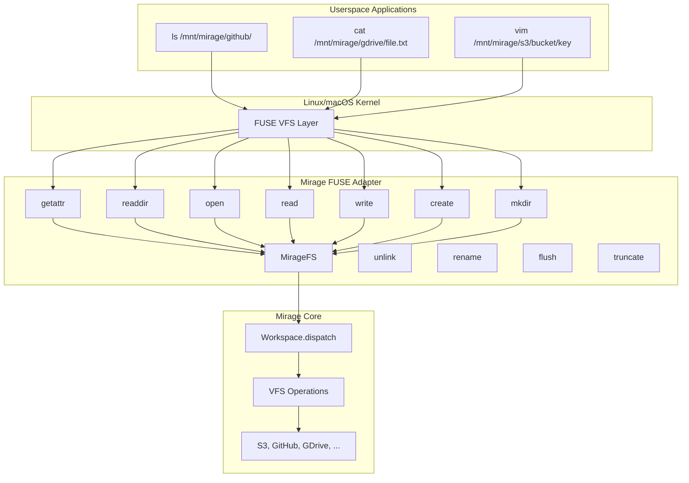
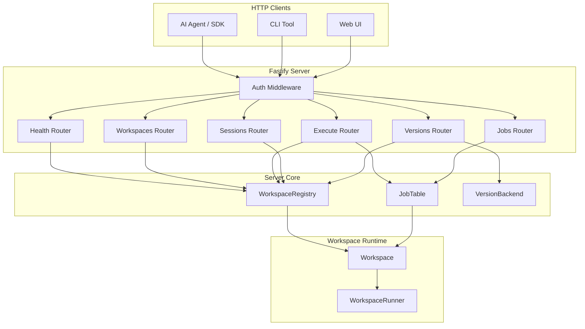

# TypeScript Node & Server Packages (`@struktoai/mirage-node` and `@struktoai/mirage-server`)

The Node package (`@struktoai/mirage-node`) extends the platform-agnostic `@struktoai/mirage-core` with Node.js-specific capabilities -- native process execution, FUSE filesystem mounting, platform-specific resources (SSH, Redis, Email, Disk), and a Redis cross-process cache. The Server package (`@struktoai/mirage-server`) builds a production HTTP API daemon on top of both, providing workspace management, command execution as background jobs, session isolation, JWT/bearer authentication, and version-controlled workspace cloning.

---

## Table of Contents

- [Node Package Overview](#node-package-overview)
- [Node Workspace: Native Execution and FUSE](#node-workspace-native-execution-and-fuse)
- [Native Execution (`nativeExec`)](#native-execution-nativeexec)
- [FUSE Adapter (`MirageFS`)](#fuse-adapter-miragefs)
- [FUSE Mount Management](#fuse-mount-management)
- [Platform-Specific Accessors](#platform-specific-accessors)
- [Node-Specific Resources](#node-specific-resources)
- [Redis Cache for Cross-Process Sharing](#redis-cache-for-cross-process-sharing)
- [Email Accessor and Ops](#email-accessor-and-ops)
- [Local Audio Command](#local-audio-command)
- [fs-monkey Patching](#fs-monkey-patching)
- [Server Package Overview](#server-package-overview)
- [Authentication](#authentication)
- [API Routers](#api-routers)
- [Workspace Registry and Job Table](#workspace-registry-and-job-table)
- [Daemon Binary](#daemon-binary)
- [Aha Moments](#aha-moments)
- [Cross-References](#cross-references)

---

## Node Package Overview

**Package**: `@struktoai/mirage-node` v0.0.2-alpha.0

**Source**: `/home/darkvoid/Boxxed/@formulas/src.rust/src.AI/src.strukto-ai/mirage/typescript/packages/node/`

**Build**: `tsup`, `vitest`, `typescript` (same as core).

### Key Dependencies (from `package.json` lines 50-63)

| Dependency | Purpose |
|---|---|
| `@struktoai/mirage-core` | workspace:* | Base VFS implementation |
| `tree-sitter-bash` ^0.25.1 | WASM grammar files for shell parser |
| `web-tree-sitter` ^0.26.8 | WASM parser engine |
| `ssh2` ^1.16.0 | SSH2 client for SSH resource |
| `redis` ^5.0.0 | Redis client for cache and resource |
| `imapflow` ^1.0.0 | IMAP client for email resource |
| `nodemailer` ^8.0.0 | SMTP client for email sending |
| `mailparser` ^3.6.0 | MIME email parsing |
| `pg` ^8.13.0 | PostgreSQL client |
| `mongodb` ^6.10.0 | MongoDB client |
| `music-metadata` ^11.12.3 | Audio file metadata extraction |
| `wavefile` ^11.0.0 | WAV file processing |
| `fs-monkey` ^1.1.0 | Node `fs` module monkey-patching |

### Optional Peer Dependencies

| Package | Purpose |
|---|---|
| `@zkochan/fuse-native` | FUSE filesystem mounting (Linux/macOS) |
| `sherpa-onnx-node` | On-device speech-to-text for local audio |

### Re-exports

The node package re-exports everything from core (`export * from '@struktoai/mirage-core'`) and then overlays Node-specific classes, resources, and utilities.

---

## Node Workspace: Native Execution and FUSE

**File**: `typescript/packages/node/src/workspace.ts`

The Node `Workspace` extends the core `Workspace` with two major additions: **native execution** (running commands through the host OS shell via FUSE) and **auto-FUSE** (mounting the VFS as a real filesystem).

```typescript
export interface NodeWorkspaceOptions extends WorkspaceOptions {
  fuse?: boolean    // Auto-mount FUSE on workspace creation
  native?: boolean  // Use native OS shell for execution (via FUSE)
}

export class Workspace extends CoreWorkspace {
  private readonly defaultNative: boolean
  private readonly autoFuseManager: FuseManager | null
  private fuseSetupPromise: Promise<void> | null = null
}
```

### Shell Parser Initialization (lines 34-43)

The Node workspace automatically loads the tree-sitter WASM files from `node_modules`:

```typescript
function loadShellParser(): Promise<ShellParser> {
  if (cachedParser !== null) return cachedParser
  const enginePath = requireCjs.resolve('web-tree-sitter/web-tree-sitter.wasm')
  const grammarPath = requireCjs.resolve('tree-sitter-bash/tree-sitter-bash.wasm')
  cachedParser = createShellParser({
    engineWasm: readFileSync(enginePath),
    grammarWasm: readFileSync(grammarPath),
  })
  return cachedParser
}
```

The parser is cached globally after first load, avoiding repeated WASM initialization.

### Native Execution Override (lines 90-127)

```typescript
override async execute(command: string, options: ExecuteOptions = {}): Promise<ExecuteResult | ProvisionResult> {
  await this.ensureFuseReady()
  const useNative = options.native ?? this.defaultNative
  if (useNative) {
    const mp = this.fuseMountpoint
    if (mp === null) {
      console.warn('native=true requires FUSE...')
    } else if (this.ownsFuseMount) {
      // Deadlock guard: Node's single event loop vs FUSE napi callbacks
      throw new Error('native=true with a same-process FUSE mount would deadlock...')
    } else {
      const opts: NativeExecOptions = { cwd: mp }
      if (options.signal !== undefined) opts.signal = options.signal
      const { stdout, stderr, exitCode } = await nativeExec(command, opts)
      return new ExecuteResult(stdout, stderr, exitCode)
    }
  }
  return super.execute(command, options)
}
```

When `native=true`, the command is executed via the host's `/bin/sh` with the FUSE mountpoint as the working directory. The FUSE layer translates filesystem operations back into Mirage dispatch calls.

### FUSE Deadlock Guard (lines 103-118)

A critical safety mechanism: if the workspace owns the FUSE mount (created in-process via `FuseManager`) and a caller requests native execution, it raises an error rather than deadlocking. The reason is architectural:

> Node is single-threaded -- `@zkochan/fuse-native`'s napi callbacks share the same event loop as `child_process.spawn`. Running `nativeExec` against a mount we own in this process deadlocks because the FUSE kernel callbacks cannot fire while the child process is running.

Workarounds provided:
1. Run FUSE in a helper process; call `nativeExec` from this process
2. Point `nativeExec` at a mountpoint created by another tool
3. Use the virtual executor (default, without `native=true`)

---

## Native Execution (`nativeExec`)

**File**: `typescript/packages/node/src/native.ts`

Spawns host `/bin/sh -c <command>` and collects stdout/stderr:

```typescript
export interface NativeExecOptions {
  cwd: string
  env?: Record<string, string>
  timeoutMs?: number | null
  signal?: AbortSignal
}

export function nativeExec(command: string, options: NativeExecOptions): Promise<NativeExecResult>
export function nativeExecStream(command: string, options: NativeExecOptions): NativeProcess
```

### Timeout Handling with Grandchild Orphaning (lines 53-64)

```typescript
const timer = timeoutMs !== null
  ? setTimeout(() => {
      killed = true
      proc.kill('SIGKILL')
      // When sh spawns a child (e.g. `echo x && sleep 5`), SIGKILL'ing sh
      // leaves the grandchild holding the stdio fds -- Node's 'close' event
      // never fires until the grandchild dies. Destroying the pipes
      // unblocks the promise so we return promptly on timeout.
      proc.stdout.destroy()
      proc.stderr.destroy()
    }, timeoutMs)
  : null
```

This addresses a subtle Node.js issue: killing `sh` doesn't kill grandchildren, and the stdio pipes keep the 'close' event from firing. The solution forcibly destroys the pipes to unblock the promise.

### Timeout Exit Code (lines 88-93)

Aligns with Python's `native_exec`: timeout returns empty stdout, `"timeout\n"` stderr, and exit code 124 (matching GNU `timeout`).

### `nativeExecStream` (lines 107-133)

Returns a `NativeProcess` wrapper for streaming execution:

```typescript
export interface NativeProcess {
  raw: ChildProcess
  stdoutStream(): Readable
  stderrStream(): Readable | null
  wait(): Promise<number>
}
```

Intentionally does not thread the `signal` parameter -- doing so would require abort-aware error handling and wait() logic. Callers who need abort support should use `nativeExec` instead.

---

## FUSE Adapter (`MirageFS`)

**File**: `typescript/packages/node/src/fuse/fs.ts`

The `MirageFS` class translates FUSE VFS operations into Mirage `Workspace` calls. It implements the full FUSE operations interface required by `@zkochan/fuse-native`.

### Architecture



### FUSE Operations (lines 243-265)

```typescript
ops(): Record<string, unknown> {
  return {
    readdir: this.readdir.bind(this), getattr: this.getattr.bind(this),
    open: this.open.bind(this), read: this.read.bind(this),
    write: this.write.bind(this), create: this.create.bind(this),
    unlink: this.unlink.bind(this), mkdir: this.mkdir.bind(this),
    rmdir: this.rmdir.bind(this), rename: this.rename.bind(this),
    release: this.release.bind(this), truncate: this.truncate.bind(this),
    flush: this.flush.bind(this), fsync: this.fsync.bind(this),
    utimens: this.utimens.bind(this), chmod: this.chmod.bind(this),
    chown: this.chown.bind(this), access: this.access.bind(this),
    statfs: this.statfs.bind(this),
  }
}
```

### Unknown Size Sentinel (lines 54-74)

A key design decision: for API-backed resources that report `size=null` up front (Trello, Linear, Slack), the FUSE layer reports a 100 MiB sentinel size instead of 0:

```typescript
const UNKNOWN_SIZE_SENTINEL = 100 * 1024 * 1024 // 100 MiB
```

Python uses libfuse's `direct_io` flag to make the kernel ignore the reported size and issue `read()` regardless. `@zkochan/fuse-native` doesn't expose `direct_io`, so:
- Reporting 0 would make the kernel think the file is empty and never issue `read()`
- Reporting the real size requires fetching all bytes (expensive for `ls -l` on every file)
- The sentinel keeps `ls` cheap while still letting `cat` work (read returns 0 at actual EOF)
- 100 MiB is capped to stay under V8's ~512 MiB string limit for `fs/promises.readFile`

### Prefetch System (lines 205-223)

When a file with unknown size is opened, `MirageFS` proactively fetches its contents and caches them for 30 seconds:

```typescript
private async prefetch(path: string): Promise<Uint8Array | null> {
  const cached = this.cachedData(path)
  if (cached !== null) return cached
  // Inflight deduplication: concurrent opens of the same file share one fetch
  const inflight = this.prefetchInflight.get(path)
  if (inflight !== undefined) return inflight
  const promise = (async () => {
    const data = await this.ws.fs.readFile(path)
    this.prefetchCache.set(path, { data, expires: Date.now() + PREFETCH_TTL_MS })
    return data
  })()
  this.prefetchInflight.set(path, promise)
  return promise
}
```

### Error Classification (lines 78-93)

FUSE requires numeric errno values. `classifyError` maps error messages to FUSE errno constants:

```typescript
const ENOENT = -2, EACCES = -13, ENOTDIR = -20, EEXIST = -17, ENOTEMPTY = -66, EIO = -5

function classifyError(err: unknown): number {
  const msg = (err instanceof Error ? err.message : String(err)).toLowerCase()
  if (msg.includes('not found') || msg.includes('no such') || msg.includes('enoent') || msg.includes('no mount'))
    return ENOENT
  // ... etc
  return EIO
}
```

### Virtual Directories and `/mirage/whoami`

Mount prefixes appear as virtual directories in the FUSE filesystem. The `/.mirage/whoami` pseudo-file returns agent identity and mount information:

```typescript
private whoamiContent(): Uint8Array {
  const lines = [`agent: ${this.agentId}`, 'cwd: /', `mounts: ${this.prefixes.join(', ')}`]
  return new TextEncoder().encode(lines.join('\n') + '\n')
}
```

### macOS Metadata Rejection (lines 277-282)

macOS Finder and Spotlight probe for `.DS_Store`, `._*`, `.Spotlight-V100`, etc. These are rejected early in `getattr` to avoid unnecessary API calls to remote backends:

```typescript
const name = path.slice(path.lastIndexOf('/') + 1)
if (isMacosMetadata(name)) { cb(ENOENT); return }
```

### Write Buffering (lines 364-411)

FUSE writes are buffered per file handle and flushed on `close`/`flush`. The `write` method handles sparse writes (writing past EOF with zero-padding):

```typescript
private write(path, fd, buf, len, pos, cb): void {
  const ctx = this.handles.get(fd)
  const data = new Uint8Array(buf.subarray(0, len))
  if (ctx !== undefined) {
    ctx.writeBuf ??= []
    ctx.writeBuf.push([pos, data])
    cb(len)
    return
  }
  // Direct write path: read existing, merge at position, dispatch write
}
```

### Flush and fsync (lines 593-628)

`flush` merges all buffered writes into the existing file content and dispatches the merged result via `Workspace.dispatch('write', ...)`. `fsync` delegates to `flush`.

---

## FUSE Mount Management

### `mount()` Function

**File**: `typescript/packages/node/src/fuse/mount.ts` (lines 81-110)

```typescript
export async function mount(ws: Workspace, options: MountOptions = {}): Promise<FuseHandle> {
  const Fuse = await loadFuse()  // Optional peer dependency
  const mountpoint = options.mountpoint ?? mkdtempSync(join(tmpdir(), 'mirage-fuse-'))
  const mfs = new MirageFS(ws, agentId !== undefined ? { agentId } : {})
  const autoUnmount = options.autoUnmount ?? process.platform === 'linux'
  const fuseOpts: Record<string, unknown> = { force: true, mkdir: true, ...(autoUnmount ? { autoUnmount: true } : {}) }
  const fuse = new Fuse(mountpoint, mfs.ops(), fuseOpts)
  await new Promise<void>((resolve, reject) => fuse.mount((err) => err ? reject(err) : resolve()))
  return { mountpoint, unmount: () => new Promise<void>((resolve, reject) => fuse.unmount(...)) }
}
```

### Force Unmount (lines 69-79)

Platform-specific force unmount for cleanup:

```typescript
export function forceUnmount(mountpoint: string): void {
  if (process.platform === 'darwin') {
    execSync(`diskutil unmount force ${JSON.stringify(mountpoint)}`, { stdio: 'ignore' })
  } else {
    execSync(`fusermount -u ${JSON.stringify(mountpoint)}`, { stdio: 'ignore' })
  }
}
```

### `FuseManager` Class

**File**: `typescript/packages/node/src/workspace/fuse.ts` (lines 82-136)

Manages auto-mounted FUSE handles with process-lifecycle cleanup:

```typescript
export class FuseManager {
  private handle: FuseHandle | null = null
  private externalMountpoint: string | null = null
  private auto = false

  get mountpoint(): string | null
  set mountpoint(path: string | null)

  async setup(ws: Workspace, options: MountOptions = {}): Promise<string>
  async unmount(ws?: Workspace): Promise<void>
  async close(ws?: Workspace): Promise<void>
}
```

### `FuseCleanupRegistry` (lines 28-80)

A singleton that registers SIGINT/SIGTERM/SIGHUP/beforeExit/exit handlers to ensure FUSE mounts are always cleaned up, even on abnormal process termination:

```typescript
class FuseCleanupRegistry {
  private readonly mounts = new Set<{ mountpoint: string; handle: FuseHandle }>()

  register(entry: { mountpoint: string; handle: FuseHandle }): void {
    this.mounts.add(entry)
    this.install()  // Install signal handlers on first registration
  }

  private readonly onSignal = (sig: Signal): void => {
    this.drainSync()
    process.kill(process.pid, sig)  // Re-raise signal after cleanup
  }
}
```

### `autoUnmount` Platform Defaults (lines 86)

- **Linux**: `autoUnmount: true` -- libfuse `auto_unmount` is supported
- **macOS**: `autoUnmount: false` -- macFUSE rejects "unknown option `auto_unmount'"

---

## Platform-Specific Accessors

### SSH Accessor

**File**: `typescript/packages/node/src/accessor/ssh.ts` (lines 29-95)

Uses the `ssh2` library with lazy SFTP connection:

```typescript
export class SSHAccessor extends Accessor {
  private client: Client | null = null
  private sftpClient: SFTPWrapper | null = null
  private connectPromise: Promise<SFTPWrapper> | null = null

  async sftp(): Promise<SFTPWrapper> {
    if (this.sftpClient !== null) return this.sftpClient
    if (this.connectPromise !== null) return this.connectPromise
    this.connectPromise = this.connect()
    try { return await this.connectPromise }
    finally { this.connectPromise = null }
  }

  private async connect(): Promise<SFTPWrapper> {
    const ssh2Mod = await import('ssh2')  // Dynamic import for peer dep
    const c = new ssh2Mod.Client()
    const opts = { host: this.config.hostname, port: this.config.port ?? 22, ... }
    return new Promise((resolveFn, rejectFn) => {
      c.on('ready', () => c.sftp((err, sftp) => {
        this.client = c; this.sftpClient = sftp; resolveFn(sftp)
      }))
      c.on('error', rejectFn)
      c.connect(opts)
    })
  }
}
```

Features:
- `ssh2` is loaded via dynamic `import()` so it's only required when SSH is actually used
- Home directory expansion for identity file paths (`~/.ssh/id_rsa`)
- Lazy connection with deduplication (concurrent `sftp()` calls share one connect promise)

### Redis Accessor

**File**: `typescript/packages/node/src/accessor/redis.ts` (lines 18-25)

```typescript
export class RedisAccessor extends Accessor {
  readonly store: RedisStore
  constructor(store: RedisStore) {
    super()
    this.store = store
  }
}
```

The accessor holds a reference to the `RedisStore` which manages the Redis client connection.

### Disk Accessor

**File**: `typescript/packages/node/src/accessor/disk.ts` (lines 17-24)

```typescript
export class DiskAccessor extends Accessor {
  readonly root: string
  constructor(root: string) { super(); this.root = root }
}
```

### Email Accessor

**File**: `typescript/packages/node/src/accessor/email.ts` (lines 19-60)

Uses `imapflow` for IMAP connectivity:

```typescript
export class EmailAccessor extends Accessor {
  readonly config: EmailConfig
  private clientPromise: Promise<ImapFlow> | null = null

  async getImap(): Promise<ImapFlow> {
    this.clientPromise ??= (async () => {
      const mod = await loadOptionalPeer(() => import('imapflow'), { feature: 'EmailAccessor', packageName: 'imapflow' })
      const client = new mod.ImapFlow({
        host: this.config.imapHost, port: this.config.imapPort, secure: this.config.useSsl,
        auth: { user: this.config.username, pass: this.config.password }, logger: false,
      })
      await client.connect()
      return client
    })()
    return this.clientPromise
  }
}
```

---

## Node-Specific Resources

The node package adds resources not available in the browser-only core:

| Resource | File | Description |
|---|---|---|
| Disk | `resource/disk/disk.ts` | Local filesystem access via Node `fs/promises` |
| Redis | `resource/redis/redis.ts` | Redis key-value store as VFS |
| SSH | `resource/ssh/ssh.ts` | Remote filesystem via SSH/SFTP |
| Email | `resource/email/email.ts` | IMAP email accounts as VFS |
| S3 (extended) | `resource/s3/s3.ts` | AWS S3 with extended Node config |
| GCS | `resource/gcs/gcs.ts` | Google Cloud Storage |
| OCI | `resource/oci/oci.ts` | Oracle Cloud Infrastructure |
| R2 | `resource/r2/r2.ts` | Cloudflare R2 |
| Supabase | `resource/supabase/supabase.ts` | Supabase storage |
| Postgres | `resource/postgres/postgres.ts` | PostgreSQL (full Node implementation) |
| MongoDB | `resource/mongodb/mongodb.ts` | MongoDB (full Node implementation) |

### Resource Registry

**File**: `typescript/packages/node/src/resource/registry.ts`

Provides factory-based resource construction:

```typescript
export function register(name: string, factory: ResourceFactory): void
export async function buildResource(name: string, config: Record<string, unknown>): Promise<Resource>
export function knownResources(): string[]
```

### Node-Specific Resource Features

- **Disk**: Full read/write VFS against local filesystem, with `find`, `du`, `tree`, and all standard Unix commands. Uses `fs/promises` for async I/O.
- **Redis**: Redis keys and hashes exposed as a hierarchical VFS. Supports `RedisFileCacheStore` for cross-process cache sharing.
- **SSH**: Remote filesystem via SFTP, with all standard VFS operations.

---

## Redis Cache for Cross-Process Sharing

**File**: `typescript/packages/node/src/cache/redis/file.ts`

`RedisFileCacheStore` implements the `FileCache` interface backed by Redis, enabling cache sharing across multiple Node processes:

```typescript
export class RedisFileCacheStore extends RedisResource implements FileCache {
  private readonly limit: number
  private readonly dataPrefix: string   // e.g. "mirage:cache:data:"
  private readonly metaPrefix: string   // e.g. "mirage:cache:meta:"
  maxDrainBytes: number | null

  async get(key: string): Promise<Uint8Array | null>
  async set(key: string, data: Uint8Array, options?: { fingerprint?, ttl? }): Promise<void>
  async add(key: string, data: Uint8Array, options?): Promise<boolean>  // Atomic add-if-not-exists
  async remove(key: string): Promise<void>
  async exists(key: string | PathSpec): Promise<boolean>
  async isFresh(key: string, remoteFingerprint: string): Promise<boolean>
  async clear(): Promise<void>
  async allCached(keys: readonly string[]): Promise<boolean>
  async multiGet(keys: readonly string[]): Promise<(Uint8Array | null)[]>
}
```

### Key Design

- **Data keys**: `${dataPrefix}${key}` -- stores the actual blob via Redis `SET` with Buffer
- **Metadata keys**: `${metaPrefix}${key}` -- stores the fingerprint string for freshness checks
- **Atomic operations**: `set()` uses Redis MULTI pipeline to atomically set data + metadata + optional TTL
- **Type mapping**: Uses Redis `withTypeMapping` to get Buffer responses directly (lines 59-67)
- **Scan-based cleanup**: `clear()` uses `scanIterator` to batch-delete matching keys

### Usage Pattern

```typescript
const cache = new RedisFileCacheStore({ url: 'redis://localhost:6379/0', cacheLimit: '512MB' })
const ws = new Workspace({ '/github/': githubResource }, { cache })
// Multiple Workspace instances can share the same Redis cache
```

---

## Email Accessor and Ops

The Email resource provides IMAP email accounts as a virtual filesystem, with `nodemailer` for SMTP sending.

### Email Resource

**File**: `typescript/packages/node/src/resource/email/email.ts`

- Emails appear as files in mailboxes (folders)
- Attachments are accessible as child files
- Supports reading, searching, and sending email through the VFS interface

### Email Ops

**File**: `typescript/packages/node/src/ops/email/index.ts`

Standard VFS operations (read, readdir, stat) mapped to IMAP commands. The `EmailAccessor` provides the IMAP connection, and `nodemailer` handles SMTP for sending.

---

## Local Audio Command

**Directory**: `typescript/packages/node/src/commands/local_audio/`

Provides speech-to-text and audio metadata extraction:

```typescript
export interface LocalAudioConfig {
  // sherpa-onnx-node configuration for on-device transcription
}

export interface LocalAudioMetadata {
  duration: number
  sampleRate: number
  channels: number
  format: string
}

export async function transcribe(audio: Uint8Array, config: LocalAudioConfig): Promise<string>
export async function metadata(audio: Uint8Array): Promise<LocalAudioMetadata>
export async function estimateByteRange(durationSec: number, sampleRate: number): { start, end }
export function formatDuration(seconds: number): string
export function formatMetadata(m: LocalAudioMetadata): string
```

### Dependencies

- `sherpa-onnx-node` (optional peer) -- on-device speech recognition without cloud API calls
- `music-metadata` -- audio file metadata extraction (duration, format, sample rate)
- `wavefile` -- WAV file processing

The command is available as `local_audio` in the shell and supports both RAM-backed and Disk-backed audio files.

---

## fs-monkey Patching

**File**: `typescript/packages/node/src/fs_monkey.ts`

Patches Node's `fs` module so that paths under Mirage mounts route through the workspace:

```typescript
export function patchNodeFs(ws: Workspace): () => void {
  // Creates a virtual volume object that:
  // 1. Checks if path is under a Mirage mount
  // 2. If yes, routes through ws.fs.* methods
  // 3. If no, falls through to native fs.* methods
  // Returns restore() function to undo the patch
}
```

### Patched Methods

| Method | Behavior |
|---|---|
| `fs.promises.readFile` | Mirage mount -> `ws.fs.readFile()`, else native |
| `fs.promises.writeFile` | Mirage mount -> `ws.fs.writeFile()`, else native |
| `fs.promises.readdir` | Mirage mount -> `ws.fs.readdir()` (strips to basename), else native |
| `fs.promises.stat` | Mirage mount -> `mirageStat(ws, p)`, else native |
| `fs.promises.unlink` | Mirage mount -> `ws.fs.unlink()`, else native |
| `fs.promises.mkdir` | Mirage mount -> `ws.fs.mkdir()`, else native |
| `fs.promises.rmdir` | Mirage mount -> `ws.fs.rmdir()`, else native |
| `fs.readFile` (callback) | Same routing for callback-style API |
| `fs.readdir` (callback) | Same routing for callback-style API |

### Synchronous Methods Blocked

```typescript
readFileSync: (): Uint8Array => {
  throw new Error('mirage.patchNodeFs: sync fs methods not supported -- use fs.promises.*')
}
```

Only async methods are patched; synchronous fs calls on Mirage paths throw a clear error directing users to the promises API.

---

## Server Package Overview

**Package**: `@struktoai/mirage-server` v0.0.2-alpha.0

**Source**: `/home/darkvoid/Boxxed/@formulas/src.rust/src.AI/src.strukto-ai/mirage/typescript/packages/server/`

**Dependencies**:

| Dependency | Purpose |
|---|---|
| `fastify` ^5.8.5 | HTTP server framework |
| `@fastify/multipart` ^10.0.0 | Multipart form parsing |
| `@struktoai/mirage-core` | workspace:* |
| `@struktoai/mirage-node` | workspace:* |
| `jose` ^6.2.3 | JWT verification |
| `isomorphic-git` ^1.38.1 | Git operations for version control |
| `yaml` ^2.6.0 | Workspace config parsing |

**Binary**: `mirage-daemon` (installed globally via `bin` field in package.json)

### Server Architecture



---

## Authentication

**Directory**: `typescript/packages/server/src/auth/`

### Auth Modes

**File**: `typescript/packages/server/src/auth/config.ts`

Three authentication modes:

| Mode | Description |
|---|---|
| `Local` | Simple bearer token comparison (constant-time) |
| `Bearer` | External bearer token comparison |
| `Jwt` | JWT verification via `jose` library |

### Authentication Middleware

**File**: `typescript/packages/server/src/auth/middleware.ts` (lines 45-80)

```typescript
export function registerAuth(app: FastifyInstance, config: AuthConfig): void {
  app.addHook('onRequest', async (req, reply) => {
    if (HEALTH_PATHS.has(req.url)) return  // Health endpoint is unauthenticated
    const token = extractBearer(req)
    if (token === undefined) { await unauthorized(reply, 'missing bearer token'); return }

    if (config.mode === AuthMode.Jwt) {
      if (!JWT_SHAPE.test(token)) { await unauthorized(reply, 'token shape is not a JWT'); return }
      try { await verifyJwt(token, config.jwt) }
      catch (e) { await unauthorized(reply, e instanceof JWTVerificationError ? e.message : String(e)); return }
      return
    }

    const expected = config.mode === AuthMode.Local ? config.localToken : config.bearerToken
    if (expected === undefined || !constantTimeEqual(token, expected)) {
      await unauthorized(reply, 'bearer mismatch')
      return
    }
  })
}
```

### Constant-Time Comparison (lines 25-30)

Uses Node's `crypto.timingSafeEqual` to prevent timing attacks:

```typescript
function constantTimeEqual(a: string, b: string): boolean {
  const ab = Buffer.from(a)
  const bb = Buffer.from(b)
  if (ab.length !== bb.length) return false
  return timingSafeEqual(ab, bb)
}
```

### JWT Verification

**File**: `typescript/packages/server/src/auth/jwt.ts`

Uses `jose` library to verify JWTs with configurable:
- Algorithm (RS256, ES256, etc.)
- Issuer validation
- Audience validation
- Authorized parties
- Clock skew tolerance
- Public key from PEM string or file

---

## API Routers

### Execute Router

**File**: `typescript/packages/server/src/routers/execute.ts` (lines 43-81)

```typescript
app.post('/v1/workspaces/:wsId/execute', async (req, reply) => {
  const { wsId } = req.params
  const body = req.body  // { command, sessionId?, provision?, agentId?, native?, stdinBase64? }
  const background = req.query.background === 'true'

  const job = deps.jobs.submit(wsId, body.command, async (signal) =>
    entry.runner.ws.execute(body.command, {
      sessionId: body.sessionId, agentId: body.agentId, native: body.native,
      provision: body.provision === true ? true : undefined,
      stdin: body.stdinBase64 ? new Uint8Array(Buffer.from(body.stdinBase64, 'base64')) : undefined,
      signal,
    }),
  )

  if (background) {
    return reply.status(202).send({ jobId: job.id, workspaceId: wsId, submittedAt: job.submittedAt })
  }
  await deps.jobs.wait(job.id)
  reply.header('X-Mirage-Job-Id', job.id)
  if (job.status === JobStatus.FAILED) return reply.status(500).send({ detail: job.error })
  return ioResultToDict(job.result)
})
```

Features:
- **Synchronous mode** (default): waits for completion and returns the result
- **Background mode** (`?background=true`): returns 202 Accepted with job ID
- **AbortSignal** threading: the job's `AbortController.signal` is passed to `execute()`
- **Base64 stdin**: supports binary stdin via base64 encoding
- **Job ID header**: `X-Mirage-Job-Id` on all responses

### Workspaces Router

**File**: `typescript/packages/server/src/routers/workspaces.ts`

| Endpoint | Method | Description |
|---|---|---|
| `/v1/workspaces` | POST | Create workspace from config YAML/JSON |
| `/v1/workspaces` | GET | List all workspaces |
| `/v1/workspaces/:id` | GET | Get workspace detail (with `?verbose=true`) |
| `/v1/workspaces/:id` | DELETE | Close workspace |
| `/v1/workspaces/:id/clone` | POST | Clone workspace with optional override |
| `/v1/workspaces/:id/snapshot` | POST | Save workspace snapshot to file |
| `/v1/workspaces/load` | POST | Load workspace from snapshot file |

### Sessions Router

**File**: `typescript/packages/server/src/routers/sessions.ts`

| Endpoint | Method | Description |
|---|---|---|
| `/v1/workspaces/:wsId/sessions` | POST | Create session (with optional `allowedMounts` for capability isolation) |
| `/v1/workspaces/:wsId/sessions` | GET | List sessions |
| `/v1/workspaces/:wsId/sessions/:sessionId` | DELETE | Close session |

### Health Router

**File**: `typescript/packages/server/src/routers/health.ts`

| Endpoint | Method | Description |
|---|---|---|
| `/v1/health` | GET | Health check (unauthenticated) |

### Versions Router

**File**: `typescript/packages/server/src/routers/versions.ts`

Provides version control for workspaces backed by git repositories (using `isomorphic-git`).

### Jobs Router

**File**: `typescript/packages/server/src/routers/jobs.ts`

| Endpoint | Method | Description |
|---|---|---|
| `/v1/jobs` | GET | List all jobs |
| `/v1/jobs/:jobId` | GET | Get job detail |
| `/v1/jobs/:jobId/cancel` | POST | Cancel a running job |

---

## Workspace Registry and Job Table

### WorkspaceRegistry

**File**: `typescript/packages/server/src/registry.ts`

Manages workspace instances with lifecycle:

```typescript
export class WorkspaceRegistry {
  private entries = new Map<string, WorkspaceEntry>()
  private readonly idleGraceSeconds: number
  private readonly onIdleExit: (() => void) | null

  add(ws: Workspace, id?: string): WorkspaceEntry
  async remove(id: string): Promise<WorkspaceEntry>
  async closeAll(): Promise<void>
}
```

**Idle exit** (lines 96-114): When the last workspace is removed, starts a timer (default 30 seconds). If no new workspaces are added during the grace period, calls `onIdleExit` (which shuts down the daemon by default).

### JobTable

**File**: `typescript/packages/server/src/jobs.ts`

Manages asynchronous job execution:

```typescript
export class JobTable {
  submit(workspaceId: string, command: string, coroFactory: (signal: AbortSignal) => Promise<unknown>): JobEntry
  async wait(id: string, timeoutSeconds?: number): Promise<JobEntry>
  cancel(id: string): boolean
  list(workspaceId?: string): JobEntry[]
}
```

Each `JobEntry` has:
- **AbortController**: enables cancellation via `abort()`
- **Status state machine**: PENDING -> RUNNING -> DONE/FAILED/CANCELED
- **Promise-based completion**: `entry.done` resolves when the job finishes

### Job Status Machine

| Status | Transition |
|---|---|
| `pending` | Initial state |
| `running` | Set immediately on `submit()` |
| `done` | Promise resolved, signal not aborted |
| `failed` | Promise rejected, signal not aborted |
| `canceled` | Promise resolved or rejected, signal was aborted |

---

## Daemon Binary

**File**: `typescript/packages/server/src/bin/daemon.ts`

The `mirage-daemon` CLI starts a Fastify HTTP server:

```typescript
#!/usr/bin/env node

async function main(): Promise<void> {
  const { port, opts } = buildDaemonOpts(process.env)
  let exiting = false
  const triggerExit = (): void => {
    if (exiting) return
    exiting = true
    void app.close().finally(() => { removePidFile(); process.exit(0) })
  }
  app = buildApp({ ...opts, onIdleExit: triggerExit })
  process.on('SIGTERM', triggerExit)
  process.on('SIGINT', triggerExit)
  await app.listen({ port, host: '127.0.0.1' })
  writePidFile()
}
```

### Default Configuration

| Setting | Value | Env Var |
|---|---|---|
| Port | 8765 | `MIRAGE_DAEMON_PORT` |
| Idle grace | 30 seconds | `MIRAGE_IDLE_GRACE_SECONDS` |
| Version root | `~/.mirage/repos` | `MIRAGE_VERSION_ROOT` |
| Bind address | `127.0.0.1` | -- |

### PID File

Writes `~/.mirage/daemon.pid` on startup, removes it on shutdown.

### Signal Handling

SIGTERM and SIGINT trigger graceful shutdown: close all workspaces, remove PID file, exit 0.

### Environment Variables

**File**: `typescript/packages/server/src/env.ts`

```typescript
export const ENV_DAEMON_PORT = 'MIRAGE_DAEMON_PORT'
export const ENV_IDLE_GRACE_SECONDS = 'MIRAGE_IDLE_GRACE_SECONDS'
export const ENV_VERSION_ROOT = 'MIRAGE_VERSION_ROOT'
export const ENV_ALLOWED_HOSTS = 'MIRAGE_ALLOWED_HOSTS'
export const ENV_AUTH_MODE = 'MIRAGE_AUTH_MODE'
export const ENV_AUTH_TOKEN = 'MIRAGE_AUTH_TOKEN'
export const ENV_JWT_ISSUER = 'MIRAGE_JWT_ISSUER'
export const ENV_JWT_AUDIENCE = 'MIRAGE_JWT_AUDIENCE'
export const ENV_JWT_ALG = 'MIRAGE_JWT_ALG'
export const ENV_JWT_PUBKEY = 'MIRAGE_JWT_PUBKEY'
export const ENV_JWT_PUBKEY_FILE = 'MIRAGE_JWT_PUBKEY_FILE'
```

### Host Validation

**File**: `typescript/packages/server/src/host_validation.ts`

When `MIRAGE_ALLOWED_HOSTS` is set (not `*`), all requests are checked for a matching `Host` header to prevent DNS rebinding attacks.

---

## Aha Moments

### 1. `rm -r /mount/` is Actually `unmount`

The Node workspace intercepts destructive commands targeting mount prefixes (`rm -r /github/`, `rmdir /s3/`) and translates them into `unmount()` calls (lines 851-898 of `executor/command.ts`). Mount roots are structural metadata, not real directories, so trying to delete them recursively is semantically wrong. This is elegant because it maps a familiar Unix gesture to the correct VFS operation.

### 2. FUSE `direct_io` Workaround via Size Sentinel

Since `@zkochan/fuse-native` doesn't expose libfuse's `direct_io` flag, the FUSE layer reports a 100 MiB sentinel size for API-backed files where the resource returns `size=null`. The kernel ignores 0-size files (never issues `read()`), and fetching the real size upfront would be expensive for `ls -l`. The sentinel keeps `ls` cheap while `read()` returns 0 bytes at actual EOF, surfacing correctly as end-of-file. The prefetch system then caches the actual bytes so subsequent reads are fast.

### 3. The Native Execution Deadlock and Its Workarounds

Node's single event loop creates a unique deadlock: `@zkochan/fuse-native`'s FUSE callbacks run on the same event loop as `child_process.spawn`. If you mount FUSE in-process and then try to execute a native command against that mount, the FUSE kernel callbacks block waiting for the event loop, which is itself blocked waiting for the child process. The code raises an error with three workarounds instead of hanging silently.

### 4. SIGKILL Grandchild Orphaning in Node

When `nativeExec` times out and kills `sh` with SIGKILL, the grandchildren (e.g., `sleep 5` from `echo x && sleep 5`) inherit the stdio file descriptors and keep them open. Node's `close` event on the child process never fires because the pipes are still held open. The fix: explicitly destroy `proc.stdout` and `proc.stderr` after SIGKILL to unblock the promise.

---

## Cross-References

- [[15-typescript-core.md]] -- Core package: Workspace, shell parser, command dispatch, ops registry, resources
- [[01-architecture.md]] -- Overall Mirage architecture and VFS design
- [[05-resource-model.md]] -- Resource interface, accessor pattern, and ops system
- [[12-fuse-native.md]] -- FUSE native implementation details (if applicable)
