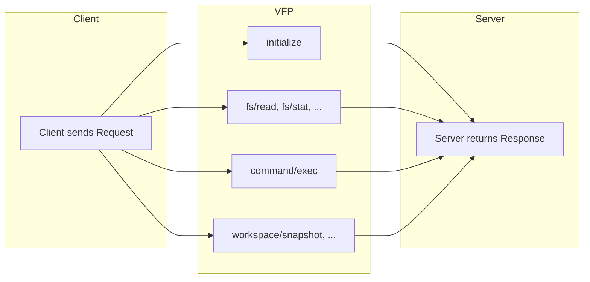
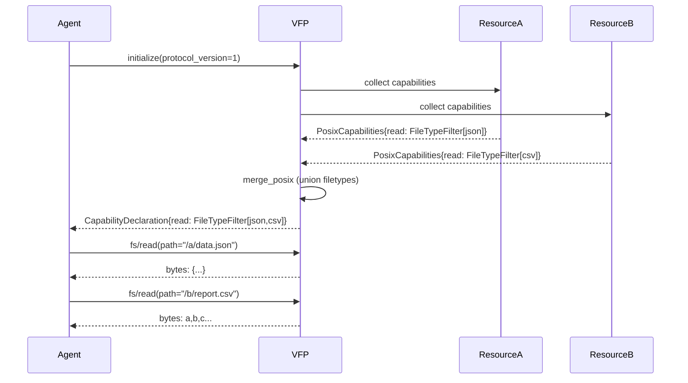

# 18. VFP Protocol — How Mirage Exposes Every Service as a Filesystem

The Virtual Filesystem Protocol (VFP) is Mirage's core interface contract: a small, language-agnostic set of JSON-RPC-shaped methods that define how resources expose filesystem semantics to coding agents. VFP translates 16 methods across three domains -- POSIX filesystem operations, command execution, and workspace lifecycle -- into a unified API that works identically whether the backend is S3, Slack, MongoDB, or Google Drive. The protocol is versioned (`PROTOCOL_VERSION = 1`), typed with Pydantic models in Python and frozen object literals in TypeScript, and self-describes capabilities so clients know exactly what each server supports before making a call.

Source: `python/mirage/vfp/__init__.py`, `python/mirage/vfp/methods.py`, `python/mirage/vfp/types.py`, `python/mirage/vfp/capability.py`, `python/mirage/vfp/skill.py`, `python/mirage/vfp/schema/vfp-0.1.json`, `typescript/packages/core/src/vfp/` -- the complete VFP protocol implementation.

Cross-reference: See [05-resource-model.md](05-resource-model.md) for how resources implement VFP methods, and [04-command-system.md](04-command-system.md) for how commands are dispatched under VFP semantics.

## VFP Protocol Overview

VFP defines a request/response pattern where every method has a named request type and a corresponding response type. All messages inherit from `_Msg` (Python) or `BaseMsg` (TypeScript), which provides an optional `_meta` dictionary for extensibility. The protocol is deliberately wire-format-agnostic at v0.1 -- the in-process Python and TypeScript SDKs are the reference implementations, and the JSON Schema at `vfp-0.1.json` provides a machine-readable contract for future wire implementations.



## Complete Method Set

VFP defines **16 methods** organized into three domains. The `METHODS` dictionary in `methods.py` maps each method name to its request/response tuple:

Source: `python/mirage/vfp/methods.py:223-244`

```python
METHODS: dict[str, tuple[type[_Msg], type[_Msg]]] = {
    InitializeRequest.METHOD: (InitializeRequest, InitializeResponse),
    FsReadRequest.METHOD: (FsReadRequest, FsReadResponse),
    FsReaddirRequest.METHOD: (FsReaddirRequest, FsReaddirResponse),
    FsStatRequest.METHOD: (FsStatRequest, FsStatResponse),
    FsWriteRequest.METHOD: (FsWriteRequest, FsWriteResponse),
    FsUnlinkRequest.METHOD: (FsUnlinkRequest, FsUnlinkResponse),
    FsMkdirRequest.METHOD: (FsMkdirRequest, FsMkdirResponse),
    FsRmdirRequest.METHOD: (FsRmdirRequest, FsRmdirResponse),
    FsRenameRequest.METHOD: (FsRenameRequest, FsRenameResponse),
    FsGlobRequest.METHOD: (FsGlobRequest, FsGlobResponse),
    CommandExecRequest.METHOD: (CommandExecRequest, CommandExecResponse),
    WorkspaceSnapshotRequest.METHOD: (WorkspaceSnapshotRequest, WorkspaceSnapshotResponse),
    WorkspaceLoadRequest.METHOD: (WorkspaceLoadRequest, WorkspaceLoadResponse),
    WorkspaceListRequest.METHOD: (WorkspaceListRequest, WorkspaceListResponse),
    WorkspaceDeleteRequest.METHOD: (WorkspaceDeleteRequest, WorkspaceDeleteResponse),
    WorkspaceInfoRequest.METHOD: (WorkspaceInfoRequest, WorkspaceInfoResponse),
}
```

### POSIX Filesystem Methods (10 methods)

These map directly to POSIX filesystem operations. Every resource that mounts as `MountType.FILESYSTEM` or `MountType.OBJECT_STORE` implements at least a subset of these.

| Method | Request Fields | Response Fields | POSIX Equivalent |
|--------|---------------|-----------------|------------------|
| `fs/read` | `path: str` | `bytes: bytes` | `open(path, O_RDONLY) + read()` |
| `fs/readdir` | `path: str` | `entries: list[Entry]` | `opendir() + readdir()` |
| `fs/stat` | `path: str` | `stat: FileStat` | `stat(2)` |
| `fs/write` | `path: str, bytes: bytes` | *(empty)* | `open(path, O_WRONLY\|O_CREAT) + write()` |
| `fs/unlink` | `path: str` | *(empty)* | `unlink(2)` |
| `fs/mkdir` | `path: str` | *(empty)* | `mkdir(2)` |
| `fs/rmdir` | `path: str` | *(empty)* | `rmdir(2)` |
| `fs/rename` | `src: str, dst: str` | *(empty)* | `rename(2)` |
| `fs/glob` | `pattern: str` | `paths: list[str]` | `glob(3)` with `*`, `?`, `[abc]`, `**` |

Source: `python/mirage/vfp/methods.py:44-141` -- each method's request/response pair:

```python
class FsReadRequest(_Msg):
    METHOD: ClassVar[str] = "fs/read"
    path: str

class FsReadResponse(_Msg):
    METHOD: ClassVar[str] = "fs/read"
    bytes: bytes

class FsStatRequest(_Msg):
    METHOD: ClassVar[str] = "fs/stat"
    path: str

class FsStatResponse(_Msg):
    METHOD: ClassVar[str] = "fs/stat"
    stat: FileStat

class FsWriteRequest(_Msg):
    METHOD: ClassVar[str] = "fs/write"
    path: str
    bytes: bytes

class FsGlobRequest(_Msg):
    METHOD: ClassVar[str] = "fs/glob"
    pattern: str

class FsGlobResponse(_Msg):
    METHOD: ClassVar[str] = "fs/glob"
    paths: list[str]
```

### Command Execution Method (1 method)

`command/exec` lets agents run tool-specific commands through VFP, with full stdin/stdout/stderr plumbing:

Source: `python/mirage/vfp/methods.py:144-159`

```python
class CommandExecRequest(_Msg):
    METHOD: ClassVar[str] = "command/exec"
    name: str
    argv: list[str] = Field(default_factory=list)
    stdin: bytes | None = None
    cwd: str | None = None

class CommandExecResponse(_Msg):
    METHOD: ClassVar[str] = "command/exec"
    stdout: bytes
    stderr: bytes
    exit_code: int
```

The `name` field is the command identifier (e.g., `grep`, `jq`, `cat`), `argv` carries arguments, `stdin` feeds input to the first pipeline stage, and `cwd` overrides the session working directory.

### Workspace Lifecycle Methods (5 methods)

These manage workspace snapshots, which capture the state of all mounted resources at a point in time:

Source: `python/mirage/vfp/methods.py:161-221`

```python
class WorkspaceSnapshotRequest(_Msg):
    METHOD: ClassVar[str] = "workspace/snapshot"
    name: str | None = None
    description: str | None = None

class WorkspaceSnapshotResponse(_Msg):
    METHOD: ClassVar[str] = "workspace/snapshot"
    snapshot: SnapshotInfo

class WorkspaceLoadRequest(_Msg):
    METHOD: ClassVar[str] = "workspace/load"
    id: str

class WorkspaceListRequest(_Msg):
    METHOD: ClassVar[str] = "workspace/list"
    limit: int | None = None
    offset: int = 0

class WorkspaceDeleteRequest(_Msg):
    METHOD: ClassVar[str] = "workspace/delete"
    id: str

class WorkspaceInfoRequest(_Msg):
    METHOD: ClassVar[str] = "workspace/info"
    # no fields
```

## VFP Type System

### Core Types

Source: `python/mirage/vfp/types.py:22-118`

```python
class FileType(str, Enum):
    DIRECTORY = "directory"
    TEXT = "text"
    BINARY = "binary"
    JSON = "json"
    CSV = "csv"
    MARKDOWN = "markdown"
    IMAGE_PNG = "image/png"
    IMAGE_JPEG = "image/jpeg"
    IMAGE_GIF = "image/gif"
    PDF = "application/pdf"
    ZIP = "application/zip"
    GZIP = "application/gzip"
    GDOC = "application/vnd.google-apps.document"
    PARQUET = "parquet"
    ORC = "orc"
    FEATHER = "feather"
    HDF5 = "hdf5"
```

`FileType` is the central type discriminator. Core values are normative across all backends, but the JSON Schema explicitly allows vendor-prefixed custom values (`x-<vendor>:...`). Clients must not error on unknown filetypes -- they should treat them as `binary`.

Source: `python/mirage/vfp/types.py:42-53` -- `ErrorCode`:

```python
class ErrorCode(str, Enum):
    NOT_FOUND = "NotFound"
    DENIED = "Denied"
    CONFLICT = "Conflict"
    IS_A_DIRECTORY = "IsADirectory"
    NOT_A_DIRECTORY = "NotADirectory"
    UNSUPPORTED_FILE_TYPE = "UnsupportedFileType"
    INVALID_PATH = "InvalidPath"
    NOT_IMPLEMENTED = "NotImplemented"
    RATE_LIMITED = "RateLimited"
    NETWORK = "Network"
```

Source: `python/mirage/vfp/types.py:55-65` -- `MountType`:

```python
class MountType(str, Enum):
    FILESYSTEM = "filesystem"
    OBJECT_STORE = "object-store"
    MESSAGING = "messaging"
    EMAIL = "email"
    DOCUMENTS = "documents"
    ISSUE_TRACKER = "issue-tracker"
    DATABASE = "database"
    CACHE = "cache"
    OBSERVABILITY = "observability"
```

### Data Transfer Types

Source: `python/mirage/vfp/types.py:67-97`

```python
class Entry(BaseModel):
    model_config = ConfigDict(frozen=True, populate_by_name=True)
    name: str
    type: FileType
    size: int | None = None
    modified: datetime | None = None
    meta: dict[str, Any] = Field(default_factory=dict, alias="_meta")

class FileStat(BaseModel):
    model_config = ConfigDict(frozen=True, populate_by_name=True)
    name: str
    type: FileType
    size: int | None = None
    modified: datetime | None = None
    fingerprint: str | None = None
    extra: dict[str, Any] = Field(default_factory=dict)
    meta: dict[str, Any] = Field(default_factory=dict, alias="_meta")

class Mount(BaseModel):
    model_config = ConfigDict(frozen=True, populate_by_name=True)
    path: str
    type: MountType | str
    writable: bool = False
    filetypes: list[FileType] = Field(default_factory=list)
    meta: dict[str, Any] = Field(default_factory=dict, alias="_meta")
```

`FileStat.fingerprint` is a content-derived change token (ETag, md5 hash) that must change if and only if content changes. `FileStat.extra` carries backend-specific fields like S3 etags or GitHub SHAs.

### Implementation and Snapshot Types

Source: `python/mirage/vfp/types.py:99-118`

```python
class Implementation(BaseModel):
    model_config = ConfigDict(frozen=True, populate_by_name=True)
    name: str
    language: str
    version: str
    meta: dict[str, Any] = Field(default_factory=dict, alias="_meta")

class SnapshotInfo(BaseModel):
    model_config = ConfigDict(frozen=True, populate_by_name=True)
    id: str
    name: str | None = None
    description: str | None = None
    parent_id: str | None = None
    created: datetime
    size: int | None = None
    meta: dict[str, Any] = Field(default_factory=dict, alias="_meta")
```

`SnapshotInfo.parent_id` provides free lineage without explicit branch operations -- each snapshot tracks its source, enabling a Git-like history graph.

## Capability System

The capability system is VFP's self-description mechanism. During `initialize`, a server returns a `CapabilityDeclaration` that tells the client exactly what it can do. This is not a static manifest -- it is computed per-workspace from the actual mounted resources.

Source: `python/mirage/vfp/capability.py:87-103`

```python
class ServerCapabilities(BaseModel):
    model_config = ConfigDict(populate_by_name=True)
    posix: PosixCapabilities = Field(default_factory=PosixCapabilities)
    commands: CommandCapabilities = Field(default_factory=CommandCapabilities)
    workspace: WorkspaceCapabilities = Field(default_factory=WorkspaceCapabilities)
    mounts: list[Mount] = Field(default_factory=list)
    meta: dict[str, Any] = Field(default_factory=dict, alias="_meta")

class CapabilityDeclaration(BaseModel):
    model_config = ConfigDict(populate_by_name=True)
    protocol_version: int = 1
    implementation: Implementation
    capabilities: ServerCapabilities
```

### PosixCapabilities

Each POSIX operation declares its support level as either a boolean or a `FileTypeFilter`:

Source: `python/mirage/vfp/capability.py:43-58`

```python
PosixOpSupport = bool | FileTypeFilter

class PosixCapabilities(BaseModel):
    model_config = ConfigDict(populate_by_name=True)
    read: PosixOpSupport = False
    readdir: bool = False
    stat: bool = False
    write: PosixOpSupport = False
    unlink: bool = False
    mkdir: bool = False
    rmdir: bool = False
    rename: bool = False
    glob: bool = False
```

`read` and `write` use `PosixOpSupport` (either `True`/`False` or a `FileTypeFilter`) because these operations are the most filetype-sensitive. A S3 bucket might only support reading/writing `text`, `json`, and `csv`, while a disk resource supports everything. Operations like `readdir`, `stat`, `unlink` are pure booleans because they operate on directory entries or paths regardless of content type.

### CommandCapabilities

Source: `python/mirage/vfp/capability.py:61-74`

```python
class CommandCapability(BaseModel):
    model_config = ConfigDict(populate_by_name=True)
    filetypes: list[FileType] | None = None
    flags: FlagFilter | None = None

class CommandCapabilities(BaseModel):
    model_config = ConfigDict(populate_by_name=True, extra="allow")
    ls: CommandSupport = False
    cat: CommandSupport = False
    head: CommandSupport = False
    tail: CommandSupport = False
    wc: CommandSupport = False
    grep: CommandSupport = False
    find: CommandSupport = False
    jq: CommandSupport = False
    sed: CommandSupport = False
    cp: CommandSupport = False
    mv: CommandSupport = False
```

The `extra="allow"` config permits vendor extensions. Commands like `cat` can be restricted to specific filetypes and have their flag sets constrained via `FlagFilter`.

### FlagFilter

Source: `python/mirage/vfp/capability.py:22-27`

```python
class FlagFilter(BaseModel):
    model_config = ConfigDict(populate_by_name=True)
    exclude: list[str] = Field(default_factory=list)
    include: list[str] = Field(default_factory=list)
    only: list[str] | None = None
```

`exclude` lists standard flags the implementation does not support. `include` lists non-standard flags it accepts. `only` is an explicit override that replaces the standard flag set entirely.

### WorkspaceCapabilities

Source: `python/mirage/vfp/capability.py:77-84`

```python
class WorkspaceCapabilities(BaseModel):
    model_config = ConfigDict(populate_by_name=True)
    snapshot: bool = False
    load: bool = False
    list: bool = False
    delete: bool = False
    info: bool = False
```

### Capability Merging

When multiple mounts are present in a workspace, capabilities are unioned. The `merge_posix` and `merge_commands` functions combine per-mount capabilities:

Source: `python/mirage/vfp/capability.py:139-166`

```python
def merge_posix(into: PosixCapabilities,
                src: PosixCapabilities) -> PosixCapabilities:
    """Union per-op support across mounts."""
    for field in into.model_fields:
        existing = getattr(into, field)
        new = getattr(src, field)
        merged = _merge_op_support(existing, new)
        setattr(into, field, merged)
    return into

def _merge_op_support(a: PosixOpSupport, b: PosixOpSupport) -> PosixOpSupport:
    if a is True or b is True:
        return True
    if a is False:
        return b
    if b is False:
        return a
    types = sorted(set(a.filetypes) | set(b.filetypes), key=lambda t: t.value)
    return FileTypeFilter(filetypes=types)
```

The merge logic is a three-way: if either side is `True`, the result is `True`; if one side is `False`, the result takes the other; otherwise the filetypes are unioned into a combined `FileTypeFilter`.

### CapabilityBuilder

The `CapabilityBuilder` is a factory that accumulates capabilities for a mount and produces a `Mount` object:

Source: `python/mirage/vfp/capability.py:106-137`

```python
class CapabilityBuilder:
    def __init__(
        self,
        mount_type: MountType | str = MountType.FILESYSTEM,
        writable: bool = False,
    ) -> None:
        self.mount_type = mount_type
        self.writable = writable
        self.posix = PosixCapabilities()
        self.commands = CommandCapabilities()
        self.workspace = WorkspaceCapabilities()

    def advertised_filetypes(self) -> list[FileType]:
        types: set[FileType] = set()
        for op in (self.posix.read, self.posix.write):
            if isinstance(op, FileTypeFilter):
                types.update(op.filetypes)
        for cmd_name in self.commands.model_fields:
            cmd = getattr(self.commands, cmd_name)
            if isinstance(cmd, CommandCapability) and cmd.filetypes:
                types.update(cmd.filetypes)
        return sorted(types, key=lambda t: t.value)

    def to_mount(self, path: str) -> Mount:
        return Mount(
            path=path,
            type=self.mount_type,
            writable=self.writable,
            filetypes=self.advertised_filetypes(),
        )
```

```mermaid
flowchart TD
    A[CapabilityBuilder] --> B["posix: PosixCapabilities"]
    A --> C["commands: CommandCapabilities"]
    A --> D["workspace: WorkspaceCapabilities"]

    B --> B1["read: bool or FileTypeFilter"]
    B --> B2["write: bool or FileTypeFilter"]
    B --> B3["readdir, stat, unlink...: bool"]

    C --> C1["ls, cat, grep, jq..."]
    C1 --> C2["filetypes: list"]
    C1 --> C3["flags: FlagFilter"]

    A --> E[advertised_filetypes()]
    E --> F[to_mount(path)]
    F --> G["Mount{path, type, writable, filetypes}"]
```

## Skill System

VFP's `render` function transforms a `CapabilityDeclaration` into a human-readable (and LLM-readable) skill description. This is how agents learn what they can do in a workspace.

Source: `python/mirage/vfp/skill.py:24-82`

```python
def render(
    declaration: CapabilityDeclaration,
    *,
    format: SkillFormat = "markdown",
) -> str:
    impl = declaration.implementation
    caps = declaration.capabilities

    h1, h2 = ("# ", "## ") if format == "markdown" else ("", "")

    lines: list[str] = []
    lines.append(f"{h1}{impl.name} workspace ({impl.language} {impl.version})")
    lines.append("")
    lines.append(f"{h2}Mounts")
    if not caps.mounts:
        lines.append("- (none)")
    else:
        for m in caps.mounts:
            lines.append(_render_mount(m))
    lines.append("")
    lines.append(f"{h2}Filesystem operations")
    lines.extend(_render_posix(caps.posix))
    lines.append("")
    lines.append(f"{h2}Commands")
    lines.extend(_render_commands(caps.commands))
    lines.append("")
    if any([caps.workspace.snapshot, caps.workspace.load, ...]):
        lines.append(f"{h2}Workspace lifecycle")
        ...
    lines.append(f"{h2}Path rules")
    lines.append("- Paths are absolute (start with `/`).")
    lines.append("- Glob patterns are accepted only on `fs/glob`.")
    lines.append("- Other ops reject patterns with `InvalidPath`.")
    return "\n".join(lines).rstrip() + "\n"
```

The output looks like:

```
# mirage workspace (python 0.1.0)

## Mounts
- `/s3` -- object-store (read-only). Filetypes: text, json, csv
- `/github` -- filesystem (writable). Filetypes: text, json, markdown

## Filesystem operations
- `fs/read` -- supports: text, json, csv
- `fs/write` -- supports: text, json, markdown
- `fs/readdir`
- `fs/stat`
- `fs/glob`

## Commands
- `grep` -- filetypes: text, json
- `jq`
- `cat` -- filetypes: text, json, markdown

## Path rules
- Paths are absolute (start with `/`).
- Glob patterns are accepted only on `fs/glob`.
- Other ops reject patterns with `InvalidPath`.
```

## VFP Mapping to POSIX Operations

| VFP Method | POSIX Operation | Notes |
|------------|----------------|-------|
| `fs/read` | `read(2)` | Returns raw `bytes`; content type inferred from `FileStat` |
| `fs/readdir` | `readdir(3)` | Returns `list[Entry]`, not raw directory entries |
| `fs/stat` | `stat(2)` | Returns `FileStat` with `fingerprint` for change detection |
| `fs/write` | `write(2)` | Overwrites atomically; creates if missing |
| `fs/unlink` | `unlink(2)` | Deletes files only; `IsADirectory` error for directories |
| `fs/mkdir` | `mkdir(2)` | Creates single directory; no recursive `-p` behavior |
| `fs/rmdir` | `rmdir(2)` | Removes empty directories only |
| `fs/rename` | `rename(2)` | Atomic rename within same mount |
| `fs/glob` | `glob(3)` | Supports `*`, `?`, `[abc]`, `[!abc]`, `**` patterns |
| `command/exec` | `execve(2)` | Runs named command with stdin/stdout/stderr |

## VFP for Non-Filesystem Resources

VFP's type system handles non-filesystem resources through `MountType` and custom `FileType` values:

- **Databases** (`MountType.DATABASE`): Tables appear as files with types like `json`, `csv`, `parquet`. `fs/readdir` lists tables, `fs/read` returns query results, `fs/stat` returns row counts. MongoDB uses custom filetypes for document representations.
- **APIs** (`MountType.MESSAGING`, `MountType.EMAIL`): Channels/conversations are directories, messages are files with custom types like `x-mirage:slack-message` (as noted in the JSON Schema example at `vfp-0.1.json:25`).
- **Object stores** (`MountType.OBJECT_STORE`): Buckets are directories, objects are files. `FileStat.extra` carries S3 etags or GCS generation IDs.
- **Issue trackers** (`MountType.ISSUE_TRACKER`): Repositories are directories, issues are files. `fs/stat` returns issue metadata via `extra`.

The JSON Schema explicitly supports vendor-prefixed types: `x-<vendor>:<subtype>`. Clients must tolerate unknown types as `binary` per the schema contract.

## TypeScript VFP Implementation

The TypeScript implementation at `typescript/packages/core/src/vfp/` mirrors the Python implementation exactly. Key differences:

Source: `typescript/packages/core/src/vfp/types.ts:15-34`

```typescript
export const FileType = Object.freeze({
  DIRECTORY: 'directory',
  TEXT: 'text',
  BINARY: 'binary',
  JSON: 'json',
  CSV: 'csv',
  MARKDOWN: 'markdown',
  IMAGE_PNG: 'image/png',
  IMAGE_JPEG: 'image/jpeg',
  IMAGE_GIF: 'image/gif',
  PDF: 'application/pdf',
  ZIP: 'application/zip',
  GZIP: 'application/gzip',
  GDOC: 'application/vnd.google-apps.document',
  PARQUET: 'parquet',
  ORC: 'orc',
  FEATHER: 'feather',
  HDF5: 'hdf5',
} as const)
export type FileType = (typeof FileType)[keyof typeof FileType] | (string & {})
```

TypeScript uses `Object.freeze` const objects instead of Python `Enum`. The `| (string & {})` trick allows vendor-prefixed custom types while preserving autocomplete for the core set.

Source: `typescript/packages/core/src/vfp/methods.ts:136-155`

```typescript
export const Methods = Object.freeze({
  INITIALIZE: 'initialize',
  FS_READ: 'fs/read',
  FS_READDIR: 'fs/readdir',
  FS_STAT: 'fs/stat',
  FS_WRITE: 'fs/write',
  FS_UNLINK: 'fs/unlink',
  FS_MKDIR: 'fs/mkdir',
  FS_Rmdir: 'fs/rmdir',
  FS_RENAME: 'fs/rename',
  FS_GLOB: 'fs/glob',
  COMMAND_EXEC: 'command/exec',
  WORKSPACE_SNAPSHOT: 'workspace/snapshot',
  WORKSPACE_LOAD: 'workspace/load',
  WORKSPACE_LIST: 'workspace/list',
  WORKSPACE_DELETE: 'workspace/delete',
  WORKSPACE_INFO: 'workspace/info',
} as const)
```

The `MountType` type allows `(string & {})` for vendor extensions, matching the Python `MountType | str` union.

### Cross-Language Parity

| Aspect | Python | TypeScript |
|--------|--------|-----------|
| Base message | `_Msg` with `alias="_meta"` | `BaseMsg` with `_meta?` |
| Enum types | `str, Enum` subclasses | `Object.freeze` const objects |
| Extensible types | `MountType | str` | `MountType | (string & {})` |
| Capabilities | Pydantic `BaseModel` | TypeScript `interface` |
| Method registry | `METHODS` dict | `Methods` frozen object |
| Capability merge | `merge_posix`, `merge_commands` | `mergePosix`, `mergeCommands` |
| Skill render | `render(declaration, format=)` | `render(declaration, opts?)` |

The TypeScript `CommandCapabilities` interface uses an index signature for vendor extensions:

Source: `typescript/packages/core/src/vfp/capability.ts:48-61`

```typescript
export interface CommandCapabilities {
  ls: CommandSupport
  cat: CommandSupport
  head: CommandSupport
  tail: CommandSupport
  wc: CommandSupport
  grep: CommandSupport
  find: CommandSupport
  jq: CommandSupport
  sed: CommandSupport
  cp: CommandSupport
  mv: CommandSupport
  [vendor: string]: CommandSupport  // vendor extensions
}
```

## JSON Schema

The VFP JSON Schema at `python/mirage/vfp/schema/vfp-0.1.json` provides a complete machine-readable contract. Key design decisions:

- `$id: "https://strukto.ai/schema/vfp-0.1.json"` -- the schema is hosted and versioned
- All definitions live in `$defs` -- the schema covers every request/response type
- `x-method` and `x-side` extensions tag each type with its VFP method and direction
- `FileType` examples include vendor-prefixed values (`x-mirage:slack-message`) to demonstrate extensibility
- `FileStat.fingerprint` is documented as: "MUST change iff content changes. MAY be an etag, hash, or version identifier."

## Aha: Capability-Driven Contract Negotiation

VFP does not assume all servers support all methods. Instead, the `initialize` handshake returns a `CapabilityDeclaration` that is computed from the actual mounts. A workspace with only a RAM mount and a read-only S3 bucket will declare only `read` (filtered by filetype), `readdir`, `stat`, and no write operations. This means agents know exactly what they can do before attempting an operation, eliminating trial-and-error. The capability system is **union-based** across mounts: if mount A supports reading `json` and mount B supports reading `csv`, the workspace declares support for both -- the agent doesn't need to know which mount handles which type.



Cross-reference: See [05-resource-model.md](05-resource-model.md) for how individual resources register their ops and commands, and [04-command-system.md](04-command-system.md) for how `command/exec` dispatches through the op system. The next document, [19-observability.md](19-observability.md), covers how VFP operations are recorded and replayed through the Observer system.
