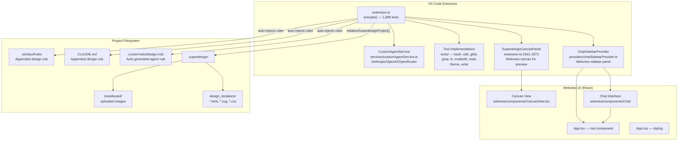
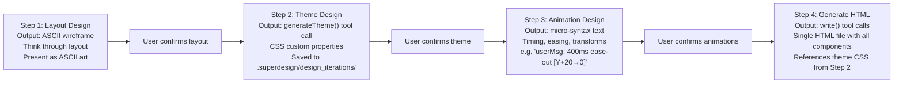

# Superdesign — AI Design Agent Inside Your IDE

**Superdesign (v0.0.11, MIT) is a VS Code extension that puts an AI design agent directly in your IDE sidebar.** It's the first open-source design agent that lives inside the editor — users describe what they want in natural language, and the agent follows a structured 4-step design workflow: Layout (ASCII wireframes) → Theme (CSS custom properties with the `generateTheme` tool) → Animation (micro-syntax) → HTML generation (single-file output to `.superdesign/design_iterations/`). It supports Anthropic, OpenAI, and OpenRouter as AI providers, integrates with Cursor rules, Claude Code, and Windsurf rules files, and includes a Canvas panel for previewing generated HTML/CSS/SVG designs with live file watching.

Source: `src/` — 25 TypeScript files, VS Code extension

## Architecture



## The 4-Step Design Workflow

The agent follows a structured, step-by-step process enforced by the design rule prompt:



### Step 1: ASCII Wireframe Example

The agent outputs ASCII layouts like:
```
┌─────────────────────────────────────┐
│ ☰          HEADER BAR            + │
├─────────────────────────────────────┤
│ ┌─────────────────────────────┐     │
│ │     AI Message Bubble       │     │
│ └─────────────────────────────┘     │
│     ┌─────────────────────────────┐ │
│     │     User Message Bubble     │ │
│     └─────────────────────────────┘ │
│              [CHAT AREA]            │
├─────────────────────────────────────┤
│ [Text Input Field]           [Send] │
└─────────────────────────────────────┘
```

### Step 2: Theme Design with generateTheme

The `generateTheme` tool writes CSS custom properties as a `.css` file:

```css
:root {
  --background: oklch(0.145 0 0);
  --foreground: oklch(0.985 0 0);
  --card: oklch(0.205 0 0);
  --primary: oklch(0.922 0 0);
  --font-sans: 'Geist Mono', monospace;
  --radius: 0rem;
  --shadow-sm: 0px 1px 0px 0px hsl(0 0% 0% / 0.00);
  /* ... 40+ CSS custom properties */
}
```

### Step 3: Animation Micro-Syntax

```
userMsg: 400ms ease-out [Y+20→0, X+10→0, S0.9→1]
aiMsg: 600ms bounce [Y+15→0, S0.95→1] +200ms
sidebar: 350ms ease-out [X-280→0, α0→1]
sendBtn: 150ms [S1→0.95→1, R±2°] press
```

## The ChatSidebarProvider — Webview-Backed Chat

The sidebar provider (`providers/chatSidebarProvider.ts`) manages a VS Code `WebviewView` that hosts a React chat UI. It handles:

1. **Message routing** — user text → AI provider → streaming response → webview display
2. **Tool execution** — AI requests tool calls (read, write, bash, etc.) → provider executes → results sent back
3. **Image handling** — moodboard uploads saved to `.superdesign/moodboard/`, base64 conversion for AI SDK
4. **Theme preview** — CSS file content read from disk and forwarded to webview
5. **Canvas coordination** — `autoOpenCanvas` command opens the Canvas panel when designs are generated

## Tool Implementations — 9 Tools

Each tool in `src/tools/` follows the VS Code tool contract:

| Tool | File | Purpose |
|------|------|---------|
| **read** | `read-tool.ts` | Read file contents (supports text, images, line ranges) |
| **write** | `write-tool.ts` | Write content to files (creates parent directories) |
| **edit** | `edit-tool.ts` | Replace text using exact string matching |
| **multiedit** | `multiedit-tool.ts` | Multiple find-and-replace operations in sequence |
| **bash** | `bash-tool.ts` | Execute shell commands (with timeout and output capture) |
| **glob** | `glob-tool.ts` | Find files matching glob patterns |
| **grep** | `grep-tool.ts` | Search file contents with regex |
| **ls** | `ls-tool.ts` | List directory contents |
| **theme** | `theme-tool.ts` | Generate theme CSS file with custom properties |

**Aha:** The `generateTheme` tool is superdesign's unique contribution — it writes CSS custom properties as a complete theme file, which the generated HTML can then reference via `<link rel="stylesheet">`. This separates theme design from component design, allowing the user to iterate on colors/fonts independently of layout.

## Canvas Panel — Live Design Preview

The `SuperdesignCanvasPanel` (lines 1541-1872 of `extension.ts`) creates a secondary webview panel that:

1. **Reads** all `.html` and `.svg` files from `.superdesign/design_iterations/`
2. **Inlines** external CSS files referenced via `<link>` tags
3. **Renders** them as preview frames in a React canvas UI
4. **Watches** the directory via `vscode.workspace.createFileSystemWatcher` for live reload on file changes
5. **Passes context** back to the chat sidebar — selecting a design frame can trigger "iterate on this"

```typescript
// extension.ts:1639-1686 — File watcher setup
const pattern = new vscode.RelativePattern(
    workspaceFolder, 
    '.superdesign/design_iterations/**/*.{html,svg,css}'
);
this._fileWatcher = vscode.workspace.createFileSystemWatcher(pattern, false, false, false);
this._fileWatcher.onDidCreate((uri) => {
    this._panel.webview.postMessage({ command: 'fileChanged', data: { fileName, changeType: 'created' } });
});
```

## Project Initialization — Auto-Injecting Rules

`initializeSuperdesignProject()` (lines 243-1242) does more than create directories:

1. Creates `.superdesign/design_iterations/` folder
2. Writes `default_ui_darkmode.css` — a 1,168-line comprehensive CSS framework with dark mode tokens, components (cards, buttons, forms, tabs, badges), utilities, responsive breakpoints, and accessibility support
3. Injects the design rule into **three** agent rule files:
   - `.cursor/rules/design.mdc` — Cursor agent instructions
   - `CLAUDE.md` — Claude Code instructions  
   - `.windsurfrules` — Windsurf instructions
4. Each injection is **idempotent** — checks if the rule already exists before appending

## AI Provider Support

Three providers configured via VS Code settings:

| Provider | Config Key | API Key Prefix |
|----------|-----------|---------------|
| **Anthropic** (Claude) | `superdesign.anthropicApiKey` | `sk-ant-` |
| **OpenAI** | `superdesign.openaiApiKey` | `sk-` |
| **OpenRouter** | `superdesign.openrouterApiKey` | `sk-` |

API keys are stored in VS Code's `SecretStorage` and configured via command palette commands (`superdesign.configureApiKey`, `superdesign.configureOpenAIApiKey`, `superdesign.configureOpenRouterApiKey`) with masked input validation.

### Key Validation

```typescript
// extension.ts:1420-1425
validateInput: (value) => {
    if (!value || value.trim().length === 0) return 'API key cannot be empty';
    if (value === '••••••••••••••••') return null; // Mask unchanged
    if (!value.startsWith('sk-ant-')) return 'Anthropic API keys should start with "sk-ant-"';
    return null;
}
```

## Design Prompt Engineering — The 627-Line Rule

The core of superdesign is a 627-line design rule injected into agent contexts. Key principles:

1. **Flowbite as default component library** (loaded from CDN via `<script>` tag)
2. **No indigo/blue unless requested** — avoids the Bootstrap default aesthetic
3. **Always responsive** — `@media` breakpoints at 768px and 640px
4. **Google Fonts for typography** — 21 curated font options from JetBrains Mono to Space Grotesk
5. **`!important` for Tailwind overrides** — because CDN-loaded Tailwind can override custom styles
6. **Two built-in theme presets:**
   - **Neo-brutalism:** `--radius: 0px`, `--shadow: 4px 4px 0px`, flat borders, DM Sans
   - **Modern dark mode:** `--radius: 0.625rem`, soft shadows, system font stack

## Cross-References

- [ponytail](../src.PromptOptimizations/markdown/00-overview.md) — Agent skill for minimal code generation
- [taste-skill](../src.DesignSkills/markdown/00-overview.md) — Anti-slop design skills (similar prompt-engineering approach)

## Build HTML

```bash
cd /home/darkvoid/Boxxed/@dev/repo-expolorations/[src.AI]/src.superdesign
python3 build.py .
```
