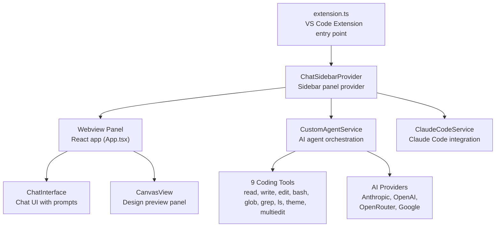
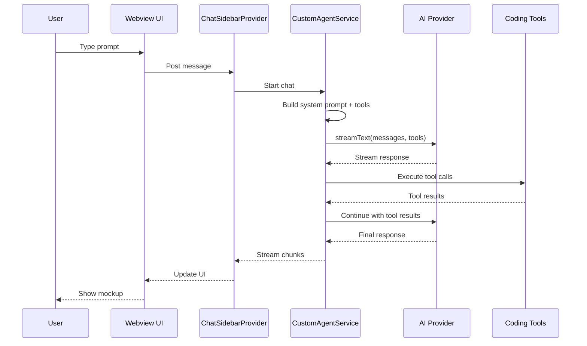

# SuperDesign Architecture

SuperDesign is a VS Code extension with a React webview sidebar, an AI agent service, and a set of 9 coding tools.

**Source:** `/home/darkvoid/Boxxed/@formulas/src.rust/src.AI/src.superdesign/superdesign/`

## Extension Architecture



## Key Components

### extension.ts

The VS Code extension entry point (`src/extension.ts`):

- Registers the `ChatSidebarProvider` for the sidebar panel
- Sets up image upload handling (moodboard feature)
- Creates the output channel for logging
- Manages extension lifecycle (activation, disposal)

### ChatSidebarProvider

The sidebar panel provider (`src/providers/chatSidebarProvider.ts`):

- Creates and manages the webview panel
- Handles messages between the webview and extension host
- Delegates chat requests to the CustomAgentService

### CustomAgentService

The AI agent orchestrator (`src/services/customAgentService.ts`):

- Sets up working directory (`.superdesign/` in workspace root)
- Configures AI provider (Anthropic, OpenAI, OpenRouter, Google)
- Creates and manages the 9 coding tools
- Streams AI responses with tool execution
- Uses Vercel AI SDK (`ai` package) with `streamText()`

### ClaudeCodeService

Claude Code integration (`src/services/claudeCodeService.ts`):

- Integrates with Claude Code for enhanced code generation
- Uses `@anthropic-ai/claude-code` package

## Data Flow



## Working Directory

The agent creates and uses a `.superdesign/` directory in the workspace root:

```
workspace/
├── .superdesign/
│   └── moodboard/     — Uploaded images
│   └── agent files   — Agent-created files
└── ...
```

If no workspace is found, it falls back to a temporary directory in the OS temp folder.

**Source:** `src/services/customAgentService.ts` lines 31-77.

## Logging

The Logger service (`src/services/logger.ts`) provides:

- `LogLevel` enum: info, warn, error, debug
- Output channel writing for VS Code output panel
- Structured logging with timestamps

## Next

Continue to [02-ai-providers](02-ai-providers.md) for the Vercel AI SDK and provider configuration.

## Aha Moments

**Aha: The extension uses two separate webview shells for sidebar and canvas.** Rather than rendering both views in a single webview with conditional CSS, the code creates entirely different HTML shells via `webviewTemplate.ts`. The sidebar template injects VS Code theme CSS variables (`--vscode-sideBar-foreground`, `--vscode-sideBar-background`) while the canvas template creates its own standalone layout. This avoids the VS Code webview CSP restrictions fighting with internal layout CSS, and lets each view have its own CSP policy — the sidebar allows `'unsafe-inline'` styles while the canvas restricts `frame-src` for iframe embedding of generated HTML previews.

**Aha: The message handler is bidirectional through a single middleware.** The `ChatSidebarProvider` doesn't just relay messages — it acts as a full message broker. The webview sends messages via `vscode.postMessage()`, which the sidebar receives in `onDidReceiveMessage`. But the sidebar also sets up a `setMessageHandler` callback in `extension.ts` that intercepts the same messages for cross-component coordination. When the webview sends `autoOpenCanvas`, the sidebar catches it in its own switch AND forwards it to the extension's handler which creates the `SuperdesignCanvasPanel`. This pattern means a single webview message can trigger actions in both the sidebar and the main extension host simultaneously.

**Aha: Provider switching happens at the VS Code config layer, not the SDK layer.** When the user selects a different model in the ModelSelector, the webview sends `changeProvider` which updates `vscode.workspace.getConfiguration('superdesign')` settings globally. The next AI call reads these settings fresh — there is no live provider swap or SDK reinitialization. This means the provider is stateless between calls, which is why the `getModel()` method in `CustomAgentService` reads config every time rather than caching a provider instance. The tradeoff is simplicity over performance, but for a design agent making infrequent calls, the overhead is negligible.
