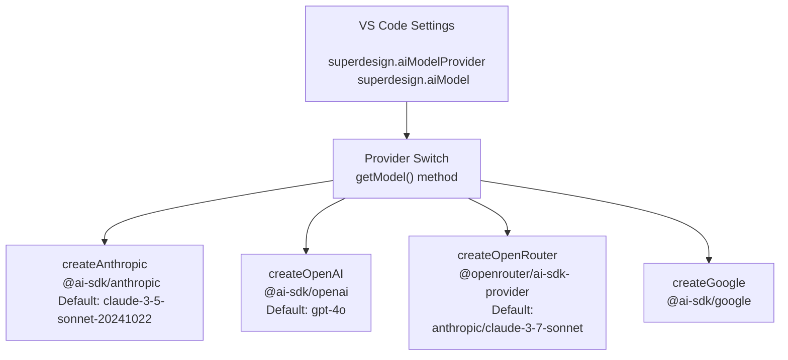
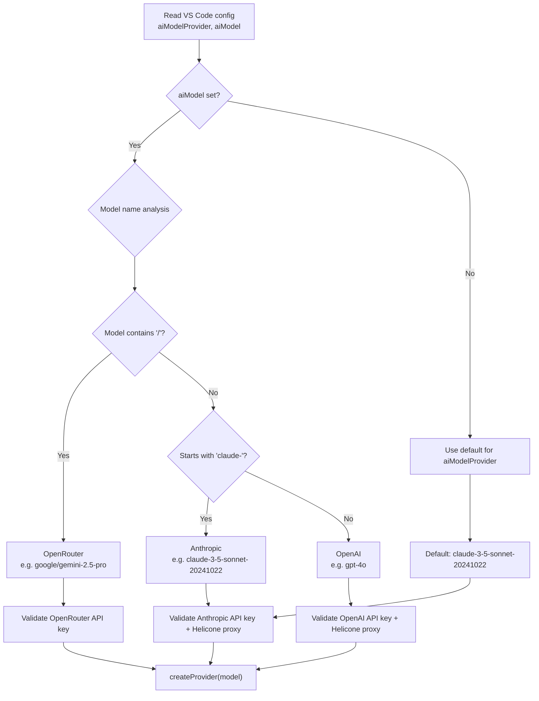
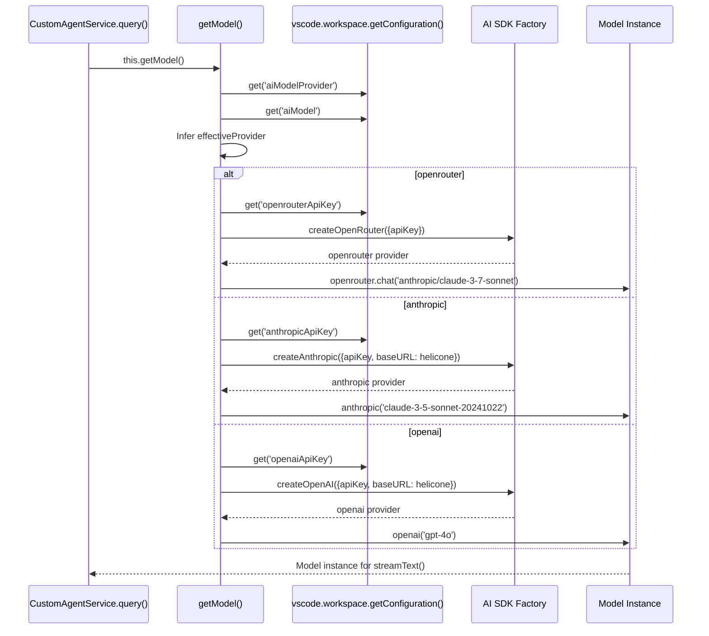

# AI Providers: Vercel AI SDK

SuperDesign uses the Vercel AI SDK (`ai` package) as its abstraction layer, supporting 4 AI providers: Anthropic, OpenAI, OpenRouter, and Google.

**Source:** `/home/darkvoid/Boxxed/@formulas/src.rust/src.AI/src.superdesign/superdesign/src/services/customAgentService.ts`

## Provider Abstraction



**Aha:** The provider is determined by a combination of `aiModelProvider` setting and the model name prefix. If the model contains `/`, it uses OpenRouter. If it starts with `claude-`, it uses Anthropic. Otherwise, OpenAI.

**Source:** `src/services/customAgentService.ts` lines 80-163.

## Provider Resolution Flow

When the AI provider is determined, the resolution follows a two-tier cascade:



**Source:** `src/services/customAgentService.ts` lines 80-163 — `getModel()` method.

## Provider Configuration

| Provider | API Key Setting | Default Model | Helicone Proxy |
|----------|----------------|---------------|----------------|
| Anthropic | `superdesign.anthropicApiKey` | `claude-3-5-sonnet-20241022` | Yes (`anthropic.helicone.ai`) |
| OpenAI | `superdesign.openaiApiKey` | `gpt-4o` | Yes (`oai.helicone.ai`) |
| OpenRouter | `superdesign.openrouterApiKey` | `anthropic/claude-3-7-sonnet-20250219` | No |
| Google | `superdesign.googleApiKey` | — | No |

**Aha:** Anthropic and OpenAI providers use Helicone as a proxy for observability and caching. The Helicone auth header is hardcoded in the SDK configuration, meaning all requests through these providers go through Helicone's proxy layer. OpenRouter connects directly without a proxy.

**Source:** `src/services/customAgentService.ts` lines 120-162.

## Provider SDK Construction Sequence



## Streaming

The agent uses `streamText()` from the Vercel AI SDK:

```typescript
import { streamText, CoreMessage } from 'ai';

const result = streamText({
  model: this.getModel(),
  messages: coreMessages,
  tools: this.getTools(),
  system: this.getSystemPrompt(),
});
```

This provides streaming responses with tool execution support.

## System Prompt

The system prompt varies based on the configured model:

```typescript
// src/services/customAgentService.ts
// System prompt instructs the AI to:
// - Design UI based on user prompts
// - Use available tools to create files
// - Generate clean, modern HTML/CSS
```

**Source:** `src/services/customAgentService.ts` lines 165+.

## VS Code Settings

| Setting | Type | Description |
|---------|------|-------------|
| `superdesign.aiModelProvider` | string | Provider: 'anthropic', 'openai', 'openrouter', 'google' |
| `superdesign.aiModel` | string | Specific model name (overrides default) |
| `superdesign.anthropicApiKey` | string | Anthropic API key |
| `superdesign.openaiApiKey` | string | OpenAI API key |
| `superdesign.openrouterApiKey` | string | OpenRouter API key |
| `superdesign.googleApiKey` | string | Google AI API key |

## Next

Continue to [03-tools](03-tools.md) for the 9 coding tools.
