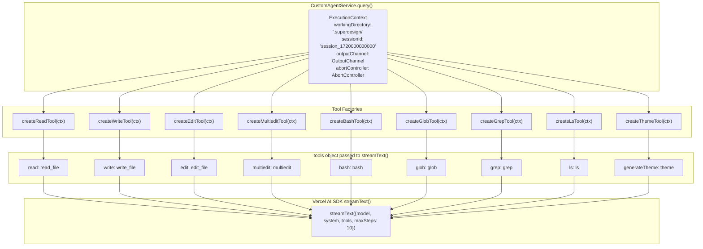
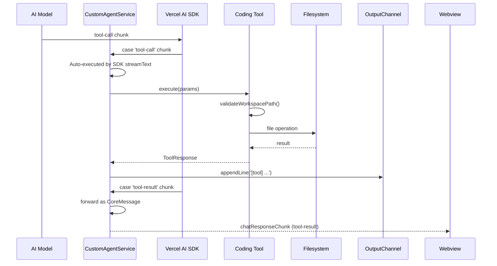

# Coding Tools

SuperDesign provides 9 coding tools that the AI agent can use to manipulate files, execute commands, and manage themes.

**Source:** `/home/darkvoid/Boxxed/@formulas/src.rust/src.AI/src.superdesign/superdesign/src/tools/`

## Tool Catalog

| Tool | File | Purpose |
|------|------|---------|
| Read | `read-tool.ts` | Read file contents |
| Write | `write-tool.ts` | Write file contents |
| Edit | `edit-tool.ts` | Edit file contents (search and replace) |
| Bash | `bash-tool.ts` | Execute shell commands |
| Glob | `glob-tool.ts` | Find files matching a pattern |
| Grep | `grep-tool.ts` | Search for text patterns in files |
| Ls | `ls-tool.ts` | List directory contents |
| Multiedit | `multiedit-tool.ts` | Edit multiple files simultaneously |
| Theme | `theme-tool.ts` | Manage design themes |

## Tool Architecture

Each tool follows the same factory pattern:

```typescript
// tools/<name>-tool.ts
// create<Name>Tool(context: ExecutionContext) → returns tool() from 'ai'
//   - description: string (shown to AI model)
//   - parameters: Zod schema (validated by AI SDK)
//   - execute: async function with validated params
```

All tools receive an `ExecutionContext` containing:
- `workingDirectory: string` — the `.superdesign/` directory
- `sessionId: string` — unique session ID like `session_1720000000000`
- `outputChannel: vscode.OutputChannel` — for logging
- `abortController?: AbortController` — for cancellation

**Source:** `src/types/agent.ts` lines 17-22.

## Shared Utilities: tool-utils.ts

Every tool imports from `tool-utils.ts` for shared validation and response formatting:

```typescript
// src/tools/tool-utils.ts:7-22
export interface ToolErrorResponse {
  success: false;
  error: string;
  error_type?: 'validation' | 'security' | 'file_not_found' | 'permission' | 'execution' | 'unknown';
  details?: any;
}

export interface ToolSuccessResponse {
  success: true;
  [key: string]: any;
}
```

### Path Security

The `validateWorkspacePath()` function (lines 66-96) prevents directory traversal:

```typescript
// src/tools/tool-utils.ts:66-96
export function validateWorkspacePath(filePath: string, context: ExecutionContext): ToolErrorResponse | null {
  if (filePath.includes('..')) {
    return handleToolError('Path cannot contain ".." for security reasons', 'Path validation', 'security');
  }
  // Normalize and check path is within workspace
  const resolvedPath = path.isAbsolute(filePath) 
    ? path.normalize(filePath) 
    : path.resolve(context.workingDirectory, filePath);
  if (!resolvedPath.startsWith(normalizedWorkspace)) {
    return handleToolError(`Path must be within workspace directory`, 'Security check', 'security');
  }
  return null;
}
```

The security model is simple but effective: no `..` allowed, and the resolved path must start with the workspace directory. Both absolute and relative paths are supported.

## Key Tools

### Read Tool (`read-tool.ts`, 300 lines)

**Source:** `src/tools/read-tool.ts`

Parameters:
- `filePath` (required) — relative or absolute path within workspace
- `startLine` (optional) — 1-based starting line
- `lineCount` (optional) — number of lines to read
- `encoding` (optional, default `utf-8`)

Constants:
- `DEFAULT_MAX_LINES = 1000`
- `MAX_LINE_LENGTH = 2000` (longer lines are truncated)
- `MAX_FILE_SIZE_BYTES = 10 * 1024 * 1024` (10MB)

File type detection (`detectFileType`, line 82):
1. Check MIME type via `mime-types` — images → `'image'`, PDF → `'pdf'`
2. Check known binary extensions (`.exe`, `.dll`, `.zip`, `.wasm`, etc.)
3. Content-based binary detection via `isBinaryFile()` — samples first 4KB, checks for null bytes and >30% non-printable characters

Text processing (`processTextFile`, line 119):
- Splits by `\n`, applies line range
- Truncates lines exceeding `MAX_LINE_LENGTH`
- Adds truncation notices like `[Content truncated: showing lines 1-1000 of 2500 total lines]`

### Write Tool (`write-tool.ts`, 100 lines)

**Source:** `src/tools/write-tool.ts`

Parameters:
- `path` (required) — file path
- `content` (required) — file content
- `overwrite` (optional) — whether to overwrite existing file

Creates parent directories automatically via `fs.mkdirSync({ recursive: true })`.

### Edit Tool (`edit-tool.ts`, 196 lines)

**Source:** `src/tools/edit-tool.ts`

Parameters:
- `path` (required) — file path
- `oldText` (required) — exact text to find
- `newText` (required) — replacement text
- `replaceAll` (optional) — replace all occurrences

Uses exact string matching — no regex. The AI must provide the exact whitespace and indentation to match.

### Multiedit Tool (`multiedit-tool.ts`, 182 lines)

**Source:** `src/tools/multiedit-tool.ts`

Parameters:
- `edits` (required) — array of `{path, oldText, newText}`

Applies edits sequentially — each edit is applied to the result of the previous one on the same file.

### Bash Tool (`bash-tool.ts`, 262 lines)

**Source:** `src/tools/bash-tool.ts`

Parameters:
- `command` (required) — shell command
- `workingDirectory` (optional) — override working directory
- `timeout` (optional) — timeout in milliseconds

Uses `execa` for process execution with timeout and output capture.

### Glob Tool (`glob-tool.ts`, 293 lines)

**Source:** `src/tools/glob-tool.ts`

Parameters:
- `pattern` (required) — glob pattern like `**/*.ts`
- `exclude` (optional) — patterns to exclude

Uses the `glob` package (v11) for file pattern matching.

### Grep Tool (`grep-tool.ts`, 314 lines)

**Source:** `src/tools/grep-tool.ts`

Parameters:
- `pattern` (required) — regex search pattern
- `path` (optional) — directory to search
- `include` (optional) — file pattern to include
- `exclude` (optional) — file pattern to exclude
- `caseSensitive` (optional)
- `maxResults` (optional)

### Ls Tool (`ls-tool.ts`, 226 lines)

**Source:** `src/tools/ls-tool.ts`

Parameters:
- `path` (optional) — directory to list
- `recursive` (optional) — list recursively
- `maxDepth` (optional) — maximum recursion depth

### Theme Tool (`theme-tool.ts`, 89 lines)

**Source:** `src/tools/theme-tool.ts`

This is SuperDesign's unique tool. Parameters:
- `theme_name` (required) — name for the theme
- `reasoning_reference` (required) — AI's reasoning for the design choices
- `cssSheet` (required) — full CSS content with `:root` custom properties
- `cssFilePath` (required) — where to write the CSS file
- `create_dirs` (optional, default `true`)

The tool validates the CSS sheet must include specific variables: `--background`, `--foreground`, `--primary`, `--font-sans`, `--font-serif`, `--font-mono`, `--radius`, `--spacing`, `--shadow-*` variants, and semantic colors (`--card`, `--popover`, `--muted`, `--accent`, `--destructive`, `--border`, `--input`, `--ring`).

**Source:** `src/tools/theme-tool.ts` lines 20-35 — the `cssSheetDescription` constant.

## Tool Factory Architecture

Every tool follows the same factory pattern, receiving an `ExecutionContext` and returning a Vercel AI SDK `tool()` definition:



**Source:** `src/services/customAgentService.ts` lines 603-622 — tool object construction.

## Tool Execution Flow



## Aha Moments

**Aha: The Vercel AI SDK auto-executes tools — the extension never manually dispatches them.** In `CustomAgentService.query()`, the tools object is passed to `streamText()` with `toolCallStreaming: true`. The AI SDK handles the entire tool call loop internally: when the model emits a `tool-call` chunk, the SDK automatically invokes the matching tool function and feeds the result back into the next step. The extension's role is purely observational — it reads the `fullStream` and forwards chunks to the webview. This means `maxSteps: 10` controls the maximum tool-call round-trips, and the extension never writes a `switch(toolName)` dispatcher. The `getTools()` method just returns an object mapping tool names to tool definitions.

**Aha: Binary file detection samples only the first 4KB, not the entire file.** The `isBinaryFile()` function (read-tool.ts:40-77) opens the file, reads a 4KB buffer, and checks for null bytes or >30% non-printable characters. This is a pragmatic tradeoff — sampling is O(1) regardless of file size, but it means a file with binary content only in its second 4KB block would be misclassified as text. The 30% threshold is generous enough to handle UTF-8 multi-byte characters while still catching most binary formats.

**Aha: Tool responses use typed discriminated unions for error handling.** Rather than throwing exceptions that bubble up as unhandled errors, every tool returns either `ToolSuccessResponse` (`{ success: true, ...data }`) or `ToolErrorResponse` (`{ success: false, error, error_type }`). The `error_type` field is a discriminated union of `'validation' | 'security' | 'file_not_found' | 'permission' | 'execution' | 'unknown'`, which allows the AI model to understand why a tool failed and potentially recover. A `security` error means the path escaped the workspace, while a `file_not_found` error means the AI can try creating the file first.

## Next

Continue to [04-webview-ui](04-webview-ui.md) for the React webview UI components.
