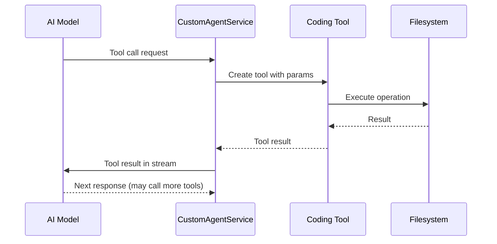

# Coding Tools

SuperDesign provides 9 coding tools that the AI agent can use to manipulate files, execute commands, and manage themes.

**Source:** `/home/darkvoid/Boxxed/@formulas/src.rust/src.AI/src.superdesign/superdesign/src/tools/`

## Tool Catalog

| Tool | File | Purpose |
|------|------|---------|
| Read | `read-tool.ts` | Read file contents |
| Write | `write-tool.ts` | Write file contents |
| Edit | `edit-tool.ts` | Edit file contents (search and replace) |
| Bash | `bash-tool.ts` | Execute shell commands |
| Glob | `glob-tool.ts` | Find files matching a pattern |
| Grep | `grep-tool.ts` | Search for text patterns in files |
| Ls | `ls-tool.ts` | List directory contents |
| Multiedit | `multiedit-tool.ts` | Edit multiple files simultaneously |
| Theme | `theme-tool.ts` | Manage design themes |

## Tool Architecture

Each tool follows the same pattern:

```typescript
// tools/<name>-tool.ts
// create<Name>Tool() → returns tool definition with:
//   - name: string
//   - description: string
//   - parameters: Zod schema
//   - execute: function
```

**Source:** `src/tools/tool-utils.ts` for shared utilities.

## Tool Utilities

```typescript
// tools/tool-utils.ts
// Shared helper functions used across tools
```

## Tool Execution Flow



## Key Tools

### Read Tool

Reads file contents and returns them as a string. Used by the AI to understand existing code.

**Source:** `src/tools/read-tool.ts`.

### Write Tool

Writes content to a file. Creates the file if it doesn't exist.

**Source:** `src/tools/write-tool.ts`.

### Edit Tool

Performs search-and-replace editing on a file. More precise than write for small changes.

**Source:** `src/tools/edit-tool.ts`.

### Bash Tool

Executes shell commands via `execa`. Used for build commands, package installs, etc.

**Source:** `src/tools/bash-tool.ts`.

### Multiedit Tool

Edits multiple files simultaneously in a single operation. More efficient than multiple edit calls.

**Source:** `src/tools/multiedit-tool.ts`.

### Theme Tool

Manages design themes — creating, reading, and applying theme configurations.

**Source:** `src/tools/theme-tool.ts`.

## Next

Continue to [04-webview-ui](04-webview-ui.md) for the React webview UI components.
