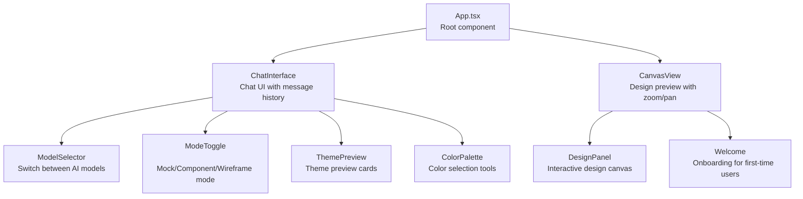

# Webview UI

SuperDesign's user interface is a React webview rendered inside VS Code's sidebar panel.

**Source:** `/home/darkvoid/Boxxed/@formulas/src.rust/src.AI/src.superdesign/superdesign/src/webview/`

## Webview Architecture



## Components

### ChatInterface

The main chat UI (`src/webview/components/Chat/ChatInterface.tsx`):

- Message history with markdown rendering
- Model selector for switching providers
- Mode toggle (Mock, Component, Wireframe)
- Theme preview cards for design suggestions
- Color palette for color selection

### CanvasView

The design preview panel (`src/webview/components/CanvasView.tsx`):

- Renders generated UI mockups
- Supports zoom and pan via `react-zoom-pan-pinch`
- Connection lines between design elements

### Welcome

First-time user onboarding (`src/webview/components/Welcome/`):

- Introduces SuperDesign features
- Quick-start guide

### MarkdownRenderer

Renders markdown content with syntax highlighting (`src/webview/components/MarkdownRenderer.tsx`):

- Uses `react-markdown` + `rehype-highlight`
- Code blocks with `highlight.js`

## Hooks

| Hook | File | Purpose |
|------|------|---------|
| `useChat` | `src/webview/hooks/useChat.ts` | Chat state and message handling |
| `useFirstTimeUser` | `src/webview/hooks/useFirstTime.ts` | First-time user detection |

## Utilities

| Utility | File | Purpose |
|---------|------|---------|
| `gridLayout` | `src/webview/utils/gridLayout.ts` | Canvas grid layout calculations |
| `themeParser` | `src/webview/utils/themeParser.ts` | Parse theme configurations |

## Webview Template

The webview HTML is generated by `src/templates/webviewTemplate.ts`, which creates the HTML shell that loads the React app.

## Message Protocol

Messages flow between the webview and extension host via `vscode.postMessage()` and the sidebar provider's `onDidReceiveMessage`:

```typescript
// Webview → Extension
vscode.postMessage({ command: 'sendMessage', data: { text: '...' } });

// Extension → Webview
sidebarProvider.sendMessage({ command: 'updateChat', data: { ... } });
```

## Next

You've completed the src.superdesign documentation. Return to the [README](README.md) for the full index.
