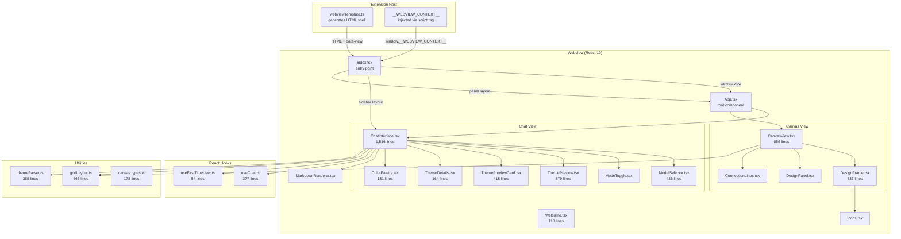
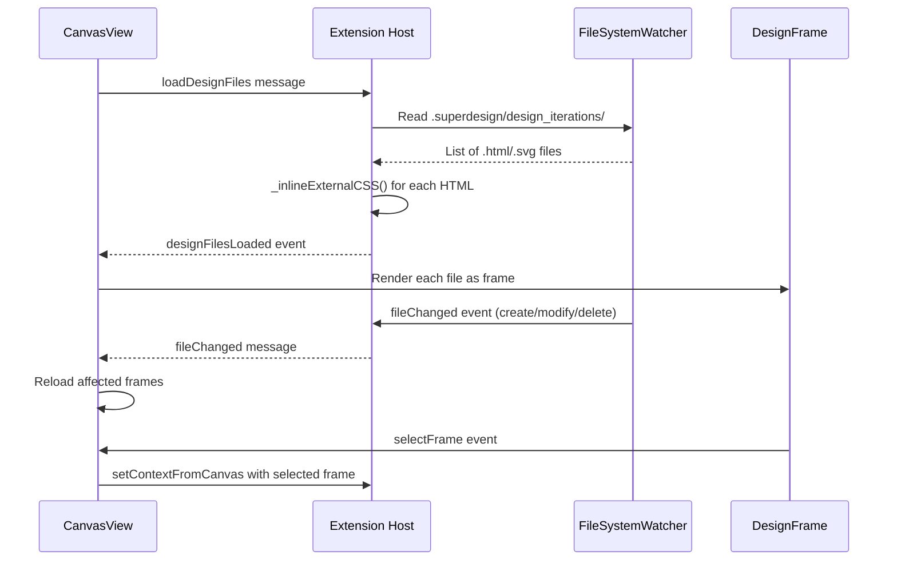

# Webview UI: React App, Components, Hooks, Message Protocol

SuperDesign's user interface is a React 19 webview rendered inside VS Code's sidebar panel and canvas panel. The same React bundle serves both views -- the entry point detects which view is needed via a `data-view` attribute set by the extension host.

**Source:** `/home/darkvoid/Boxxed/@formulas/src.rust/src.AI/src.superdesign/superdesign/src/webview/`

## Webview Architecture



## Entry Point: index.tsx

The entry point (42 lines) detects the view type and routes accordingly:

```typescript
// src/webview/index.tsx
const viewType = container.getAttribute('data-view');

if (viewType === 'canvas') {
    root.render(<App />);  // Canvas uses full App component
} else {
    const context: WebviewContext = (window as any).__WEBVIEW_CONTEXT__;
    if (context.layout === 'panel') {
        root.render(<App />);  // Panel layout uses full App
    } else {
        // Sidebar layout renders ChatInterface directly (no header wrapper)
        const vscode = acquireVsCodeApi();
        root.render(<ChatInterface layout="sidebar" vscode={vscode} />);
    }
}
```

**Source:** `src/webview/index.tsx` lines 16-41.

The context is injected by the extension host as `window.__WEBVIEW_CONTEXT__` in the HTML shell:

```typescript
// src/templates/webviewTemplate.ts:65
window.__WEBVIEW_CONTEXT__ = {
    layout: 'sidebar',           // or 'panel'
    extensionUri: '...',
    logoUris: { cursor, windsurf, claudeCode, lovable, bolt }
};
```

## App.tsx: Root Component

The App component (112 lines) handles view detection, CSS injection, and routing:

```typescript
// src/webview/App.tsx
const App: React.FC = () => {
    const [vscode] = useState(() => acquireVsCodeApi());
    const [context, setContext] = useState<WebviewContext | null>(null);
    const [currentView, setCurrentView] = useState<'chat' | 'canvas'>('chat');
    const [nonce, setNonce] = useState<string | null>(null);

    useEffect(() => {
        // Detect view from HTML data-view attribute
        const rootElement = document.getElementById('root');
        const viewType = rootElement?.getAttribute('data-view');
        const nonceValue = rootElement?.getAttribute('data-nonce');
        
        if (nonceValue) setNonce(nonceValue);
        setCurrentView(viewType === 'canvas' ? 'canvas' : 'chat');
        
        // Inject CSS styles from esbuild-imported string
        const styleElement = document.createElement('style');
        styleElement.textContent = styles;
        document.head.appendChild(styleElement);
        
        // Get context for chat view
        const webviewContext = (window as any).__WEBVIEW_CONTEXT__;
        if (webviewContext) setContext(webviewContext);
    }, []);

    return (
        <div className={`superdesign-app ${currentView}-view ${context?.layout ? `${context.layout}-layout` : ''}`}>
            {currentView === 'canvas' 
                ? <CanvasView vscode={vscode} nonce={nonce} />
                : context ? <ChatInterface layout={context.layout} vscode={vscode} /> : <div>Loading...</div>
            }
        </div>
    );
};
```

The `data-nonce` attribute is only set for the canvas panel (line 1723 of `extension.ts`), not for the sidebar. The nonce is required for the canvas panel's CSP `script-src 'nonce-${nonce}'` policy.

**Source:** `src/webview/App.tsx` lines 9-111.

## ChatInterface: Main Chat UI (1,516 lines)

**Source:** `src/webview/components/Chat/ChatInterface.tsx`

The ChatInterface is the largest component. It handles:

### Message Rendering

Messages are rendered as a scrollable list. User messages are right-aligned, assistant messages are left-aligned with markdown rendering via `MarkdownRenderer`. Tool calls display as expandable cards with the tool name, parameters (streaming live), and results.

### Input Area

The input field supports:
- Text input with send button
- Image upload (moodboard feature)
- Stop button during streaming

### Sub-Components

| Component | Lines | Purpose |
|-----------|-------|---------|
| `ModelSelector` | 436 | Dropdown to switch AI models/providers |
| `ModeToggle` | 56 | Toggle between Mock/Component/Wireframe modes |
| `ThemePreview` | 579 | Preview generated themes with color swatches |
| `ThemePreviewCard` | 418 | Individual theme card with apply/iterate actions |
| `ThemeDetails` | 164 | Expanded theme detail view |
| `ThemePreviewHeader` | -- | Theme header component |
| `ColorPalette` | 131 | Color picker/palette display |
| `MarkdownRenderer` | -- | Markdown rendering with syntax highlighting |

### ModelSelector (436 lines)

**Source:** `src/webview/components/Chat/ModelSelector.tsx`

Displays available models organized by provider:

```typescript
// Model groups rendered in the selector
// - Anthropic: Claude 4 Opus, Claude 4 Sonnet, Claude 3.7/3.5 Sonnet, Claude 3 Opus/Haiku
// - OpenAI: GPT-4.1, GPT-4.1 Mini, GPT-4.1 Nano, GPT-4o, GPT-4o Mini
// - OpenRouter: 100+ models from Google, Meta, DeepSeek, Mistral, xAI, Qwen, etc.
```

When a model is selected, the hook sends:
```typescript
vscode.postMessage({ command: 'changeProvider', model: selectedModel });
```

The sidebar provider (`ChatSidebarProvider.handleChangeProvider`) determines the provider from the model string:
- Models with `/` → OpenRouter
- Models starting with `claude-` → Anthropic
- Otherwise → OpenAI

Then updates both `aiModelProvider` and `aiModel` settings.

**Source:** `src/providers/chatSidebarProvider.ts` lines 125-182.

## CanvasView: Design Canvas (859 lines)

**Source:** `src/webview/components/CanvasView.tsx`

The canvas provides:
- Pan and zoom via `react-zoom-pan-pinch` library
- Grid background rendering
- Design frame positioning via `gridLayout.ts`
- Connection lines between frames via `ConnectionLines.tsx`
- File loading from the extension via `loadDesignFiles` message

### Canvas Interaction Flow



### CSS Inlining

The `_inlineExternalCSS()` method in `SuperdesignCanvasPanel` (extension.ts:1836-1871) replaces `<link rel="stylesheet">` tags with `<style>` tags containing the actual CSS content. This ensures generated HTML files render correctly in the webview without needing network access to local CSS files.

## DesignFrame (837 lines)

**Source:** `src/webview/components/DesignFrame.tsx`

Each design frame renders a generated HTML/SVG file with:
- Device frame wrapper (desktop/tablet/mobile sizing)
- iframe or inline rendering of the design content
- Interaction controls (iterate, export, delete)
- Connection point anchors for `ConnectionLines.tsx`

Uses `Icons.tsx` for Lucide icon rendering.

## Welcome Component

**Source:** `src/webview/components/Welcome/Welcome.tsx` (110 lines)

First-time user onboarding with:
- Feature introduction
- Quick-start guide
- Email submission to Supabase for notifications
- "Initialize Superdesign" button triggers `superdesign.initializeProject` command

### Email Submission

The Welcome screen submits email to Supabase via the extension host:

```typescript
// extension.ts:181-239
async function submitEmailToSupabase(email: string, sidebarProvider: ChatSidebarProvider) {
    const https = require('https');
    const options = {
        hostname: 'uqofryalyuvdvlbbutvi.supabase.co',
        path: '/rest/v1/forms',
        method: 'POST',
        headers: {
            'Content-Type': 'application/json',
            'apikey': 'eyJ...' // hardcoded Supabase anon key
        }
    };
    // POST { email } to Supabase REST API
}
```

**Source:** `src/extension.ts` lines 181-239.

## useChat Hook (377 lines)

**Source:** `src/webview/hooks/useChat.ts`

The `useChat` hook manages the entire chat state machine:

### State

```typescript
interface MessageMetadata {
    timestamp?: number;
    is_loading?: boolean;
    estimated_duration?: number;
    start_time?: number;
    elapsed_time?: number;
    progress_percentage?: number;
    session_id?: string;
    is_error?: boolean;
    tool_name?: string;
    tool_id?: string;
    tool_input?: any;
    tool_result?: any;
    is_error?: boolean;
    actions?: Array<{ text: string; command: string; args?: string; }>;
}

export type ChatMessage = CoreMessage & { metadata?: MessageMetadata };
```

### Tool Time Estimation

The hook includes a `TOOL_TIME_ESTIMATES` map for displaying progress indicators:

```typescript
// src/webview/hooks/useChat.ts:45-60
const TOOL_TIME_ESTIMATES: { [key: string]: number } = {
    'codebase_search': 30,
    'read_file': 15,
    'edit_file': 45,
    'run_terminal_cmd': 60,
    'default': 90
};
```

The `getToolTimeEstimate()` function uses substring matching to find estimates for tool names not in the map.

### Message Handling

The hook listens to `window.message` events and handles:

| Command | Action |
|---------|--------|
| `chatResponseChunk` | Append text, tool-call, or tool-result to history |
| `chatToolUpdate` | Update tool call args during streaming |
| `chatToolResult` | Mark tool as complete, update loading state |
| `chatStreamEnd` | Set `isLoading = false` |
| `chatErrorWithActions` | Show error with action buttons (Configure API Key, Open Settings) |
| `chatError` | Show error message |
| `chatStopped` | Set `isLoading = false` |

### localStorage Persistence

Chat history is persisted to `localStorage` under key `superdesign-chat-history`:

```typescript
// Save on every change
useEffect(() => {
    localStorage.setItem('superdesign-chat-history', JSON.stringify(chatHistory));
}, [chatHistory]);

// Load on initialization
const [chatHistory, setChatHistory] = useState(() => {
    const saved = localStorage.getItem('superdesign-chat-history');
    return saved ? JSON.parse(saved) : [];
});
```

## useFirstTimeUser Hook (54 lines)

**Source:** `src/webview/hooks/useFirstTimeUser.ts`

```typescript
const FIRST_TIME_USER_KEY = 'superdesign-first-time-user';

export const useFirstTimeUser = () => {
    const [isFirstTime, setIsFirstTime] = useState(true);
    const [isLoading, setIsLoading] = useState(true);

    useEffect(() => {
        const hasVisited = localStorage.getItem(FIRST_TIME_USER_KEY);
        setIsFirstTime(hasVisited === null);
        setIsLoading(false);
    }, []);

    const markAsReturningUser = () => {
        localStorage.setItem(FIRST_TIME_USER_KEY, 'visited');
        setIsFirstTime(false);
    };

    const resetFirstTimeUser = () => {
        localStorage.removeItem(FIRST_TIME_USER_KEY);
        setIsFirstTime(true);
    };
};
```

The `superdesign.resetWelcome` command triggers `resetFirstTimeUser` via the sidebar provider.

## MarkdownRenderer

**Source:** `src/webview/components/MarkdownRenderer.tsx`

Uses:
- `react-markdown` for markdown parsing
- `remark-gfm` for GitHub Flavored Markdown (tables, strikethrough, task lists)
- `rehype-highlight` for syntax highlighting
- `highlight.js` for code block highlighting

## gridLayout.ts (465 lines)

**Source:** `src/webview/utils/gridLayout.ts`

Calculates optimal positioning for design frames on the canvas:
- Frame sizing based on device type
- Collision detection between frames
- Responsive arrangement algorithms

## themeParser.ts (355 lines)

**Source:** `src/webview/utils/themeParser.ts`

Parses CSS custom properties from theme files:
- Color extraction from `--background`, `--primary`, etc.
- Typography parsing from `--font-sans`, `--font-mono`
- Shadow value parsing
- Theme validation

## Canvas Types (178 lines)

**Source:** `src/webview/types/canvas.types.ts`

Type definitions for canvas state, frame data, and design file metadata.

## Webview Template

**Source:** `src/templates/webviewTemplate.ts` (80 lines)

Generates the HTML shell for the webview. Key elements:

```typescript
// CSP policy for sidebar
content="default-src 'none'; style-src ${webview.cspSource} 'unsafe-inline'; 
         img-src ${webview.cspSource} data: https: vscode-webview:; 
         script-src ${webview.cspSource} 'unsafe-inline'; 
         font-src ${webview.cspSource};"

// For canvas panel (stricter)
content="default-src 'none'; style-src ${webview.cspSource} 'unsafe-inline'; 
         img-src ${webview.cspSource} data: https: vscode-webview:; 
         script-src 'nonce-${nonce}'; 
         frame-src ${webview.cspSource};"
```

The sidebar allows `'unsafe-inline'` scripts while the canvas uses a nonce. The canvas also adds `frame-src` for iframe rendering of generated designs.

## Message Protocol

### Webview to Extension (via `vscode.postMessage`)

| Command | Source | Handler |
|---------|--------|---------|
| `chatMessage` | useChat | `ChatMessageService.handleChatMessage` |
| `stopChat` | useChat | `ChatMessageService.stopCurrentChat` |
| `executeAction` | ChatInterface | `vscode.commands.executeCommand` |
| `getCurrentProvider` | ModelSelector | `ChatSidebarProvider.handleGetCurrentProvider` |
| `changeProvider` | ModelSelector | `ChatSidebarProvider.handleChangeProvider` |
| `saveImageToMoodboard` | ChatInterface | `saveImageToMoodboard()` in extension.ts |
| `getBase64Image` | ChatInterface | `getBase64Image()` in extension.ts |
| `getCssFileContent` | ThemePreview | `getCssFileContent()` in extension.ts |
| `checkCanvasStatus` | ChatInterface | Extension: checks `SuperdesignCanvasPanel.currentPanel` |
| `autoOpenCanvas` | ChatInterface | Extension: `SuperdesignCanvasPanel.createOrShow()` |
| `setContextFromCanvas` | CanvasView | Extension: forwards to sidebar |
| `setChatPrompt` | CanvasView | Extension: forwards to sidebar |
| `showError` | Any webview | Extension: `vscode.window.showErrorMessage` |
| `submitEmail` | Welcome | `submitEmailToSupabase()` |
| `initializeSuperdesign` | Welcome | Extension: `superdesign.initializeProject` |

### Extension to Webview (via `webview.postMessage`)

| Command | Source | Handler |
|---------|--------|---------|
| `chatStreamStart` | ChatMessageService | useChat: `setIsLoading(true)` |
| `chatResponseChunk` | ChatMessageService | useChat: append to history |
| `chatToolUpdate` | ChatMessageService | useChat: update tool args |
| `chatToolResult` | ChatMessageService | useChat: mark complete |
| `chatStreamEnd` | ChatMessageService | useChat: `setIsLoading(false)` |
| `chatError` | ChatMessageService | useChat: show error |
| `chatErrorWithActions` | ChatMessageService | useChat: show error with buttons |
| `chatStopped` | ChatMessageService | useChat: `setIsLoading(false)` |
| `clearChat` | extension.ts | Webview: clear history |
| `resetWelcome` | extension.ts | Webview: reset first-time flag |
| `currentProviderResponse` | ChatSidebarProvider | ModelSelector: update display |
| `providerChanged` | ChatSidebarProvider | ModelSelector: refresh |
| `imageSavedToMoodboard` | extension.ts | Webview: show confirmation |
| `imageSaveError` | extension.ts | Webview: show error |
| `base64ImageResponse` | extension.ts | Webview: use base64 image |
| `cssFileContentResponse` | extension.ts | ThemePreview: render theme |
| `canvasStatusResponse` | Extension | ChatInterface: show/hide canvas btn |
| `contextFromCanvas` | Extension | ChatInterface: set iteration context |
| `setChatPrompt` | Extension | ChatInterface: pre-fill input |
| `fileChanged` | SuperdesignCanvasPanel | CanvasView: reload frame |
| `designFilesLoaded` | SuperdesignCanvasPanel | CanvasView: render frames |
| `emailSubmitSuccess` | Extension | Welcome: show success |
| `emailSubmitError` | Extension | Welcome: show error |

## Aha Moments

**Aha: The sidebar renders ChatInterface directly while the canvas uses the App wrapper.** When the layout is `sidebar`, `index.tsx` skips `App.tsx` entirely and renders `<ChatInterface layout="sidebar" vscode={vscode} />` directly. This avoids the double-header problem -- VS Code already provides a sidebar title, so wrapping it in another App component with its own header would waste precious sidebar space. The `panel` layout and `canvas` view both use `App.tsx` because they need the full chrome (header, view switcher, styling).

**Aha: Chat history persists to localStorage but the extension host ignores it on restart.** The `useChat` hook saves every message to `superdesign-chat-history` in localStorage, which survives page reloads. But the extension host (`ChatMessageService`) only receives the history that the hook sends with each `chatMessage` call. If the webview is recreated (e.g., VS Code restart), the localStorage history is loaded by the hook, and the next message sends the full accumulated history. This means conversation continuity depends entirely on the webview's localStorage, not any server-side session.

**Aha: The webview CSS is imported as a string by esbuild, not loaded as a separate file.** In `App.tsx`, `import styles from './App.css'` uses esbuild's CSS-as-string loader. The CSS is injected at runtime via a dynamically created `<style>` element. This avoids a separate network request inside the webview and keeps the bundle self-contained. The esbuild configuration (in `esbuild.js`) handles this with `loader: { '.css': 'text' }`.

## Next

Continue to [05-superdesign-deep](05-superdesign-deep.md) for the source-level deep dive into every file, or jump to [06-design-workflow](06-design-workflow.md) for the complete design-to-code workflow.
