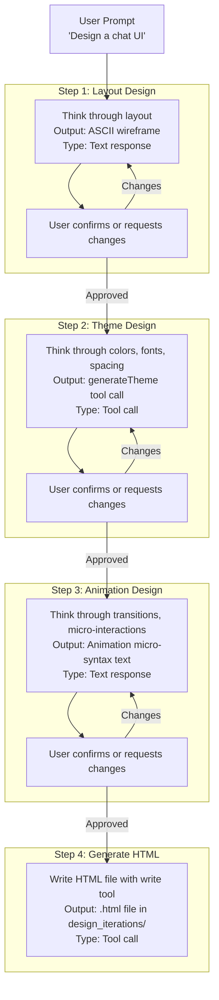
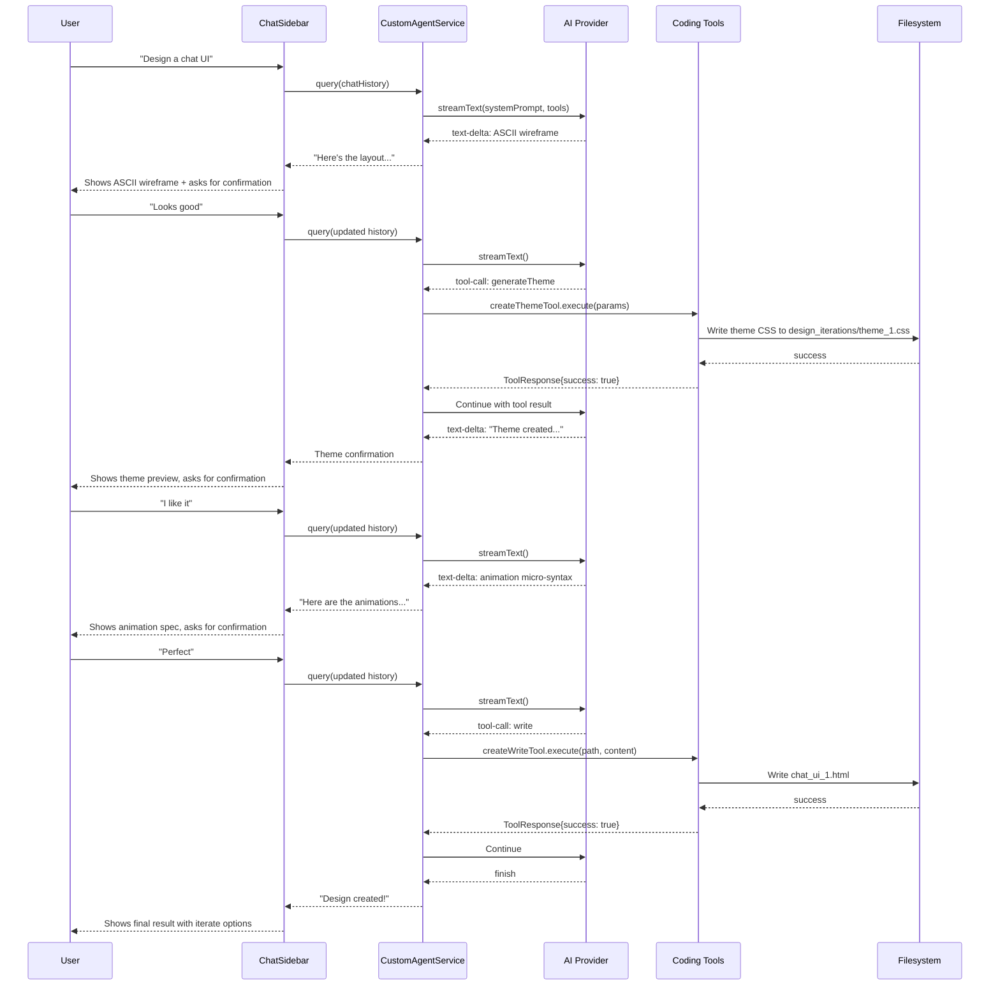

# Design Workflow: The 4-Step Design-to-Code Pipeline

SuperDesign's core innovation is its structured 4-step design workflow that the AI agent follows for every design task. This is enforced by the system prompt injected into every AI query.

**Source:** `src/services/customAgentService.ts` lines 338-428 (the `getSystemPrompt()` method).

## The Workflow Overview



**Key rule from the prompt (line 408):** "You HAVE TO confirm with user step by step, don't do theme design until user sign off the layout design, same for all following steps."

## Step 1: Layout Design (ASCII Wireframes)

The agent receives the user's design request and first thinks through the layout structure. It presents an ASCII art wireframe that shows:

- Component placement and sizing
- Spatial relationships between elements
- Interactive states (e.g., sidebar open/closed)
- Responsive behavior notes

### Wireframe Example

From the system prompt example (lines 386-431):

```
┌─────────────────────────────────────┐
│ ☰          HEADER BAR            + │
├─────────────────────────────────────┤
│                                     │
│ ┌─────────────────────────────┐     │
│ │     AI Message Bubble       │     │
│ └─────────────────────────────┘     │
│     ┌─────────────────────────────┐ │
│     │     User Message Bubble     │ │
│     └─────────────────────────────┘ │
│              [CHAT AREA]            │
├─────────────────────────────────────┤
│ [Text Input Field]           [Send] │
└─────────────────────────────────────┘
```

The wireframe is followed by a question: "Would you like to go ahead with this layout & UI interaction or needs any modification?"

### Why ASCII Wireframes?

**Aha: ASCII wireframes force the AI to commit to a spatial layout before any design decisions are made.** Unlike a text description like "put the header at top", an ASCII wireframe is unambiguous about relative sizes, positions, and relationships. The AI cannot hand-wave "there's a sidebar somewhere" -- it must draw it. This is the same reason architects use floor plans before choosing paint colors. The wireframe step prevents the common failure mode where an AI generates HTML with an incoherent layout because it never thought through the structure first.

**Aha: The sidebar state wireframe shows interaction design, not just static layout.** The example includes two states: the collapsed view and the expanded view (with sidebar sliding out). This teaches the AI to think about state transitions before committing to implementation, and gives the user a preview of interactions they might not have considered.

## Step 2: Theme Design (generateTheme Tool Call)

Once the layout is approved, the agent thinks through the visual design and calls the `generateTheme` tool.

### Tool Call Parameters

```typescript
// From the system prompt example (lines 443-490)
generateTheme(
    theme_name: 'Vercel techy style',
    reasoning_reference: 'Reference classic shadcn style that has ...',
    cssFilePath: 'design_iterations/theme_1.css',
    cssSheet: ':root {\n  --background: oklch(1.0000 0 0);\n  ...'
)
```

The `cssFilePath` is relative to the working directory (`.superdesign/`). The tool writes the CSS file to disk.

### Theme Structure

The theme CSS uses shadcn-style CSS custom properties with OKLCH color space:

```css
:root {
  /* Core colors */
  --background: oklch(1.0000 0 0);
  --foreground: oklch(0.1448 0 0);
  
  /* Semantic colors */
  --primary: oklch(0.5555 0 0);
  --secondary: oklch(0.9702 0 0);
  --muted: oklch(0.9702 0 0);
  --accent: oklch(0.9702 0 0);
  --destructive: oklch(0.5830 0.2387 28.4765);
  
  /* Component colors */
  --card: oklch(1.0000 0 0);
  --popover: oklch(1.0000 0 0);
  --sidebar: oklch(0.9851 0 0);
  
  /* Typography */
  --font-sans: Geist Mono, monospace;
  --font-serif: Geist Mono, monospace;
  --font-mono: Geist Mono, monospace;
  
  /* Spacing & Radius */
  --radius: 0rem;
  --spacing: 0.25rem;
  
  /* Shadows (6 levels) */
  --shadow-2xs: 0px 1px 0px 0px hsl(0 0% 0% / 0.00);
  --shadow-xs: 0px 1px 0px 0px hsl(0 0% 0% / 0.00);
  --shadow-sm: 0px 1px 0px 0px hsl(0 0% 0% / 0.00), 0px 1px 2px -1px hsl(0 0% 0% / 0.00);
  --shadow: ...,
  --shadow-md: ...,
  --shadow-lg: ...,
  --shadow-xl: ...,
  --shadow-2xl: ...;
}
```

### Built-in Theme Presets

The system prompt includes two complete theme presets the AI can reference (lines 217-392):

| Preset | Style | Key Characteristics |
|--------|-------|---------------------|
| Neo-brutalism | 90s web design | `--radius: 0px`, `--shadow: 4px 4px 0px`, flat borders, DM Sans, bold OKLCH colors |
| Modern dark mode | Vercel/Linear | `--radius: 0.625rem`, soft shadows, system font stack, grayscale OKLCH |

**Aha: The theme CSS uses OKLCH color space, not HSL or RGB.** OKLCH is a perceptually uniform color space where equal numerical changes produce equal perceptual changes. This means the AI can adjust `oklch(0.5555 0 0)` to `oklch(0.6 0 0)` and the lightness change will feel natural. The built-in presets use OKLCH with zero chroma (grayscale) for the modern theme and full chroma for the neo-brutalism theme, giving the AI a clear understanding of how to use the color space.

## Step 3: Animation Design (Micro-Syntax)

The animation step uses a compact text-based micro-syntax to describe transitions:

```
# CHAT UI ANIMATIONS - MICRO-SYNTAX

## Core Message Flow
userMsg: 400ms ease-out [Y+20→0, X+10→0, S0.9→1]
aiMsg: 600ms bounce [Y+15→0, S0.95→1] +200ms
typing: 1400ms ∞ [Y±8, α0.4→1] stagger+200ms

## Button Interactions
sendBtn: 150ms [S1→0.95→1, R±2°] press
sendBtn: 200ms [S1→1.05, shadow↗] hover
ripple: 400ms [S0→2, α1→0]
```

### Micro-Syntax Grammar

The format is: `target: duration easing [transform-properties]`

| Element | Meaning | Example |
|---------|---------|---------|
| `target` | CSS selector or component name | `userMsg`, `sidebar`, `sendBtn` |
| `duration` | Animation length | `400ms`, `1.5s` |
| `easing` | Timing function | `ease-out`, `bounce`, `linear` |
| `[...]` | Transform properties | `[Y+20→0, S0.9→1]` |
| `+Nms` | Delay offset | `+200ms` |
| `∞` | Infinite loop | `1400ms ∞` |
| `stagger+Nms` | Stagger delay | `stagger+200ms` |

Transform properties:
- `Y`, `X` -- translate (e.g., `Y+20→0` means translate from +20px to 0px)
- `S` -- scale (e.g., `S0.9→1` means scale from 0.9 to 1)
- `R` -- rotation (e.g., `R±2°` means rotate ±2 degrees)
- `α` -- opacity (e.g., `α0.4→1` means fade from 0.4 to 1)
- `bg:` -- background color transition

**Aha: The animation micro-syntax is design documentation, not executable code.** SuperDesign doesn't have an animation engine that parses this syntax. The micro-syntax serves as a structured communication format between the AI and the user -- it's more precise than prose ("the message fades in with a slight upward motion") but more readable than CSS (`animation: fadeInUp 400ms ease-out`). The AI then implements these animations as actual CSS `@keyframes` in the generated HTML. The micro-syntax is the blueprint, not the building.

## Step 4: Generate HTML

The final step produces a single HTML file that combines:
- The layout from Step 1 (as HTML structure)
- The theme from Step 2 (via `<link>` to the generated CSS)
- The animations from Step 3 (as CSS `@keyframes`)

### Output Location

Files are written to `.superdesign/design_iterations/` with the naming convention:
- New designs: `{design_name}_{n}.html` (e.g., `chat_ui_1.html`, `chat_ui_2.html`)
- Iterations: `{existing_file_name}_{n}.html` (e.g., iterating `ui_1.html` produces `ui_1_1.html`, `ui_1_2.html`)

**Source:** System prompt lines 267-268.

### File Structure

The generated HTML is a single-file page:
```html
<!DOCTYPE html>
<html>
<head>
    <link rel="stylesheet" href="theme_1.css">
    <script src="https://cdn.tailwindcss.com"></script>
    <script src="https://cdn.jsdelivr.net/npm/flowbite@2.0.0/dist/flowbite.min.js"></script>
    <script src="https://unpkg.com/lucide@latest/dist/umd/lucide.min.js"></script>
    <style>
        /* Custom CSS + animations */
    </style>
</head>
<body>
    <!-- Layout HTML -->
    <script>
        // Lucide icons init, etc.
    </script>
</body>
</html>
```

### Styling Rules from the Prompt

The system prompt enforces specific styling rules:

1. **Flowbite as default** component library (CDN-loaded)
2. **No indigo/blue** unless requested (avoids Bootstrap default aesthetic)
3. **Responsive designs** required (`@media` breakpoints at 768px and 640px)
4. **Google Fonts** for typography (21 curated fonts in the prompt)
5. **`!important`** for Tailwind overrides (CDN Tailwind can override custom styles)
6. **Tailwind via `<script>`** not `<link>` (line 399)
7. **No Bootstrap blue** by default (line 278)

**Source:** System prompt lines 207-400.

## Step-by-Step User-Agent Interaction



## Workflow Enforcement

The workflow is enforced by the system prompt's explicit ordering:

```
## Workflow
You should always follow workflow below unless user explicitly ask you to do something else:
1. Layout design
2. Theme design (Color, font, spacing, shadown), using generateTheme tool
3. Core Animation design
4. Generate a singlehtml file for the UI
5. You HAVE TO confirm with user step by step
```

The AI SDK's `maxSteps: 10` (in `CustomAgentService.query()`) allows the agent to make up to 10 tool-call rounds per query, which is sufficient for the 4-step workflow plus iteration rounds.

## Project Initialization and Rule Injection

When `initializeSuperdesignProject()` runs (extension.ts lines 243-1242), it:

1. Creates `.superdesign/design_iterations/` directory
2. Writes `default_ui_darkmode.css` (a 500+ line CSS framework)
3. Injects the 627-line design rule into three agent rule files:
   - `.cursor/rules/design.mdc` (Cursor)
   - `CLAUDE.md` (Claude Code)
   - `.windsurfrules` (Windsurf)

Each injection is idempotent -- it checks for the string `superdesign: Open Canvas View` before appending.

## Aha Moments

**Aha: The workflow is a prompt-enforced protocol, not code-enforced state machine.** There is no code that prevents the AI from skipping to Step 4 without doing Step 1. The entire workflow relies on the AI following instructions in the system prompt. This is both a strength (flexibility -- the AI can break the workflow when the user explicitly asks) and a risk (the AI might skip steps if the prompt isn't clear enough). The "MUST" and "HAVE TO" language in the prompt is the enforcement mechanism.

**Aha: The design rules are injected into external AI agents' contexts, not just SuperDesign's own agent.** By writing to `.cursor/rules/design.mdc`, `CLAUDE.md`, and `.windsurfrules`, SuperDesign ensures that when the user copies the generated prompt into Cursor, Claude Code, or Windsurf, those agents also follow the same design principles. This is SuperDesign's "prompt-to-IDE" feature -- the design workflow isn't locked inside the extension, it's portable to any AI coding agent.

## Cross-References

- [02-ai-providers](02-ai-providers.md) -- AI provider configuration
- [03-tools](03-tools.md) -- Tool system including generateTheme
- [05-superdesign-deep](05-superdesign-deep.md) -- Source-level deep dive
- [07-canvas-panel](07-canvas-panel.md) -- Design file preview and management
