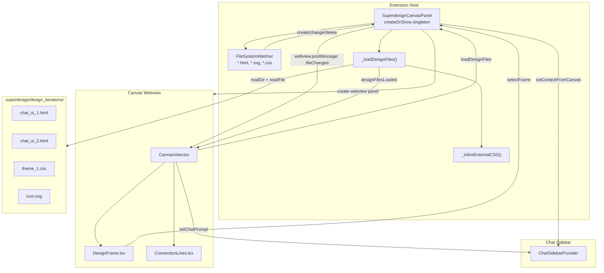

# Canvas Panel: Design File Preview, File Watching, and CSS Inlining

The Canvas Panel is a VS Code webview panel that previews generated HTML and SVG design files. It monitors the `.superdesign/design_iterations/` directory for changes and auto-reloads affected frames.

**Source:** `src/extension.ts` lines 1541-1872 (`SuperdesignCanvasPanel` class).

## Canvas Architecture



## Singleton Panel Pattern

The `SuperdesignCanvasPanel` uses the VS Code singleton panel pattern:

```typescript
// src/extension.ts:1541-1573
class SuperdesignCanvasPanel {
    public static currentPanel: SuperdesignCanvasPanel | undefined;
    public static readonly viewType = 'superdesignCanvasPanel';

    public static createOrShow(extensionUri: vscode.Uri, sidebarProvider: ChatSidebarProvider) {
        const column = vscode.window.activeTextEditor?.viewColumn;

        if (SuperdesignCanvasPanel.currentPanel) {
            SuperdesignCanvasPanel.currentPanel._panel.reveal(column);
            return;  // Already open, just reveal
        }

        const panel = vscode.window.createWebviewPanel(
            SuperdesignCanvasPanel.viewType,
            'Superdesign Canvas',
            column || vscode.ViewColumn.One,
            {
                enableScripts: true,
                localResourceRoots: [
                    vscode.Uri.joinPath(extensionUri, 'dist'),
                    vscode.Uri.joinPath(extensionUri, 'src', 'assets')
                ]
            }
        );

        SuperdesignCanvasPanel.currentPanel = new SuperdesignCanvasPanel(panel, extensionUri, sidebarProvider);
    }
}
```

This ensures only one canvas panel exists at a time. Calling `createOrShow` when the panel is already open reveals it rather than creating a duplicate.

## Webview HTML Generation

The canvas generates its own HTML shell with stricter CSP than the sidebar:

```typescript
// extension.ts:1694-1741
private _getHtmlForWebview(webview: vscode.Webview) {
    const scriptUri = webview.asWebviewUri(
        vscode.Uri.joinPath(this._extensionUri, 'dist', 'webview.js')
    );

    // Generate logo URIs for partner IDEs
    const logoUris = {
        cursor: webview.asWebviewUri(...).toString(),
        windsurf: webview.asWebviewUri(...).toString(),
        claudeCode: webview.asWebviewUri(...).toString(),
        lovable: webview.asWebviewUri(...).toString(),
        bolt: webview.asWebviewUri(...).toString(),
    };

    const nonce = getNonce();

    return `<!DOCTYPE html>
    <html lang="en">
    <head>
        <meta charset="UTF-8">
        <meta http-equiv="Content-Security-Policy" 
              content="default-src 'none'; style-src ${webview.cspSource} 'unsafe-inline'; 
                       img-src ${webview.cspSource} data: https: vscode-webview:; 
                       script-src 'nonce-${nonce}'; 
                       frame-src ${webview.cspSource};">
        <meta name="viewport" content="width=device-width, initial-scale=1.0">
        <title>Superdesign Canvas</title>
    </head>
    <body>
        <div id="root" data-view="canvas" data-nonce="${nonce}"></div>
        <script nonce="${nonce}">
            window.__WEBVIEW_CONTEXT__ = {
                layout: 'panel',
                extensionUri: '${this._extensionUri.toString()}',
                logoUris: ${JSON.stringify(logoUris)}
            };
        </script>
        <script nonce="${nonce}" src="${scriptUri}"></script>
    </body>
    </html>`;
}
```

**Key differences from sidebar webview:**
- `data-view="canvas"` tells the React entry point to render the canvas view
- `data-nonce` is set for CSP nonce-based script loading
- `frame-src ${webview.cspSource}` allows iframe embedding for design previews
- CSP uses `script-src 'nonce-${nonce}'` instead of `'unsafe-inline'`
- Logo URIs for Cursor, Windsurf, Claude Code, Lovable, and Bolt are injected

## File System Watcher

The canvas sets up a file watcher on `.superdesign/design_iterations/**/*.{html,svg,css}`:

```typescript
// extension.ts:1633-1686
private _setupFileWatcher() {
    const workspaceFolder = vscode.workspace.workspaceFolders?.[0];
    if (!workspaceFolder) return;

    const pattern = new vscode.RelativePattern(
        workspaceFolder,
        '.superdesign/design_iterations/**/*.{html,svg,css}'
    );

    this._fileWatcher = vscode.workspace.createFileSystemWatcher(
        pattern,
        false, // Don't ignore create events
        false, // Don't ignore change events
        false  // Don't ignore delete events
    );

    this._fileWatcher.onDidCreate((uri) => {
        this._panel.webview.postMessage({
            command: 'fileChanged',
            data: { fileName: uri.fsPath.split('/').pop(), changeType: 'created' }
        });
    });

    this._fileWatcher.onDidChange((uri) => {
        this._panel.webview.postMessage({
            command: 'fileChanged',
            data: { fileName: uri.fsPath.split('/').pop(), changeType: 'modified' }
        });
    });

    this._fileWatcher.onDidDelete((uri) => {
        this._panel.webview.postMessage({
            command: 'fileChanged',
            data: { fileName: uri.fsPath.split('/').pop(), changeType: 'deleted' }
        });
    });
}
```

The watcher monitors create, modify, and delete events. The webview receives `fileChanged` messages and reloads the affected design frame.

## Loading Design Files

The `_loadDesignFiles()` method reads all HTML and SVG files and sends them to the webview:

```typescript
// extension.ts:1744-1833
private async _loadDesignFiles() {
    const designFolder = vscode.Uri.joinPath(workspaceFolder.uri, '.superdesign', 'design_iterations');
    
    // Read all files
    const files = await vscode.workspace.fs.readDirectory(designFolder);
    const designFiles = files.filter(([name, type]) => 
        type === vscode.FileType.File && (
            name.toLowerCase().endsWith('.html') || 
            name.toLowerCase().endsWith('.svg')
        )
    );

    const loadedFiles = await Promise.all(
        designFiles.map(async ([fileName, _]) => {
            const [stat, content] = await Promise.all([
                vscode.workspace.fs.stat(filePath),
                vscode.workspace.fs.readFile(filePath)
            ]);

            const fileType = fileName.endsWith('.svg') ? 'svg' : 'html';
            let htmlContent = Buffer.from(content).toString('utf8');
            
            // Inline external CSS for HTML files
            if (fileType === 'html') {
                htmlContent = await this._inlineExternalCSS(htmlContent, designFolder);
            }
            
            return { name, path, content: htmlContent, size: stat.size, modified: new Date(stat.mtime), fileType };
        })
    );

    this._panel.webview.postMessage({
        command: 'designFilesLoaded',
        data: { files: validFiles }
    });
}
```

## CSS Inlining Detail

The `_inlineExternalCSS()` method parses HTML for `<link rel="stylesheet">` tags and replaces them with inline `<style>` tags:

```mermaid
flowchart TD
    HTML["HTML Content
    <link href='theme_1.css'>"] --> Parse["Regex: /<link.*?rel=['\"]stylesheet['\"].*?href=['\"](.*?)['\"]>/gi"]

    Parse --> Matches{"Has matches?"}
    Matches -->|"No"| Return["Return unchanged HTML"]
    Matches -->|"Yes"| Loop["For each match"]

    Loop --> IsLocal{"Is relative path?
    !startsWith('http') && !startsWith('//')"}
    IsLocal -->|"No (CDN)"| Skip["Leave <link> tag as-is"]
    IsLocal -->|"Yes"| ReadFile["vscode.workspace.fs.readFile(cssFilePath)"]

    ReadFile --> ReadOK{"File read success?"}
    ReadOK -->|"No"| LeaveOrig["Leave original <link> in place"]
    ReadOK -->|"Yes"| BuildStyle["Create <style> tag with CSS content"]
    BuildStyle --> Replace["Replace <link> with <style>"]

    Skip --> Next{"More matches?"}
    LeaveOrig --> Next
    Replace --> Next
    Next -->|"Yes"| Loop
    Next -->|"No"| Return
```

**Source:** `src/extension.ts` lines 1836-1871 — `_inlineExternalCSS()` method.

## CSS Inlining

The `_inlineExternalCSS()` method replaces `<link>` tags with `<style>` tags:

```typescript
// extension.ts:1836-1871
private async _inlineExternalCSS(htmlContent: string, designFolder: vscode.Uri): Promise<string> {
    const linkRegex = /<link\s+[^>]*rel=["']stylesheet["'][^>]*href=["']([^"']+)["'][^>]*>/gi;
    let modifiedContent = htmlContent;
    const matches = Array.from(htmlContent.matchAll(linkRegex));
    
    for (const match of matches) {
        const fullLinkTag = match[0];
        const cssFileName = match[1];
        
        // Only process relative paths
        if (!cssFileName.startsWith('http') && !cssFileName.startsWith('//')) {
            const cssFilePath = vscode.Uri.joinPath(designFolder, cssFileName);
            
            try {
                const cssContent = await vscode.workspace.fs.readFile(cssFilePath);
                const cssText = Buffer.from(cssContent).toString('utf8');
                const styleTag = `<style>\n${cssText}\n</style>`;
                modifiedContent = modifiedContent.replace(fullLinkTag, styleTag);
            } catch (cssError) {
                // Leave original link in place if CSS file can't be read
            }
        }
    }
    
    return modifiedContent;
}
```

**Aha: CSS inlining solves the VS Code webview local resource restriction problem.** Generated HTML files reference CSS files with relative paths like `<link href="theme_1.css">`. In a browser, this works fine. In a VS Code webview, the CSP `localResourceRoots` only allows files from `dist/` and `src/assets/`. The CSS files in `.superdesign/design_iterations/` are outside these roots, so the browser would fail to load them. By inlining the CSS content directly into `<style>` tags, the canvas avoids CSP violations entirely. External URLs (starting with `http://` or `https://`) are left untouched, so CDN-loaded libraries like Tailwind and Flowbite still work.

## Canvas-to-Chat Communication

The canvas panel forwards messages back to the chat sidebar:

```typescript
// extension.ts:1585-1612
this._panel.webview.onDidReceiveMessage(message => {
    switch (message.command) {
        case 'setContextFromCanvas':
            this._sidebarProvider.sendMessage({
                command: 'contextFromCanvas',
                data: message.data
            });
            break;
        case 'setChatPrompt':
            this._sidebarProvider.sendMessage({
                command: 'setChatPrompt',
                data: message.data
            });
            break;
        case 'autoOpenCanvas':
            SuperdesignCanvasPanel.createOrShow(context.extensionUri, sidebarProvider);
            break;
    }
});
```

When a user selects a design frame in the canvas and clicks "iterate on this", the canvas sends `setChatPrompt` which pre-fills the chat sidebar input with a context-aware prompt.

## Auto-Open Canvas

The chat sidebar can trigger the canvas to open automatically:

```typescript
// extension.ts:1333-1347
sidebarProvider.setMessageHandler((message) => {
    switch (message.command) {
        case 'checkCanvasStatus':
            const isCanvasOpen = SuperdesignCanvasPanel.currentPanel !== undefined;
            sidebarProvider.sendMessage({ command: 'canvasStatusResponse', isOpen: isCanvasOpen });
            break;
        case 'autoOpenCanvas':
            SuperdesignCanvasPanel.createOrShow(context.extensionUri, sidebarProvider);
            break;
    }
});
```

The `checkCanvasStatus` command lets the webview query whether the canvas is already open, avoiding duplicate panels.

## Nonce Generation

The nonce for CSP is generated by a simple random string function:

```typescript
// extension.ts:1875-1882
function getNonce() {
    let text = '';
    const possible = 'ABCDEFGHIJKLMNOPQRSTUVWXYZabcdefghijklmnopqrstuvwxyz0123456789';
    for (let i = 0; i < 32; i++) {
        text += possible.charAt(Math.floor(Math.random() * possible.length));
    }
    return text;
}
```

A 32-character alphanumeric nonce provides sufficient entropy for CSP purposes.

## Disposal

The panel cleans up resources on disposal:

```typescript
// extension.ts:1615-1631
public dispose() {
    SuperdesignCanvasPanel.currentPanel = undefined;
    
    if (this._fileWatcher) {
        this._fileWatcher.dispose();
        this._fileWatcher = undefined;
    }
    
    this._panel.dispose();
    while (this._disposables.length) {
        const x = this._disposables.pop();
        if (x) x.dispose();
    }
}
```

## Aha Moments

**Aha: The canvas is a singleton with reveal-not-recreate semantics.** When the user clicks "Open Canvas" while it's already open, the panel is revealed (brought to front) rather than creating a new tab. This prevents the common annoyance of accumulating canvas tabs in the editor. The `currentPanel` static field tracks the single instance.

**Aha: The canvas inlines CSS but not JavaScript.** Only `<link rel="stylesheet">` tags are replaced. `<script src="...">` tags pointing to CDNs (Tailwind, Flowbite, Lucide) are left as-is because they're external URLs that the webview's CSP allows via `img-src ... https:`. This is a targeted fix for local file access, not a blanket inlining strategy. The tradeoff is that local JS files would also need inlining if the generated HTML ever references them, but SuperDesign's design prompt only generates single-file HTML with inline JS.

## Cross-References

- [01-architecture](01-architecture.md) -- Overall extension architecture
- [04-webview-ui](04-webview-ui.md) -- CanvasView and DesignFrame components
- [06-design-workflow](06-design-workflow.md) -- How design files are generated
