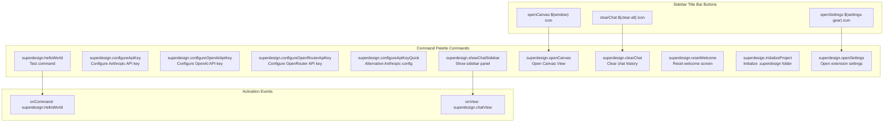
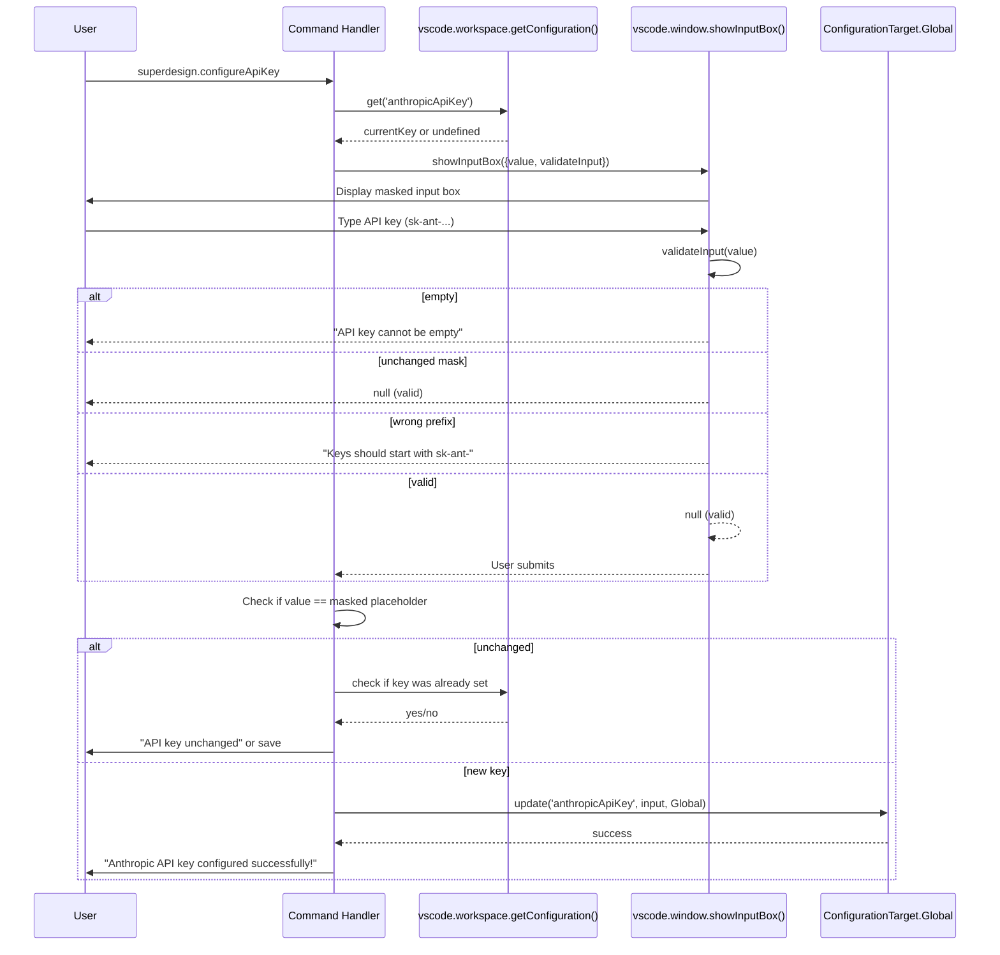

# Commands, Configuration, and Settings: VS Code Integration

SuperDesign integrates deeply with VS Code's command palette, settings system, and configuration API. This document catalogs every command, setting, and configuration flow.

**Source:** `src/extension.ts` (commands), `package.json` (contributes), `src/providers/chatSidebarProvider.ts` (settings handling).

## Registered Commands



## Command Catalog

| Command ID | Title | Handler | Purpose |
|------------|-------|---------|---------|
| `superdesign.helloWorld` | Hello World | Inline: `showInformationMessage` | Test/development command |
| `superdesign.configureApiKey` | Configure Anthropic API Key | `configureAnthropicApiKey()` | Interactive API key input with validation |
| `superdesign.configureOpenAIApiKey` | Configure OpenAI API Key | `configureOpenAIApiKey()` | Interactive API key input with validation |
| `superdesign.configureOpenRouterApiKey` | Configure OpenRouter API Key | `configureOpenRouterApiKey()` | Interactive API key input with validation |
| `superdesign.configureApiKeyQuick` | (hidden) | `configureAnthropicApiKey()` | Alternative Anthropic config entry |
| `superdesign.showChatSidebar` | Show Chat Sidebar | `executeCommand('workbench.view.extension.superdesign-sidebar')` | Open sidebar view |
| `superdesign.openCanvas` | Open Canvas View | `SuperdesignCanvasPanel.createOrShow()` | Open canvas panel (singleton) |
| `superdesign.clearChat` | Clear Chat | `sidebarProvider.sendMessage({command: 'clearChat'})` | Clear webview chat history |
| `superdesign.resetWelcome` | Reset Welcome Screen | `sidebarProvider.sendMessage({command: 'resetWelcome'})` | Reset first-time user flag |
| `superdesign.initializeProject` | Initialize Superdesign | `initializeSuperdesignProject()` | Create `.superdesign/` and inject rules |
| `superdesign.openSettings` | Open Settings | `executeCommand('workbench.action.openSettings', '@ext:iganbold.superdesign')` | Filter settings to this extension |

## VS Code Settings (package.json Configuration)

```json
// From package.json "contributes.configuration"
{
    "superdesign.anthropicApiKey": {
        "type": "string",
        "description": "Anthropic API key for Claude Code integration",
        "scope": "application"
    },
    "superdesign.openaiApiKey": {
        "type": "string",
        "description": "OpenAI API key for custom agent",
        "scope": "application"
    },
    "superdesign.openrouterApiKey": {
        "type": "string",
        "description": "OpenRouter API key for custom agent",
        "scope": "application"
    },
    "superdesign.googleApiKey": {
        // Referenced in code but NOT in package.json contributes
        "type": "string",
        "scope": "application"
    },
    "superdesign.aiModelProvider": {
        "type": "string",
        "enum": ["openai", "anthropic", "openrouter"],
        "default": "anthropic",
        "description": "AI model provider for custom agent"
    },
    "superdesign.aiModel": {
        "type": "string",
        "description": "Specific AI model to use (e.g., gpt-4o, claude-3-5-sonnet-20241022)"
    }
}
```

**Note:** `superdesign.googleApiKey` is referenced in the code (`customAgentService.ts`, `chatSidebarProvider.ts`) but is NOT declared in `package.json`'s configuration contributes. This means it can be set programmatically or in settings.json but won't appear in the VS Code Settings UI.

**Source:** `package.json` lines 52-78, `src/services/customAgentService.ts`.

## Settings Table

| Setting Key | Type | Default | Enum Values | Scope | Used By |
|-------------|------|---------|-------------|-------|---------|
| `superdesign.anthropicApiKey` | string | -- | -- | application | CustomAgentService |
| `superdesign.openaiApiKey` | string | -- | -- | application | CustomAgentService |
| `superdesign.openrouterApiKey` | string | -- | -- | application | CustomAgentService |
| `superdesign.googleApiKey` | string | -- | -- | application | CustomAgentService (undocumented) |
| `superdesign.aiModelProvider` | string | `"anthropic"` | `openai`, `anthropic`, `openrouter` | application | CustomAgentService, ChatSidebarProvider |
| `superdesign.aiModel` | string | -- | -- | application | CustomAgentService, ChatSidebarProvider |

## API Key Configuration Flow Detail

The interactive API key configuration uses VS Code's `showInputBox` with real-time validation:



**Source:** `src/extension.ts` lines 1407-1449 — `configureAnthropicApiKey()` function.

## API Key Configuration Flow

```typescript
// src/extension.ts:1407-1449
async function configureAnthropicApiKey() {
    const currentKey = vscode.workspace.getConfiguration('superdesign').get<string>('anthropicApiKey');

    const input = await vscode.window.showInputBox({
        title: 'Configure Anthropic API Key',
        prompt: 'Enter your Anthropic API key (get one from https://console.anthropic.com/)',
        value: currentKey ? '••••••••••••••••' : '',
        password: true,
        placeHolder: 'sk-ant-...',
        validateInput: (value) => {
            if (!value || value.trim().length === 0) return 'API key cannot be empty';
            if (value === '••••••••••••••••') return null; // Mask unchanged
            if (!value.startsWith('sk-ant-')) return 'Anthropic API keys should start with "sk-ant-"';
            return null;
        }
    });

    if (input !== undefined && input !== '••••••••••••••••') {
        await vscode.workspace.getConfiguration('superdesign').update(
            'anthropicApiKey',
            input.trim(),
            vscode.ConfigurationTarget.Global
        );
        vscode.window.showInformationMessage('✅ Anthropic API key configured successfully!');
    }
}
```

### Key Validation Patterns

| Provider | Validation | Placeholder |
|----------|-----------|-------------|
| Anthropic | `value.startsWith('sk-ant-')` | `sk-ant-...` |
| OpenAI | `value.startsWith('sk-')` | `sk-...` |
| OpenRouter | `value.startsWith('sk-')` | `sk-...` |

All three use `password: true` for masked input and `ConfigurationTarget.Global` for user-level settings.

### Masked Value Handling

When a key is already configured, the input shows `••••••••••••••••` (16 bullets). The validation function returns `null` for this value, meaning "user didn't change it." If the user submits the masked value unchanged, the code checks if a key was already set and shows "API key unchanged" rather than overwriting.

## Model Provider Resolution

The provider is determined by a two-tier system:

1. **Explicit setting:** `aiModelProvider` setting (one of `openai`, `anthropic`, `openrouter`)
2. **Model name inference:** If `aiModel` is set, the provider is inferred from the model name:

```typescript
// src/services/customAgentService.ts:90-100
let effectiveProvider = provider;
if (specificModel) {
    if (specificModel.includes('/')) {
        effectiveProvider = 'openrouter';   // e.g., "google/gemini-2.5-pro"
    } else if (specificModel.startsWith('claude-')) {
        effectiveProvider = 'anthropic';    // e.g., "claude-3-5-sonnet-20241022"
    } else {
        effectiveProvider = 'openai';       // e.g., "gpt-4o"
    }
}
```

This means the user can set `aiModelProvider: "anthropic"` but override it to OpenAI by setting `aiModel: "gpt-4o"`. The model name always wins when specified.

## Available Models (from ModelSelector)

The ModelSelector component includes 100+ models organized by provider:

| Provider | Models |
|----------|--------|
| Anthropic | Claude 4 Opus, Claude 4 Sonnet, Claude 3.7 Sonnet, Claude 3.5 Sonnet, Claude 3 Opus/Sonnet/Haiku |
| OpenAI | GPT-4.1, GPT-4.1 Mini/Nano, GPT-4o, GPT-4o Mini |
| OpenRouter | Google (Gemini 2.5 Pro/Flash, Gemma 3), Meta (Llama 4/3.x), DeepSeek (R1/V3), Mistral, xAI (Grok 3), Qwen3, Perplexity (Sonar), Microsoft (Phi-4), NVIDIA, Cohere, Amazon (Nova), and more |

**Source:** `src/providers/chatSidebarProvider.ts` lines 184-339 (`getModelDisplayName`).

## Views Configuration

```json
// package.json
{
    "viewsContainers": {
        "activitybar": [{
            "id": "superdesign-sidebar",
            "title": "Superdesign",
            "icon": "icon.svg"
        }]
    },
    "views": {
        "superdesign-sidebar": [{
            "type": "webview",
            "id": "superdesign.chatView",
            "name": "SUPER DESIGN",
            "when": "true"
        }]
    }
}
```

The activity bar icon (`icon.svg`) opens the sidebar containing the `superdesign.chatView` webview view. The `"when": "true"` clause means the view is always visible when the extension is installed.

## Menus Configuration

Three buttons appear in the sidebar title bar:

```json
{
    "menus": {
        "view/title": [
            { "command": "superdesign.openCanvas", "when": "view == superdesign.chatView", "group": "navigation" },
            { "command": "superdesign.openSettings", "when": "view == superdesign.chatView", "group": "navigation" },
            { "command": "superdesign.clearChat", "when": "view == superdesign.chatView", "group": "navigation" }
        ]
    }
}
```

## Aha Moments

**Aha: The `superdesign.googleApiKey` setting exists in code but not in package.json.** The Google provider (`@ai-sdk/google`) is imported and can be selected via the model name inference, but there is no `configureGoogleApiKey` command, no package.json configuration entry, and no validation flow for it. Users would need to set `superdesign.googleApiKey` manually in their `settings.json`. This is likely an incomplete feature -- the SDK integration is wired up, but the UX for configuring it is missing.

**Aha: The `initializeProject` command can be triggered from both the command palette AND the webview.** The Welcome screen sends an `initializeSuperdesign` message to the extension, which executes `superdesign.initializeProject`. This means new users can initialize the project structure without ever opening the command palette. The dual entry point (command palette for experienced users, Welcome button for new users) reduces onboarding friction.

**Aha: Settings are stored at `ConfigurationTarget.Global` (user-level), not `Workspace`.** API keys are stored in the user's global VS Code settings, not in the workspace's `.vscode/settings.json`. This means the same API key is used across all workspaces, which is the right security model (keys shouldn't be checked into git). The `"scope": "application"` in package.json reinforces this -- these settings are application-wide, not workspace-specific.

## Cross-References

- [02-ai-providers](02-ai-providers.md) -- AI provider details and Helicone proxy
- [06-design-workflow](06-design-workflow.md) -- Project initialization and rule injection
- [08-chat-streaming](08-chat-streaming.md) -- Chat message handling and error flows
