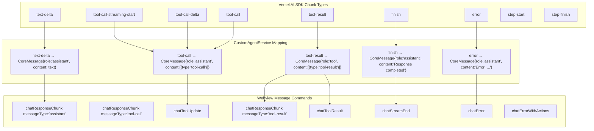
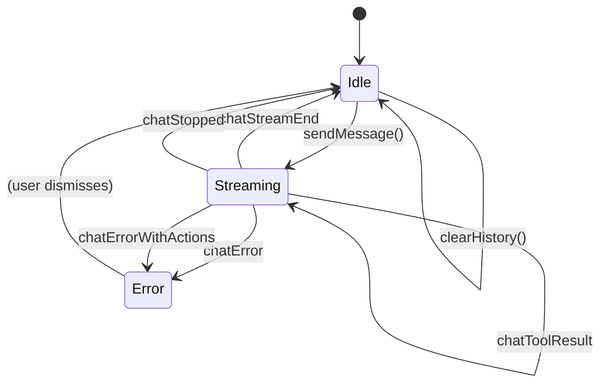
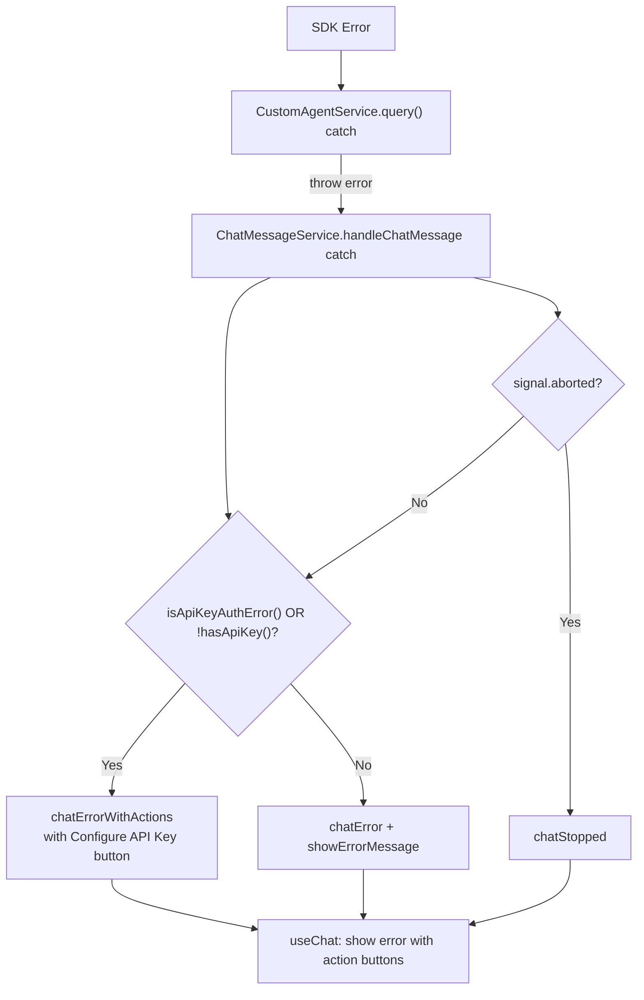

# Chat Streaming and Message Handling: CoreMessage Protocol

The chat system in SuperDesign uses the Vercel AI SDK's `CoreMessage` format as its internal protocol. This document traces the complete message flow from user input to rendered response, including streaming, tool calls, and error handling.

**Source:** `src/services/chatMessageService.ts`, `src/services/customAgentService.ts`, `src/webview/hooks/useChat.ts`.

## Message Type Architecture



## The CoreMessage Format

SuperDesign uses the Vercel AI SDK's `CoreMessage` type as its internal message format:

```typescript
// From 'ai' package
interface CoreMessage {
    role: 'system' | 'user' | 'assistant' | 'tool';
    content: string | Array<TextPart | ToolCallPart | ToolResultPart>;
}

interface ToolCallPart {
    type: 'tool-call';
    toolCallId: string;
    toolName: string;
    args: Record<string, unknown>;
}

interface ToolResultPart {
    type: 'tool-result';
    toolCallId: string;
    toolName: string;
    result: unknown;
    isError: boolean;
}
```

**Source:** `src/types/agent.ts` imports `CoreMessage` from `ai`.

## ChatMessageService: The Message Pipeline

The `ChatMessageService` sits between the webview and the AI agent:

```typescript
// src/services/chatMessageService.ts:7-13
export class ChatMessageService {
    private currentRequestController?: AbortController;

    constructor(
        private agentService: AgentService,
        private outputChannel: vscode.OutputChannel
    ) {}
```

### handleChatMessage Flow

```typescript
// src/services/chatMessageService.ts:15-98
async handleChatMessage(message: any, webview: vscode.Webview): Promise<void> {
    const chatHistory: CoreMessage[] = message.chatHistory || [];
    const latestMessage = message.message || '';
    
    // Create AbortController for this request
    this.currentRequestController = new AbortController();
    
    // Send streaming start
    webview.postMessage({ command: 'chatStreamStart' });
    
    // Query agent with conversation history or single prompt
    if (chatHistory.length > 0) {
        response = await this.agentService.query(
            undefined,          // no single prompt
            chatHistory,        // use conversation history
            undefined,
            this.currentRequestController,
            (streamMessage) => this.handleStreamMessage(streamMessage, webview)
        );
    } else {
        response = await this.agentService.query(
            latestMessage,      // single prompt
            undefined,          // no conversation history
            undefined,
            this.currentRequestController,
            (streamMessage) => this.handleStreamMessage(streamMessage, webview)
        );
    }
    
    // Send stream end
    webview.postMessage({ command: 'chatStreamEnd' });
}
```

### handleStreamMessage: SDK to Webview Translation

The `handleStreamMessage` method translates `CoreMessage` objects into webview-friendly commands:

```typescript
// src/services/chatMessageService.ts:192-298
private handleStreamMessage(message: CoreMessage, webview: vscode.Webview): void {
    const isUpdate = (message as any)._isUpdate;
    const updateToolId = (message as any)._updateToolId;
    
    if (message.role === 'assistant') {
        if (typeof message.content === 'string') {
            // Simple text
            webview.postMessage({
                command: 'chatResponseChunk',
                messageType: 'assistant',
                content: message.content
            });
        } else if (Array.isArray(message.content)) {
            for (const part of message.content) {
                if (part.type === 'text' && part.text) {
                    webview.postMessage({
                        command: 'chatResponseChunk',
                        messageType: 'assistant',
                        content: part.text
                    });
                } else if (part.type === 'tool-call') {
                    if (isUpdate) {
                        // Streaming parameter update
                        webview.postMessage({
                            command: 'chatToolUpdate',
                            tool_use_id: part.toolCallId,
                            tool_input: part.args
                        });
                    } else {
                        // New tool call
                        webview.postMessage({
                            command: 'chatResponseChunk',
                            messageType: 'tool-call',
                            content: '',
                            metadata: {
                                tool_name: part.toolName,
                                tool_id: part.toolCallId,
                                tool_input: part.args
                            }
                        });
                    }
                }
            }
        }
    }
    
    if (message.role === 'tool') {
        for (const part of message.content) {
            if (part.type === 'tool-result') {
                webview.postMessage({
                    command: 'chatResponseChunk',
                    messageType: 'tool-result',
                    content: typeof part.result === 'string' ? part.result : JSON.stringify(part.result),
                    metadata: { tool_id: part.toolCallId, tool_name: part.toolName, is_error: part.isError }
                });
                webview.postMessage({
                    command: 'chatToolResult',
                    tool_use_id: part.toolCallId,
                    content: typeof part.result === 'string' ? part.result : JSON.stringify(part.result),
                    is_error: part.isError
                });
            }
        }
    }
}
```

## CustomAgentService: SDK Chunk Processing

The agent service processes the AI SDK's `fullStream` and maps chunk types to `CoreMessage` objects:

```typescript
// src/services/customAgentService.ts:660-843
for await (const chunk of result.fullStream) {
    switch (chunk.type) {
        case 'text-delta':
            messageBuffer += chunk.textDelta;
            onMessage?.({ role: 'assistant', content: chunk.textDelta });
            break;

        case 'tool-call-streaming-start':
            currentToolCall = { toolCallId, toolName, args: {} };
            onMessage?.({
                role: 'assistant',
                content: [{ type: 'tool-call', toolCallId, toolName, args: {} }]
            });
            break;

        case 'tool-call-delta':
            toolCallBuffer += delta.argsTextDelta;
            try {
                const parsedArgs = JSON.parse(toolCallBuffer);
                onMessage?.({
                    role: 'assistant',
                    content: [{ type: 'tool-call', toolCallId, toolName, args: parsedArgs }],
                    _isUpdate: true,
                    _updateToolId: toolCallId
                });
            } catch { /* JSON not complete yet */ }
            break;

        case 'tool-call':
            // Skip if we already sent streaming start
            if (!currentToolCall) {
                onMessage?.({ role: 'assistant', content: [{ type: 'tool-call', ... }] });
            }
            currentToolCall = null;
            toolCallBuffer = '';
            break;

        case 'tool-result':
            onMessage?.({
                role: 'tool',
                content: [{ type: 'tool-result', toolCallId, toolName, result, isError }]
            });
            break;

        case 'finish':
            onMessage?.({ role: 'assistant', content: 'Response completed successfully' });
            break;

        case 'error':
            onMessage?.({ role: 'assistant', content: `Error: ${chunk.error.message}` });
            break;
    }
}
```

**Aha: Tool call streaming uses a JSON buffer with progressive parsing.** The `tool-call-delta` chunks arrive as text fragments, not complete JSON. The code buffers them in `toolCallBuffer` and tries `JSON.parse()` on each delta. When parsing succeeds, it sends an `_isUpdate: true` message with the partially-parsed args. The webview can then show the tool call parameters filling in real-time. If parsing fails (incomplete JSON), the buffer keeps accumulating. This is a clever way to provide streaming tool call visibility without the SDK providing a structured partial-args API.

**Aha: Duplicate tool call messages are suppressed.** When `tool-call-streaming-start` fires, the code sends an initial tool call message with empty args. When `tool-call` fires (the complete call), it checks `if (!currentToolCall)` to avoid sending a duplicate. The streaming start already sent the message, so the complete call is silently acknowledged. This prevents the webview from showing the same tool call twice.

## useChat Hook: Webview State Machine

The `useChat` hook manages the client-side state machine:



### Tool Loading States

The hook tracks tool execution progress:

```typescript
// When tool-call received
metadata: {
    is_loading: true,
    estimated_duration: 90,
    start_time: Date.now(),
    progress_percentage: 0
}

// When chatToolResult received
metadata: {
    is_loading: false,
    progress_percentage: 100,
    elapsed_time: metadata.estimated_duration || 90
}
```

The `TOOL_TIME_ESTIMATES` map provides estimated durations:
- `codebase_search`: 30s
- `read_file`: 15s
- `edit_file`: 45s
- `run_terminal_cmd`: 60s
- `default`: 90s

## Error Handling Flow



### API Key Error Detection

```typescript
// src/services/customAgentService.ts:914-927
isApiKeyAuthError(errorMessage: string): boolean {
    const lowerError = errorMessage.toLowerCase();
    return lowerError.includes('api key') ||
           lowerError.includes('authentication') ||
           lowerError.includes('unauthorized') ||
           lowerError.includes('invalid_api_key') ||
           lowerError.includes('permission_denied') ||
           lowerError.includes('api_key_invalid') ||
           lowerError.includes('unauthenticated');
}
```

When an API key error is detected, the webview receives `chatErrorWithActions` with action buttons:
- "Configure {Provider} API Key" → triggers the appropriate configure command
- "Open Settings" → opens `@ext:iganbold.superdesign` filtered settings

### Abort Handling

Each chat request creates a fresh `AbortController`. The stop button calls:

```typescript
// src/services/chatMessageService.ts:383-394
async stopCurrentChat(webview: vscode.Webview): Promise<void> {
    if (this.currentRequestController) {
        this.currentRequestController.abort();
        webview.postMessage({ command: 'chatStopped' });
    }
}
```

The `CustomAgentService.query()` loop checks `abortController?.signal.aborted` on each chunk and throws `Error('Operation cancelled')` if aborted.

## Conversation History Persistence

The `useChat` hook persists chat history to `localStorage`:

```typescript
// Load on mount
const [chatHistory, setChatHistory] = useState(() => {
    const saved = localStorage.getItem('superdesign-chat-history');
    return saved ? JSON.parse(saved) : [];
});

// Save on change
useEffect(() => {
    localStorage.setItem('superdesign-chat-history', JSON.stringify(chatHistory));
}, [chatHistory]);
```

This means the conversation survives webview recreation (e.g., VS Code restart, sidebar close/reopen). The `clearHistory()` function removes both the state and the localStorage entry.

## Aha Moments

**Aha: The hook sends the full chat history with every message, not just the new message.** When the user sends a message, `sendMessage` posts `{ chatMessage, message, chatHistory: [...chatHistory, userMessage] }`. The entire conversation history is sent to the extension, which forwards it to the AI SDK. This means the agent is stateless between calls -- it doesn't maintain any server-side session. The tradeoff is that for long conversations, the full history is retransmitted each time, but the `maxTokens: 8192` limit in the SDK config prevents unbounded growth.

**Aha: The error handler creates actionable buttons, not just error text.** When an API key error occurs, the webview doesn't just show "API key not configured" -- it shows two buttons: "Configure Anthropic API Key" and "Open Settings". The `executeAction` handler in the sidebar provider calls `vscode.commands.executeCommand(message.actionCommand, message.actionArgs)`. This reduces the steps to fix a configuration error from "read error → open command palette → find the right command → type API key" to just "click Configure API Key → type key."

## Cross-References

- [03-tools](03-tools.md) -- Tool execution and response formats
- [06-design-workflow](06-design-workflow.md) -- How the agent uses tool calls in the workflow
- [08-commands-settings](08-commands-settings.md) -- Configuration commands triggered by error actions
