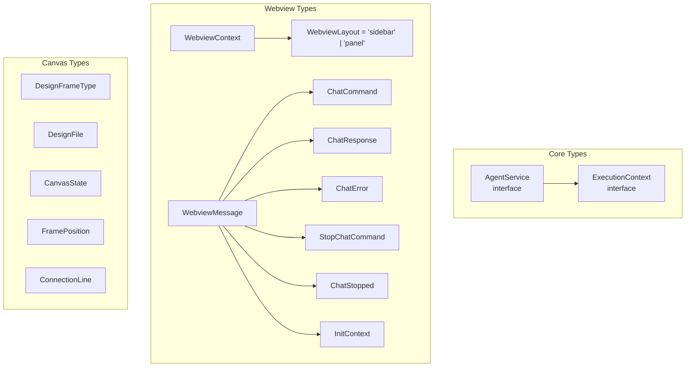
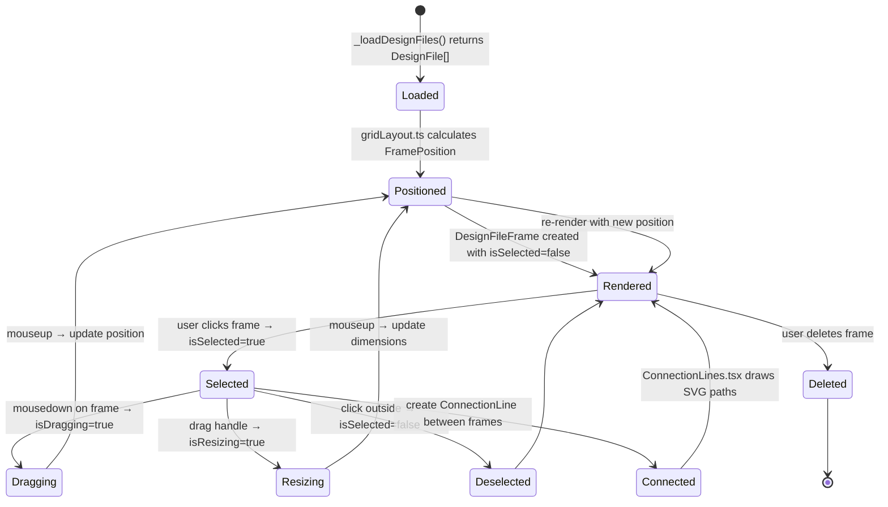

# Type System and Context: AgentService, ExecutionContext, WebviewContext

SuperDesign's TypeScript types define the contracts between its major subsystems. Understanding these types is key to understanding how the extension's components communicate.

**Source:** `src/types/agent.ts`, `src/types/context.ts`, `src/webview/types/canvas.types.ts`, `src/webview/types.d.ts`.

## Core Type Hierarchy



## AgentService Interface

**Source:** `src/types/agent.ts` lines 4-15

```typescript
import * as vscode from 'vscode';
import { CoreMessage } from 'ai';

export interface AgentService {
    query(
        prompt?: string,
        messages?: CoreMessage[],
        options?: any,
        abortController?: AbortController,
        onMessage?: (message: any) => void
    ): Promise<any[]>;
    
    hasApiKey(): boolean;
    isApiKeyAuthError(errorMessage: string): boolean;
}
```

This interface is implemented by `CustomAgentService` (primary) and `ClaudeCodeService` (deprecated). The interface has exactly three members:

1. **`query()`** -- The main method. Sends a prompt or conversation history to the AI provider and streams responses via `onMessage`. Returns accumulated response messages.
2. **`hasApiKey()`** -- Returns whether the current provider's API key is configured.
3. **`isApiKeyAuthError()`** -- Detects if an error message indicates an authentication failure.

**Aha: The AgentService interface is deliberately minimal.** It has only three methods, which is exactly what the ChatSidebarProvider and ChatMessageService need. There is no `getTools()`, `getSystemPrompt()`, or `getWorkingDirectory()` on the interface -- those are implementation details of `CustomAgentService`. This means the interface could be implemented by any AI agent system (Claude Code SDK, another LLM provider, a mock for testing) without requiring tool or prompt knowledge.

## ExecutionContext Interface

**Source:** `src/types/agent.ts` lines 17-22

```typescript
export interface ExecutionContext {
    workingDirectory: string;
    sessionId: string;
    outputChannel: vscode.OutputChannel;
    abortController?: AbortController;
}
```

Every tool receives this context when created. The `workingDirectory` is typically `.superdesign/` in the workspace root. The `sessionId` is generated as `session_${Date.now()}` in `CustomAgentService.query()`.

### Context Creation

```typescript
// src/services/customAgentService.ts:604-609
const executionContext: ExecutionContext = {
    workingDirectory: this.workingDirectory,
    sessionId: sessionId,
    outputChannel: this.outputChannel,
    abortController: abortController,
};
```

## Webview Types

**Source:** `src/types/context.ts` (45 lines)

### WebviewLayout

```typescript
export type WebviewLayout = 'sidebar' | 'panel';
```

### WebviewContext

```typescript
export interface WebviewContext {
    layout: WebviewLayout;
    extensionUri: string;
    logoUris?: {
        cursor: string;
        windsurf: string;
        claudeCode: string;
        lovable: string;
        bolt: string;
    };
}
```

The `logoUris` are webview-secure URIs pointing to partner IDE logos. They are only populated for the canvas panel, not the sidebar (the sidebar doesn't show partner IDE links in its welcome screen).

### Message Types

```typescript
export interface WebviewMessage {
    command: string;
    [key: string]: any;
}

export interface ChatCommand extends WebviewMessage {
    command: 'chatMessage';
    message: string;
}

export interface ChatResponse extends WebviewMessage {
    command: 'chatResponse';
    response: string;
}

export interface ChatError extends WebviewMessage {
    command: 'chatError';
    error: string;
}

export interface StopChatCommand extends WebviewMessage {
    command: 'stopChat';
}

export interface ChatStopped extends WebviewMessage {
    command: 'chatStopped';
}

export interface InitContext extends WebviewMessage {
    command: 'initContext';
    context: WebviewContext;
}
```

**Aha: The typed message interfaces (ChatCommand, ChatResponse, etc.) are defined but rarely used directly.** The actual message handling uses `any` type with string-based command routing (`switch (message.command)`). The typed interfaces serve as documentation rather than compile-time enforcement. In the webview, messages are constructed as plain objects like `{ command: 'chatMessage', message: 'hello' }` and received as `event.data` (which is `any` from `MessageEvent`). This is a pragmatic choice for a VS Code extension where the message protocol is controlled by the extension itself, but it means the TypeScript type system cannot catch typos in command names or missing fields.

## Canvas Types

**Source:** `src/webview/types/canvas.types.ts` (178 lines)

### DesignFrameType

```typescript
export type DesignFrameType = 'html' | 'svg';
```

### DesignFile

```typescript
export interface DesignFile {
    name: string;
    path: string;
    content: string;
    size: number;
    modified: Date;
    fileType: DesignFrameType;
}
```

This matches the return type of `_loadDesignFiles()` in the canvas panel.

### FramePosition

```typescript
export interface FramePosition {
    x: number;
    y: number;
    width: number;
    height: number;
    zIndex: number;
}
```

Used by `gridLayout.ts` to calculate frame positions on the canvas.

### DesignFrame

```typescript
export interface DesignFileFrame extends DesignFile {
    position: FramePosition;
    isSelected: boolean;
    isDragging: boolean;
    isResizing: boolean;
}
```

### CanvasState

```typescript
export interface CanvasState {
    frames: DesignFileFrame[];
    selectedFrame: string | null;
    zoom: number;
    pan: { x: number; y: number };
    gridSize: number;
    showGrid: boolean;
}
```

### ConnectionLine

```typescript
export interface ConnectionLine {
    id: string;
    fromFrame: string;
    toFrame: string;
    fromAnchor: 'top' | 'right' | 'bottom' | 'left';
    toAnchor: 'top' | 'right' | 'bottom' | 'left';
    color: string;
}
```

Used by `ConnectionLines.tsx` to draw lines between design frames showing iteration relationships.

## Webview Type Declarations

**Source:** `src/webview/types.d.ts`

Global type declarations for the VS Code API and CSS module imports:

```typescript
declare function acquireVsCodeApi(): {
    postMessage(message: any): void;
    setState(state: any): void;
    getState(): any;
};

declare module '*.css' {
    const content: string;
    export default content;
}
```

The `acquireVsCodeApi` declaration provides TypeScript types for the VS Code webview API, which is injected at runtime by VS Code and not available as an npm import.

The CSS module declaration allows `import styles from './App.css'` to work with esbuild's text loader.

## Tool Response Types

**Source:** `src/tools/tool-utils.ts`

```typescript
export interface ToolErrorResponse {
  success: false;
  error: string;
  error_type?: 'validation' | 'security' | 'file_not_found' | 'permission' | 'execution' | 'unknown';
  details?: any;
}

export interface ToolSuccessResponse {
  success: true;
  [key: string]: any;
}

export type ToolResponse = ToolSuccessResponse | ToolErrorResponse;
```

This discriminated union uses `success` as the discriminator. Every tool returns this type, which the AI SDK uses to determine whether the tool succeeded.

## Canvas State Lifecycle

The canvas types describe how design frames transition through interactive states:



## Aha Moments

**Aha: The ExecutionContext bridges the extension host and tool implementations.** Tools don't have direct access to VS Code APIs -- they receive everything they need through `ExecutionContext`. This makes tools testable in isolation: you can create a mock context with a fake working directory, a mock output channel, and no abort controller. The `outputChannel` field is a `vscode.OutputChannel` (from the VS Code API), which means tools are coupled to VS Code at the logging level, but the `appendLine()` method is simple enough to mock.

**Aha: The Canvas types describe a complete design management system, not just a viewer.** The `DesignFileFrame` type includes `isSelected`, `isDragging`, `isResizing` -- full interactive state for a design management canvas. The `ConnectionLine` type supports anchor-based connections between frames, suggesting the canvas can show relationships between design iterations (e.g., "this frame is iteration 2 of that frame"). This type system describes a more ambitious canvas than what the current implementation fully realizes.

## Cross-References

- [03-tools](03-tools.md) -- Tool implementations using ExecutionContext
- [05-superdesign-deep](05-superdesign-deep.md) -- Source-level deep dive
- [07-canvas-panel](07-canvas-panel.md) -- Canvas implementation using canvas types
