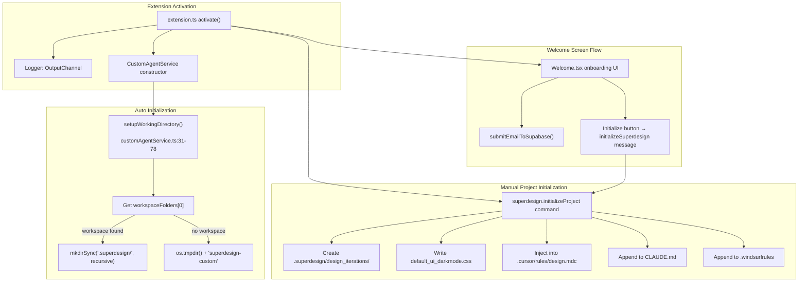
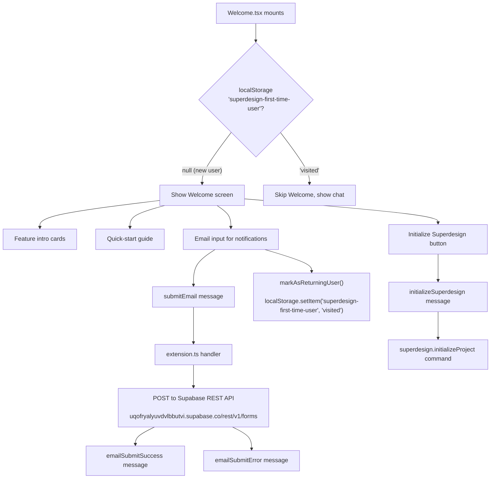
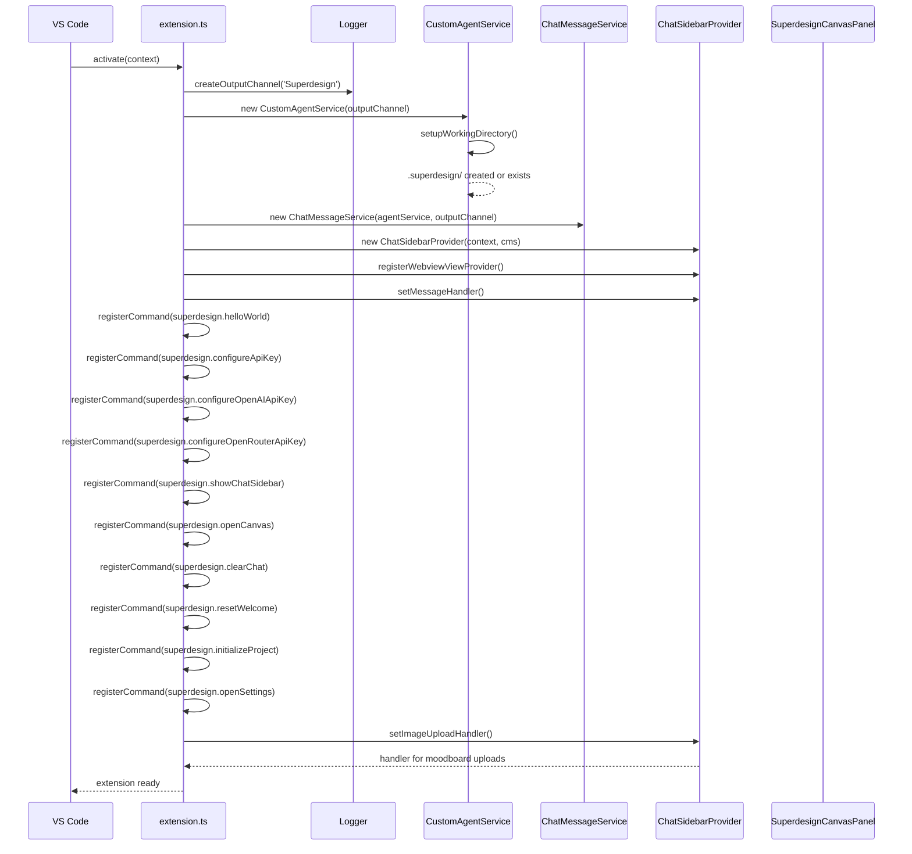

# Project Initialization: Directory Structure, Rule Injection, and Welcome Flow

SuperDesign's initialization process creates the `.superdesign/` project directory structure, injects design rules into external AI agent contexts (Cursor, Claude Code, Windsurf), and handles first-time user onboarding. This document traces the complete initialization flow from extension activation through project setup.

**Source:** `src/extension.ts` lines 243-1242 (`initializeSuperdesignProject`), `src/services/customAgentService.ts` lines 31-78 (`setupWorkingDirectory`).

## Initialization Architecture



## Two-Phase Initialization

SuperDesign initializes at two levels: **automatic working directory setup** and **manual project initialization**.

### Phase 1: Automatic Working Directory Setup

When the `CustomAgentService` is constructed (during extension activation), it automatically sets up the working directory:

```typescript
// src/services/customAgentService.ts:31-78
private async setupWorkingDirectory(): Promise<void> {
    const workspaceRoot = vscode.workspace.workspaceFolders?.[0]?.uri.fsPath;
    
    if (workspaceRoot) {
        const superdesignDir = path.join(workspaceRoot, '.superdesign');
        if (!fs.existsSync(superdesignDir)) {
            fs.mkdirSync(superdesignDir, { recursive: true });
        }
        this.workingDirectory = superdesignDir;
    } else {
        // Fallback to OS temp directory
        const tempDir = path.join(os.tmpdir(), 'superdesign-custom');
        if (!fs.existsSync(tempDir)) {
            fs.mkdirSync(tempDir, { recursive: true });
        }
        this.workingDirectory = tempDir;
        vscode.window.showWarningMessage(
            'No workspace folder found. Using temporary directory...'
        );
    }
    this.isInitialized = true;
}
```

This creates only the `.superdesign/` directory itself. The `design_iterations/` subdirectory and rule injection happen in Phase 2.

**Aha: The working directory setup is lazy, not eager.** The `setupWorkingDirectory()` is called in the constructor, but the `isInitialized` flag and `waitForInitialization()` method allow other parts of the system to wait for completion if needed. The `query()` method also checks `if (!this.isInitialized)` and calls `setupWorkingDirectory()` again before each query, providing a fallback initialization path if the constructor failed.

### Phase 2: Manual Project Initialization

The `initializeSuperdesignProject()` function (lines 243-1242 of `extension.ts`) performs the full project setup:

```typescript
// src/extension.ts:243-1242
async function initializeSuperdesignProject() {
    const workspaceFolder = vscode.workspace.workspaceFolders?.[0];
    if (!workspaceFolder) {
        vscode.window.showErrorMessage('No workspace folder found');
        return;
    }

    // 1. Create directory structure
    const superdesignDir = vscode.Uri.joinPath(workspaceFolder.uri, '.superdesign');
    const designDir = vscode.Uri.joinPath(superdesignDir, 'design_iterations');
    const moodboardDir = vscode.Uri.joinPath(superdesignDir, 'moodboard');
    await vscode.workspace.fs.createDirectory(designDir);
    await vscode.workspace.fs.createDirectory(moodboardDir);

    // 2. Write default_ui_darkmode.css (1,168-line CSS framework)
    const cssUri = vscode.Uri.joinPath(designDir, 'default_ui_darkmode.css');
    await vscode.workspace.fs.writeFile(cssUri, new TextEncoder().encode(defaultCssContent));

    // 3. Inject design rules into agent contexts
    await injectDesignRule(workspaceFolder);
}
```

## Directory Structure After Initialization

```
workspace/
├── .superdesign/
│   ├── design_iterations/          ← Generated HTML, SVG, CSS files
│   │   └── default_ui_darkmode.css ← 1,168-line CSS framework
│   └── moodboard/                  ← Uploaded reference images
├── .cursor/
│   └── rules/
│       └── design.mdc              ← Cursor agent design rules (injected)
├── CLAUDE.md                       ← Claude Code design rules (appended)
└── .windsurfrules                  ← Windsurf design rules (appended)
```

## Rule Injection System

The `injectDesignRule()` function writes the 627-line design prompt into three external AI agent configuration files. Each injection is idempotent:

```typescript
// src/extension.ts — idempotent injection pattern
async function injectIntoFile(filePath: vscode.Uri, ruleContent: string, marker: string): Promise<void> {
    let existingContent = '';
    try {
        const bytes = await vscode.workspace.fs.readFile(filePath);
        existingContent = new TextDecoder().decode(bytes);
    } catch {
        // File doesn't exist yet — will be created
    }

    if (existingContent.includes(marker)) {
        return; // Already injected, skip
    }

    const newContent = existingContent + '\n\n' + ruleContent;
    await vscode.workspace.fs.writeFile(filePath, new TextEncoder().encode(newContent));
}
```

### Target Files and Markers

| Target File | Format | Marker String | Purpose |
|-------------|--------|---------------|---------|
| `.cursor/rules/design.mdc` | MDC (Cursor rules) | `superdesign: Open Canvas View` | Cursor AI agent instructions |
| `CLAUDE.md` | Markdown | `superdesign: Open Canvas View` | Claude Code system prompt |
| `.windsurfrules` | Text | `superdesign: Open Canvas View` | Windsurf AI agent instructions |

**Aha: The injection is additive, not replacing.** The design rule is appended to existing files rather than overwriting them. This means if a user has their own `CLAUDE.md` with project instructions, the SuperDesign rules are added below their content. The marker check (`includes(marker)`) prevents duplicate injections on repeated runs. This is the correct approach for a VS Code extension — it respects existing user configuration while adding its own layer.

## Default CSS Framework

The `default_ui_darkmode.css` file is a comprehensive 1,168-line CSS framework that includes:

- **Dark mode tokens** — Full set of `--background`, `--foreground`, `--card`, `--primary`, etc. in OKLCH color space
- **Component styles** — Cards, buttons, forms, tabs, badges, alerts, modals, navigation
- **Utility classes** — Spacing, typography, display, flexbox, grid helpers
- **Responsive breakpoints** — `@media (max-width: 768px)` and `@media (max-width: 640px)`
- **Accessibility** — Focus styles, reduced motion support, contrast ratios

This CSS is written to `.superdesign/design_iterations/default_ui_darkmode.css` and serves as both a reference for the AI agent and a usable stylesheet for generated designs.

## Welcome Screen Flow

The `Welcome.tsx` component (110 lines) provides first-time user onboarding:



### Supabase Email Submission

```typescript
// src/extension.ts:181-239
async function submitEmailToSupabase(email: string, sidebarProvider: ChatSidebarProvider) {
    const https = require('https');
    const options = {
        hostname: 'uqofryalyuvdvlbbutvi.supabase.co',
        path: '/rest/v1/forms',
        method: 'POST',
        headers: {
            'Content-Type': 'application/json',
            'apikey': 'eyJ...' // hardcoded Supabase anon key
        }
    };
    // POST { email } to Supabase REST API
}
```

**Aha: The Supabase anon key is hardcoded in the extension source.** This is acceptable for a client-side application where the key only provides write access to a public forms table (Row Level Security restricts reads). The Supabase pattern here is "collect emails via a public form endpoint" — the key can't read other users' data, only insert new rows. This is the standard Supabase pattern for public form submissions.

## First-Time User Detection

The `useFirstTimeUser` hook (54 lines) manages the first-time state:

```typescript
// src/webview/hooks/useFirstTimeUser.ts
const FIRST_TIME_USER_KEY = 'superdesign-first-time-user';

export const useFirstTimeUser = () => {
    const [isFirstTime, setIsFirstTime] = useState(true);
    const [isLoading, setIsLoading] = useState(true);

    useEffect(() => {
        const hasVisited = localStorage.getItem(FIRST_TIME_USER_KEY);
        setIsFirstTime(hasVisited === null);
        setIsLoading(false);
    }, []);

    const markAsReturningUser = () => {
        localStorage.setItem(FIRST_TIME_USER_KEY, 'visited');
        setIsFirstTime(false);
    };

    const resetFirstTimeUser = () => {
        localStorage.removeItem(FIRST_TIME_USER_KEY);
        setIsFirstTime(true);
    };
};
```

The `superdesign.resetWelcome` command triggers `resetFirstTimeUser()` via the sidebar provider, allowing users to see the Welcome screen again for testing or re-onboarding.

## Extension Lifecycle



**Source:** `src/extension.ts` `activate()` function.

## Cross-References

- [00-overview](00-overview.md) — What SuperDesign is, features overview
- [06-design-workflow](06-design-workflow.md) — The 4-step design pipeline that runs inside `.superdesign/`
- [08-commands-settings](08-commands-settings.md) — Command palette commands including `initializeProject`
- [07-canvas-panel](07-canvas-panel.md) — Canvas panel that previews files in `design_iterations/`
