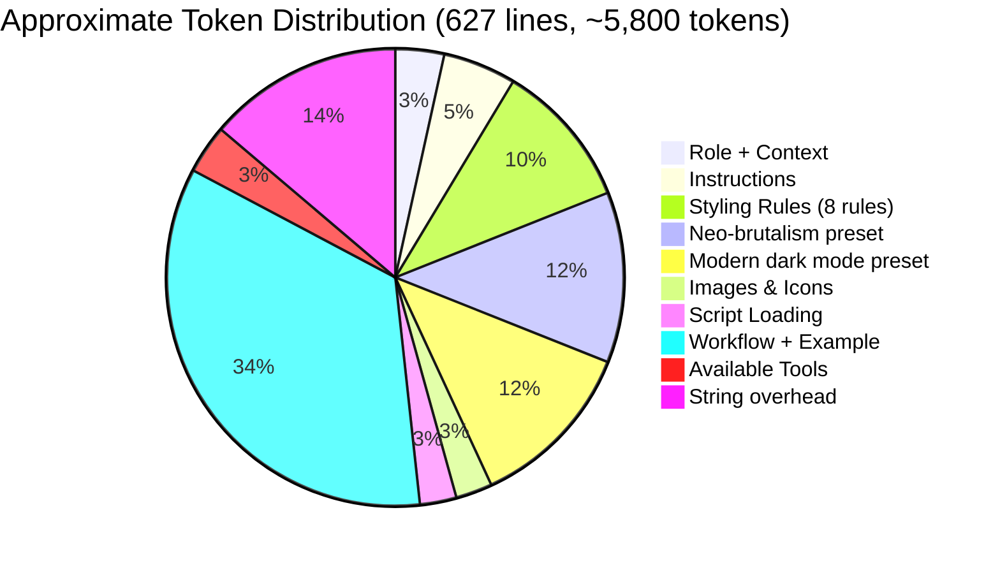

# Design Prompt Engineering: The 627-Line System Prompt, Styling Rules, and Workflow Enforcement

SuperDesign's core intelligence is a 627-line system prompt injected into every AI query via `CustomAgentService.getSystemPrompt()`. This prompt defines the agent's role, styling rules, tool usage guidelines, the 4-step design workflow, and a complete worked example. Understanding this prompt is essential to understanding why SuperDesign generates designs the way it does.

**Source:** `src/services/customAgentService.ts` lines 165-563 — `getSystemPrompt()` method.

## System Prompt Architecture

```mermaid
flowchart TD
    subgraph GetSystemPrompt["getSystemPrompt() — lines 165-563"]
        R["Role Section
        'You are superdesign, a senior frontend designer'
        Current Context: extension, model, workingDirectory"]

        Ins["Instructions Section
        File naming convention: {name}_{n}.html
        Iteration naming: {file}_{n}.html
        Must use tools for write/edit"]

        Sty["Styling Rules (8 rules)
        1. Flowbite as default
        2. No indigo/blue unless requested
        3. Responsive required
        4. Background/foreground pairing
        5. Google Fonts (21 options)
        6. !important for Tailwind overrides
        7. No Bootstrap blue default
        8. Example theme patterns"]

        Themes["Theme Presets
        Neo-brutalism (90s style)
        Modern dark mode (Vercel/Linear style)"]

        Img["Images & Icons
        Placeholder images from known sources
        Lucide icons via CDN"]

        Script["Script Loading Rules
        Tailwind via <script> not <link>
        Flowbite via CDN script tag"]

        WF["Workflow (5 steps)
        1. Layout (ASCII wireframe)
        2. Theme (generateTheme tool)
        3. Animation (micro-syntax)
        4. HTML generation (write tool)
        5. Step-by-step confirmation REQUIRED"]

        Ex["Complete Worked Example
        User: 'design an AI chat UI'
        Assistant: ASCII wireframe + question
        User: 'looks good'
        Assistant: generateTheme call
        User: 'I like vintage'
        Assistant: animation micro-syntax
        User: 'lets do it'
        Assistant: write() tool calls"]

        Tools["Available Tools List
        read, write, edit, multiedit,
        glob, grep, ls, bash, generateTheme"]
    end

    R --> Ins --> Sty --> Themes --> Img --> Script --> WF --> Ex --> Tools
```



## Prompt Sections and Token Budget

The 627-line prompt is organized into 8 sections, each consuming different token budgets:



## Dynamic Prompt Construction

The system prompt is not static — it incorporates runtime values via template literals:

```typescript
// src/services/customAgentService.ts:165-188
private getSystemPrompt(): string {
    const config = vscode.workspace.getConfiguration('superdesign');
    const specificModel = config.get<string>('aiModel');
    const provider = config.get<string>('aiModelProvider', 'anthropic');

    let modelName: string;
    if (specificModel) {
        modelName = specificModel;
    } else {
        switch (provider) {
            case 'openai': modelName = 'gpt-4o'; break;
            case 'openrouter': modelName = 'anthropic/claude-3-7-sonnet-20250219'; break;
            case 'anthropic': default: modelName = 'claude-3-5-sonnet-20241022'; break;
        }
    }

    return `# Role
You are superdesign, a senior frontend designer...
# Current Context
- Extension: Super Design (Design Agent for VS Code)
- AI Model: ${modelName}
- Working directory: ${this.workingDirectory}
...`;
}
```

The prompt dynamically includes the resolved model name and actual working directory path. This means the AI agent knows exactly where it's writing files and which model it's running on.

**Aha: The system prompt uses string interpolation to embed runtime context, not static text.** The `${modelName}` and `${this.workingDirectory}` placeholders are resolved at call time. This is a deliberate design choice — the prompt is reconstructed for every query, not cached. This ensures the working directory is always current (important if the workspace changes) and the model name is accurate (useful for model-specific instructions). The tradeoff is 627 lines of string concatenation on every query, but this is negligible compared to the token cost of the LLM call.

## Styling Rules Analysis

The prompt enforces 8 specific styling rules. Each rule prevents a common failure mode:

| Rule | Constraint | Prevents | Source Line |
|------|-----------|----------|-------------|
| 1 | Flowbite as default component library | Inconsistent component aesthetics across generations | Line 208 |
| 2 | No indigo/blue unless requested | Bootstrap default blue that looks generic | Line 209 |
| 3 | Must be responsive (`@media` breakpoints) | Desktop-only designs that break on mobile | Line 210 |
| 4 | Background must complement foreground | White components on white backgrounds (invisible) | Line 211 |
| 5 | Google Fonts only (21 curated options) | System font stack inconsistency across platforms | Lines 212-213 |
| 6 | `!important` for Tailwind overrides | Tailwind CDN silently overriding custom styles | Line 214 |
| 7 | No Bootstrap blue defaults | Generic "Bootstrap-looking" designs | Lines 215-216 |
| 8 | Two complete theme pattern examples | AI guessing at CSS custom property structure | Lines 217-328 |

### Built-in Theme Presets

The prompt includes two complete CSS theme templates as reference:

**Neo-brutalism** (lines 217-271): `--radius: 0px`, hard 4px offset shadows (`4px 4px 0px 0px`), OKLCH colors at full chroma (red: `oklch(0.6489 0.2370 26.9728)`, yellow: `oklch(0.9680 0.2110 109.7692)`, blue: `oklch(0.5635 0.2408 260.8178)`), DM Sans font.

**Modern dark mode** (lines 273-328): `--radius: 0.625rem`, soft layered shadows (`0 1px 3px 0px hsl(0 0% 0% / 0.10)`), grayscale OKLCH (zero chroma), system font stack with fallbacks.

## The Worked Example

The prompt includes a complete end-to-end example spanning lines 360-550. This example demonstrates:

1. **Assistant reasoning** — "Let's think through the layout design..."
2. **ASCII wireframe** — Two states: collapsed and expanded (sidebar)
3. **Confirmation question** — "Would you like to go ahead with this layout & UI interaction or needs any modification?"
4. **Theme tool call** — `generateTheme(theme_name='...', cssFilePath='...', cssSheet='...')`
5. **Animation micro-syntax** — Complete animation spec with 11 animation targets
6. **HTML generation** — `write(file_path='design_iterations/chat_ui.css', content='...')`

**Aha: The worked example is longer than the actual rules.** The example section (lines 360-550) is approximately 190 lines, while the rules themselves are about 170 lines (lines 190-360). This ratio is intentional — AI models learn better from concrete examples than from abstract rules. The example demonstrates the exact format the AI should use for each step, including the confirmation language ("Would you like to go ahead with this layout...").

## Workflow Enforcement Language

The workflow section uses escalating imperative language:

```
## Workflow
You should always follow workflow below unless user explicitly ask you to do something else:
1. Layout design
2. Theme design (Color, font, spacing, shadow), using generateTheme tool
3. Core Animation design
4. Generate a singlehtml file for the UI
5. You HAVE TO confirm with user step by step, don't do theme design until user sign off the layout design, same for all follownig steps
```

Key enforcement phrases:
- "You **should always** follow workflow below" — establishes the default behavior
- "**unless** user explicitly ask you to do something else" — allows workflow override
- "You **HAVE TO** confirm with user step by step" — mandatory confirmation
- "don't do theme design **until** user sign off the layout design" — sequential dependency

**Aha: The workflow is enforced through prompt language, not code state machine.** There is no `enum WorkflowStep { Layout, Theme, Animation, HTML }` in the TypeScript code. The agent service doesn't track which step the AI is on. The entire sequential enforcement relies on the AI following instructions. The `maxSteps: 10` in `streamText()` provides a technical bound (10 tool-call rounds maximum), but the step ordering is purely conversational. This is both flexible (the AI can skip steps when the user asks) and fragile (a confused AI might jump to HTML generation without doing the wireframe).

## Tool Descriptions in the Prompt

The prompt lists available tools at the end (lines 553-562):

```
# Available Tools
- **read**: Read file contents within the workspace...
- **write**: Write content to files in the workspace...
- **edit**: Replace text within files using exact string matching...
- **multiedit**: Perform multiple find-and-replace operations...
- **glob**: Find files and directories matching glob patterns...
- **grep**: Search for text patterns within file contents...
- **ls**: List directory contents with optional filtering...
- **bash**: Execute shell/bash commands within the workspace...
- **generateTheme**: Generate a theme for the design
```

Note the mismatch: the prompt lists `read`, `write`, `edit`, `multiedit`, `glob`, `grep`, `ls`, `bash`, and `generateTheme`, but the actual tool names registered in `CustomAgentService.query()` are:

```typescript
// src/services/customAgentService.ts:612-622
const tools = {
    read: createReadTool(executionContext),
    write: createWriteTool(executionContext),
    edit: createEditTool(executionContext),
    multiedit: createMultieditTool(executionContext),
    glob: createGlobTool(executionContext),
    grep: createGrepTool(executionContext),
    ls: createLsTool(executionContext),
    bash: createBashTool(executionContext),
    generateTheme: createThemeTool(executionContext)
};
```

The names match between the prompt and the registration, which is essential — if the prompt mentioned a tool name the SDK didn't recognize, the AI would try to call a non-existent tool.

## File Naming Convention

The prompt specifies a precise naming convention:

- **New designs:** `{design_name}_{n}.html` — e.g., `table_1.html`, `table_2.html`
- **Iterations:** `{existing_file_name}_{n}.html` — e.g., iterating `ui_1.html` produces `ui_1_1.html`, `ui_1_2.html`

This convention is enforced in the prompt (lines 202-205):
```
- You ALWAYS output design files in 'design_iterations' folder as {design_name}_{n}.html
  (Where n needs to be unique like table_1.html, table_2.html, etc.) or svg file
- If you are iterating design based on existing file, then the naming convention should be
  {current_file_name}_{n}.html, e.g. if we are iterating ui_1.html, then each version should
  be ui_1_1.html, ui_1_2.html, etc.
```

**Aha: The iteration naming convention creates a traceable design lineage.** If you iterate `ui_1.html` to get `ui_1_1.html`, then iterate that to get `ui_1_1_1.html`, the filename encodes the complete iteration history. This is a form of version control through naming conventions rather than git commits. The Canvas Panel's `ConnectionLines.tsx` can draw lines between related frames based on these naming patterns, creating a visual iteration graph.

## Prompt Size and Token Cost

The 627-line system prompt consumes a significant portion of the context window:

- **Prompt size:** ~4,500 tokens (estimated at ~7 characters per token)
- **With two theme presets:** Each preset is ~55 lines of CSS = ~350 tokens each = ~700 tokens total
- **With worked example:** ~190 lines = ~1,300 tokens
- **Remaining for conversation:** `maxTokens: 8192` - ~4,500 (system) = ~3,692 tokens for messages

The `maxTokens: 8192` in the `streamText` config (line 631) is chosen to accommodate this large system prompt while leaving enough room for conversation history and responses.

## Cross-References

- [02-ai-providers](02-ai-providers.md) — AI provider configuration and model selection
- [03-tools](03-tools.md) — Tool implementations referenced in the prompt
- [06-design-workflow](06-design-workflow.md) — The 4-step workflow enforced by this prompt
- [09-chat-streaming](09-chat-streaming.md) — How the system prompt feeds into the streaming pipeline
