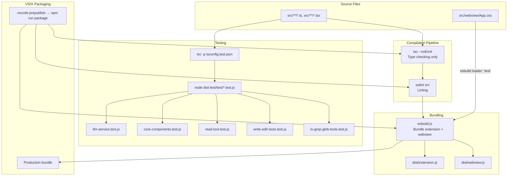
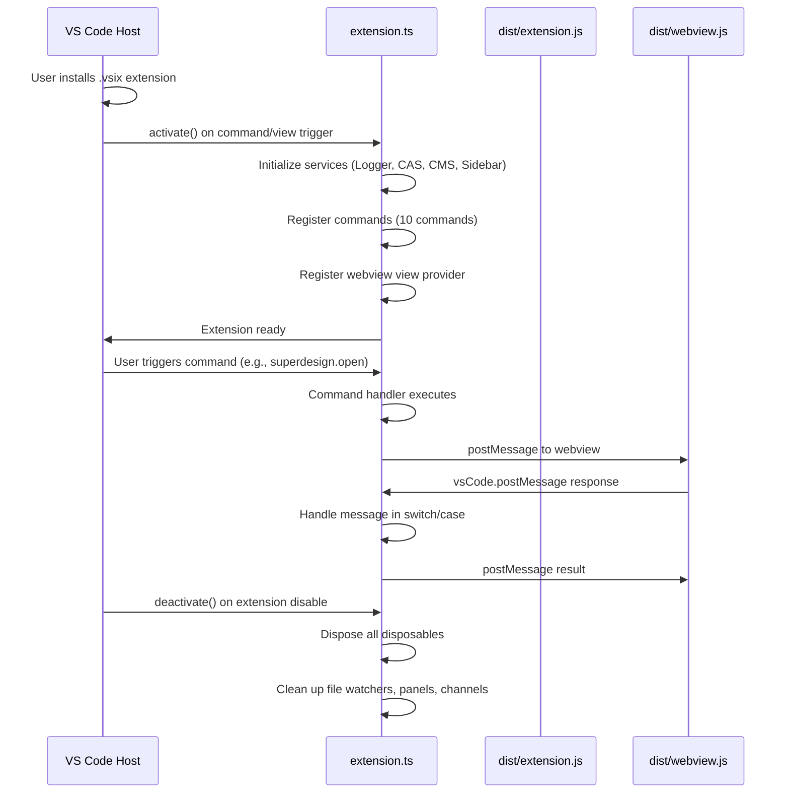

# Build System, Testing, and Packaging: Esbuild, TypeScript, and VS Code Extension Lifecycle

SuperDesign uses esbuild for bundling, TypeScript for type checking, and VS Code's extension packaging pipeline. This document covers the build configuration, test structure, packaging process, and extension lifecycle management.

**Source:** `package.json`, `esbuild.js`, `tsconfig.json`, `tsconfig.test.json`.

## Build Toolchain Overview



## Esbuild Configuration

The `esbuild.js` script bundles both the extension host code and the webview React app:

```javascript
// esbuild.js (typical structure)
const esbuild = require('esbuild');

const production = process.argv.includes('--production');

async function main() {
    // Extension host bundle
    await esbuild.build({
        entryPoints: ['src/extension.ts'],
        bundle: true,
        outdir: 'dist',
        external: ['vscode'],  // VS Code API is external
        format: 'cjs',
        platform: 'node',
        target: 'node20',
        loader: { '.css': 'text' },  // CSS imported as string
        minify: production,
        sourcemap: !production,
    });

    // Webview bundle
    await esbuild.build({
        entryPoints: ['src/webview/index.tsx'],
        bundle: true,
        outfile: 'dist/webview.js',
        external: [],  // No externals — everything bundled
        format: 'iife',
        platform: 'browser',
        target: 'es2020',
        loader: { '.css': 'text' },  // CSS-as-string loader
        jsx: 'automatic',  // React 19 JSX transform
        minify: production,
        sourcemap: !production,
    });
}
```

**Aha: Two separate bundles with different configurations.** The extension host bundle targets Node.js with `format: 'cjs'` and externalizes `vscode` (the VS Code API is only available at runtime). The webview bundle targets the browser with `format: 'iife'` (immediately invoked function expression) and bundles everything including React. This split is necessary because the extension host runs in VS Code's Node.js process while the webview runs in an isolated Chromium context.

**Aha: CSS is imported as a string via esbuild's `loader: { '.css': 'text' }`.** In `App.tsx`, `import styles from './App.css'` resolves to a string containing the CSS content, not a CSS module. The App component then injects this string into a `<style>` element at runtime. This avoids a separate network request inside the webview and keeps the bundle self-contained. The tradeoff is that CSS changes require a full rebuild, not just a CSS reload.

## NPM Scripts

| Script | Command | Purpose |
|--------|---------|---------|
| `compile` | `npm run check-types && npm run lint && node esbuild.js` | Full development build |
| `watch` | `npm-run-all -p watch:*` | Watch mode (esbuild + tsc) |
| `watch:esbuild` | `node esbuild.js --watch` | Incremental esbuild rebuild |
| `watch:tsc` | `tsc --noEmit --watch` | Background type checking |
| `package` | `npm run check-types && npm run lint && node esbuild.js --production` | Production build (minified) |
| `vscode:prepublish` | `npm run package` | VS Code VSIX build trigger |
| `test` | `vscode-test` | VS Code extension tests |
| `test:llm` | `tsc -p tsconfig.test.json && node dist-test/test/llm-service.test.js` | LLM service tests |
| `test:core` | `tsc -p tsconfig.test.json && node dist-test/test/core-components.test.js` | Core component tests |
| `test:read` | `tsc -p tsconfig.test.json && node dist-test/test/read-tool.test.js` | Read tool tests |
| `test:write-edit` | `tsc -p tsconfig.test.json && node dist-test/test/write-edit-tools.test.js` | Write/edit tool tests |
| `test:ls-grep-glob` | `tsc -p tsconfig.test.json && node dist-test/test/ls-grep-glob-tools.test.js` | File search tool tests |
| `test:agent` | Combined LLM + core tests | Full agent test suite |
| `test:tools` | Combined tool tests | Full tool test suite |

## TypeScript Configuration

Two tsconfig files serve different purposes:

### tsconfig.json (Main)

```json
{
    "compilerOptions": {
        "module": "commonjs",
        "target": "ES2020",
        "lib": ["ES2020"],
        "sourceMap": true,
        "strict": true,
        "esModuleInterop": true,
        "skipLibCheck": true,
        "forceConsistentCasingInFileNames": true,
        "resolveJsonModule": true,
        "moduleResolution": "node",
        "outDir": "out",
        "jsx": "react-jsx"
    },
    "include": ["src/**/*.ts", "src/**/*.tsx"]
}
```

### tsconfig.test.json (Tests)

```json
{
    "compilerOptions": {
        "module": "commonjs",
        "target": "ES2020",
        "outDir": "dist-test",
        "strict": true,
        "esModuleInterop": true
    },
    "include": ["test/**/*.ts"]
}
```

**Aha: Tests compile to a separate output directory (`dist-test/`) rather than `out/`.** This keeps test artifacts separate from development builds. The test files live in `test/` and compile to `dist-test/test/`, which is then run with `node` directly (not through VS Code's test runner for the LLM/tool tests). The `vscode-test` command handles the full VS Code integration tests separately.

## Dependencies Breakdown

### Runtime Dependencies

| Package | Version | Purpose |
|---------|---------|---------|
| `ai` | ^4.3.16 | Vercel AI SDK — core streaming abstraction |
| `@ai-sdk/anthropic` | ^1.2.12 | Anthropic Claude provider |
| `@ai-sdk/openai` | ^1.3.22 | OpenAI provider |
| `@ai-sdk/google` | ^1.2.19 | Google Gemini provider |
| `@openrouter/ai-sdk-provider` | ^0.7.2 | OpenRouter provider |
| `@anthropic-ai/claude-code` | ^1.0.31 | Claude Code integration |
| `react` | ^19.1.0 | UI framework for webview |
| `react-dom` | ^19.1.0 | React DOM rendering |
| `react-markdown` | ^10.1.0 | Markdown rendering in chat |
| `react-zoom-pan-pinch` | ^3.7.0 | Canvas pan/zoom interactions |
| `remark-gfm` | ^4.0.1 | GitHub Flavored Markdown support |
| `rehype-highlight` | ^7.0.2 | Syntax highlighting for code blocks |
| `highlight.js` | ^11.11.1 | Code highlighting engine |
| `lucide-react` | ^0.522.0 | Icon library |
| `zod` | ^3.25.67 | Schema validation for tool parameters |
| `execa` | ^9.6.0 | Process execution for bash tool |
| `glob` | ^11.0.3 | File pattern matching for glob tool |
| `micromatch` | ^4.0.8 | Glob matching for file filtering |
| `mime-types` | ^3.0.1 | MIME type detection for read tool |

### Dev Dependencies

| Package | Version | Purpose |
|---------|---------|---------|
| `@types/vscode` | ^1.90.0 | VS Code API type definitions |
| `@types/react` | ^19.1.8 | React type definitions |
| `@types/react-dom` | ^19.1.6 | React DOM type definitions |
| `@types/node` | 20.x | Node.js type definitions |
| `esbuild` | ^0.25.3 | Bundler for extension and webview |
| `typescript` | ^5.8.3 | TypeScript compiler |
| `eslint` | ^9.25.1 | Linter |
| `@typescript-eslint/*` | ^8.31.1 | TypeScript ESLint rules |
| `@vscode/test-cli` | ^0.0.10 | VS Code test runner |
| `@vscode/test-electron` | ^2.5.2 | VS Code Electron test harness |

## Extension Lifecycle



### Activation Events

The extension activates on:
- `onCommand: superdesign.helloWorld` — When the test command is run
- `onView: superdesign.chatView` — When the sidebar view is opened

```json
// package.json
"activationEvents": [
    "onCommand:superdesign.helloWorld",
    "onView:superdesign.chatView"
]
```

**Aha: The extension uses lazy activation, not eager.** It only activates when a command is run or the sidebar view is opened. This means the extension doesn't consume resources on VS Code startup unless the user explicitly interacts with it. The `"when": "true"` on the `chatView` ensures the view is always available in the activity bar, but the extension code doesn't run until the view is actually opened.

## VS Code Engine Requirements

```json
{
    "engines": {
        "vscode": "^1.90.0"
    }
}
```

The extension requires VS Code 1.90.0 or later. This is driven by:
- `vscode.WebviewViewProvider` API for the sidebar webview view
- `vscode.workspace.fs` API for filesystem operations
- `vscode.RelativePattern` for file system watchers
- `vscode.SecretStorage` for API key storage

## Packaging

The VSIX package is built via:

```bash
npm run package              # Production build (minified esbuild)
vsce package                 # Creates .vsix file
```

The `vscode:prepublish` script runs `npm run package` automatically before `vsce package`, ensuring the latest compiled code is packaged.

## Cross-References

- [04-webview-ui](04-webview-ui.md) — Webview components bundled by esbuild
- [08-commands-settings](08-commands-settings.md) — Commands registered during activation
- [11-initialization-project](11-initialization-project.md) — Project initialization during extension activation
