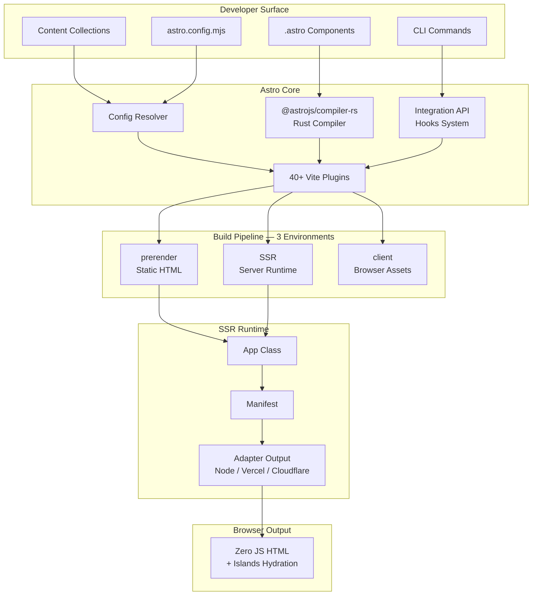
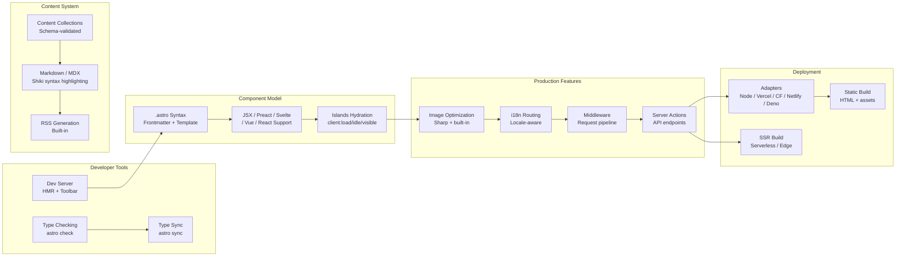

# Astro 7.0.4: Overview

Astro is a content-focused web framework that ships zero JavaScript to the browser by default. It uses an islands architecture — the framework renders full HTML on the server, and only selectively hydrates interactive components when needed. This means pages load as fast static HTML, with JavaScript added incrementally only for components that explicitly request it. Astro is built on Vite, uses a Rust-based compiler (`@astrojs/compiler-rs`) for `.astro` files, and supports deployment to any platform through a pluggable adapter system.

**Source:** [withastro/astro](https://github.com/withastro/astro) v7.0.4 | [npm](https://www.npmjs.com/package/astro)

---

## Core Philosophy: Server-First, Content-Focused

Astro's design decisions all flow from one principle: **content should be delivered to the user as fast as possible, and JavaScript is an implementation detail, not a default.** Three pillars support this:

**Islands architecture.** Traditional frameworks like Next.js or Nuxt ship a JavaScript bundle that hydrates the entire page. Astro flips this. Every `.astro` component renders to HTML at build time or request time. Only components marked with `client:*` directives send JavaScript to the browser. The "islands" of interactivity float in a sea of static HTML.

**Server-first.** Astro runs on the server by default. Even during development, the dev server renders components server-side and streams HTML to the browser. SSR is not an opt-in mode — it is the default. Static prerendering is an optimization on top of that default.

**Content-focused.** Astro was designed for content-driven sites — blogs, documentation, marketing pages, e-commerce storefronts. Features like content collections, markdown/MDX support, and RSS generation are built into the core, not bolted on as plugins. The routing system maps directly to the file system, making it intuitive for content authors.

---

## Architecture at a Glance

Astro's architecture spans three layers: the developer-facing component model, the Vite-powered build pipeline, and the SSR runtime. The Rust compiler transforms `.astro` files into JavaScript, 40+ custom Vite plugins handle specialized transformations, and the build produces output across three Vite environments.



The build pipeline runs three Vite environments sequentially. The `prerender` environment generates static HTML for pages marked as prerendered. The `SSR` environment builds the server runtime. The `client` environment bundles browser-side assets and hydration code. This sequential approach ensures each environment has the information it needs from the previous stage.

---

## Feature Overview

Astro provides a rich feature set that covers the entire lifecycle from development to production deployment.



Each feature connects to the core zero-JS philosophy. Content collections ensure type-safe content access without runtime overhead. Image optimization happens at build time, producing optimized static assets. Server actions let you define API endpoints that run on the server, keeping logic out of the browser.

---

## Key Components Deep Dive

### Entry Points

The main package entry point is minimal, re-exporting from two internal modules.

```ts
// packages/astro/src/index.ts
export * from './core/index.js';
export type * from './types/public/index.js';
```

The `core/index.js` module exports the four programmatic API functions, while `types/public/index.js` exports all public TypeScript types.

```ts
// packages/astro/src/core/index.ts — Programmatic API entry point
export { default as build } from './build/index.js';
export { default as dev } from './dev/index.js';
export { default as preview } from './preview/index.js';
export const sync = (inlineConfig: AstroInlineConfig) => _sync(inlineConfig);
```

These four functions — `build`, `dev`, `preview`, `sync` — form the programmatic API. You can import them directly and run Astro from Node.js without using the CLI.

**Source:** `packages/astro/src/index.ts:1-2` and `packages/astro/src/core/index.ts:1-17`

### Package Exports Surface

Astro exposes a broad exports surface through its `package.json`, organized by feature area. The key public export paths include:

| Export Path | Purpose |
|---|---|
| `.` (default) | Core API: `build`, `dev`, `preview`, `sync` + public types |
| `astro/app` | SSR App class for server-side rendering |
| `astro/config` | Configuration entry point for integrations |
| `astro/container` | Container API for isolated rendering |
| `astro/middleware` | Middleware definition and composition |
| `astro/assets` | Image and asset optimization pipeline |
| `astro/content/config` | Content collection configuration |
| `astro/actions/runtime/entrypoints/*` | Server action runtime entry points |
| `astro/jsx-runtime` | JSX runtime for `.astro` and JSX components |
| `astro/markdown` | Markdown processing utilities |
| `astro/zod` | Zod schema validation (re-exported) |
| `astro/hono` | Hono web framework integration |
| `astro/fetch` | Fetch utilities for SSR contexts |
| `astro/loaders` | Content collection loaders |
| `astro/client/*` | Client-side hydration directives (`client:load`, `client:idle`, etc.) |
| `astro/env/*` | Environment variable runtime |
| `astro/toolbar` | Dev toolbar plugin API |
| `astro/components/*` | Built-in components (Image, Picture, ViewTransitions) |
| `astro/logger/*` | Logging implementation (json, node, compose, console) |
| `astro/cache/*` | Caching provider (memory, provider-utils) |

This granular export surface lets consumers import only what they need without pulling in the entire framework.

**Source:** `packages/astro/package.json:15-84` (exports field)

---

## CLI Commands

Astro ships a comprehensive CLI powered by `yargs-parser` for argument parsing and `tinyclip` for clipboard operations. The CLI entry point is `bin/astro.mjs`, which delegates to `src/cli/index.ts`.

### Command Registry

All supported CLI commands are defined as a union type and resolved through a command dispatcher:

```ts
// packages/astro/src/cli/index.ts:3-16
type CLICommand =
    | 'help'
    | 'version'
    | 'add'
    | 'create-key'
    | 'docs'
    | 'dev'
    | 'build'
    | 'preview'
    | 'sync'
    | 'check'
    | 'info'
    | 'preferences'
    | 'telemetry';
```

### Command Details

| Command | Purpose | Source Path |
|---|---|---|
| `astro dev` | Start the dev server with HMR and dev toolbar | `src/cli/dev/index.ts` |
| `astro build` | Build for production (static or SSR) | `src/cli/build/index.js` |
| `astro preview` | Preview the production build locally | `src/cli/preview/index.js` |
| `astro sync` | Generate TypeScript types for content collections | `src/cli/sync/index.js` |
| `astro check` | Type-check the project (wraps `@astrojs/check`) | `src/cli/check/index.js` |
| `astro add` | Add integrations, adapters, or utilities to a project | `src/cli/add/index.js` |
| `astro telemetry` | Manage telemetry settings (enable/disable/status) | `src/cli/telemetry/index.js` |
| `astro preferences` | Manage project preferences (get/set/list) | `src/cli/preferences/index.js` |
| `astro info` | Display environment debug info (OS, Node, PM, config) | `src/cli/info/core/info.js` |
| `astro docs` | Open Astro documentation in the browser | `src/cli/docs/core/open-docs.js` |
| `astro create-key` | Generate a cryptographic key (for sessions/auth) | `src/cli/create-key/core/create-key.js` |

### Command Execution Flow

The CLI follows a two-phase dispatch. Phase one handles commands that don't need the user's Astro config (`help`, `version`, `info`, `create-key`, `docs`, `telemetry`, `sync`, `preferences`). Phase two handles commands that do need config resolution (`add`, `dev`, `build`, `preview`, `check`).

```ts
// packages/astro/src/cli/index.ts:212-249 — Phase two: config-dependent commands
switch (cmd) {
    case 'add': {
        const { add } = await import('./add/index.js');
        await add(packages, { flags });
        return;
    }
    case 'dev': {
        const { dev } = await import('./dev/index.js');
        const server = await dev({ flags });
        if (server) return await new Promise(() => {}); // lives forever
        return;
    }
    case 'build': {
        const { build } = await import('./build/index.js');
        await build({ flags });
        return;
    }
    // ... preview, check
}
```

The `dev` command returns a Promise that never resolves — the dev server runs indefinitely until the process is killed. The `preview` command keeps alive until its HTTP server is closed.

**Source:** `packages/astro/src/cli/index.ts:1-265`

---

## Monorepo at a Glance

Astro is a pnpm workspace monorepo. The main `packages/astro` package is the core framework, but the monorepo includes supporting packages that are published independently.

```
packages/
├── astro                    ← Core framework (v7.0.4) — the main package
├── create-astro             ← `create astro` scaffolding wizard
├── astro-prism              ← Prism syntax highlighting integration
├── astro-rss                ← RSS feed generation utilities
├── telemetry                ← Anonymous usage telemetry
├── internal-helpers         ← Shared internal utilities (fs, path, etc.)
├── language-tools           ← VS Code extension + language server
├── underscore-redirects     ← Redirect handling for adapters
├── upgrade                  ← `@astrojs/upgrade` CLI
└── integrations/            ← Official integrations (multiple packages)
    ├── node                 ← Node.js adapter
    ├── vercel               ← Vercel adapter
    ├── cloudflare           ← Cloudflare adapter
    ├── netlify              ← Netlify adapter
    ├── deno                 ← Deno adapter
    ├── sitemap              ← Sitemap generation
    ├── mdx                  ← MDX support
    ├── react                ← React integration
    ├── preact               ← Preact integration
    ├── vue                  ← Vue integration
    ├── svelte               ← Svelte integration
    ├── solid                ← Solid.js integration
    └── ...                  ← Many more
```

The monorepo uses `pnpm 11.5.0` with workspace protocol (`workspace:*`) for internal dependencies. This means `packages/astro` depends on `@astrojs/internal-helpers` via `workspace:*`, which resolves to the local package rather than a published version.

### Supporting Scripts Package

The monorepo includes an `astro-scripts` package (not published) that handles build tooling, test runners, and prebuild steps:

```json
// packages/astro/package.json — scripts field
"scripts": {
    "prebuild": "astro-scripts prebuild --to-string \"src/runtime/server/astro-island.ts\" ...",
    "build": "pnpm run prebuild && astro-scripts build \"src/**/*.{ts,js}\" --copy-wasm && tsc -b ...",
    "dev": "astro-scripts dev --copy-wasm --prebuild ...",
    "test:unit": "astro-scripts test \"test/units/**/*.test.ts\" --strip-types ...",
    "test:integration": "astro-scripts test \"test/*.test.ts\" --parallel --strip-types"
}
```

The prebuild step compiles the `astro-island` runtime and client hydration directives (`idle`, `load`, `media`, `only`, `visible`) into stringified JavaScript that can be inlined into HTML output. The `--copy-wasm` flag ensures the Rust compiler's WASM binary is included in the build.

---

## Vite Plugins: The Engine Room

Astro ships **40+ custom Vite plugins** in `src/vite-plugin-*/` and subdirectories. Each plugin handles a specific transformation or resolution concern within the Vite build pipeline.

| Plugin | Purpose |
|---|---|
| `vite-plugin-astro` | Compiles `.astro` files via the Rust compiler |
| `vite-plugin-astro-server` | Dev server: routing, HMR, response handling |
| `vite-plugin-app` | SSR App class integration, manifest generation |
| `vite-plugin-pages` | File-based routing, route scanning |
| `vite-plugin-routes` | Route metadata and URL generation |
| `vite-plugin-markdown` | Markdown/MDX content processing |
| `vite-plugin-css` | CSS bundling, module CSS handling |
| `vite-plugin-html` | HTML generation and injection |
| `vite-plugin-head` | `<head>` management and merging |
| `vite-plugin-scripts` | Script injection (before/after head/body) |
| `vite-plugin-static-paths` | `Astro.glob` and static path resolution |
| `vite-plugin-renderers` | JSX framework renderer integration |
| `vite-plugin-config-alias` | Config aliasing and path resolution |
| `vite-plugin-environment` | Environment variable injection |
| `vite-plugin-dev-status` | Dev server status overlay |
| `vite-plugin-overlay` | Error overlay rendering |
| `vite-plugin-hmr-reload` | HMR reload and invalidation |
| `vite-plugin-fileurl` | `file://` URL resolution |
| `vite-plugin-integrations-container` | Integration container management |
| `vite-plugin-adapter-config` | Adapter-specific Vite config |
| `vite-plugin-load-fallback` | Module loading fallbacks |
| `vite-plugin-chromedevtools` | Chrome DevTools integration |
| `vite-plugin-utils` | Shared Vite plugin utilities |

**Aha:** The plugin architecture is deliberately granular. Instead of one monolithic plugin that does everything, each concern (CSS, HTML, routing, head, scripts, markdown, etc.) lives in its own plugin. This makes the build pipeline composable and debuggable — you can trace a CSS issue directly to `vite-plugin-css` without wading through unrelated code.

**Source:** `packages/astro/src/vite-plugin-*/` and subdirectories (assets, container, env, i18n, prefetch, toolbar, transitions, middleware, server-islands, session, cache, fetch, content, actions) — 40+ plugins total

---

## Build Pipeline: Three Environments

Astro's build process uses Vite's multi-environment API to produce output across three sequential build environments:

1. **prerender** — Generates static HTML for pages that don't need SSR. Runs first so the output can be referenced by subsequent stages.
2. **SSR** — Builds the server-side runtime. Produces a manifest and server entry point that adapters use to handle requests.
3. **client** — Bundles browser-side JavaScript, including hydration code for islands and client-side assets.

The sequential order matters: prerender output feeds into the SSR manifest, which the client environment references for hydration boundaries.

```ts
// packages/astro/src/core/build/static-build.ts — Three-environment sequential build
// Build prerender environment for static generation
let prerenderOutput = await builder.build(builder.environments.prerender);
// ... SSR and client environments follow
```

Each environment has its own Rollup output configuration, plugin set, and entry points. The SSR environment produces a manifest file that maps routes to their rendering strategy (prerendered vs SSR), and the client environment produces the hydration bundles referenced by `client:*` directives.

---

## Package.json Key Information

```json
{
    "name": "astro",
    "version": "7.0.4",
    "type": "module",
    "license": "MIT",
    "engines": {
        "node": ">=22.12.0",
        "npm": ">=9.6.5",
        "pnpm": ">=7.1.0"
    },
    "optionalDependencies": {
        "sharp": "^0.34.0 || ^0.35.0"
    },
    "dependencies": {
        "@astrojs/compiler-rs": "^0.3.0",
        "vite": "^8.0.13",
        "zod": "^4.3.6",
        "@astrojs/telemetry": "workspace:*",
        "@astrojs/internal-helpers": "workspace:*",
        "@astrojs/markdown-satteri": "workspace:*"
        // ... 50+ total dependencies
    }
}
```

Key dependency notes:

- **`@astrojs/compiler-rs` ^0.3.0** — The Rust-based compiler that transforms `.astro` files. Runs as WASM in the Node.js process. This is what makes `.astro` syntax fast.
- **`vite` ^8.0.13** — Astro builds on Vite 8, using its multi-environment API for the three-stage build.
- **`zod` ^4.3.6** — Used for config validation and content collection schemas. Re-exported as `astro/zod` for user convenience.
- **`sharp` (optional)** — Image optimization. If installed, Astro uses Sharp for image resizing and format conversion. Without it, Astro falls back to a no-op image service.
- **`unstorage` ^1.17.5** — Universal storage layer used for caching and session management.
- **`esbuild` ^0.28.0** — Used for bundling and minification in the build pipeline.

The `engines.node >= 22.12.0` requirement is significant. Astro requires Node.js 22.12.0 or later, which provides modern JavaScript features and the stable WASM execution needed for the Rust compiler.

---

## Quick Start Flow

The typical Astro project follows this flow:

```
1. Create    →  npm create astro@latest   (uses create-astro package)
2. Develop   →  astro dev                 (HMR + dev toolbar + server-side rendering)
3. Type Sync →  astro sync                (generate env.d.ts for content collections)
4. Check     →  astro check               (TypeScript type-checking)
5. Build     →  astro build               (three-environment production build)
6. Preview   →  astro preview             (local production preview server)
7. Deploy    →  Adapter output → Platform (Node, Vercel, Cloudflare, Netlify, Deno)
```

The `create astro` scaffolding uses the `create-astro` package from the monorepo. It prompts for project name, template (blog, portfolio, docs, etc.), TypeScript preference, and git initialization. After scaffolding, `astro dev` starts the development server with hot module replacement, the dev toolbar for debugging, and full server-side rendering.

---

## Aha Moments

**Aha: Zero JavaScript is not "no JavaScript" — it's "JavaScript on demand."** Astro doesn't eliminate JavaScript; it changes who pays the cost. By default, the server renders everything to HTML, and the browser receives pure markup. When a component needs interactivity, the developer explicitly opts in with `client:load`, `client:idle`, `client:visible`, or `client:media`. This means JavaScript bytes are only shipped when the developer consciously decides they're worth the cost. The framework doesn't hide this decision behind abstractions.

**Aha: The three-environment build is sequential, not parallel, because each environment depends on the previous one's output.** The prerender environment must complete first so the SSR environment knows which routes are static vs dynamic. The SSR environment must complete so the client environment knows which hydration boundaries exist. This is a deliberate tradeoff: slower builds, but correct output.

**Aha: Astro re-exports Zod as `astro/zod` so users don't need to install it separately for content collection schemas.** This is a small DX win that prevents version mismatches. The same Zod instance that validates Astro's internal config is the one users write content schemas against.

---

## Cross-References

This overview sets the stage for deeper exploration of individual systems:

- [Architecture](./01-architecture.md) — Full monorepo dependency graph, layer diagram, and module map
- [Configuration & Routing](./02-config-routing.md) — AstroConfig schema, settings resolution, file-based routing
- [Component Model](./03-component-model.md) — `.astro` syntax, frontmatter processing, JSX rendering
- [Vite Plugins](./04-vite-plugins.md) — Deep dive into all 40+ Vite plugins
- [Build Pipeline](./05-build-pipeline.md) — Three-environment build process in detail
- [SSR Runtime](./06-ssr-runtime.md) — App class, manifest generation, request handling
- [Integration API](./07-integration-api.md) — Hook system and plugin injection
- [Content Collections](./08-content-collections.md) — Schema-validated content management
- [Islands Hydration](./09-islands-hydration.md) — How islands are hydrated in the browser
- [Assets & Images](./10-assets-images.md) — Image pipeline, Sharp integration, fonts
- [Middleware & Actions](./11-middleware-actions.md) — Request middleware and server actions
- [Internationalization](./12-i18n.md) — Locale resolution and routing
- [Dev Toolbar](./13-dev-toolbar.md) — Developer tools and audit system
- [Cross-Cutting Concerns](./14-cross-cutting.md) — CSP, caching, sessions, errors, telemetry

---

*Source: [withastro/astro](https://github.com/withastro/astro) v7.0.4 | `packages/astro/src/index.ts`, `packages/astro/src/core/index.ts`, `packages/astro/src/cli/index.ts`, `packages/astro/package.json`*
