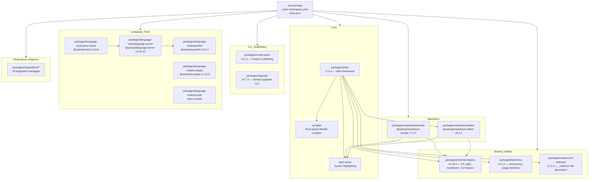
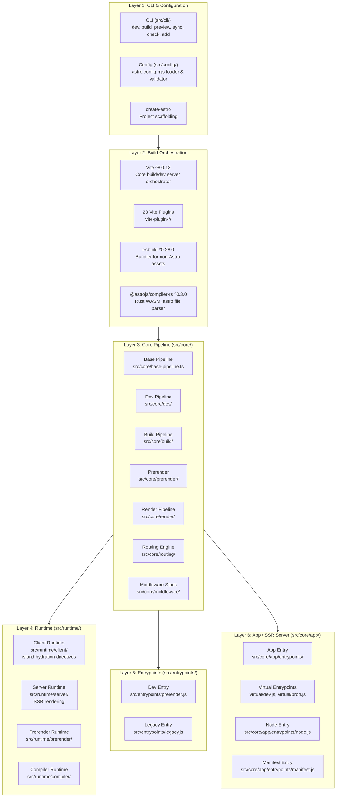
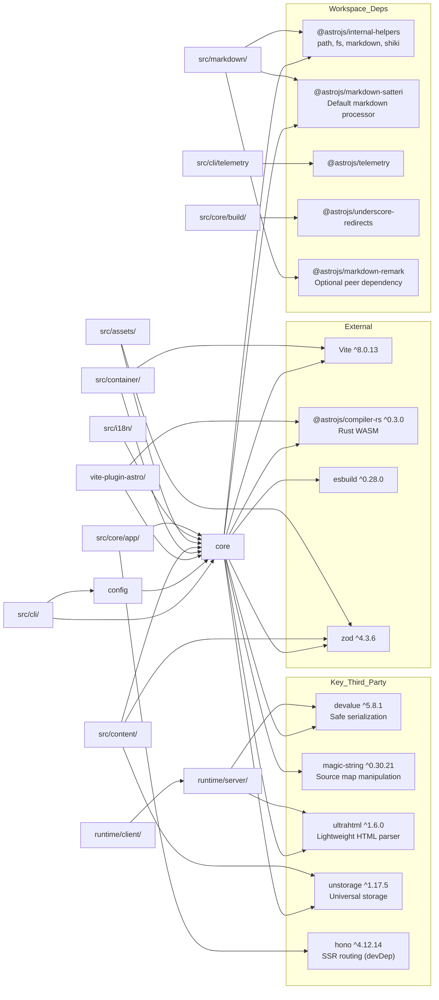

# Astro 7.0.4 Architecture

**Core concept:** Astro is a content-focused, island-based web framework that ships zero JavaScript by default. The framework operates as a **monorepo built around Vite as its build orchestrator**, with the core `astro` package at the center, surrounded by integration packages, markdown processors, language tooling, and a Rust-based compiler (`@astrojs/compiler-rs`) that parses `.astro` files into efficient JavaScript.

---

## Table of Contents

- [Monorepo Structure](#monorepo-structure)
- [Package Ecosystem](#package-ecosystem)
- [Layer Diagram](#layer-diagram)
- [packages/astro Source Structure](#packagesastro-source-structure)
- [Core Module Breakdown](#core-module-breakdown)
- [Module Dependency Graph](#module-dependency-graph)
- [Package Exports Surface](#package-exports-surface)
- [Compiler Integration](#compiler-integration)
- [Vite Integration](#vite-integration)
- [Integration Packages](#integration-packages)
- [Markdown Packages](#markdown-packages)
- [Three Environments](#three-environments)
- [Key Design Patterns](#key-design-patterns)

---

## Monorepo Structure

Astro is organized as a **pnpm workspace monorepo** at [github.com/withastro/astro](https://github.com/withastro/astro), managed through `pnpm-workspace.yaml` with patterns covering `packages/**/*`, `examples/**/*`, `benchmark/**/*`, and auxiliary directories. The build system uses **Turborepo** (`turbo.json`) for orchestrated parallel builds.



**Top-level workspace packages** (outside `packages/`):

| Directory | Purpose |
|---|---|
| `compiler/` | Rust-based WASM compiler (`@astrojs/compiler-rs`) — published as a separate npm package |
| `astro-prism/` | Prism-based syntax highlighting (Astro 1.x heritage, largely superseded by Shiki) |
| `flue/` | E2E test framework for Astro |
| `benchmark/` | Performance benchmarking infrastructure |
| `scripts/` | Shared build/test/dev scripts used across all workspace packages |
| `examples/` | Example projects for each integration and feature |

---

## Package Ecosystem

The workspace contains approximately **30+ packages** organized into logical groups:

### Core Package

| Package | Name | Version | Description |
|---|---|---|---|
| `packages/astro` | `astro` | **7.0.4** | The main framework — CLI, compiler pipeline, runtime, server, dev tools |

### CLI & Scaffolding

| Package | Name | Version | Description |
|---|---|---|---|
| `packages/create-astro` | `create-astro` | 5.2.1 | Interactive project scaffolding wizard |
| `packages/upgrade` | `@astrojs/upgrade` | 0.7.3 | CLI for upgrading Astro versions |

### Shared Utilities

| Package | Name | Version | Description |
|---|---|---|---|
| `packages/internal-helpers` | `@astrojs/internal-helpers` | 0.10.0 | Cross-package utilities: path, fs, markdown, shiki, CLI, request |
| `packages/telemetry` | `@astrojs/telemetry` | 3.3.2 | Anonymous usage analytics |
| `packages/underscore-redirects` | `@astrojs/underscore-redirects` | 1.0.3 | `_redirects` file generator for deploy adapters |

### Markdown Processing

| Package | Name | Version | Description |
|---|---|---|---|
| `packages/markdown/remark` | `@astrojs/markdown-remark` | 7.2.0 | Remark/rehype-based markdown processor (legacy default) |
| `packages/markdown/satteri` | `@astrojs/markdown-satteri` | 0.3.2 | Newer markdown processor, default in Astro 7 |

### Language Tools

| Package | Name | Version | Description |
|---|---|---|---|
| `packages/language-tools/language-server` | `@astrojs/language-server` | 2.16.10 | LSP implementation for Astro files |
| `packages/language-tools/astro-check` | `@astrojs/check` | 0.9.9 | Type-checking CLI for Astro projects |
| `packages/language-tools/ts-plugin` | `@astrojs/ts-plugin` | 1.10.9 | TypeScript plugin for Astro intellisense |
| `packages/language-tools/vscode` | `astro-vscode` | — | VS Code extension |
| `packages/language-tools/yaml2ts` | `@astrojs/yaml2ts` | 0.2.4 | YAML-to-VirtualCode converter for data collection intellisense |

### Integration Packages (18 packages)

| Package | Name | Version | Purpose |
|---|---|---|---|
| `packages/integrations/node` | `@astrojs/node` | 11.0.0 | Node.js SSR adapter |
| `packages/integrations/cloudflare` | `@astrojs/cloudflare` | 14.0.2 | Cloudflare Workers/Pages adapter |
| `packages/integrations/vercel` | `@astrojs/vercel` | 11.0.0 | Vercel adapter |
| `packages/integrations/netlify` | `@astrojs/netlify` | 8.0.0 | Netlify adapter |
| `packages/integrations/deno` | — | — | Deno adapter |
| `packages/integrations/react` | `@astrojs/react` | 6.0.0 | React integration |
| `packages/integrations/vue` | `@astrojs/vue` | 7.0.0 | Vue integration |
| `packages/integrations/svelte` | `@astrojs/svelte` | 9.0.0 | Svelte integration |
| `packages/integrations/solid` | `@astrojs/solid-js` | 7.0.0 | SolidJS integration |
| `packages/integrations/preact` | `@astrojs/preact` | 6.0.0 | Preact integration |
| `packages/integrations/mdx` | `@astrojs/mdx` | 7.0.0 | MDX support |
| `packages/integrations/markdoc` | `@astrojs/markdoc` | 2.0.1 | Markdoc support |
| `packages/integrations/tailwind` | — | — | Tailwind CSS integration |
| `packages/integrations/partytown` | `@astrojs/partytown` | 2.1.7 | Partytown integration |
| `packages/integrations/sitemap` | `@astrojs/sitemap` | 3.7.3 | Sitemap generation |
| `packages/integrations/alpinejs` | — | — | Alpine.js integration |
| `packages/integrations/web-vitals` | — | — | Web Vitals integration |

---

## Layer Diagram

Astro's architecture is layered, flowing from user-facing CLI commands down through compilation and runtime execution.



### Layer Responsibilities

| Layer | Primary Source | Responsibility |
|---|---|---|
| **CLI & Config** | `src/cli/`, `src/config/` | Parse commands, load/validate `astro.config.mjs`, initialize environment |
| **Build Orchestration** | Vite + 23 plugins | File resolution, HMR, module graph, dev server, asset bundling |
| **Core Pipeline** | `src/core/` | Page routing, middleware, rendering orchestration, build/prerender/dev pipelines |
| **Runtime** | `src/runtime/` | Island hydration scripts, SSR template rendering, prerender worker communication |
| **Entrypoints** | `src/entrypoints/` | Process entry points for prerender workers and legacy SSR |
| **App / SSR** | `src/core/app/` | `Astro` class, request handling, manifest generation, adapter interface |

---

## packages/astro Source Structure

The main `packages/astro` package contains **37 top-level source directories** under `src/`, each responsible for a distinct subsystem.

```
packages/astro/src/
├── # === Domain Subsystems (12 directories) ===
├── actions/                  # Server actions (form submissions, RPC-style handlers)
├── assets/                   # Image optimization, fonts, SVG processing
│   ├── build/                # Build-time asset processing
│   ├── endpoint/             # Image endpoint handlers
│   ├── fonts/                # Font optimization (unifont, capsize)
│   ├── services/             # Sharp/noop image processing services
│   ├── svg/                  # SVG optimization (SVGO)
│   └── utils/                # Asset utility functions
├── content/                  # Content collections, data loaders, content layer
├── i18n/                     # Internationalization — routing, fallback, middleware
├── integrations/             # Integration API utilities (adapter utils, hooks, features)
├── markdown/                 # Markdown rendering facade (delegates to remark/satteri)
├── preferences/              # User preferences store (CLI config persistence)
├── prerender/                # Prerender routing utilities
├── transitions/              # View transitions API
├── toolbar/                  # Dev toolbar
├── env/                      # Environment variable handling (runtime + setup)
├── template/                 # Template rendering helpers (4xx pages)
├──
├── # === Core Infrastructure (5 directories) ===
├── core/                     # CENTRAL MODULE — pipeline, routing, rendering, config, dev, build
├── runtime/                  # Runtime code (client, server, compiler, prerender)
├── cli/                      # CLI command implementations (dev, build, preview, sync...)
├── config/                   # Config loading entrypoint
├── types/                    # Type definitions (astro.ts, public types, typed-emitter)
├──
├── # === Integration Points (4 directories) ===
├── container/                # Container API for testing/rendering in isolation
├── entrypoints/              # Process entry points (prerender, legacy)
├── jsx-runtime/              # JSX runtime for .astro components
├── virtual-modules/          # Virtual module generators (i18n, transitions, middleware...)
├──
├── # === Build-Time (2 directories) ===
├── manifest/                 # Route manifest serialization
├── events/                   # Internal event system
├──
├── # === Vite Plugins (23 directories) ===
├── vite-plugin-adapter-config/    # Adapter configuration injection
├── vite-plugin-app/               # App SSR server integration
├── vite-plugin-astro/             # .astro file compilation (main compiler bridge)
├── vite-plugin-astro-server/      # Astro dev server enhancements
├── vite-plugin-chromedevtools/    # Chrome DevTools integration
├── vite-plugin-config-alias/      # Config path aliasing
├── vite-plugin-css/               # CSS processing and injection
├── vite-plugin-dev-status/        # Dev server status indicators
├── vite-plugin-environment/       # Environment variable injection
├── vite-plugin-fileurl/           # file:// URL handling
├── vite-plugin-head/              # <head> propagation and management
├── vite-plugin-hmr-reload/        # HMR reload on config changes
├── vite-plugin-html/              # HTML generation and processing
├── vite-plugin-integrations-container/  # Integration container support
├── vite-plugin-load-fallback/     # Module load fallbacks
├── vite-plugin-markdown/          # Markdown file processing in Vite
├── vite-plugin-overlay/           # Error overlay display
├── vite-plugin-pages/             # File-based routing
├── vite-plugin-renderers/         # Framework renderer integration (React, Vue, etc.)
├── vite-plugin-routes/            # Route generation and management
├── vite-plugin-scripts/           # Script injection
├── vite-plugin-static-paths/      # Static path handling
├── vite-plugin-utils/             # Shared Vite plugin utilities
├──
├── # === Top-Level Files ===
├── index.ts                  # Main entry: exports core/index.js + types
├── zod.ts                    # Zod schema utilities
├── environments.ts           # Environment type definitions
└── type-utils.ts             # TypeScript utility types
```

### packages/astro/src/core/ Deep Dive

The `core/` directory is the central hub with **40+ files** covering the most critical subsystems:

| File/Directory | Purpose |
|---|---|
| `base-pipeline.ts` | Base pipeline shared by dev and build |
| `build/` | Build pipeline — generates static output |
| `dev/` | Development server pipeline |
| `preview/` | Preview server for built sites |
| `routing/` | Route matching, generation, and management |
| `render/` | Component rendering orchestration |
| `middleware/` | Middleware chain execution |
| `compile/` | Compiler bridge to `@astrojs/compiler-rs` |
| `config/` | Configuration loading and validation |
| `logger/` | Structured logging system |
| `errors/` | Error handling and user-facing error messages |
| `app/` | `Astro` class — SSR request handling |
| `hono/` | Hono-based routing adapter |
| `fetch/` | Fetch utilities |
| `pages/` | Page generation |
| `head-propagation/` | `<head>` element collection and propagation |
| `csp/` | Content Security Policy generation |
| `cookies/` | Cookie handling |
| `session/` | Session management |
| `encryption.ts` | Encryption utilities |
| `server-islands/` | Server Islands (partial hydration) |
| `client-directive/` | Client directive processing (`client:load`, `client:idle`, etc.) |
| `create-vite.ts` | Vite configuration builder |
| `module-loader/` | Dynamic module loading |
| `i18n/` | i18n core utilities |
| `redirects/` | Redirect generation |
| `rewrites/` | URL rewrite rules |
| `sync/` | Content collection sync |
| `cache/` | Caching provider abstraction |
| `constants.ts` | Shared constants |
| `util.ts` / `util-runtime.ts` / `util-runtime.ts` | Utility functions |
| `path.ts` | Path manipulation |
| `output-filename.ts` | Output file naming |
| `request.ts` / `request-body.ts` | Request handling |
| `fs/` | Filesystem utilities |
| `messages/` | User-facing messages |
| `wait-until.ts` | WaitUntil API |
| `viteUtils.ts` | Vite-specific utilities |
| `createMinimalViteDevServer.ts` | Minimal Vite dev server factory |
| `index.ts` | Core exports |

---

## Core Module Breakdown

### Module Groups and Their Responsibilities

```
packages/astro/
├── src/core/          ← Central logic: pipeline, routing, rendering, config
├── src/runtime/       ← Runtime code split by environment
│   ├── client/        ←   Client-side island hydration scripts
│   ├── server/        ←   Server-side rendering (astro-island, template)
│   ├── compiler/      ←   Compiler runtime bridge
│   └── prerender/     ←   Prerender worker communication
├── src/types/         ← Type definitions
│   ├── astro.ts       ←   Core Astro types (AstroGlobal, etc.)
│   ├── public/        ←   Public-facing type exports
│   └── typed-emitter.ts ← Event emitter types
├── src/vite-plugin-*/ ← 23 Vite plugins forming the build pipeline
├── src/container/     ← Container API for testing
│   ├── index.ts       ←   Container entrypoint
│   ├── pipeline.ts    ←   Container-specific pipeline
│   └── vite-plugin-container.ts ← Vite plugin for container mode
└── src/entrypoints/   ← Process entry points
    ├── prerender.js   ←   Prerender worker entry
    └── legacy.js      ←   Legacy SSR entry
```

---

## Module Dependency Graph



---

## Package Exports Surface

The `astro` package exposes an extensive public API through conditional exports in `package.json`. These exports define the surface area that user code, integrations, and internal modules can import.

```jsonc
// packages/astro/package.json — exports (key entries)
{
  "exports": {
    ".": "./dist/index.js",                     // Main: defineModel, getAstroIntegration, etc.
    "./env": "./env.d.ts",                      // Environment type declarations
    "./env/runtime": "./dist/env/runtime.js",   // Environment variable runtime access
    "./env/setup": "./dist/env/setup.js",       // Environment setup utilities
    "./types": "./types.d.ts",                  // Public TypeScript definitions
    "./client": "./client.d.ts",                // Client-side type declarations
    "./astro-jsx": "./astro-jsx.d.ts",          // Astro JSX types
    "./jsx-runtime": "./dist/jsx-runtime/index.js",  // JSX runtime for .astro files
    "./compiler-runtime": "./dist/runtime/compiler/index.js",
    "./markdown": "./dist/markdown/index.js",   // Markdown rendering API
    "./runtime/*": "./dist/runtime/*",          // Runtime modules (client/*, server/*)
    "./config": "./dist/config/entrypoint.js",  // Config loading entrypoint
    "./container": "./dist/container/index.js", // Container API
    "./app": "./dist/core/app/entrypoints/index.js",     // App SSR entry
    "./app/node": "./dist/core/app/entrypoints/node.js", // Node.js-specific app
    "./app/entrypoint": "./dist/core/app/entrypoints/virtual/index.js",
    "./app/entrypoint/dev": "./dist/core/app/entrypoints/virtual/dev.js",
    "./app/entrypoint/prod": "./dist/core/app/entrypoints/virtual/prod.js",
    "./app/manifest": "./dist/core/app/entrypoints/manifest.js",
    "./middleware": "./dist/core/middleware/index.js",
    "./toolbar": "./dist/toolbar/index.js",
    "./actions/runtime/entrypoints/*": "./dist/actions/runtime/entrypoints/*",
    "./assets": "./dist/assets/index.js",
    "./assets/runtime": "./dist/assets/runtime.js",
    "./assets/utils": "./dist/assets/utils/index.js",
    "./assets/services/sharp": "./dist/assets/services/sharp.js",
    "./assets/fonts/runtime.js": "./dist/assets/fonts/runtime.js",
    "./content/config": "./dist/content/config.js",
    "./content/runtime": "./dist/content/runtime.js",
    "./content/runtime-assets": "./dist/content/runtime-assets.js",
    "./loaders": "./dist/content/loaders/index.js",
    "./fetch": "./dist/core/fetch/index.js",
    "./hono": "./dist/core/hono/index.js",
    "./zod": "./dist/zod.js",
    "./errors": "./dist/core/errors/userError.js",
    "./logger": "./dist/core/logger/public.js",
    "./virtual-modules/*": "./dist/virtual-modules/*",
    // ... and many more
  }
}
```

### Export Categories

| Export Prefix | Purpose | Key Imports |
|---|---|---|
| `astro` | Main entry | `defineConfig`, `getStaticPaths`, `Astro` global |
| `astro/app` | SSR app instance | `App` class for server-side rendering |
| `astro/config` | Config loading | Configuration loader |
| `astro/container` | Testing container | `createContainer` for testing |
| `astro/middleware` | Middleware API | `sequence`, `defineMiddleware` |
| `astro/content/*` | Content collections | `defineCollection`, `getCollection`, content loaders |
| `astro/assets` | Image optimization | `getImage`, `picture`, image components |
| `astro/actions/*` | Server actions | Action entrypoints for form submissions |
| `astro/toolbar` | Dev toolbar | Toolbar extension APIs |
| `astro/logger/*` | Logging | Multiple logger implementations (json, node, console, compose) |
| `astro/virtual-modules/*` | Virtual modules | i18n, transitions, middleware virtual modules |
| `astro/client/*` | Client directives | `client:load`, `client:idle`, `client:visible`, etc. |

---

## Compiler Integration

Astro uses a **Rust-based compiler** (`@astrojs/compiler-rs`) compiled to WebAssembly. This is the core parsing engine that transforms `.astro` component files into efficient JavaScript.

```
.astro file
     │
     ▼
┌─────────────────────────────┐
│  @astrojs/compiler-rs       │  ← Rust + WASM
│  (compiler/ directory)      │
│                             │
│  • Lexer (tokenization)     │
│  • Parser (AST generation)  │
│  • Codegen (JS output)      │
└──────────────┬──────────────┘
               │
               ▼
┌─────────────────────────────┐
│  src/runtime/compiler/      │  ← Compiler runtime bridge
│  (compiler-runtime export)  │
│                             │
│  • WASM module loading      │
│  • Compile function wrapper │
│  • Source map handling      │
└──────────────┬──────────────┘
               │
               ▼
┌─────────────────────────────┐
│  vite-plugin-astro/         │  ← Vite plugin bridge
│                             │
│  • resolveId (file routing) │
│  • transform (compile hook) │
│  • handleHotUpdate (HMR)    │
└─────────────────────────────┘
```

The compiler flow:

1. **vite-plugin-astro** intercepts `.astro` files during Vite's module resolution
2. It calls into `src/core/compile/` which wraps `@astrojs/compiler-rs`
3. The Rust compiler parses the `.astro` file into a three-part structure: **frontmatter** (JS between `---` fences), **template** (HTML-like JSX), and **component metadata**
4. The generated JS is emitted as an ES module that Vite can process further
5. At runtime, `src/runtime/compiler/` provides the `compile()` function for dynamic compilation

```typescript
// src/core/compile/ — simplified compiler bridge
import { compile as astroCompile } from '@astrojs/compiler-rs';

export async function compile(input: string, options: CompileOptions) {
  return astroCompile(input, {
    // ... compilation options
    sourcefile: options.filename,
    sourcemap: options.sourcemap,
  });
}
```

---

## Vite Integration

Vite **8.0.13** serves as the build orchestrator for the entire Astro framework. Rather than building a custom bundler, Astro composes **23 specialized Vite plugins** that form a processing pipeline:

```
Request/Build
     │
     ▼
 vite-plugin-load-fallback    ← Graceful fallbacks for missing modules
     │
     ▼
 vite-plugin-config-alias     ← Config path aliasing
     │
     ▼
 vite-plugin-fileurl          ← file:// URL handling
     │
     ▼
 vite-plugin-astro            ← .astro file compilation (compiler bridge)
     │
     ▼
 vite-plugin-markdown         ← Markdown file processing
     │
     ▼
 vite-plugin-pages            ← File-based routing
     │
     ▼
 vite-plugin-routes           ← Route generation
     │
     ▼
 vite-plugin-renderers        ← Framework renderers (React, Vue, Svelte...)
     │
     ▼
 vite-plugin-css              ← CSS processing
     │
     ▼
 vite-plugin-head             ← <head> propagation
     │
     ▼
 vite-plugin-html             ← HTML generation
     │
     ▼
 vite-plugin-scripts          ← Script injection
     │
     ▼
 vite-plugin-assets           ← Asset handling (built into core pipeline)
     │
     ▼
 vite-plugin-static-paths     ← Static path generation
     │
     ▼
 vite-plugin-environment      ← Environment variable injection
     │
     ▼
 vite-plugin-app              ← App SSR server integration
     │
     ▼
 vite-plugin-astro-server     ← Dev server enhancements
     │
     ▼
 vite-plugin-hmr-reload       ← HMR on config changes
     │
     ▼
 vite-plugin-chromedevtools   ← Chrome DevTools integration
     │
     ▼
 vite-plugin-dev-status       ← Dev status indicators
     │
     ▼
 vite-plugin-integrations-container ← Integration container
     │
     ▼
 vite-plugin-adapter-config   ← Adapter config injection
     │
     ▼
 vite-plugin-overlay          ← Error overlay
     │
     ▼
 vite-plugin-utils            ← Shared utilities
     │
     ▼
 vite-plugin-container        ← Container mode (testing)
     │
     ▼
 vite-plugin-i18n             ← i18n routing
     │
     ▼
 vite-plugin-actions          ← Server actions
     │
     ▼
Output (HTML/JS/CSS)
```

Vite configuration is constructed in `src/core/create-vite.ts`, which assembles the plugin array, configures resolve aliases, sets up SSR mode when needed, and configures esbuild for non-Astro file processing.

---

## Integration Packages

Integration packages (`packages/integrations/*`) follow a standard pattern: they export a function conforming to Astro's integration API that hooks into the build lifecycle via `astro:config:setup`, `astro:config:done`, `astro:build:setup`, `astro:build:start`, `astro:build:done`, and `astro:server:setup` hooks.

### Adapter Integrations (deploy targets)

| Package | Purpose | Key Files |
|---|---|---|
| `@astrojs/node` | Node.js SSR server | Express-based server, edge functions |
| `@astrojs/cloudflare` | Cloudflare Workers/Pages | Wrangler integration, _routes.json |
| `@astrojs/vercel` | Vercel deployment | Edge/serverless functions, _routes.json |
| `@astrojs/netlify` | Netlify deployment | Edge handlers, serverless functions |
| `@astrojs/deno` | Deno deployment | Deno-specific server |

### UI Framework Integrations

| Package | Purpose | Key Mechanism |
|---|---|---|
| `@astrojs/react` | React components | `@vitejs/plugin-react`, client directives |
| `@astrojs/vue` | Vue components | `@vitejs/plugin-vue` |
| `@astrojs/svelte` | Svelte components | `@sveltejs/vite-plugin-svelte` |
| `@astrojs/solid-js` | SolidJS components | `vite-plugin-solid` |
| `@astrojs/preact` | Preact components | `@preact/preset-vite` |

### Content Integrations

| Package | Purpose |
|---|---|
| `@astrojs/mdx` | MDX support (JSX in markdown) |
| `@astrojs/markdoc` | Markdoc support (GitHub-style docs) |

### Utility Integrations

| Package | Purpose |
|---|---|
| `@astrojs/sitemap` | XML sitemap generation |
| `@astrojs/partytown` | Third-party script sandboxing |
| `@astrojs/tailwind` | Tailwind CSS integration |
| `@astrojs/alpinejs` | Alpine.js integration |
| `@astrojs/web-vitals` | Web Vitals tracking |

### Internal Integration API

The integration system is defined in `src/integrations/`:

- **`hooks.ts`** — Integration hook type definitions
- **`adapter-utils.ts`** — Utilities for building adapters (server entry generation, manifest creation)
- **`features-validation.ts`** — Integration feature validation

---

## Markdown Packages

Astro ships with two markdown processing packages:

### @astrojs/markdown-satteri (Default in Astro 7)

- **Version**: 0.3.2
- **Role**: Default markdown processor
- **Dependencies**: `@astrojs/internal-helpers`, `@astrojs/prism`, Shiki, unified ecosystem
- **Design**: Newer, purpose-built processor for Astro

### @astrojs/markdown-remark (Optional Peer Dependency)

- **Version**: 7.2.0
- **Role**: Remark/rehype-based processor (legacy, opt-in)
- **Dependencies**: `@astrojs/internal-helpers`, `@astrojs/prism`, rehype, remark, Shiki
- **Exports**: `.` (main processor) and `./shiki` (Shiki syntax highlighting)
- **Imports**: Conditional `#import-plugin` — browser vs. default implementation

Both processors share common infrastructure through `@astrojs/internal-helpers` (markdown parsing, Shiki engines) and `astro-prism` (Prism syntax highlighting).

```typescript
// packages/astro/src/markdown/index.ts — Markdown facade
// Delegates to the configured processor (satteri or remark)
import { renderMarkdown } from '@astrojs/markdown-satteri';

export { renderMarkdown };
```

---

## Three Environments

Astro organizes code around **three execution environments**, each with distinct responsibilities:

### 1. SSR (Server-Side Rendering) Environment

**Source**: `src/core/app/`, `src/runtime/server/`

The SSR environment renders `.astro` components to HTML on the server. It uses:

- **`src/core/app/entrypoints/`** — Multiple entry points:
  - `index.js` — Generic app entry
  - `node.js` — Node.js-specific (uses `node:http`)
  - `virtual/dev.js` — Development virtual entry
  - `virtual/prod.js` — Production virtual entry
  - `manifest.js` — Route manifest generation

- **`src/runtime/server/`** — Server-side rendering runtime:
  - `astro-island.ts` — Island component rendering
  - Template rendering functions
  - `<head>` collection and propagation

- **Key dependencies**: `devalue` (serialization), `ultrahtml` (HTML parsing), `hono` (routing)

### 2. Prerender Environment

**Source**: `src/entrypoints/prerender.js`, `src/runtime/prerender/`, `src/core/build/`

The prerender environment generates static HTML at build time:

- **`src/entrypoints/prerender.js`** — Worker process entry point
- **`src/runtime/prerender/`** — Prerender-specific runtime code
- **Communication**: Uses a worker-pool model where prerender workers receive route data and emit HTML
- **Key files**: `src/prerender/routing.ts`, `src/prerender/utils.ts`

### 3. Client Environment

**Source**: `src/runtime/client/`, `src/assets/`, virtual modules

The client environment handles browser-side code:

- **`src/runtime/client/`** — Hydration scripts for islands:
  - `idle.ts` — `client:idle` directive
  - `load.ts` — `client:load` directive
  - `media.ts` — `client:media` directive
  - `only.ts` — `client:only` directive
  - `visible.ts` — `client:visible` directive

- **`src/assets/`** — Client-side asset handling:
  - Image optimization endpoints
  - Font runtime (`src/assets/fonts/runtime.js`)
  - SVG processing

- **Virtual modules** (`src/virtual-modules/`) — Generated at build time:
  - `transitions.ts` — View transitions router
  - `transitions-events.ts` — Transition event handling
  - `transitions-router.ts` — Client-side routing for transitions
  - `i18n.ts` — i18n client configuration
  - `middleware.ts` — Client middleware
  - `prefetch.ts` — Prefetch configuration
  - `live-config.ts` — Dev live reload config
  - `container.ts` — Container virtual module

```
┌──────────────────────────────────────────────────────────────┐
│                    Three Environments                         │
├──────────────────────┬──────────────────┬─────────────────────┤
│       SSR            │    Prerender     │      Client         │
│  (src/core/app/)     │ (src/entrypoints/│ (src/runtime/client/│
│                      │  prerender.js)   │  src/assets/)       │
├──────────────────────┼──────────────────┼─────────────────────┤
│ Renders .astro → HTML│ Generates static │ Hydrates islands    │
│ Handles requests     │ HTML at build    │ client:load/idle/   │
│ Adapter deployment   │ Worker pool      │ visible/only/media  │
│ Hono routing         │ Route distribution│ Transitions        │
│ devalue serialization│ prerender/utils  │ Virtual modules     │
│ Server components    │ build pipeline   │ Image/font runtime  │
└──────────────────────┴──────────────────┴─────────────────────┘
```

---

## Key Design Patterns

### 1. Pipeline Architecture

Astro's core follows a **pipeline pattern** defined in `src/core/base-pipeline.ts`. Both dev and build modes extend this base:

- **Dev Pipeline** (`src/core/dev/`): Vite dev server with HMR, on-demand compilation
- **Build Pipeline** (`src/core/build/`): Full compilation, prerendering, static output generation

### 2. Virtual Module System

Astro generates virtual modules at build time that are injected into Vite's module graph:

```
src/virtual-modules/
├── transitions.ts          → View transitions client code
├── transitions-router.ts   → Client-side transition routing
├── transitions-events.ts   → Transition event dispatcher
├── transitions-swap-functions.ts → Swap animation functions
├── transitions-types.ts    → Transition type definitions
├── i18n.ts                 → i18n client configuration
├── middleware.ts           → Middleware client code
├── prefetch.ts             → Prefetch setup
├── live-config.ts          → Dev reload configuration
└── container.ts            → Container testing virtual module
```

### 3. Island Architecture

The island pattern is central to Astro's zero-JS-by-default philosophy:

- `.astro` components render to HTML with **no client JavaScript**
- UI framework components (React, Vue, Svelte) become "islands" with explicit client directives
- Each directive (`client:load`, `client:idle`, `client:visible`, `client:media`, `client:only`) generates a specific hydration script
- The `astro-island` web component (`src/runtime/server/astro-island.ts`) manages hydration

### 4. Integration Hook System

Integrations hook into the lifecycle through named events:

```typescript
// Integration hook types (src/integrations/hooks.ts)
interface AstroIntegration {
  name: string;
  hooks: {
    'astro:config:setup'?: (options: ConfigSetupOptions) => void | Promise<void>;
    'astro:config:done'?: (options: ConfigDoneOptions) => void | Promise<void>;
    'astro:server:setup'?: (options: ServerSetupOptions) => void | Promise<void>;
    'astro:server:done'?: () => void | Promise<void>;
    'astro:build:start'?: (options: BuildStartOptions) => void | Promise<void>;
    'astro:build:setup'?: (options: BuildSetupOptions) => void | Promise<void>;
    'astro:build:done'?: (pages: PageData[]) => void | Promise<void>;
    // ... and more
  };
}
```

---

## Aha Moment

**Astro is fundamentally a Vite meta-framework, not a standalone bundler.** The 23 `vite-plugin-*` directories reveal that Astro's entire compilation and serving strategy is implemented as Vite plugins. This means Astro inherits Vite's module resolution, HMR, CSS processing, and dev server for free, and focuses its engineering effort on the domain-specific pieces: the `.astro` compiler bridge (`vite-plugin-astro`), file-based routing (`vite-plugin-pages`), SSR rendering (`vite-plugin-app`), and the 19 other plugins that compose the Astro experience. The `src/core/create-vite.ts` file is the single orchestrator that assembles this plugin chain.

---

## Cross-References

- **[02-build-system.md](./02-build-system.md)** — Detailed Vite plugin pipeline, compiler bridge, and build orchestration
- **[03-runtime.md](./03-runtime.md)** — SSR rendering, prerender workers, client hydration, and island architecture
- **[04-integrations.md](./04-integrations.md)** — Integration API, adapter patterns, and UI framework integrations
- **[05-content.md](./05-content.md)** — Content collections, data loaders, and content layer architecture
- **[06-assets.md](./06-assets.md)** — Image optimization, font processing, and asset pipeline

---

*GitHub: [github.com/withastro/astro](https://github.com/withastro/astro)*
*Package: `astro@7.0.4` — Node.js >=22.12.0*
