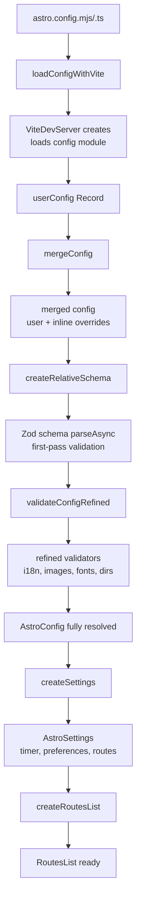
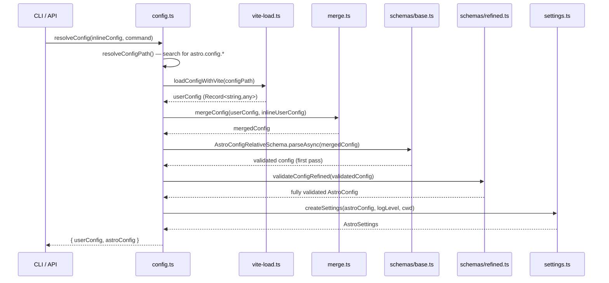

# Configuration System and Routing

Astro's configuration system is a three-phase pipeline — load, merge, validate — that transforms a user's `astro.config.mjs` into a fully typed `AstroConfig` object, while the routing system translates the `src/pages/` directory tree into a sorted manifest of `RouteData` objects with regex patterns, priority ordering, and support for dynamic segments, redirects, and injected routes. Together, these two systems form the backbone of every Astro project: configuration defines what the project is, and routing defines what the project serves.

See [Architecture](01-architecture.html) for the high-level monorepo structure, and [SSR Runtime](06-ssr-runtime.html) for how the route manifest is consumed at request time.

## Configuration Resolution Pipeline



The entire config resolution flow is sequential: a user file is loaded through Vite, merged with inline CLI flags, validated against a Zod schema, refined with cross-field validators, then wrapped into an `AstroSettings` object that drives the rest of the build and dev pipeline.

**Source:** `packages/astro/src/core/config/config.ts:134` — `resolveConfig()` entry point

## Config Loading: `loadConfigWithVite`

Config loading lives in `packages/astro/src/core/config/vite-load.ts`. Astro searches for the config file in a fixed order, checking the most common extensions first:

```ts
// packages/astro/src/core/config/config.ts:29-34
const configPaths = Object.freeze([
    'astro.config.mjs',
    'astro.config.js',
    'astro.config.ts',
    'astro.config.mts',
]);
```

The `search()` function iterates these paths in the project root and returns the first match. If the user passes `--config` via CLI, that path is used directly and an error is thrown if the file does not exist.

The actual loading strategy in `loadConfigWithVite` has two phases:

1. **Native import for JS files** — If the config path matches `/\.[cm]?js$/`, Astro tries a direct `import()` first. This is fast and avoids Vite startup overhead.
2. **Vite fallback for TS files** — If the native import fails or the file is `.ts`/`.mts`, Astro creates a minimal Vite dev server (`createMinimalViteDevServer`) with a fallback plugin, then uses the SSR environment's `runner.import()` to load the TypeScript config.

```ts
// packages/astro/src/core/config/vite-load.ts:15-56
export async function loadConfigWithVite({
    configPath, fs, root,
}: LoadConfigWithViteOptions): Promise<Record<string, any>> {
    if (/\.[cm]?js$/.test(configPath)) {
        try {
            const config = await import(pathToFileURL(configPath).toString() + '?t=' + Date.now());
            return config.default ?? {};
        } catch (e) { /* falls through to Vite */ }
    }
    // Vite fallback for .ts/.mts
    let server: ViteDevServer | undefined;
    try {
        const plugins = loadFallbackPlugin({ fs, root: pathToFileURL(root) });
        server = await createMinimalViteDevServer(plugins);
        if (isRunnableDevEnvironment(server.environments[ASTRO_VITE_ENVIRONMENT_NAMES.ssr])) {
            const environment = server.environments[ASTRO_VITE_ENVIRONMENT_NAMES.ssr] as RunnableDevEnvironment;
            const mod = await environment.runner.import(configPath);
            return mod.default ?? {};
        }
    } finally {
        if (server) await server.close();
    }
}
```

The Vite server is torn down immediately after loading — it exists solely to transpile TypeScript and resolve ESM imports in the config file.

**Source:** `packages/astro/src/core/config/vite-load.ts:15` — `loadConfigWithVite()`

## Config Merge: `mergeConfig`

After loading, the user config is merged with any inline-only config (CLI flags like `--root`, `--mode`). The merge logic lives in `packages/astro/src/core/config/merge.ts` and performs a recursive deep merge with special handling for specific fields:

```ts
// packages/astro/src/core/config/merge.ts:6-81
function mergeConfigRecursively(defaults, overrides, rootPath) {
    const merged = { ...defaults };
    for (const key in overrides) {
        const value = overrides[key];
        if (value == null) continue;
        const existing = merged[key];
        if (existing == null) { merged[key] = value; continue; }

        // Special handling: vite config uses Vite's own merge
        if (key === 'vite' && rootPath === '') {
            merged[key] = mergeViteConfig(existing, value);
            continue;
        }
        // server config can be a function
        if (key === 'server' && rootPath === '') {
            if (typeof existing === 'function' || typeof value === 'function') {
                merged[key] = (...args) => {
                    const exConfig = typeof existing === 'function' ? existing(...args) : existing;
                    const valConfig = typeof value === 'function' ? value(...args) : value;
                    return mergeConfigRecursively(exConfig, valConfig, key);
                };
                continue;
            }
        }
        // Arrays are concatenated
        if (Array.isArray(existing) || Array.isArray(value)) {
            merged[key] = [...arraify(existing ?? []), ...arraify(value ?? [])];
            continue;
        }
        // Objects are recursively merged
        if (isObject(existing) && isObject(value)) {
            merged[key] = mergeConfigRecursively(existing, value, rootPath ? `${rootPath}.${key}` : key);
            continue;
        }
        merged[key] = value;
    }
    return merged;
}
```

Key merge behaviors:

| Field | Merge Strategy |
|-------|---------------|
| `vite` | Uses Vite's `mergeConfig` for proper plugin merging |
| `server` | Supports function configs — wraps into a combined function |
| `server.allowedHosts` | Boolean wins over array (no array merge if either is `true`) |
| Arrays (`integrations`, `remarkPlugins`, etc.) | Concatenated |
| `markdown.processor` | Replaced atomically (deep merge would leak default options) |
| URLs | Later value wins (no deep merge) |
| All other objects | Recursive deep merge |

**Source:** `packages/astro/src/core/config/merge.ts:83` — `mergeConfig()`

## Validation: Zod Schema and Refined Validators

Validation happens in two passes. The first pass validates the raw merged config against the base Zod schema. The second pass runs refined validators that check cross-field relationships.

### First Pass: `AstroConfigSchema`

The base schema is defined in `packages/astro/src/core/config/schemas/base.ts` and covers every config field. It uses Zod v4 (`zod/v4`) with defaults, transforms, and refinements.

```ts
// packages/astro/src/core/config/schemas/base.ts:148-587 (abbreviated)
export const AstroConfigSchema = z.object({
    root: z.string().optional().default('.').transform(v => new URL(v)),
    srcDir: z.string().optional().default('./src').transform(v => new URL(v)),
    publicDir: z.string().optional().default('./public').transform(v => new URL(v)),
    outDir: z.string().optional().default('./dist').transform(v => new URL(v)),
    cacheDir: z.string().optional().default('./node_modules/.astro').transform(v => new URL(v)),
    site: z.string().url().optional(),
    base: z.string().optional().default('/'),
    trailingSlash: z.union([z.literal('always'), z.literal('never'), z.literal('ignore')]).optional().default('ignore'),
    output: z.union([z.literal('static'), z.literal('server'), z.literal('hybrid')]).optional().default('static')
        .refine(v => v !== 'hybrid', { message: 'The `output: "hybrid"` option has been removed...' }),
    adapter: z.object({ name: z.string(), hooks: z.object({}).loose().default({}) }).optional(),
    integrations: z.preprocess(v => Array.isArray(v) ? v.flat(Infinity).filter(Boolean) : v,
        z.array(z.object({ name: z.string(), hooks: z.object({}).loose().default({}) }))).optional().default([]),
    // ... build, server, markdown, image, security, i18n, fonts, cache, experimental, etc.
});
```

All path fields (`root`, `srcDir`, `publicDir`, `outDir`, `cacheDir`) are transformed from strings to `URL` objects during validation.

### Default Configuration Values

The complete set of defaults is defined in `ASTRO_CONFIG_DEFAULTS` in `packages/astro/src/core/config/schemas/base.ts:61-122`:

```ts
// packages/astro/src/core/config/schemas/base.ts:61-122
export const ASTRO_CONFIG_DEFAULTS = {
    root: '.',
    srcDir: './src',
    publicDir: './public',
    outDir: './dist',
    cacheDir: './node_modules/.astro',
    base: '/',
    trailingSlash: 'ignore',
    build: {
        format: 'directory',
        client: './client/',
        server: './server/',
        assets: '_astro',
        serverEntry: 'entry.mjs',
        redirects: true,
        inlineStylesheets: 'auto',
        concurrency: 1,
    },
    image: {
        endpoint: { entrypoint: undefined, route: '/_image' },
        service: { entrypoint: 'astro/assets/services/sharp', config: {} },
        dangerouslyProcessSVG: false,
        responsiveStyles: false,
    },
    devToolbar: { enabled: true },
    compressHTML: 'jsx',
    server: { host: false, port: 4321, open: false, allowedHosts: [] },
    integrations: [],
    markdown: markdownConfigDefaults,
    vite: {},
    redirects: {},
    security: { checkOrigin: true, allowedDomains: [], csp: false, actionBodySizeLimit: 1048576, serverIslandBodySizeLimit: 1048576 },
    env: { schema: {}, validateSecrets: false },
    prerenderConflictBehavior: 'warn',
    fetchFile: 'fetch',
    experimental: { clientPrerender: false, contentIntellisense: false, chromeDevtoolsWorkspace: false },
    legacy: { collectionsBackwardsCompat: false },
};
```

### Second Pass: Refined Validators

After the base schema parses, `AstroConfigRefinedSchema` in `packages/astro/src/core/config/schemas/refined.ts` runs cross-field validators:

```ts
// packages/astro/src/core/config/schemas/refined.ts:15-43
export const AstroConfigRefinedSchema = z.custom<AstroConfig>().superRefine((config, ctx) => {
    let issues: ConfigValidationIssue[] = [];
    issues = issues.concat(
        validateAssetsPrefix(config),
        validateRemotePatterns(config.image.remotePatterns),
        validateI18nRedirectToDefaultLocale(config.i18n),
        validateOutDirNotInPublicDir(config.outDir, config.publicDir),
    );
    if (config.i18n) {
        issues = issues.concat(
            validateI18nDefaultLocale(config.i18n),
            validateI18nFallback(config.i18n),
            validateI18nDomains(config),
        );
    }
    if (config.fonts && config.fonts.length > 0) {
        issues = issues.concat(validateFontsCssVariables(config.fonts));
    }
    for (const issue of issues) {
        ctx.addIssue({ code: z.ZodIssueCode.custom, message: issue.message, path: issue.path });
    }
});
```

These validators ensure that:

- `assetsPrefix` is properly formatted
- `image.remotePatterns` have valid patterns
- `i18n.defaultLocale` is one of the configured locales
- `i18n.fallback` targets valid locales
- `i18n.domains` are properly configured
- `outDir` is not nested inside `publicDir` (would cause infinite build loops)
- `fonts` CSS variables are properly set up

**Source:** `packages/astro/src/core/config/schemas/refined.ts:15` — `AstroConfigRefinedSchema`

## AstroConfig Field Reference

### Core Path Fields

| Field | Type | Default | Description |
|-------|------|---------|-------------|
| `root` | `URL` | `'.'` | Project root directory. All relative paths resolve from here. |
| `srcDir` | `URL` | `'./src'` | Source directory. Contains `pages/`, `components/`, `content/`, etc. |
| `publicDir` | `URL` | `'./public'` | Static assets served as-is (not processed by Vite). |
| `outDir` | `URL` | `'./dist'` | Build output directory. |
| `cacheDir` | `URL` | `'./node_modules/.astro'` | Internal cache directory for dev server and build artifacts. |

### Site and URL Fields

| Field | Type | Default | Description |
|-------|------|---------|-------------|
| `site` | `string \| undefined` | `undefined` | The deployed site URL. Used for sitemap generation and absolute URL construction. Must be a valid URL. |
| `base` | `string` | `'/'` | The base path the site is deployed under. Prepended to all routes. |

### Output and Build Fields

| Field | Type | Default | Description |
|-------|------|---------|-------------|
| `output` | `'static' \| 'server'` | `'static'` | Output mode. `'hybrid'` was removed; use `'static'` for static sites. |
| `build.format` | `'file' \| 'directory' \| 'preserve'` | `'directory'` | Output file structure for static builds. |
| `build.client` | `URL` | `'./client/'` | Client-side output directory (within `outDir`). |
| `build.server` | `URL` | `'./server/'` | Server-side output directory (within `outDir`). |
| `build.assets` | `string` | `'_astro'` | Asset subdirectory name for hashed client assets. |
| `build.assetsPrefix` | `string \| { fallback: string } & Record<string, string>` | `undefined` | CDN prefix for assets. Supports per-environment fallback mapping. |
| `build.serverEntry` | `string` | `'entry.mjs'` | Name of the server entry point file. |
| `build.redirects` | `boolean` | `true` | Whether to generate redirect files for dynamic routes in static builds. |
| `build.inlineStylesheets` | `'always' \| 'auto' \| 'never'` | `'auto'` | CSS inlining strategy. |
| `build.concurrency` | `number` | `1` | Number of pages to build concurrently. |

### Server Configuration

| Field | Type | Default | Description |
|-------|------|---------|-------------|
| `server.host` | `string \| boolean` | `false` | Network interface to bind to. `true` exposes on all interfaces. |
| `server.port` | `number` | `4321` | Dev server port. |
| `server.open` | `string \| boolean` | `false` | Whether to open browser on dev start. Can be a path string. |
| `server.allowedHosts` | `string[] \| true` | `[]` | Host header validation. `true` allows all hosts. |
| `server.headers` | `OutgoingHttpHeaders` | `undefined` | Custom HTTP headers for dev server responses. |

### Vite Integration

The `vite` field accepts a standard Vite configuration object. It is merged using Vite's own `mergeConfig` function, which properly handles plugin arrays, resolve aliases, and other Vite-specific merge semantics.

```ts
// packages/astro/src/core/config/schemas/base.ts:554-556
vite: z.custom<ViteUserConfig>((data) => data instanceof Object && !Array.isArray(data))
    .default(ASTRO_CONFIG_DEFAULTS.vite),
```

Astro's internal Vite plugins are layered on top of the user's vite config. The user config is never overwritten -- it is always merged, so user plugins run alongside Astro's 40+ internal plugins. See [Vite Plugins](04-vite-plugins.html) for the full list of internal plugins.

### Image Service Configuration

```ts
// packages/astro/src/core/config/schemas/base.ts:291-328
image: z.object({
    endpoint: z.object({
        route: z.literal('/_image').or(z.string()).default('/_image'),
        entrypoint: z.string().optional(),
    }).default({ route: '/_image', entrypoint: undefined }),
    service: z.object({
        entrypoint: z.union([z.literal('astro/assets/services/sharp'), z.string()]).default('astro/assets/services/sharp'),
        config: z.record(z.string(), z.any()).default({}),
    }).default({ entrypoint: 'astro/assets/services/sharp', config: {} }),
    dangerouslyProcessSVG: z.boolean().default(false),
    domains: z.array(z.string()).default([]),
    remotePatterns: z.array(z.object({ protocol: z.string().optional(), hostname: z.string().optional(), port: z.string().optional(), pathname: z.string().optional() })).default([]),
    layout: z.enum(['constrained', 'fixed', 'full-width', 'none']).optional(),
    objectFit: z.string().optional(),
    objectPosition: z.string().optional(),
    breakpoints: z.array(z.number()).optional(),
    responsiveStyles: z.boolean().default(false),
}),
```

The image service has two modes:

- **Sharp** (default): `entrypoint: 'astro/assets/services/sharp'` — uses the `sharp` npm package for image transformations. Requires native bindings.
- **Noop**: A custom entrypoint that does no processing — used for static sites or environments where Sharp is unavailable.

The `/_image` endpoint is injected into the route manifest during dev or server builds. See [Assets & Images](10-assets-images.html) for details.

### Markdown Configuration

```ts
// packages/astro/src/core/config/schemas/base.ts:335-453
markdown: z.object({
    syntaxHighlight: z.union([
        z.object({ type: z.union([z.literal('shiki'), z.literal('prism')]).default('shiki'), excludeLangs: z.array(z.string()).optional() })
            .default(syntaxHighlightDefaults),
        z.literal(false),
    ]).default({ type: 'shiki' }),
    shikiConfig: z.object({
        langs: z.custom<ShikiLang>().array().default([]),
        langAlias: z.record(z.string(), z.string()).default({}),
        theme: z.enum(Object.keys(bundledThemes) as [BuiltinTheme, ...BuiltinTheme[]]).or(z.custom<ShikiTheme>()).default('github-dark'),
        themes: z.record(z.string(), z.enum(Object.keys(bundledThemes) as [BuiltinTheme, ...BuiltinTheme[]]).or(z.custom<ShikiTheme>())).default({}),
        defaultColor: z.union([z.literal('light'), z.literal('dark'), z.string(), z.literal(false)]).optional(),
        wrap: z.boolean().or(z.null()).default(false),
        transformers: z.custom<ShikiTransformer>().array().default([]),
    }).prefault({}),
    remarkPlugins: z.array(/* string | [string, options] | function | [function, options] */).default([]),
    rehypePlugins: z.array(/* same as remarkPlugins */).default([]),
    remarkRehype: z.custom<RemarkRehype>().default({}),
    gfm: z.boolean().optional(),           // deprecated
    smartypants: z.union([z.boolean(), smartypantsOptionsSchema]).optional(),  // deprecated
    processor: z.object({
        name: z.string(),
        options: z.custom<object>().default(() => ({})),
        createRenderer: z.custom<MarkdownProcessor['createRenderer']>(v => typeof v === 'function'),
        createMdxRenderer: z.custom<MarkdownProcessor['createMdxRenderer']>(v => v === undefined || typeof v === 'function').optional(),
    }).default(() => satteri()),
}),
```

Markdown configuration has two tiers:

**Processor-based (current)**: The `processor` field holds a unified-like processor instance. The default is `satteri()` from `@astrojs/markdown-satteri`. Users pass plugins directly to the processor via its options object.

**Legacy (deprecated)**: `remarkPlugins`, `rehypePlugins`, `remarkRehype`, `gfm`, and `smartypants` are deprecated. During validation, `coerceLegacyMarkdownPlugins()` in `validate.ts` migrates these into the processor's options automatically. If a user sets a custom processor that isn't the unified processor, a warning is issued because those legacy fields won't apply.

```ts
// packages/astro/src/core/config/validate.ts:60-121
async function coerceLegacyMarkdownPlugins(config) {
    const md = config?.markdown;
    if (!md) return;
    const remarkPlugins = md.remarkPlugins ?? [];
    const rehypePlugins = md.rehypePlugins ?? [];
    if (remarkPlugins.length === 0 && rehypePlugins.length === 0 && Object.keys(remarkRehype).length === 0) return;

    // Only auto-coerce if using unified or no processor
    const current = md.processor;
    if (!current || isUnifiedProcessor(current)) {
        const target = (current ?? (md.processor = unified())) as ReturnType<typeof unified>;
        target.options.remarkPlugins.push(...remarkPlugins.slice(counts.remark));
        target.options.rehypePlugins.push(...rehypePlugins.slice(counts.rehype));
        Object.assign(target.options.remarkRehype, remarkRehype);
    }
}
```

Shiki syntax highlighting supports both single-theme mode (`theme`) and dual-theme mode (`themes` mapping mode name to theme). Custom Shiki languages and transformers can be added via `shikiConfig.langs` and `shikiConfig.transformers`.

### Session Configuration

```ts
// packages/astro/src/core/config/schemas/base.ts:550
session: SessionSchema.optional(),
```

Session configuration uses `SessionSchema` from `packages/astro/src/core/session/config.ts`. Supported drivers include:

| Driver | `driverName` | Storage |
|--------|-------------|---------|
| Cookie | `'cookie'` | Encrypted browser cookies |
| Memory | `'memory'` | In-process memory (dev only) |
| Custom | Custom entrypoint | User-defined driver |

### CSP (Content Security Policy) Configuration

```ts
// packages/astro/src/core/config/schemas/base.ts:516-538
csp: z.union([
    z.boolean().optional().default(false),
    z.object({
        algorithm: cspAlgorithmSchema,
        directives: z.array(allowedDirectivesSchema).optional(),
        styleDirective: z.object({ resources: z.array(z.string()).optional(), hashes: z.array(cspHashSchema).optional() }).optional(),
        scriptDirective: z.object({ resources: z.array(z.string()).optional(), hashes: z.array(cspHashSchema).optional(), strictDynamic: z.boolean().optional() }).optional(),
    }),
]).optional().default(false),
```

CSP can be enabled with `security.csp: true` for default settings, or configured with an object specifying:

- `algorithm`: Hash algorithm for inline script/style hashing
- `directives`: Array of CSP directives
- `styleDirective`: Resources and hashes for the style-src directive
- `scriptDirective`: Resources, hashes, and `'strict-dynamic'` toggle for script-src

See [Cross-Cutting Concerns](14-cross-cutting.html) for the full CSP implementation.

### Font Configuration

```ts
// packages/astro/src/core/config/schemas/base.ts:562
fonts: z.array(FontFamilySchema).optional(),
```

Font configuration uses `FontFamilySchema` from `packages/astro/src/assets/fonts/config.ts`. Defines font families loaded from providers (Google Fonts, local files, or custom sources). See [Assets & Images](10-assets-images.html) for details.

### Cache Configuration

```ts
// packages/astro/src/core/config/schemas/base.ts:563
cache: CacheSchema.optional(),
```

Cache configuration uses `CacheSchema` from `packages/astro/src/core/cache/config.ts`. Allows configuring custom cache providers for build and dev caching.

### Redirects Configuration

```ts
// packages/astro/src/core/config/schemas/base.ts:262-281
redirects: z.record(
    z.string(),
    z.union([
        z.string(),  // simple string redirect
        z.object({
            status: z.union([z.literal(300), z.literal(301), z.literal(302), z.literal(303), z.literal(307), z.literal(308)]),
            destination: z.string(),
        }),
    ]),
).default({}),
```

Redirects map source paths to destinations. Simple string redirects default to a 301 status code. Object redirects allow explicit status codes. Dynamic segments in redirect sources (e.g., `'/blog/[...slug]'`) are validated against the target route's params during build.

### Environment Variables

```ts
// packages/astro/src/core/config/schemas/base.ts:542-549
env: z.object({
    schema: EnvSchema.optional().default({}),
    validateSecrets: z.boolean().optional().default(false),
}).strict().optional().default({ schema: {}, validateSecrets: false }),
```

Environment variable schema uses `EnvSchema` from `packages/astro/src/env/schema.ts`. Defines typed environment variables with `envField` sources (runtime, prefix, etc.). `validateSecrets: true` validates secret variables at build time.

### Experimental Features

```ts
// packages/astro/src/core/config/schemas/base.ts:565-581
experimental: z.strictObject({
    clientPrerender: z.boolean().optional().default(false),
    contentIntellisense: z.boolean().optional().default(false),
    chromeDevtoolsWorkspace: z.boolean().optional().default(false),
    svgOptimizer: SvgOptimizerSchema.optional(),
}).prefault({}),
```

All experimental features default to `false`. The schema is strict — unknown experimental keys cause validation errors.

## AstroSettings: The Runtime Configuration Object

After `AstroConfig` is resolved, `createSettings()` in `packages/astro/src/core/config/settings.ts` wraps it into an `AstroSettings` object that carries additional runtime state:

```ts
// packages/astro/src/core/config/settings.ts:168-190
export async function createSettings(config: AstroConfig, logLevel, cwd?): Promise<AstroSettings> {
    const tsconfig = await loadTSConfig(cwd);
    const settings = createBaseSettings(config, logLevel);
    // Watch package.json and tsconfig sources
    if (cwd) settings.watchFiles.push(fileURLToPath(new URL('./package.json', pathToFileURL(cwd))));
    if (!tsconfig.error) {
        settings.watchFiles.push(...tsconfig.sources);
        settings.tsConfig = tsconfig.tsconfig;
        settings.tsConfigPath = tsconfig.tsconfigFile;
    }
    return settings;
}
```

The `AstroSettings` object contains:

| Field | Type | Description |
|-------|------|-------------|
| `config` | `AstroConfig` | The resolved configuration. |
| `preferences` | `Preferences` | Dev preferences persisted to `.astro/` directory. |
| `tsConfig` | `object \| undefined` | Parsed `tsconfig.json` if found. |
| `tsConfigPath` | `string \| undefined` | Path to `tsconfig.json`. |
| `adapter` | `Adapter \| undefined` | Active SSR adapter (set by integrations). |
| `prerenderer` | `Prerenderer \| undefined` | Active prerenderer. |
| `injectedRoutes` | `InjectedRoute[]` | Routes injected by integrations. |
| `pageExtensions` | `string[]` | `['.astro', '.html', ...SUPPORTED_MARKDOWN_FILE_EXTENSIONS]` |
| `contentEntryTypes` | `ContentEntryType[]` | Content entry type handlers (markdown by default). |
| `dataEntryTypes` | `DataEntryType[]` | Data entry type handlers (JSON, YAML, TOML parsers). |
| `renderers` | `Renderer[]` | Framework renderers (React, Vue, Svelte, etc.). |
| `clientDirectives` | `Map<string, string>` | `client:*` hydration directive mappings. |
| `middlewares` | `{ pre: [], post: [] }` | Pre/post middleware arrays. |
| `watchFiles` | `string[]` | Files the dev server should watch. |
| `devToolbarApps` | `string[]` | Dev toolbar application entrypoints. |
| `timer` | `AstroTimer` | Build/dev timer instance. |
| `dotAstroDir` | `URL` | `.astro/` cache directory. |
| `injectedTypes` | `object[]` | Types injected by integrations. |
| `buildOutput` | `'static' \| 'server'` | Resolved build output type. |
| `injectedCsp` | `{ fontResources: Set, styleHashes: [] }` | CSP hashes collected during build. |
| `logLevel` | `'info' \| 'debug' \| 'silent' \| 'warn' \| 'error'` | Current log level. |
| `fontsHttpServer` | `object \| null` | Dev font HTTP server (SSR target only). |

The `createBaseSettings()` function (lines 22-166) initializes all these fields with their defaults. It sets up content paths via `getContentPaths()`, creates the preferences system, and configures the three data entry parsers (JSON, YAML via `js-yaml`, TOML via `smol-toml`) with detailed error reporting including file-relative paths.

**Source:** `packages/astro/src/core/config/settings.ts:22` — `createBaseSettings()`, `packages/astro/src/core/config/settings.ts:168` — `createSettings()`

## Complete Config Resolution Flow



**Key insight:** Config resolution is a pure pipeline — each stage produces output consumed by the next, with no backtracking. The Zod schema (`AstroConfigSchema`) serves dual purposes: it provides defaults for missing fields AND validates the shape, so by the time `mergeConfig` returns, all defaults are already applied.

## Routing System Overview

Astro's routing system converts the filesystem structure under `src/pages/` into a sorted manifest of `RouteData` objects. Each route carries a compiled regex pattern, segment metadata, parameter names, and type information (page, endpoint, redirect, or fallback).

**Source:** `packages/astro/src/core/routing/create-manifest.ts:695` — `createRoutesList()`

## Route Manifest Creation

The `createRoutesList()` function is the single entry point for building the route manifest. It orchestrates four sub-pipelines:

```ts
// packages/astro/src/core/routing/create-manifest.ts:695-806
export async function createRoutesList(params, logger, { dev = false } = {}): Promise<RoutesList> {
    const { settings } = params;

    // Phase 1: File-based routes from src/pages/
    const fileBasedRoutes = createFileBasedRoutes(params, logger);
    for (const route of fileBasedRoutes) routeMap.set(route.route, route);

    // Phase 2: Integration-injected routes
    const injectedRoutes = createInjectedRoutes(params);
    for (const route of injectedRoutes) routeMap.set(route.route, route);

    // Phase 3: Redirect routes from config
    const redirectRoutes = createRedirectRoutes(params, routeMap);

    // Merge, sort, and filter
    const routes = [
        ...[...filteredFileBasedRoutes, ...injectedRoutes, ...redirectRoutes].sort(routeComparator),
    ];

    // Phase 4: Determine prerender option for each route
    await Promise.all(promises.map(r => getRoutePrerenderOption(content, route, settings, logger)));

    // Phase 5: Detect route collisions
    for (const [index, higherRoute] of routes.entries()) {
        for (const lowerRoute of routes.slice(index + 1)) {
            detectRouteCollision(higherRoute, lowerRoute, config, logger);
        }
    }

    // Phase 6: Inject system routes (404, image, server islands)
    if (dev) ensure404Route({ routes });
    if (dev || settings.buildOutput === 'server') injectImageEndpoint(settings, { routes }, dev ? 'dev' : 'build');
    if (dev || settings.config.adapter) injectServerIslandRoute(settings.config, { routes });

    return { routes };
}
```

The six phases produce the final `RoutesList` that the SSR runtime uses for request matching.

## Route Types

Every `RouteData` object has a `type` field that determines how the route is handled:

| Type | Source | Description |
|------|--------|-------------|
| `'page'` | `.astro`, `.md`, `.mdx` files | Renders an HTML page. |
| `'endpoint'` | `.js`, `.ts` files | Returns a raw HTTP response (API routes). |
| `'redirect'` | `config.redirects` | Returns a 3xx redirect response. |
| `'fallback'` | i18n fallback routes | Serves content from a fallback locale when the target locale has no matching page. |

## File-Based Route Discovery

`createFileBasedRoutes()` in `packages/astro/src/core/routing/create-manifest.ts:121-272` walks the `src/pages/` directory recursively using a `walk()` function. For each file encountered:

1. **Filter by extension**: Only `.astro`, `.html`, Markdown extensions, `.js`, and `.ts` files are processed. Files starting with `_` or `.` (except `.well-known`) are skipped.
2. **Parse segments**: The file path is split into route segments. Each segment is parsed by `getParts()` into `RoutePart[]` arrays.
3. **Build route data**: Each file becomes a `RouteData` with pattern, segments, params, and component path.

```ts
// packages/astro/src/core/routing/create-manifest.ts:140-146
const validPageExtensions = new Set<string>([
    '.astro', '.html',
    ...SUPPORTED_MARKDOWN_FILE_EXTENSIONS,  // ['.md', '.mdx', '.markdn', '.mdown', '.markdown', '.mdtext', '.mdtxt']
    ...settings.pageExtensions,
]);
const validEndpointExtensions = new Set<string>(['.js', '.ts']);
```

The walk function builds up `RoutePart[][]` segments and `string[]` params as it descends the directory tree. Index files (named `index.*`) contribute to their parent segment rather than creating a new one. Index files with suffix extensions (like `index.en.astro`) add the suffix as additional content to the last segment.

## RoutePart Structure

Each path segment is decomposed into `RoutePart` objects:

```ts
// RoutePart (from packages/astro/src/types/public/internal.ts)
interface RoutePart {
    content: string;   // The literal text (e.g., "slug", "blog")
    dynamic: boolean;  // True if wrapped in [brackets]
    spread: boolean;   // True if prefixed with ... (rest parameter)
}
```

The `getParts()` function splits a segment string on the dynamic route split regex and classifies each piece:

```ts
// packages/astro/src/core/routing/parts.ts:5-6
const ROUTE_DYNAMIC_SPLIT = /\[(.+?\(.+?\)|.+?)\]/;
const ROUTE_SPREAD = /^\.{3}.+$/;

export function getParts(part: string, file: string): RoutePart[] {
    const result: RoutePart[] = [];
    part.split(ROUTE_DYNAMIC_SPLIT).map((str, i) => {
        if (!str) return;
        const dynamic = i % 2 === 1;  // Odd-indexed splits are dynamic
        const [, content] = dynamic ? /([^(]+)$/.exec(str) || [null, null] : [null, str];
        // Validate parameter name
        if (!content || (dynamic && !/^(?:\.\.\.)?[\w$]+$/.test(content))) {
            throw new Error(`Invalid route ${file} — parameter name must match /^[a-zA-Z0-9_$]+$/`);
        }
        result.push({ content, dynamic, spread: dynamic && ROUTE_SPREAD.test(content) });
    });
    return result;
}
```

The split regex `/\[(.+?\(.+?\)|.+?)\]/` captures both simple parameters (`[slug]`) and parameters with type matching syntax (`[slug([a-z]+)]`). The odd/even index check works because splitting on `[...]` produces alternating static and dynamic pieces.

Example: `blog-[category]/[slug]` splits into:
- `'blog-'` (static, index 0) -> `{ content: 'blog-', dynamic: false, spread: false }`
- `'category'` (dynamic, index 1) -> `{ content: 'category', dynamic: true, spread: false }`
- `'/'` (static, index 2) -> `{ content: '/', dynamic: false, spread: false }`
- `'slug'` (dynamic, index 3) -> `{ content: 'slug', dynamic: true, spread: false }`

**Source:** `packages/astro/src/core/routing/parts.ts:8` — `getParts()`

## Pattern Generation: `getPattern()`

Each route's segments are compiled into a regex pattern by `getPattern()` in `packages/astro/src/core/routing/pattern.ts`:

```ts
// packages/astro/src/core/routing/pattern.ts:4-47
export function getPattern(segments: RoutePart[][], base: AstroConfig['base'], addTrailingSlash: AstroConfig['trailingSlash']) {
    const pathname = segments.map((segment) => {
        if (segment.length === 1 && segment[0].spread) {
            return '(?:\\/(.*?))?';  // Rest spread: optional catch-all
        } else {
            return '\\/' + segment.map((part) => {
                if (part.spread) return '(.*?)';           // Spread: match anything
                else if (part.dynamic) return '([^/]+?)';   // Dynamic: match one segment
                else return part.content.normalize()        // Static: escaped literal
                    .replace(/\?/g, '%3F').replace(/#/g, '%23')
                    .replace(/%5B/g, '[').replace(/%5D/g, ']')
                    .replace(/[.*+?^${}()|[\]\\]/g, '\\$&');
            }).join('');
        }
    }).join('');

    const trailing = addTrailingSlash && segments.length ? getTrailingSlashPattern(addTrailingSlash) : '$';
    let initial = '\\/';
    if (addTrailingSlash === 'never' && base !== '/' && pathname !== '') initial = '';
    return new RegExp(`^${pathname || initial}${trailing}`);
}

function getTrailingSlashPattern(addTrailingSlash): string {
    if (addTrailingSlash === 'always') return '\\/$';
    if (addTrailingSlash === 'never') return '$';
    return '\\/?$';  // 'ignore' — optional trailing slash
}
```

Pattern generation produces URL-matching regexes:

| File Path | Pattern (simplified) |
|-----------|---------------------|
| `src/pages/index.astro` | `^\/$` (or `^\/?$` with `ignore`) |
| `src/pages/about.astro` | `^\/about$` |
| `src/pages/blog/[slug].astro` | `^\/blog\/([^/]+?)$` |
| `src/pages/docs/[...path].astro` | `^\/docs(?:\/(.*?))?$` |
| `src/pages/api/[version]/users.ts` | `^\/api\/([^/]+?)\/users$` |

Static content is regex-escaped to prevent injection. Question marks and hash signs in paths are percent-encoded.

**Source:** `packages/astro/src/core/routing/pattern.ts:4` — `getPattern()`

## Route Priority: `routeComparator`

After all routes are collected, they are sorted using `routeComparator` in `packages/astro/src/core/routing/priority.ts`. The comparator implements a multi-key sort that determines which route wins when multiple routes could match the same URL:

```ts
// packages/astro/src/core/routing/priority.ts:24-105
export function routeComparator(a: RouteData, b: RouteData) {
    // 1. Static vs dynamic within shared segments
    // 2. Partial dynamic vs fully dynamic (game-[title] > [title])
    // 3. Spread vs non-spread
    // 4. Route length (longer routes first, except rest at end)
    // 5. Endpoints before pages
    // 6. Alphabetical as final tiebreaker
}
```

The sorting rules, in priority order:

1. **More segments = higher priority** — `/foo/bar` sorts before `/foo`. Parent routes never shadow children.
2. **Static before dynamic** — `/foo/bar` sorts before `/foo/[slug]`.
3. **Partial dynamic before full dynamic** — `game-[title]` sorts before `[title]`. Routes with mixed static/dynamic content are more specific.
4. **Single param before rest param** — `/foo/[bar]` sorts before `/foo/[...bar]`.
5. **Longer routes first** — `/a/b/c` sorts before `/a/b`. Exception: if the shorter route is the prefix of the longer and the longer ends in a rest param, the shorter route wins (e.g., `/foo` before `/foo/[...bar]`).
6. **Endpoints before pages** — A `.ts` endpoint at `/foo` sorts before a `.astro` page at the same pattern.
7. **Alphabetical tiebreaker** — If all else is equal, alphabetically earlier routes sort first.

This ordering is critical: the SSR runtime iterates routes in order and uses the first match, so `routeComparator` ensures the most specific route is always tried first.

**Source:** `packages/astro/src/core/routing/priority.ts:24` — `routeComparator()`

## Injected Routes

Integrations can inject routes via `settings.injectedRoutes`. Each injected route specifies a pattern, entrypoint, prerender flag, and origin:

```ts
// packages/astro/src/core/routing/create-manifest.ts:451-499
function createInjectedRoutes({ settings, cwd }: CreateRouteManifestParams): RouteData[] {
    const routes: RouteData[] = [];
    for (const injectedRoute of settings.injectedRoutes) {
        const { pattern: name, entrypoint, prerender: prerenderInjected, origin } = injectedRoute;
        const { resolved, component } = resolveInjectedRoute(entrypoint.toString(), config.root, cwd);

        const segments = removeLeadingForwardSlash(name)
            .split(path.posix.sep)
            .filter(Boolean)
            .map((s) => { validateSegment(s); return getParts(s, component); });

        const type = resolved.endsWith('.astro') ? 'page' : 'endpoint';
        // ... build RouteData
        routes.push({
            type, isIndex: false, route, pattern, segments, params, component,
            pathname, prerender: prerenderInjected ?? prerender, fallbackRoutes: [], distURL: [], origin,
        });
    }
    return routes;
}
```

Injected routes have `isIndex: false` (never treated as index routes) and their `origin` field identifies which integration injected them. The entrypoint is resolved via `require.resolve()` first (for npm packages), falling back to a URL relative to the project root.

Two system routes are always injected when conditions are met:

- **404 route**: Injected in dev mode via `ensure404Route()`. In SSR builds, the 404 route is handled directly in the `App` class rather than the manifest.
- **Image endpoint**: Injected in dev or server builds via `injectImageEndpoint()`. Maps to `/_image` (or a custom route).
- **Server islands route**: Injected when an adapter is present via `injectServerIslandRoute()`. Required for server island rendering.

```ts
// packages/astro/src/core/routing/create-manifest.ts:785-800
if (dev) ensure404Route({ routes });
if (dev || settings.buildOutput === 'server') injectImageEndpoint(settings, { routes }, dev ? 'dev' : 'build');
if (dev || settings.config.adapter) injectServerIslandRoute(settings.config, { routes });
```

## Redirect Routes

Redirect routes are created from the `config.redirects` object. Each redirect is validated to ensure:

- External redirects must start with `https://` or `http://`
- Internal redirects with dynamic params in prerender mode must target an existing route with matching params
- The destination route's params must be a superset of the source's params

```ts
// packages/astro/src/core/routing/create-manifest.ts:505-604
function createRedirectRoutes({ settings }: CreateRouteManifestParams, routeMap: Map<string, RouteData>): RouteData[] {
    for (const [from, to] of Object.entries(settings.config.redirects)) {
        // Validate external URLs
        if (URL.canParse(destination) && !/^https?:\/\//.test(destination)) {
            throw new AstroError({ ...UnsupportedExternalRedirect, ... });
        }
        // Validate dynamic params in prerender mode
        if (params.length > 0 && !redirectRoute && !URL.canParse(destination) && getPrerenderDefault(config)) {
            throw new AstroError({ ...InvalidRedirectDestination, ... });
        }
        routes.push({ type: 'redirect', isIndex: false, route, pattern, segments, params, component: from, redirect: to, redirectRoute, ... });
    }
    return routes;
}
```

After redirect routes are created, any file-based routes that overlap with redirect routes are filtered out, ensuring the redirect takes precedence.

## Trailing Slash Handling

The trailing slash behavior is determined at route definition time by `trailingSlashForPath()` and enforced at request time by `TrailingSlashHandler`:

```ts
// packages/astro/src/core/routing/create-manifest.ts:443-449
const trailingSlashForPath = (
    pathname: string | null, config: AstroConfig,
    type: 'page' | 'endpoint', route?: string,
): AstroConfig['trailingSlash'] =>
    type === 'endpoint' && hasFileExtension(pathname ?? route ?? '') ? 'never' : config.trailingSlash;
```

Endpoints with file extensions (like `/feed.xml`) always get `trailingSlash: 'never'` to prevent broken URLs. Pages with dots in their names (like `/hello.world`) respect the user's config.

At runtime, `TrailingSlashHandler` in `packages/astro/src/core/routing/trailing-slash-handler.ts` redirects mismatched URLs:

```ts
// packages/astro/src/core/routing/trailing-slash-handler.ts:64-90
#redirectTrailingSlash(pathname: string): string {
    if (pathname === '/' || isInternalPath(pathname)) return pathname;
    const path = collapseDuplicateTrailingSlashes(pathname, trailingSlash !== 'never');
    if (path !== pathname) return path;  // Multiple slashes -> redirect
    if (trailingSlash === 'ignore') return pathname;
    if (trailingSlash === 'always' && !hasFileExtension(pathname)) return appendForwardSlash(pathname);
    if (trailingSlash === 'never') return removeTrailingForwardSlash(pathname);
    return pathname;
}
```

GET requests get 301 redirects; non-GET requests get 308 redirects to preserve the HTTP method.

**Source:** `packages/astro/src/core/routing/trailing-slash-handler.ts:20` — `TrailingSlashHandler`

## Route Collision Detection

After sorting, `detectRouteCollision()` checks for routes that would never match:

```ts
// packages/astro/src/core/routing/create-manifest.ts:628-690
function detectRouteCollision(a: RouteData, b: RouteData, _config: AstroConfig, logger: AstroLogger) {
    // Fallback routes never collide
    if (a.type === 'fallback' || b.type === 'fallback') return;

    // Exact static route duplicates
    if (a.route === b.route && a.segments.every(isStaticSegment) && b.segments.every(isStaticSegment)) {
        logger.warn('router', `The route "${a.route}" is defined in both "${a.component}" and "${b.component}"...`);
        return;
    }

    // Prerendered routes can't be checked statically (depends on getStaticPaths output)
    if (a.prerender || b.prerender) return;

    // Non-prerendered dynamic routes with semantically equal segments
    // (same number of segments, each segment is semantically equal)
    // are guaranteed to collide
    if (a.segments.length !== b.segments.length) return;
    for (let index = 0; index < a.segments.length; index++) {
        if (!isSemanticallyEqualSegment(a.segments[index], b.segments[index])) return;
    }
    logger.warn('router', `The route "${a.route}" is defined in both...`);
}
```

Two dynamic routes are considered semantically equal if they have the same number of segments and each corresponding segment has the same `dynamic` and `spread` flags. Content is only compared for static parts, since `/[bar]` and `/[baz]` are the same route with different parameter names.

## Route Matching Pipeline

```mermaid
flowchart LR
    A["HTTP Request\nGET /blog/hello-world"] --> B["TrailingSlashHandler\nnormalizes path"]
    B --> C{Path matches\ntrailingSlash policy?}
    C -->|No| D["301/308 Redirect"]
    C -->|Yes| E["Iterate routes\nin priority order"]
    E --> F{pattern.test(path)?}
    F -->|No| E
    F -->|Yes| G{Route type?}
    G -->|page| H["Load component\nrender HTML"]
    G -->|endpoint| I["Execute handler\nreturn Response"]
    G -->|redirect| J["3xx Redirect"]
    G -->|fallback| K["Serve fallback\nlocale content"]
    D --> L[Response]
    H --> L
    I --> L
    J --> L
    K --> L
```

The matching pipeline is linear: routes are tested in `routeComparator` order until the first pattern matches. This O(n) scan is fast because route manifests are typically small (< 100 routes), and the sort order guarantees correctness — the first match is always the most specific one.

## i18n Fallback Routes

When internationalization is configured, `createI18nFallbackRoutes()` generates fallback route entries. For each locale pair in `i18n.fallback` (e.g., `{ es: 'en' }`), the function finds routes in the target locale that don't exist in the source locale and creates `type: 'fallback'` entries attached to the target route's `fallbackRoutes` array.

```ts
// packages/astro/src/core/routing/create-manifest.ts:821-984
export function createI18nFallbackRoutes(routes, i18n, config): void {
    // Group page routes by locale
    const routesByLocale = new Map<string, RouteData[]>();
    // For each fallback pair, find missing routes and create fallback entries
    for (const [fallbackFromLocale, fallbackToLocale] of fallback) {
        for (const fallbackToRoute of fallbackToRoutes) {
            if (!hasRoute) {
                const fallbackRoute: RouteData = {
                    ...fallbackToRoute, pathname, route, segments,
                    pattern: getPattern(segments, config.base, config.trailingSlash),
                    type: 'fallback', fallbackRoutes: [],
                };
                routeData.fallbackRoutes.push(fallbackRoute);
            }
        }
    }
}
```

The fallback routing strategy (`pathname-prefix-always`, `pathname-prefix-other-locales`, or domain-based) is determined by `toRoutingStrategy()` and affects how paths are constructed.

## Key Files Summary

| File | Purpose |
|------|---------|
| `packages/astro/src/core/config/config.ts` | Entry point: `resolveConfig()`, `resolveConfigPath()` |
| `packages/astro/src/core/config/vite-load.ts` | `loadConfigWithVite()` — loads config through minimal Vite server |
| `packages/astro/src/core/config/merge.ts` | `mergeConfig()` — deep merge with special handling for vite, server, arrays |
| `packages/astro/src/core/config/validate.ts` | `validateConfig()`, `validateConfigRefined()` — Zod validation + legacy markdown plugin coercion |
| `packages/astro/src/core/config/schemas/base.ts` | `AstroConfigSchema` — full Zod schema with all fields and defaults |
| `packages/astro/src/core/config/schemas/refined.ts` | `AstroConfigRefinedSchema` — cross-field validators |
| `packages/astro/src/core/config/settings.ts` | `createSettings()`, `createBaseSettings()` — builds AstroSettings runtime object |
| `packages/astro/src/core/routing/create-manifest.ts` | `createRoutesList()`, `createFileBasedRoutes()`, `createInjectedRoutes()`, `createRedirectRoutes()`, `createI18nFallbackRoutes()` |
| `packages/astro/src/core/routing/pattern.ts` | `getPattern()` — compiles route segments to regex |
| `packages/astro/src/core/routing/priority.ts` | `routeComparator()` — multi-key route sort |
| `packages/astro/src/core/routing/parts.ts` | `getParts()` — decomposes path segments into RoutePart arrays |
| `packages/astro/src/core/routing/trailing-slash-handler.ts` | `TrailingSlashHandler` — runtime trailing slash enforcement |

## Aha: Config Validation Is a Two-Pass Pipeline with Legacy Coercion

Astro's config validation runs the same `coerceLegacyMarkdownPlugins()` function **every time** `validateConfig()` is called — including after integrations modify the config. This means legacy `remarkPlugins`/`rehypePlugins` arrays are continuously folded into the unified processor, even if an integration adds plugins mid-build. The `migratedLegacyPluginCounts` WeakMap tracks how many plugins have already been migrated per processor instance, so re-running validation doesn't duplicate entries. This is a clever design that keeps the validation function idempotent while allowing integrations to mutate config at any point.

## Aha: Route Priority Sorting Prevents Ambiguity Without a Router Trie

Many frameworks build a trie (prefix tree) to achieve O(path-length) route matching. Astro uses a simpler approach: sort all routes by specificity using `routeComparator`, then linearly scan until the first regex match. For typical route manifests of 20-50 routes, this O(n) scan is fast enough, and the implementation is dramatically simpler than a trie. The sort rules ensure that `/blog/[slug]` always sorts before `/[...catchall]`, so the linear scan produces the same result as a trie walk would.

See [SSR Runtime](06-ssr-runtime.html) for how the route manifest is used during request handling, and [Build Pipeline](05-build-pipeline.html) for how routes determine what gets prerendered vs server-rendered.
