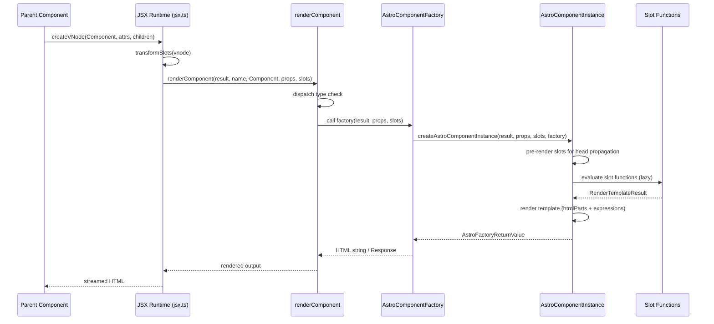
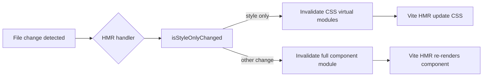

[← Architecture](01-architecture.html) | [Index](README.html) | [Vite Plugins →](04-vite-plugins.html)

# Component Model

The Astro component model is a server-first rendering system where `.astro` files compile into `AstroComponentFactory` functions that accept `(result, props, slots)` and return `RenderTemplateResult` — a tagged-template-literal representation of HTML that streams to the browser with zero JavaScript by default. Components are compiled by `@astrojs/compiler-rs` (the Rust-based compiler), transformed through Vite's plugin pipeline, and rendered via a custom JSX runtime that replaces React's `createElement` with `createVNode`, producing HTML strings on the server and only shipping JavaScript to the client when explicit hydration directives (`client:load`, `client:visible`, etc.) are used.

## .astro Component Format

Every `.astro` file has two sections: frontmatter and template. This split is the core of the component model.

### Frontmatter Section

The frontmatter is the code block between `---` delimiters at the top of the file. It runs server-side during rendering. This is where imports, data fetching, and component logic live.

```astro
---
// src/components/Card.astro
interface Props {
  title: string;
  href?: string;
  tags?: string[];
}

const { title, href, tags = [] } = Astro.props;
const slug = title.toLowerCase().replace(/\s+/g, '-');
---
```

The frontmatter is transpiled to JavaScript and executed as the component's setup function. Variables declared here are available in the template below via JSX expressions. The frontmatter runs once per component invocation and its results are used to construct the HTML output.

**Source:** `packages/astro/src/vite-plugin-astro/compile.ts` — the `compileAstro` function calls `compile()` from `@astrojs/compiler-rs`, which transforms the frontmatter section into a JavaScript function body.

### Template Section

The template section is everything after the closing `---`. It uses HTML-like syntax with JSX expressions for dynamic content. Expressions are enclosed in curly braces `{}` and evaluated in the context of the frontmatter variables.

```astro
---
const items = ['Alpha', 'Beta', 'Gamma'];
const showHeader = true;
---

<article class="card">
  {showHeader && <h2>Card Header</h2>}
  <ul>
    {items.map((item) => <li>{item}</li>)}
  </ul>
  <slot />
</article>
```

The template is compiled into a tagged template literal using `renderTemplate` from the runtime. Each static HTML fragment becomes a string in `htmlParts`, and each dynamic expression becomes an entry in the `expressions` array.

**Source:** `packages/astro/src/runtime/server/render/astro/render-template.ts` — `RenderTemplateResult` class with `htmlParts: TemplateStringsArray` and `expressions: any[]`.

### Component Imports and Exports

Components are imported using standard ES module syntax. The import path is resolved by Vite's module graph. Components can be imported from `.astro` files, framework components (React, Vue, Svelte), or npm packages.

```astro
---
import Card from '../components/Card.astro';
import Header from '../components/Header.astro';
import ReactWidget from '../components/ReactWidget.jsx';
import { getCollection } from 'astro:content';

const posts = await getCollection('blog');
---
```

Components are not explicitly exported from `.astro` files in the traditional sense. Instead, each `.astro` file is treated as a default export by the compiler. The compiled output exports a default `AstroComponentFactory` function.

**Source:** `packages/astro/src/vite-plugin-astro/index.ts` — the transform result sets `astroMetadata` which includes `hydratedComponents`, `clientOnlyComponents`, and `serverComponents` arrays, each populated from the compiler's transform result.

## Props Handling

### The `interface Props` Pattern

Astro uses a TypeScript `interface Props` declaration in the frontmatter to define the shape of component props. This is a compile-time convention — the compiler detects this interface and uses it for type inference. The interface itself is not executed at runtime; it is erased during compilation.

```astro
---
interface Props {
  title: string;
  count?: number;
  variant: 'primary' | 'secondary';
}

// Astro.props is typed based on the interface above
const { title, count = 0, variant } = Astro.props;
---
```

### Astro.props

The `Astro.props` object is the runtime props container. It is populated by the parent component's attribute values when the component is invoked. Props are passed through the JSX rendering pipeline and arrive at the component factory as the second argument.

**Source:** `packages/astro/src/runtime/server/render/astro/instance.ts` — `AstroComponentInstance` receives `props: ComponentProps` in its constructor and exposes them via the `Astro` global during rendering.

The props flow through the rendering pipeline as follows:

1. Parent component renders the child as a VNode with attributes in `props`
2. `renderJSXVNode` in `jsx.ts` extracts attributes from `vnode.props`
3. `renderComponent` dispatches to `renderAstroComponent`
4. `createAstroComponentInstance` creates an instance with the props object
5. The component's frontmatter code accesses `Astro.props`

## Astro Global

The `Astro` global object provides context about the current request, rendering environment, and component metadata. It is available exclusively within the frontmatter section of `.astro` files.

### Astro.request

The current `Request` object. Provides access to headers, method, URL, and body of the incoming HTTP request.

```astro
---
const acceptHeader = Astro.request.headers.get('Accept');
const method = Astro.request.method;
---
```

### Astro.url

A `URL` object for the current request. Useful for accessing pathname, search params, and protocol.

```astro
---
const path = Astro.url.pathname;
const searchParam = Astro.url.searchParams.get('q');
---
```

### Astro.params

The dynamic route parameters. Populated from file-based routing for pages. For example, `src/pages/blog/[slug].astro` provides `Astro.params.slug`.

```astro
---
// src/pages/blog/[slug].astro
const { slug } = Astro.params;
---
```

### Astro.cookies

A cookie management API for reading and setting cookies during SSR.

```astro
---
const sessionId = Astro.cookies.get('session')?.value;
Astro.cookies.set('theme', 'dark', { httpOnly: true });
---
```

### Astro.locals

A request-scoped store for passing data between middleware and components. Set by middleware via `context.locals`, accessed in components via `Astro.locals`.

### Astro.generator

A string identifying the Astro version used to generate the page. Used in the `<meta name="generator">` tag.

### Astro.site

The canonical site URL configured in `astro.config.mjs`. Used for generating absolute URLs.

**Source:** `packages/astro/src/runtime/server/astro-global.ts` — `createAstro(site)` function creates the stub global. In the actual rendering context, these properties are populated from the `SSRResult` and request context. The stub throws `UnavailableAstroGlobal` errors when accessed outside rendering context (e.g., in `getStaticPaths`).

Full Astro global surface includes additional properties: `redirect`, `clientAddress`, `currentLocale`, `preferredLocale`, `preferredLocaleList`, `isPrerendered`, `response`, `rewrite`, `routePattern`, `originPathname`, `callAction`, `getActionResult`, `csp`, `session`, `cache`, and `logger`.

## Slot System

Astro's slot system enables content projection — a parent component can pass content into a child component's designated insertion points.

### Default Slot

The `<slot />` element renders whatever content is placed between the opening and closing tags of the component.

```astro
<!-- Card.astro -->
<div class="card">
  <slot />
</div>

<!-- Usage -->
<Card>
  <p>This content goes into the default slot</p>
</Card>
```

### Named Slots

Named slots use the `slot` attribute to target specific `<slot name="...">` elements.

```astro
<!-- Layout.astro -->
<header><slot name="header" /></header>
<main><slot /></main>
<footer><slot name="footer" /></footer>

<!-- Usage -->
<Layout>
  <h1 slot="header">Page Title</h1>
  <p>Main content (default slot)</p>
  <span slot="footer">Copyright 2025</span>
</Layout>
```

### Fallback Content

Slots support fallback content that renders when no content is provided for that slot.

```astro
<slot name="sidebar">
  <p>No sidebar content provided</p>
</slot>
```

### Slot Implementation

Slots are implemented as lazy functions. Each slot is a `(result: SSRResult) => RenderTemplateResult | Promise<RenderTemplateResult>` function that is evaluated on demand. This lazy evaluation enables head propagation and conditional rendering without unnecessary computation.

**Source:** `packages/astro/src/runtime/server/render/slot.ts` — `ComponentSlots = Record<string, ComponentSlotValue>` and `ComponentSlotValue = (result: SSRResult) => RenderTemplateResult | Promise<RenderTemplateResult>`. The `renderSlot` function handles fallback: if `slotted` is falsy, the `fallback` content is rendered instead.

The `SlotString` class extends `HTMLString` and carries an `instructions: RenderInstruction[] | null` field that stores render instructions for deferred evaluation.

**Aha:** Slots are not pre-rendered strings — they are lazy functions evaluated on demand. This is critical for the head propagation system: when a page has `propagation: 'self'`, all slot functions are eagerly pre-rendered in `AstroComponentInstance`'s constructor so the `<head>` content from child components can be collected and hoisted to the document `<head>`, while the body content is rendered later. The pending slot evaluations are tracked via `result._metadata.pendingSlotEvaluations`. This means a single slot can be evaluated once for head extraction and again for body rendering, without the component author needing to do anything special.

## Conditional Rendering

Conditional rendering uses standard JavaScript expressions within JSX curly braces. Any JavaScript truthy/falsy logic works.

```astro
---
const isLoggedIn = true;
const notifications = [];
---

{isLoggedIn && <span>Welcome back!</span>}
{notifications.length > 0 ? (
  <ul>
    {notifications.map((n) => <li>{n.message}</li>)}
  </ul>
) : (
  <p>No notifications</p>
)}
```

The conditional expression becomes an entry in the `expressions` array of the `RenderTemplateResult`. During rendering, `renderJSX` evaluates each expression recursively.

**Source:** `packages/astro/src/runtime/server/jsx.ts` — `renderJSX(result, vnode)` handles arrays by recursively rendering each element, and `renderJSXVNode` handles VNode children by evaluating expressions in context.

## Loop Rendering

Loop rendering uses JavaScript's `Array.map()` to produce arrays of VNodes or HTML strings.

```astro
---
const items = [
  { id: 1, name: 'Item One' },
  { id: 2, name: 'Item Two' },
  { id: 3, name: 'Item Three' },
];
---

<ul>
  {items.map((item) => (
    <li key={item.id}>{item.name}</li>
  ))}
</ul>
```

The `key` attribute is used for VNode identification but unlike React, Astro does not use keys for reconciliation since there is no client-side diffing. Keys are still useful for framework components that do use reconciliation.

## Compilation

The compilation of `.astro` files is handled by `@astrojs/compiler-rs`, a Rust-based compiler that transforms `.astro` source into JavaScript. This is a key architectural decision: using Rust for compilation provides significantly faster parse and transform times compared to a JavaScript-based compiler.

### @astrojs/compiler-rs

The Rust compiler (version 0.3.0) is invoked through NAPI bindings. It parses the `.astro` source, separates frontmatter from template, and produces a JavaScript transform.

**Source:** `packages/astro/src/vite-plugin-astro/compile.ts` — `compile()` is called from `@astrojs/compiler-rs` with the following options:

- `compact` — minification flag
- `filename` / `normalizedFilename` — source identification
- `sourcemap: 'both'` — inline + external source maps
- `internalURL: 'astro/compiler-runtime'` — runtime import path
- `scopedStyleStrategy` — strategy for scoped CSS class generation
- `resultScopedSlot: true` — scoped slot support
- `transitionsAnimationURL: 'astro/components/viewtransitions.css'` — view transitions CSS

Compiler options are configured in `core/compile/compile.ts`:

```typescript
// packages/astro/src/vite-plugin-astro/compile.ts
const compileResult = await compile({
  astroConfig,
  viteConfig,
  toolbarEnabled,
  filename,
  source,
});
```

The `CompileProps` interface defines the input:

```typescript
// packages/astro/src/vite-plugin-astro/core/compile/types.ts
export interface CompileProps {
  astroConfig: AstroConfig;
  viteConfig: ResolvedConfig;
  toolbarEnabled: boolean;
  filename: string;
  source: string;
}
```

### compileAstro Function

The `compileAstro` function wraps the Rust compiler call and enriches the result with Vite-specific metadata.

```typescript
// packages/astro/src/vite-plugin-astro/compile.ts
interface CompileAstroOption {
  compileProps: CompileProps;
  astroFileToCompileMetadata: Map<string, CompileMetadata>;
}

export async function compileAstro({
  compileProps,
  astroFileToCompileMetadata,
}: CompileAstroOption): Promise<CompileAstroResult>
```

The function:

1. Calls `compile(compileProps)` from `@astrojs/compiler-rs`
2. Appends file metadata to the generated code: `const $$file = ...; const $$url = ...; export { $$file as file, $$url as url };`
3. In dev mode, imports all scripts as virtual modules: `import "${filename}?astro&type=script&index=${i}&lang.ts"`
4. Stores the original code, CSS results, and scripts in the `astroFileToCompileMetadata` map for later virtual module serving

The result type extends the compiler's `TransformResult`:

```typescript
export interface CompileAstroResult extends Omit<CompileResult, 'map'> {
  map: Rolldown.SourceMapInput;
}
```

### Transform Result Metadata

The compiler returns a `TransformResult` with the following metadata fields:

| Field | Type | Purpose |
|-------|------|---------|
| `hydratedComponents` | `AstroComponent[]` | Components with `client:*` directives |
| `clientOnlyComponents` | `AstroComponent[]` | Components with `client:only` directive |
| `serverComponents` | `AstroComponent[]` | Components rendered server-side only |
| `scripts` | `HoistedScript[]` | `<script hoist>` elements |
| `containsHead` | `boolean` | Whether the component contains a `<head>` element |
| `propagation` | `PropagationHint` | Head propagation hint (`'self'` or `'none'`) |
| `pageOptions` | `PageOptions` | Page-level configuration |

**Source:** `packages/astro/src/vite-plugin-astro/types.ts` — `PluginMetadata` interface with `astro` sub-object containing all these fields.

The plugin enriches these in `astroFileToCompileMetadata`:

```typescript
const astroMetadata: AstroPluginMetadata['astro'] = {
  clientOnlyComponents: transformResult.clientOnlyComponents.filter(notAstroComponent),
  hydratedComponents: transformResult.hydratedComponents.filter(notAstroComponent),
  serverComponents: transformResult.serverComponents,
  scripts: transformResult.scripts,
  containsHead: transformResult.containsHead,
  propagation: transformResult.propagation ? 'self' : 'none',
  pageOptions: {},
};
```

**Source:** `packages/astro/src/vite-plugin-astro/index.ts` lines 287-297.

### Compilation Flow

```mermaid
flowchart TD
    A[.astro source file] --> B[Vite plugin: transform hook]
    B --> C{environment check}
    C -->|client| D[Return error stub: Astro components cannot be used in the browser]
    C -->|SSR/prerender| E[compileAstro]
    E --> F[@astrojs/compiler-rs compile]
    F --> G[TransformResult: code + map + metadata]
    G --> H[Append $$file / $$url exports]
    H --> I{dev mode?}
    I -->|yes| J[Import scripts as virtual modules]
    I -->|no| K[Collect scripts as HoistedScript array]
    J --> L[Store in astroFileToCompileMetadata WeakMap]
    K --> L
    L --> M[Return code + Vite metadata]
    M --> N[Vite processes transformed code]
```

## Virtual Modules

Virtual modules are the mechanism by which Astro serves scripts, styles, and templates extracted from `.astro` files as separate Vite modules. This enables Vite's dependency graph, HMR, and bundling to work on parts of `.astro` files independently.

### Query Parsing

Virtual module requests use the `?astro` query string prefix. The `parseAstroRequest` function parses the module ID into a structured query object.

```typescript
// packages/astro/src/vite-plugin-astro/query.ts
interface AstroQuery {
  astro?: boolean;
  src?: boolean;
  type?: 'script' | 'template' | 'style' | 'custom';
  index?: number;
  lang?: string;
  raw?: boolean;
  inline?: boolean;
}

export function parseAstroRequest(id: string): ParsedRequestResult
```

Example parsed IDs:

- `/src/components/Card.astro?astro&type=script&index=0&lang.ts` — first script
- `/src/components/Card.astro?astro&type=style&index=0&lang.css` — first style block
- `/src/components/Card.astro?astro&type=template` — template virtual module

### The `load` Hook

The Vite plugin's `load` hook intercepts these virtual module requests and serves the appropriate content from the `astroFileToCompileMetadata` map.

**Source:** `packages/astro/src/vite-plugin-astro/index.ts` — the `load` handler in the `astro:build` plugin.

#### Script Virtual Modules

For `?astro&type=script` requests:

- **SSR environment**: returns an empty module comment — `/* client script, empty in SSR: ${id} */`. Scripts are not executed during SSR rendering; they are collected for later injection.
- **Client environment**: returns the inline script code or `import "${script.src}"` for external scripts. This enables Vite to bundle the script as part of the client build.

```typescript
// SSR: scripts are empty in server-side rendering
if (this.environment.name === ASTRO_VITE_ENVIRONMENT_NAMES.ssr) {
  return `/* client script, empty in SSR: ${id} */`;
}
// Client: return the actual script code
const code = script.type === 'inline' ? script.code : `import "${script.src}"`;
return { code, moduleType: 'js' };
```

#### Style Virtual Modules

For `?astro&type=style` requests, the plugin returns the compiled CSS from the `CompileCssResult` array stored in metadata. Non-global styles include Vite's `cssScopeTo` metadata for tree-shaking:

```typescript
return {
  code: result.code,
  meta: result.isGlobal
    ? undefined
    : { vite: { cssScopeTo: [filename, 'default'] } },
};
```

The `cssScopeTo` metadata tells Vite that this CSS module is only needed when the `[filename]` module's `default` export is used. This enables Vite to tree-shake unused component CSS when a component is imported but not rendered in a particular build.

#### Template Virtual Modules

Template virtual modules (`?astro&type=template`) serve the template portion of the compiled output. This enables the template to be processed independently from the frontmatter.

### Metadata Storage

The `astroFileToCompileMetadataWeakMap` is a `WeakMap<AstroConfig, Map<string, CompileMetadata>>` that persists compilation results across the plugin lifecycle. The weak reference to `AstroConfig` prevents memory leaks when configurations change between builds.

```typescript
// packages/astro/src/vite-plugin-astro/index.ts
const astroFileToCompileMetadataWeakMap = new WeakMap<
  AstroConfig,
  Map<string, CompileMetadata>
>();
```

Each `CompileMetadata` entry contains:

```typescript
// packages/astro/src/vite-plugin-astro/types.ts
interface CompileMetadata {
  originalCode: string;         // Used for HMR code change comparison
  css: CompileCssResult[];      // CSS results for virtual module serving
  scripts: HoistedScript[];     // Script results for virtual module serving
}
```

## JSX Runtime

Astro does not use React's JSX runtime. Instead, it provides its own `jsx-runtime` that creates `AstroVNode` objects for server-side rendering.

### createVNode

The `createVNode` function (exported as `jsx`, `jsxDEV`, and `jsxs`) creates virtual node objects:

```typescript
// packages/astro/src/runtime/server/jsx-runtime/index.ts
interface AstroVNode {
  [Renderer]: string;
  [AstroJSX]: boolean;
  type: string | ((...args: any) => any);
  props: Record<string | symbol, any>;
}

export function createVNode(type, props = {}, key?): AstroVNode
```

The `[Renderer]` symbol identifies which renderer (React, Vue, Svelte, etc.) should handle the component. The `[AstroJSX]` symbol identifies the object as an Astro VNode.

### transformSlots

The `transformSlots` function extracts `slot` attributes from children and moves them into the VNode's props. This enables named slot handling at render time. It also transforms `set:html` and `set:text` directives into VNode props with `$$slot` markers.

**Source:** `packages/astro/src/runtime/server/jsx-runtime/index.ts` — `transformSlots(vnode: AstroVNode)`.

### renderJSX

The `renderJSX` function is the main rendering dispatcher:

```typescript
// packages/astro/src/runtime/server/jsx.ts
function renderJSX(result: SSRResult, vnode: any): Promise<any>
```

It handles different node types:

- **HTMLString instances** — returned as-is (empty strings filtered)
- **Plain strings** — HTML-escaped via `escapeHTML()`
- **Arrays** — recursively rendered, with `SlotString` instruction merging
- **AstroVNode objects** — delegated to `renderJSXVNode()`

### renderJSXVNode

This function handles individual VNode rendering:

- **Fragment** (`Symbol.for('astro:fragment')`) — renders `vnode.props.children`
- **AstroComponentFactory** (`.astro` components) — extracts props/slots, calls `renderComponentToString()`
  - Slot detection: `key === 'children'` or value has `$$slot` marker
  - Slots wrapped as `() => renderJSX(result, value)`
- **HTML elements** — rendered via `renderElement()` with `spreadAttributes()`
- **Function types with `server:root` prop** — special server root handling
- **Custom elements** (hyphenated strings) — slot extraction is skipped (standard HTML attribute behavior)

### Slot Extraction in JSX

Slots are extracted from VNode children during rendering:

```typescript
// packages/astro/src/runtime/server/jsx.ts
const isCustomElement = typeof vnode.type === 'string' && vnode.type.includes('-');
function extractSlots(child: any): any {
  if (Array.isArray(child)) return child.map((c) => extractSlots(c));
  if (!isVNode(child)) { _slots.default.push(child); return; }
  if ('slot' in child.props && !isCustomElement) {
    _slots[child.props.slot] = [...(_slots[child.props.slot] ?? []), child];
    delete child.props.slot;
    return;
  }
  _slots.default.push(child);
}
```

Children with a `slot` attribute are routed to the named slot array. All other children go to the default slot. Custom elements (containing a hyphen) do not participate in slot extraction — their `slot` attribute is treated as a standard HTML attribute.

### astro-component.ts Wrapper

Non-Astro components (React, Vue, Svelte) are wrapped via the `astro-component.ts` module:

```typescript
// packages/astro/src/runtime/server/astro-component.ts
function baseCreateComponent(
  cb: AstroComponentFactory,
  moduleId?: string,
  propagation?: PropagationHint,
): AstroComponentFactory {
  const name = moduleId?.split('/').pop()?.replace('.astro', '') ?? '';
  const fn = (...args) => {
    if (!validateArgs(args)) throw new AstroError({...InvalidComponentArgs...});
    return cb(...args);
  };
  fn.isAstroComponentFactory = true;
  fn.moduleId = moduleId;
  fn.propagation = propagation;
  return fn;
}

export function createComponent(
  arg1: AstroComponentFactory | CreateComponentOptions,
  moduleId?: string,
  propagation?: PropagationHint,
)
```

The `AstroComponentFactory` type defines the component function signature:

```typescript
// packages/astro/src/runtime/server/render/astro/factory.ts
interface AstroComponentFactory {
  (result: any, props: any, slots: any): AstroFactoryReturnValue | Promise<AstroFactoryReturnValue>;
  isAstroComponentFactory?: boolean;
  moduleId?: string | undefined;
  propagation?: PropagationHint;
}

type AstroFactoryReturnValue = RenderTemplateResult | Response | HeadAndContent | ThinHead;
```

**Source:** `packages/astro/src/runtime/server/render/astro/factory.ts`.

### Framework Component Rendering

Framework components go through `renderFrameworkComponent` in the component rendering pipeline. Each renderer (React, Vue, Svelte, Solid, etc.) registers a `hydrate` function that handles server-side rendering of its component type. The `renderComponent` function in `render/component.ts` dispatches to the appropriate renderer based on the component type.

## Server Components

Server components are `.astro` components that render exclusively on the server. They produce HTML with no client-side JavaScript. This is the default behavior for all `.astro` components — zero JavaScript shipped unless explicitly requested.

### HTML Streaming

Astro supports HTML streaming for server-rendered pages. The `await-children` attribute on components enables streaming: when a component has async operations (data fetching, etc.), the rest of the page can start streaming while the async operation completes.

```astro
---
// Slow data fetch
const data = await fetchSlowData();
---

<div {await-children}>
  <p>{data.content}</p>
</div>
```

The streaming system sends HTML to the browser incrementally. This improves Time to First Byte (TTFB) and perceived performance.

**Aha:** The `AstroComponentFactory` return type includes `Response` and `HeadAndContent` alongside `RenderTemplateResult`. This is deliberate — a component can return a full `Response` object (enabling streaming responses) or a `HeadAndContent` object (separating head and body for propagation). The component model is not limited to producing HTML strings; it can produce any of these output types, giving component authors fine-grained control over the rendering pipeline.

### Component Lifecycle



## Hoisted Scripts

Scripts in `.astro` files can be hoisted to the document `<head>`. This is useful for inline scripts that need to run early (analytics, feature detection, theme setting).

### `<script hoist>`

```astro
---
// Component with hoisted script
---

<script hoist>
  // This script is extracted and hoisted to <head>
  document.documentElement.classList.toggle(
    'dark',
    localStorage.getItem('theme') === 'dark'
  );
</script>

<p>Component content</p>
```

### Script Analysis and Bundling

During compilation, scripts are analyzed and categorized:

- **Inline scripts** (`type: 'inline'`) — the script code is stored in `HoistedScript.code`
- **External scripts** (`type: 'external'`) — the source URL is stored in `HoistedScript.src`

The `scripts` array in the transform result contains `HoistedScript[]` objects. These are stored in `CompileMetadata.scripts` and served via the `?astro&type=script` virtual modules.

In dev mode, scripts are imported as virtual modules through the `load` hook. In production, the compiler collects them and the build process bundles them into the final output.

**Source:** `packages/astro/src/vite-plugin-astro/compile.ts` — dev mode imports scripts as `import "${filename}?astro&type=script&index=${i}&lang.ts"`.

## CSS Scoping and Tree-Shaking

Astro supports scoped styles via the `scoped` attribute on `<style>` elements. The compiler generates unique class names (using the `scopedStyleStrategy` from config) and applies them to both the CSS selectors and the HTML elements.

The `vite.cssScopeTo` metadata enables CSS tree-shaking. When a component is imported but not rendered in a particular build, Vite can eliminate its scoped CSS from the output because the `cssScopeTo` metadata declares that the CSS module is scoped to the component's default export.

```typescript
// packages/astro/src/vite-plugin-astro/index.ts
meta: result.isGlobal
  ? undefined
  : { vite: { cssScopeTo: [filename, 'default'] } },
```

Global styles (`<style is:global>`) do not receive `cssScopeTo` metadata and are always included. The `CompileCssResult.isGlobal` flag determines this.

## Hydration Error Handling

When hydration fails on the client (mismatch between server-rendered HTML and client-side render), Astro fires a custom `astro:hydration-error` event. This event is cancelable and bubbles, allowing application code to intercept and handle hydration errors.

```typescript
window.addEventListener('astro:hydration-error', (event) => {
  // event is cancelable and bubbles
  console.error('Hydration mismatch:', event.detail);
});
```

## Component Export Paths

Astro supports dot notation in component export paths for path traversal. When resolving a component export, the runtime uses `componentModule[componentExport]` to traverse nested exports. This enables importing named exports from framework components:

```astro
---
import { Button } from '../components/ui.astro';
---
```

The export path traversal allows accessing nested properties on the module object.

## HMR for Components

Hot Module Replacement for `.astro` files uses two strategies:

1. **CSS dependency invalidation** — if any watched file is a CSS dependency of a compiled Astro component, that component's metadata is invalidated
2. **Style-only change optimization** — if only `<style>` tags changed (no frontmatter, script, or markup changes), only the CSS virtual modules are invalidated, not the main component module. This provides faster HMR for styling iterations.

The `isStyleOnlyChanged` function uses regexes to detect changes:

- `frontmatterRE = /^---(.*?)^---/ms` — detects frontmatter changes
- `scriptRE` — detects script changes
- `styleRE` — detects style changes

If only `styleRE` matches between old and new code, HMR is optimized to invalidate CSS only.

**Source:** `packages/astro/src/vite-plugin-astro/hmr.ts` — `handleHotUpdate` and `isStyleOnlyChanged`.



## Summary

The Astro component model is a server-first system built on five key pillars:

1. **`.astro` file format** — frontmatter for logic, template for markup, separated by `---`
2. **Rust compilation** — `@astrojs/compiler-rs` transforms `.astro` into JS at high speed
3. **Virtual modules** — scripts, styles, and templates served as independent Vite modules via `?astro` query params
4. **Custom JSX runtime** — `createVNode` produces `AstroVNode` objects rendered server-side to HTML strings
5. **Zero-JS default** — components produce HTML; JavaScript only ships when `client:*` directives request hydration

Cross-references: [Architecture](01-architecture.html) for the monorepo and package structure, [Vite Plugins](04-vite-plugins.html) for the full plugin pipeline, [Islands Hydration](09-islands-hydration.html) for how hydrated components are handled on the client, [Build Pipeline](05-build-pipeline.html) for how components are processed in each build environment.
