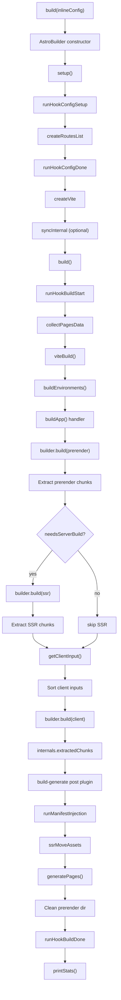
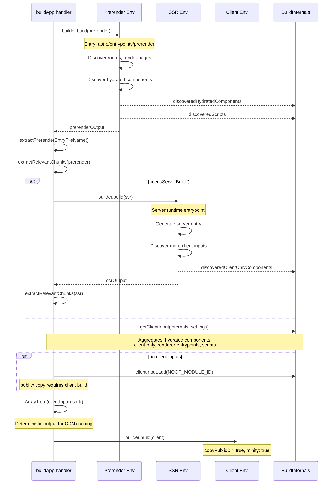

# Build Pipeline: Three-Environment Sequential Build

Astro's build pipeline is a multi-phase orchestration that compiles `.astro` components, framework components, and assets into deployable output through **three sequential Vite environments**: prerender, SSR, and client. The build is driven by the `AstroBuilder` class which coordinates hook execution, route discovery, Vite bundling, page generation, and asset management into a single cohesive pipeline that produces either static HTML files or a server-rendered application depending on the output mode.

## Core Concept

The build pipeline transforms an Astro project into deployable output by running three Vite build environments sequentially. The prerender environment generates static pages, the SSR environment produces server runtime code, and the client environment bundles hydrated components. The sequential order is mandatory: client inputs (hydrated components, client-only scripts) are discovered during SSR/prerender builds, so the client environment must be built last.

## AstroBuilder: The Build Orchestrator

Source: `packages/astro/src/core/build/index.ts` — `AstroBuilder` class, lines 97-323

The `AstroBuilder` class is the central coordinator for the entire build process. It is instantiated by the public `build()` function and executes through three phases: setup, build, and statistics reporting.

### Constructor and Initialization

```typescript
// packages/astro/src/core/build/index.ts:97-118
export class AstroBuilder {
	private settings: AstroSettings;
	private logger: AstroLogger;
	private mode: string;
	private runtimeMode: RuntimeMode;
	private origin: string;
	private routesList: RoutesList;
	private timer: Record<string, number>;
	private sync: boolean;

	constructor(settings: AstroSettings, options: AstroBuilderOptions) {
		this.mode = options.mode;
		this.runtimeMode = options.runtimeMode;
		this.settings = settings;
		this.logger = options.logger;
		this.sync = options.sync ?? true;
		this.origin = settings.config.site
			? new URL(settings.config.site).origin
			: `http://localhost:${settings.config.server.port}`;
		this.routesList = options.routesList ?? { routes: [] };
		this.timer = {};
	}
}
```

The constructor stores configuration but defers all work. The `origin` is derived from `config.site` or falls back to the dev server address. An optional pre-built `routesList` can be injected to skip filesystem scanning, useful for in-memory testing. The `sync` flag controls whether type generation runs (defaults to `true`).

### Setup Phase

The `setup()` method (line 121) runs four critical initialization steps in order:

1. **`runHookConfigSetup`** — Invokes the `astro:config:setup` integration hook with `command: 'build'`. Integrations can modify settings, add adapters, register renderers, and inject plugins during this phase.

2. **`createRoutesList`** — Scans the filesystem to discover all routes from `src/pages/`, including dynamic routes with `[param]` and `[...slug]` patterns. Skipped entirely if `routesList` was pre-populated in the constructor.

3. **`runHookConfigDone`** — Fires `astro:config:done`, giving integrations a final chance to inspect the resolved configuration before Vite is created.

4. **`createVite`** — Builds the base Vite `InlineConfig` with `middlewareMode: true` and `hmr: false`. The HMR server is never needed during a build.

5. **`syncInternal`** — Generates TypeScript types and internal manifest files. Skipped when `sync: false` is passed.

After setup, the builder determines the build output mode:

```typescript
// packages/astro/src/core/build/index.ts:130
this.settings.buildOutput = getPrerenderDefault(this.settings.config) ? 'static' : 'server';
```

If the output is `'server'` but no adapter is installed, an `AstroError` with `NoAdapterInstalled` is thrown immediately.

### Build Phase

The `build()` method (line 177) executes the actual compilation:

1. **`runHookBuildStart`** — Fires `astro:build:start`. Integrations receive final settings and can prepare build-side resources.

2. **Config validation** — `validateConfig()` checks that `outDir` is not the same as `root`. Writing output to the project root would destroy source files.

3. **`collectPagesData`** — Examines the routes list and builds an `AllPagesData` map. Each route gets a unique key via `makePageDataKey()`. Default components like `404.astro` are excluded (they get special SSR handling), but `500.astro` is included so its styles are properly bundled.

4. **`viteBuild()`** — The core bundling function. Empties the output directory (unless `emptyOutDir: false`), then calls `buildEnvironments()` to run the three-environment sequential build.

5. **Asset persistence** — Any additionally generated assets (from `assets` map) are written to disk with their computed paths.

### Post-Build and Statistics

After `viteBuild()` completes:

1. **`runHookBuildDone`** — Fires `astro:build:done` with the list of built pages and routes. This is the final integration hook in the lifecycle.

2. **`printStats()`** — Outputs timing information. Static builds show page count and total time; server builds show just total time.

The entire flow is wrapped in a try/finally that writes benchmark stats via `settings.timer.writeStats()`.

## Three-Environment Sequential Build

Source: `packages/astro/src/core/build/static-build.ts` — `buildEnvironments()` function, lines 157-323

The heart of Astro's build system is the three-environment sequential build. Each environment has a distinct purpose and must run in a specific order.

### Environment Names and Purposes

| Environment | Constant | Purpose | Output Directory |
|---|---|---|---|
| Prerender | `ASTRO_VITE_ENVIRONMENT_NAMES.prerender` | Static page generation | `.prerender/` (in server dir) |
| SSR | `ASTRO_VITE_ENVIRONMENT_NAMES.ssr` | Server runtime entrypoint | `server/` directory |
| Client | `ASTRO_VITE_ENVIRONMENT_NAMES.client` | Hydrated components, client scripts | `client/` directory (or `outDir` for static) |

### Why Sequential, Not Parallel

The build environments cannot run in parallel because of data dependencies between them. During the prerender and SSR builds, Astro discovers which components need client-side JavaScript:

- Components with `client:*` hydration directives (`client:load`, `client:visible`, etc.)
- `client:only` components that exist only in the browser
- Renderer client entrypoints (React, Vue, Svelte, etc.)
- Page-level scripts (`<script>` tags in `.astro` files)

These discoveries populate `internals.discoveredHydratedComponents`, `internals.discoveredClientOnlyComponents`, `internals.discoveredScripts`, and renderer entrypoints. The `getClientInput()` function (line 480) aggregates these into the client build's input set. Since this data is only available after SSR/prerender run, the client build must come last.

### Mermaid Diagram: Build Flow



### Mermaid Diagram: Three-Environment Sequence



## Prerender Environment

The prerender environment is built first. Its entry point is `'astro/entrypoints/prerender'` (configurable via `rolldownOptions.input` in `createViteBuildConfig`). This entrypoint creates a module that can render all prerenderable routes.

```typescript
// packages/astro/src/core/build/vite-build-config.ts:147-165
[ASTRO_VITE_ENVIRONMENT_NAMES.prerender]: {
	build: {
		emitAssets: true,
		outDir: fileURLToPath(getPrerenderOutputDirectory(settings)),
		rolldownOptions: {
			...(!legacyAdapter && settings.prerenderer
				? {}
				: { input: 'astro/entrypoints/prerender' }),
			output: {
				entryFileNames: `${PRERENDER_ENTRY_FILENAME_PREFIX}.[hash].mjs`,
				format: 'esm',
			},
		},
		ssr: true,
	},
},
```

The prerender entry filename uses the pattern `prerender-entry.[hash].mjs` (defined as `PRERENDER_ENTRY_FILENAME_PREFIX` at line 36 of `static-build.ts`). After the prerender build completes, `extractPrerenderEntryFileName()` scans the output for this file and stores the name in `internals.prerenderEntryFileName` for later use during page generation.

Assets are emitted (`emitAssets: true`) and written to the `.prerender/` subdirectory within the server output directory. This is a temporary location — assets are later moved to the client directory by `ssrMoveAssets()`.

## SSR Environment

The SSR environment builds second, but only when `needsServerBuild()` returns `true`:

```typescript
// packages/astro/src/core/build/static-build.ts:507-515
function needsServerBuild(
	settings: StaticBuildOptions['settings'],
	builder: vite.ViteBuilder,
): boolean {
	if (settings.buildOutput === 'server') {
		return true;
	}
	return hasServerIslands(builder.environments.prerender as vite.BuildEnvironment);
}
```

The SSR build is required when:
- The build output mode is `'server'` (explicit SSR mode)
- Server islands were discovered during prerender (even for static sites with some SSR-only features)

For legacy adapters (no adapter or one without modern `entrypointResolution`), the SSR input defaults to `LEGACY_SSR_ENTRY_VIRTUAL_MODULE`. Modern adapters with `entrypointResolution: 'auto'` provide their own entrypoint through `rolldownOptions.input`.

The SSR output goes to the server directory. Like prerender, it runs with `ssr: true` and emits assets. The server entrypoint filename is set to `settings.config.build.serverEntry` (typically `entry.mjs`).

## Client Environment

The client environment builds last and is the only one with real minification and public directory copying:

```typescript
// packages/astro/src/core/build/vite-build-config.ts:166-205
[ASTRO_VITE_ENVIRONMENT_NAMES.client]: {
	build: {
		emitAssets: true,
		target: 'esnext',
		outDir: fileURLToPath(getClientOutputDirectory(settings)),
		copyPublicDir: true,
		sourcemap: false,  // unless explicitly configured
		minify: true,       // unless explicitly configured
		rolldownOptions: {
			preserveEntrySignatures: 'exports-only',
			output: {
				entryFileNames: `${settings.config.build.assets}/${cleanChunkName(chunkInfo.name)}.[hash].js`,
				chunkFileNames: `${settings.config.build.assets}/${cleanChunkName(chunkInfo.name)}.[hash].js`,
				assetFileNames: `${settings.config.build.assets}/[name].[hash][extname]`,
			},
		},
	},
},
```

### getClientInput: Discovering Client Modules

```typescript
// packages/astro/src/core/build/static-build.ts:480-500
function getClientInput(
	internals: BuildInternals,
	settings: StaticBuildOptions['settings'],
): Set<string> {
	const rendererClientEntrypoints = settings.renderers
		.map((r) => r.clientEntrypoint)
		.filter((a) => typeof a === 'string') as string[];

	const clientInput = new Set([
		...internals.discoveredHydratedComponents.keys(),
		...internals.discoveredClientOnlyComponents.keys(),
		...rendererClientEntrypoints,
		...internals.discoveredScripts,
	]);

	if (settings.scripts.some((script) => script.stage === 'page')) {
		clientInput.add(PAGE_SCRIPT_ID);
	}

	return clientInput;
}
```

This function aggregates all client-side module IDs from four sources:

1. **Hydrated components** — Components with `client:*` directives discovered during SSR/prerender rendering. Keys are resolved file paths, values are exported names.

2. **Client-only components** — Components with `client:only` that have no server-side representation.

3. **Renderer entrypoints** — Each framework renderer (React, Vue, Svelte, Solid, etc.) provides a client-side runtime entrypoint for hydration support.

4. **Discovered scripts** — `<script>` tags found in `.astro` components during the SSR build.

### NOOP_MODULE_ID: The Placeholder Build

When no client inputs exist (a fully static site with zero hydration), the client build would normally be skipped. However, the `public/` folder is copied during the client build via `copyPublicDir: true`. To satisfy Rolldown's requirement of at least one input, a noop placeholder is used:

```typescript
// packages/astro/src/core/build/plugins/plugin-noop.ts:1-39
export const NOOP_MODULE_ID = 'virtual:astro:noop';
const RESOLVED_NOOP_MODULE_ID = '\0' + NOOP_MODULE_ID;

export function pluginNoop(): vite.Plugin {
	return {
		name: 'plugin-noop',
		resolveId: { handler() { return RESOLVED_NOOP_MODULE_ID; } },
		load: { handler() { return 'export const noop = {};'; } },
		generateBundle(_options, bundle) {
			// Delete this bundle so it's not written to disk.
			for (const [name, chunk] of Object.entries(bundle)) {
				if (chunk.type === 'asset') continue;
				if (chunk.facadeModuleId === RESOLVED_NOOP_MODULE_ID) {
					delete bundle[name];
				}
			}
		},
	};
}
```

The noop plugin resolves `virtual:astro:noop` to an empty module (`export const noop = {};`), then deletes the resulting chunk from the bundle during `generateBundle`. The build runs, the public directory is copied, and the placeholder is cleaned up — all without leaving artifacts on disk.

**Aha:** The noop module is a clever workaround for Rolldown's requirement that at least one input must exist. Without it, Astro would need a separate code path just to copy the public folder, duplicating the copy logic and creating a maintenance burden. Instead, the noop module lets the existing `copyPublicDir` mechanism do its job with zero additional code.

### Sorted Client Input: Deterministic Output

```typescript
// packages/astro/src/core/build/static-build.ts:296-301
const sortedClientInput = Array.from(internals.clientInput).sort();
builder.environments.client.config.build.rolldownOptions.input = sortedClientInput;
```

The `internals.clientInput` Set has non-deterministic iteration order because entries are added during async module resolution. Without sorting, two builds of identical source code could produce chunks with different filenames (e.g., `Counter-abc123.js` vs `Timer-def456.js` as the first entry). This breaks CDN cache friendliness. Sorting the input alphabetically ensures consistent entry ordering across builds.

## Build Flow: viteBuild → buildEnvironments → builder.buildApp

The complete build execution chain is:

1. **`viteBuild(opts)`** (`static-build.ts:86`) — Entry point for Vite bundling. Creates `BuildInternals`, collects page inputs, empties the output directory, then delegates to `buildEnvironments()`.

2. **`buildEnvironments(opts, internals)`** (`static-build.ts:157`) — Assembles build plugins via `getAllBuildPlugins()`, creates the Vite build config via `createViteBuildConfig()`, adds the `astro:resolve-input` and `astro:build-generate` plugins, creates a `ViteBuilder` via `vite.createBuilder()`, and calls `builder.buildApp()`.

3. **`builder.buildApp()`** — Invokes the top-level `buildApp` handler registered by the `astro:build-generate` plugin. This handler runs the sequential environment builds and post-build processing.

### Build Plugins Assembly

```typescript
// packages/astro/src/core/build/plugins/index.ts:19-39
export function getAllBuildPlugins(
	internals: BuildInternals,
	options: StaticBuildOptions,
): Array<VitePlugin | VitePlugin[] | undefined> {
	return [
		pluginComponentEntry(internals),
		pluginAnalyzer(internals),
		pluginInternals(options, internals),
		pluginMiddleware(options, internals),
		vitePluginActionsBuild(options, internals),
		pluginCssTargetLowering(),
		...pluginCSS(options, internals),
		astroHeadBuildPlugin(internals),
		pluginPrerender(options, internals),
		pluginScripts(internals),
		...pluginSSR(options, internals),
		pluginNoop(),
		vitePluginSSRAssets(internals),
		pluginChunkImports(options),
	].filter(Boolean);
}
```

Fourteen build plugins are assembled, covering component entry generation, CSS handling, head management, prerender support, script processing, SSR handling, asset tracking, and chunk import management. These plugins run across all three environments and communicate through the shared `BuildInternals` object.

## Post-Build Processing: Manifest Injection and Page Generation

After all three environments complete, the `astro:build-generate` post plugin (registered at `static-build.ts:187-226`) runs:

### runManifestInjection

```typescript
// packages/astro/src/core/build/static-build.ts:367-392
async function runManifestInjection(
	opts: StaticBuildOptions,
	internals: BuildInternals,
	chunks: ExtractedChunk[],
	buildPostHooks: BuildPostHook[],
) {
	const mutations = new Map<string, { code: string; prerender: boolean }>();

	const mutate = (fileName: string, newCode: string, prerender: boolean) => {
		mutations.set(fileName, { code: newCode, prerender });
	};

	await manifestBuildPostHook(opts, internals, { chunks, mutate });
	await contentAssetsBuildPostHook(opts.settings.config.base, opts.settings.config.build.assetsPrefix, internals, { chunks, mutate });

	for (const buildPostHook of buildPostHooks) {
		await buildPostHook({ chunks, mutate });
	}

	await writeMutatedChunks(opts, mutations);
}
```

This function performs two injections:

1. **Manifest injection** — `manifestBuildPostHook` replaces the `SERIALIZED_MANIFEST_RESOLVED_ID` placeholder in chunks with the actual serialized route manifest. The manifest contains route patterns, prerender flags, and other metadata needed at runtime.

2. **Content asset injection** — `contentAssetsBuildPostHook` replaces the `LINKS_PLACEHOLDER` placeholder with content layer asset data.

After injection, `writeMutatedChunks()` writes the modified chunk code to the appropriate output directory (prerender or server based on the `prerender` flag).

### ExtractedChunk: Memory-Efficient Chunk Handling

```typescript
// packages/astro/src/core/build/static-build.ts:38-47
export interface ExtractedChunk {
	fileName: string;
	code: string;
	moduleIds: string[];
	prerender: boolean;
}
```

After each environment build completes, `extractRelevantChunks()` (line 58) scans the Rolldown output and extracts only the chunks that need post-build injection. A chunk needs injection if it contains:
- `LINKS_PLACEHOLDER` (content layer assets)
- `SERIALIZED_MANIFEST_RESOLVED_ID` (route manifest)
- `SERVER_ISLAND_MAP_MARKER` (server islands)

**Aha:** By extracting only the relevant chunks and then setting the full `RolldownOutput` objects to `undefined`, Astro releases the complete bundle data for garbage collection before the post-build phase runs. Large sites with hundreds of chunks can hold significant memory in the bundle output. This selective extraction keeps memory usage proportional to the number of chunks that actually need modification, not the total number of output files.

### generatePages: Rendering Prerendered Pages

Source: `packages/astro/src/core/build/generate.ts` — `generatePages()` function, lines 40-334

The `generatePages()` function renders each prerenderable route to HTML:

1. **Prerenderer setup** — Either uses a custom prerenderer from `settings.prerenderer`, or creates the default prerenderer. The prerenderer provides `setup()`, `getStaticPaths()`, `render()`, and `teardown()` methods.

2. **Path filtering** — `getStaticPaths()` returns all paths with their routes. These are filtered to remove duplicates (higher-priority routes win) and check for i18n domain conflicts (prerendered routes are incompatible with i18n domains).

3. **Concurrent rendering** — When `config.build.concurrency > 1`, paths are processed in batches of 100,000 with `p-limit`. This avoids V8's `Promise.all` element limit of ~123k items. Single-concurrency mode processes paths sequentially.

4. **Per-path rendering** — `generatePathWithPrerenderer()` calls `prerenderer.render()` with a constructed request, handles the response (HTML body, redirects, error pages), computes output paths via `getOutFolder()` and `getOutFile()`, checks for public directory conflicts, and writes the result to disk.

5. **Image optimization** — After all pages are rendered, collected static images are optimized through the asset generation pipeline. Images are processed per source file with transforms running sequentially to minimize context switching.

6. **Hook and cleanup** — `runHookBuildGenerated()` fires, then the prerenderer is torn down.

### ssrMoveAssets: Consolidating Scattered Assets

```typescript
// packages/astro/src/core/build/static-build.ts:429-478
async function ssrMoveAssets(
	opts: StaticBuildOptions,
	internals: BuildInternals,
	prerenderOutputDir: URL,
) {
	// ... move prerender assets
	const prerenderAssetsToMove = getSSRAssets(internals, ASTRO_VITE_ENVIRONMENT_NAMES.prerender);
	// ... move SSR assets
	const ssrAssetsToMove = getSSRAssets(internals, ASTRO_VITE_ENVIRONMENT_NAMES.ssr);
	// ...
}
```

During the build, assets from the prerender and SSR environments land in separate directories. `ssrMoveAssets()` consolidates them into the client directory. In static mode, the client directory is `outDir` itself (unless the adapter sets `preserveBuildClientDir`). In server mode, it's `config.build.client`.

The asset filenames to move are tracked in `internals.ssrAssetsPerEnvironment`, populated by `vitePluginSSRAssets` during the build. Files are moved in parallel via `Promise.all()`.

### Prerender Directory Cleanup

After page generation and asset moves complete, the `.prerender/` temporary directory is removed:

```typescript
// packages/astro/src/core/build/static-build.ts:213
await fs.promises.rm(prerenderOutputDir, { recursive: true, force: true });
```

This ensures no intermediate build artifacts leak into the final output.

## Output Modes

### Static Mode

All pages are prerendered. The output directory (`outDir`) contains:
- HTML files for each route
- Assets in `_astro/` directory
- Public folder contents

No server entrypoint is generated. The site can be served by any static file server (CDN, S3, GitHub Pages, etc.).

### Server Mode

An SSR entrypoint is generated alongside prerendered pages. The output contains:
- `entry.mjs` (or configured `serverEntry`) — Server runtime that handles requests
- `_astro/` — Client-side assets
- Prerendered HTML pages for static routes
- Server directory with SSR chunks

An adapter is required. The adapter provides the server entrypoint and platform-specific runtime (Node.js, Cloudflare Workers, Vercel Edge, etc.).

### needsServerBuild Logic

Even in static mode, the SSR build may run if server islands are present:

```typescript
function needsServerBuild(settings, builder): boolean {
	if (settings.buildOutput === 'server') {
		return true;
	}
	return hasServerIslands(builder.environments.prerender);
}
```

This allows static sites to use server-side features (like server islands for streaming component rendering) while keeping most pages prerendered.

## Build Options

### devOutput Flag

```typescript
// packages/astro/src/core/build/index.ts:34-42
interface BuildOptions {
	devOutput?: boolean;
}
```

When `devOutput: true`, the build sets `NODE_ENV=development` instead of `production`. This includes development-mode debugging information in the output, useful for diagnosing build-only issues that don't appear in dev server mode. The `runtimeMode` is set to `'development'` which affects how components are compiled.

### force Flag

```typescript
// packages/astro/src/core/build/index.ts:67-70
if (inlineConfig.force) {
	await clearContentLayerCache({ settings, logger, fs, isDev: false });
}
```

When `force: true`, the content layer cache is cleared before the build starts. This ensures that content collections are rebuilt from source rather than using cached data. Equivalent to the `--force` CLI flag.

### sync Flag

```typescript
// packages/astro/src/core/build/index.ts:91-94
sync?: boolean;  // defaults to true
```

Controls whether `syncInternal()` runs during setup. When `sync: false`, TypeScript type generation and internal manifest file creation are skipped. This is useful for in-memory builds or CI pipelines that don't need type checking.

## BuildInternals: Shared State Across Environments

Source: `packages/astro/src/core/build/internal.ts` — `BuildInternals` interface, lines 7-126

The `BuildInternals` object is the shared state container that flows data between the three build environments:

| Field | Purpose |
|---|---|
| `cssModuleToChunkIdMap` | CSS module chunk IDs from SSR, reused by client build for consistent naming |
| `inlinedScripts` | Scripts that were inlined into HTML, keyed by their resolved URL |
| `entrySpecifierToBundleMap` | Maps entry specifiers (like `astro/client/idle.js`) to hashed bundle names |
| `pagesByKeys` | Page data indexed by unique key |
| `pagesByViteID` | Page data indexed by Vite module ID |
| `discoveredHydratedComponents` | Components with `client:*` directives, mapped to export names |
| `discoveredClientOnlyComponents` | `client:only` components mapped to export names |
| `discoveredScripts` | Scripts found in `.astro` files |
| `clientInput` | Aggregated client build inputs (Set) |
| `ssrAssetsPerEnvironment` | Assets to move from SSR/prerender to client dir |
| `extractedChunks` | Chunks needing post-build injection (manifest, content) |
| `prerenderEntryFileName` | Filename of the prerender entry chunk |

## makeAstroPageEntryPointFileName

```typescript
// packages/astro/src/core/build/static-build.ts:535-549
export function makeAstroPageEntryPointFileName(
	prefix: string,
	facadeModuleId: string,
	routes: RouteData[],
) {
	const pageModuleId = facadeModuleId
		.replace(prefix, '')
		.replace(ASTRO_PAGE_EXTENSION_POST_PATTERN, '.');
	const route = routes.find((routeData) => routeData.component === pageModuleId);
	const name = route?.route ?? pageModuleId;
	return `pages${name
		.replace(/\/$/, '/index')
		.replaceAll(/[[\]]/g, '_')
		.replaceAll('...', '---')}.astro.mjs`;
}
```

This function transforms virtual module names into final `.mjs` output filenames. It strips the `@astro-page:` prefix, removes the `@_@astro` extension-masking pattern, finds the matching route, and sanitizes the path by replacing `/` endings with `/index`, square brackets with underscores, and `...` with `---`. For example, `@astro-page:src/pages/index@_@astro` becomes `pages/index.astro.mjs`, and `@astro-page:src/pages/[slug]@_@astro` becomes `pages/_slug_.astro.mjs`.

## Cross-References

- [Vite Plugins](04-vite-plugins.html) — Details on the 14 build plugins assembled by `getAllBuildPlugins()`
- [SSR Runtime](06-ssr-runtime.html) — How the SSR entrypoint generated by this build handles requests at runtime
- [Integration API](07-integration-api.html) — Full documentation of `astro:build:start`, `astro:build:done`, and other build lifecycle hooks
- [Islands Hydration](09-islands-hydration.html) — How hydrated components discovered during the build are hydrated in the browser
- [Configuration & Routing](02-config-routing.html) — How routes are resolved by `createRoutesList()` during build setup
