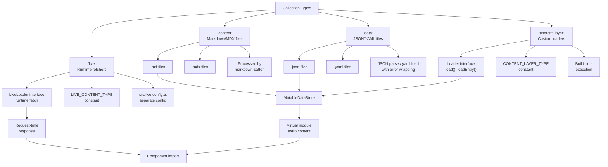
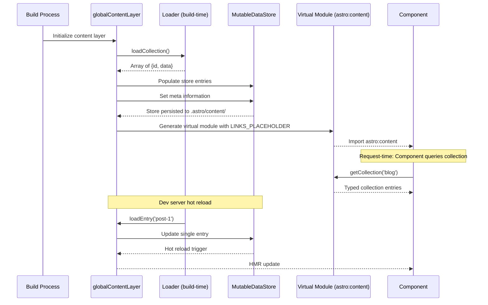

# Astro 7.0.4: Content Collections

Content Collections are Astro's type-safe content management system. They let developers define structured data schemas with Zod, validate every content entry against those schemas, and query typed collections from components and pages. The system supports four collection types — content files, data files, custom loaders, and runtime live data — all unified behind a single API. Content Collections are configured in `src/content/config.ts`, validated at build time, and exposed through virtual modules that components import as `astro:content`.

**Source:** [withastro/astro](https://github.com/withastro/astro) v7.0.4 | [`packages/astro/src/content/`](https://github.com/withastro/astro/tree/main/packages/astro/src/content/)

---

## Collection Types

Astro's content system supports four distinct collection types, each serving a different data source and lifecycle.

| Type | Constant | Data Source | Lifecycle | Use Case |
|------|----------|-------------|-----------|----------|
| `'content'` | default | `.md`, `.mdx` files in `src/content/` | Build-time | Blog posts, docs pages |
| `'data'` | default | `.json`, `.yaml` files in `src/content/` | Build-time | Site metadata, navigation data |
| `'content_layer'` | `CONTENT_LAYER_TYPE` | Custom loaders (CMS API, headless DB) | Build-time | CMS-driven content, external APIs |
| `'live'` | `LIVE_CONTENT_TYPE` | Runtime fetchers | Request-time | Real-time data, user-specific content |

The `'content'` and `'data'` types are the most common. They read files from `src/content/<collection-name>/` and parse them automatically. Markdown entries are processed through Astro's markdown renderer (markdown-escapes via the markdown-satteri pipeline). JSON entries are parsed with `JSON.parse`, wrapped in `DataCollectionEntryParseError` on failure. YAML entries are parsed with `yaml.load`, with errors formatted via `formatYAMLException`.

The `'content_layer'` type enables custom data loaders. Instead of reading from the file system, a loader function fetches data from any source — a headless CMS, a REST API, a database. The loader implements the `Loader` interface with `load()` and `loadEntry()` methods.

The `'live'` type defers fetching to request time. Live collections use `defineLiveCollection()` and are configured separately in `src/live.config.ts`. They implement the `LiveLoader` interface, fetching data on each request rather than at build time.



---

## Collection Definition

Collections are defined using `defineCollection()` in `src/content/config.ts`. The function takes a configuration object that specifies the collection's type, schema, and optional loader.

### defineCollection()

The `defineCollection()` function is the primary API for declaring collections. It is exported from `packages/astro/src/content/config.ts`.

```typescript
// packages/astro/src/content/config.ts
export function defineCollection<
  TSchema extends BaseSchema | DataSchema,
>(config: CollectionConfig<TSchema>): CollectionConfig<TSchema> {
  return config;
}
```

The function is a typed identity function — it returns its input unchanged but provides type inference for the collection's schema. The generic parameter `TSchema` extends `BaseSchema` (for content collections) or `DataSchema` (for data collections).

**`BaseSchema`** is defined as `zCore.$ZodType` — the Zod v4 base type. Content collections use this schema to validate the frontmatter of markdown entries.

**`DataSchema`** is similarly a Zod type, used to validate the structure of data entries (JSON/YAML files).

### defineLiveCollection()

Live collections use a separate function, `defineLiveCollection()`, also exported from `packages/astro/src/content/config.ts`. This function configures collections that fetch data at request time.

```typescript
// packages/astro/src/content/config.ts
export function defineLiveCollection<
  TSchema extends BaseSchema | DataSchema,
>(config: LiveCollectionConfig<TSchema>): LiveCollectionConfig<TSchema> {
  return config;
}
```

Live collections must be configured in `src/live.config.ts` — a separate file from the main content config. This separation ensures that build-time and runtime collection configurations are isolated. The `LIVE_CONTENT_TYPE` constant (from `packages/astro/src/content/consts.ts`) identifies live collections in the runtime.

### Schema Definition

Schemas are defined using Zod v4. Each collection has a `schema` property that validates entries:

```typescript
// src/content/config.ts
import { defineCollection, z } from 'astro:content';

const blog = defineCollection({
  type: 'content',
  schema: z.object({
    title: z.string(),
    date: z.date(),
    tags: z.array(z.string()),
    image: z.image(),  // ImageFunction type
  }),
});

export const collections = { blog };
```

### ImageFunction Type

The `z.image()` method creates an `ImageFunction` — a Zod schema specifically for image fields. The resolved type is a `ZodObject` with the following shape:

```typescript
// ImageFunction — resolved type
{
  src: z.string(),      // Image path or data URL
  width: z.number(),    // Image width in pixels
  height: z.number(),   // Image height in pixels
  format: z.union([     // Image format enumeration
    z.literal('png'),
    z.literal('jpg'),
    z.literal('jpeg'),
    z.literal('tiff'),
    z.literal('webp'),
    z.literal('gif'),
    z.literal('svg'),
    z.literal('avif'),
  ]),
}
```

This schema validates that image fields contain all required metadata — path, dimensions, and format. The `ImageFunction` type is part of `SchemaContext`, which provides helpers available during schema resolution.

### SchemaContext

The `SchemaContext` type provides context available during schema validation:

```typescript
// SchemaContext
interface SchemaContext {
  image: ImageFunction;  // Helper for image schema fields
}
```

When defining schemas, the `image` helper is available via the context, enabling `z.image()` shorthand. This context is passed during schema parsing, allowing the schema to resolve image references relative to the content file's location.

**Source:** `packages/astro/src/content/config.ts` — `defineCollection()`, `defineLiveCollection()`, `SchemaContext`, `BaseSchema`

---

## Content Config File

The content config file at `src/content/config.ts` is the single source of truth for collection definitions. Astro validates that all collections used in the project are defined in this file. Collections referenced in code but not declared in the config file produce build errors.

### getImporterFilename()

The `getImporterFilename()` function extracts the caller's location from the JavaScript stack trace. This is used to provide accurate error messages when content entries fail validation.

```typescript
// Stack trace extraction — finds the caller's file location
function getImporterFilename(): string | undefined {
  const stack = new Error().stack;
  if (!stack) return undefined;
  // Parse the stack to find the caller frame
  // Returns the file path of the importing module
  const lines = stack.split('\n');
  // ... frame extraction logic
}
```

This function creates a new `Error` object, reads its `.stack` property, and parses the stack trace to find the calling module's file path. The extracted filename is used in error messages like "Entry at `src/content/blog/post.md` failed schema validation" — telling the developer exactly which file caused the problem.

**Aha:** The stack trace extraction is a clever workaround for JavaScript's lack of a `__FILE__` macro. Instead of requiring callers to pass their file path explicitly, `getImporterFilename()` captures it automatically from the call stack. This means error messages are always precise without any boilerplate from the developer. The same pattern appears in many Node.js tooling libraries, but Astro uses it specifically to tie schema validation errors back to content files.

### Collection Validation

When Astro starts a build or dev server, it validates that:

1. The content config file exists at `src/content/config.ts`
2. All referenced collections are defined in the exported `collections` object
3. Each collection has a valid schema
4. Each content entry matches its collection's schema

Validation errors include the file path (from `getImporterFilename()`), the schema field that failed, and the actual value that was rejected.

### Live Config Separation

Live collections must be defined in `src/live.config.ts` rather than the main content config. This separation serves two purposes:

1. **Build-time isolation:** The main content config is processed during the build. Live collections should not affect build output since they fetch at request time.
2. **Runtime clarity:** Developers can immediately see which collections are runtime-dependent by looking at `src/live.config.ts`.

The `LIVE_CONTENT_TYPE` constant identifies live collections in the runtime system.

**Source:** `packages/astro/src/content/config.ts` — config file validation, `getImporterFilename()`

---

## Data Entry Types

Astro handles different data entry types with specialized parsers. Each parser wraps the raw parsing in error handling that produces actionable messages.

### JSON Data Entries

JSON files are parsed using `JSON.parse` with error wrapping:

```typescript
// JSON entry parsing — DataCollectionEntryParseError
try {
  const data = JSON.parse(rawContent);
} catch (e) {
  throw new DataCollectionEntryParseError(entryPath, e);
}
```

The `DataCollectionEntryParseError` class wraps the raw `JSON.parse` error and adds the entry file path. This produces error messages like "Failed to parse JSON entry at `src/content/nav/links.json`: Unexpected token '}' at position 42."

### YAML Data Entries

YAML files are parsed using `yaml.load` (from the `yaml` npm package) with formatted exception handling:

```typescript
// YAML entry parsing — formatYAMLException
import yaml from 'yaml';

try {
  const data = yaml.load(rawContent);
} catch (e) {
  throw new DataCollectionEntryParseError(entryPath, formatYAMLException(e));
}
```

The `formatYAMLException()` function converts the raw YAML parser error into a human-readable message, including the line and column where the parse error occurred. This is important because YAML errors can be cryptic — a missing indentation or stray tab produces confusing messages from the parser that `formatYAMLException()` translates into actionable guidance.

### Markdown Entries

Markdown entries (`.md`, `.mdx`) are processed by the markdown-satteri pipeline. The frontmatter is extracted, parsed against the collection's schema, and the body is rendered to HTML.

### Custom Data Entry Types

Custom data entry types can be registered via `settings.dataEntryTypes`. This allows extensions and integrations to add support for additional file formats beyond JSON, YAML, and Markdown. Each custom entry type specifies a file extension pattern and a parsing function.

**Source:** `packages/astro/src/content/config.ts` — `DataEntry` interface, `DataCollectionEntryParseError`

---

## Content Layer

The content layer is Astro's runtime abstraction over collection data. It provides a unified interface for loading, storing, and querying collection entries regardless of their source (file system, CMS, API).

### CONTENT_LAYER_TYPE Constant

The `CONTENT_LAYER_TYPE` constant (from `packages/astro/src/content/consts.ts`) identifies content layer collections. This constant is used throughout the content system to distinguish loader-driven collections from file-based collections.

### Loader Interface

The `Loader` interface defines the contract for content layer loaders:

```typescript
// packages/astro/src/content/loaders/types.ts
interface Loader {
  load(): Promise<Array<{ id: string; data: any }>>;
  loadEntry(id: string): Promise<{ id: string; data: any }>;
}
```

- **`load()`** — loads all entries in the collection. Called during the build to populate the data store.
- **`loadEntry(id)`** — loads a single entry by ID. Used for targeted re-validation and dev server hot reloading.

The `LiveLoader` interface extends this for runtime fetching:

```typescript
// packages/astro/src/content/loaders/types.ts
interface LiveLoader {
  load(): Promise<Array<{ id: string; data: any }>>;
  loadEntry(id: string): Promise<{ id: string; data: any }>;
}
```

Live loaders execute at request time rather than build time, enabling real-time data.

### MutableDataStore

The `MutableDataStore` class (from `packages/astro/src/content/mutable-data-store.ts`) is the runtime data store for collection entries. It provides a mutable, in-memory store that loaders write to during the build.

```typescript
// packages/astro/src/mutable-data-store.ts
class MutableDataStore {
  static fromFile(filePath: string): MutableDataStore;

  // DataStore interface
  get(id: string): any | undefined;
  set(id: string, value: any): void;
  entries(): Iterable<[string, any]>;
  values(): Iterable<any>;
  keys(): Iterable<string>;
  delete(id: string): boolean;
  clear(): void;
  has(id: string): boolean;

  // MetaStore interface
  meta: {
    get(key: string): any | undefined;
    set(key: string, value: any): void;
    delete(key: string): boolean;
    has(key: string): boolean;
  };
}
```

The `MutableDataStore.fromFile()` static method creates a store instance from a serialized file on disk. This enables the build to persist collection data between runs and supports the dev server's hot reload cycle.

### globalContentLayer

The `globalContentLayer` singleton (from `packages/astro/src/content/instance.ts`) is the single instance of the content layer for the entire Astro process. It coordinates loaders, manages the data store, and serves as the bridge between build-time and runtime.

```typescript
// packages/astro/src/content/instance.ts
const globalContentLayer: ContentLayer = new ContentLayer();
```

All collection operations flow through this singleton. During the build, it executes loaders and populates the `MutableDataStore`. At runtime, it serves data from the store to components importing `astro:content`.

### getDataStoreFile()

The `getDataStoreFile()` function (from `packages/astro/src/content/content-layer.ts`) determines the file path for the serialized data store. The store is written to `.astro/content/` — the Astro cache directory.

### DataStore Interface

The `DataStore` interface defines the read/write operations for collection data:

```typescript
interface DataStore {
  get(id: string): any | undefined;
  set(id: string, value: any): void;
  entries(): Iterable<[string, any]>;
  values(): Iterable<any>;
  keys(): Iterable<string>;
  delete(id: string): boolean;
  clear(): void;
  has(id: string): boolean;
}
```

### MetaStore Interface

The `MetaStore` interface stores metadata about collections — things like collection type, loader configuration, and validation results:

```typescript
interface MetaStore {
  get(key: string): any | undefined;
  set(key: string, value: any): void;
  delete(key: string): boolean;
  has(key: string): boolean;
}
```

**Source:** `packages/astro/src/content/consts.ts` — `CONTENT_LAYER_TYPE`, `packages/astro/src/content/instance.ts` — `globalContentLayer`, `packages/astro/src/content/mutable-data-store.ts` — `MutableDataStore`, `packages/astro/src/content/content-layer.ts` — `getDataStoreFile()`, `packages/astro/src/content/loaders/types.ts` — `Loader`, `LiveLoader`

---

## Loaders

Loaders are the bridge between external data sources and Astro's content collections. They implement the `Loader` or `LiveLoader` interface to fetch data and populate the collection store.

### Build-Time vs Runtime Loaders

Build-time loaders (`Loader`) execute during `astro build` or `astro dev`. Their output is serialized into the `.astro/` cache directory and served as static data to components.

Runtime loaders (`LiveLoader`) execute on each request. They bypass the build-time cache and fetch fresh data every time a component queries the collection.

### loadCollection() vs loadEntry()

- **`loadCollection()`** — loads all entries in a collection. Used during the initial build to populate the entire data store. Returns an array of `{ id, data }` objects.
- **`loadEntry(id)`** — loads a single entry. Used during dev server hot reload when only one file changed. Returns a single `{ id, data }` object.

The distinction matters for performance. Reloading an entire collection on every file change would be slow for large collections. `loadEntry()` enables targeted re-validation.

### Content Layer Flow



```mermaid
flowchart TD
    subgraph Config["src/content/config.ts"]
        A[defineCollection]
        B[defineLiveCollection]
    end

    subgraph Layer["Content Layer"]
        C[globalContentLayer\nsingleton]
        D[CONTENT_LAYER_TYPE]
        E[LIVE_CONTENT_TYPE]
    end

    subgraph Loaders["Loader System"]
        F["Loader interface\nload(), loadEntry()"]
        G["LiveLoader interface\nruntime fetch"]
        H[loadCollection]
        I[loadEntry]
    end

    subgraph Store["Data Storage"]
        J[MutableDataStore\nfromFile()]
        K[DataStore interface\nget/set/entries/values]
        L[MetaStore interface\nget/set/delete/has]
        M[".astro/content/\ncache directory"]
    end

    subgraph Runtime["Component Access"]
        N["astro:content\nvirtual module"]
        O[LINKS_PLACEHOLDER\ncontent injection]
        P[Content Assets\nvirtual module]
    end

    A --> C
    B --> C
    C --> D
    C --> E
    D --> F
    E --> G
    F --> H
    F --> I
    G --> H
    G --> I
    H --> J
    I --> J
    J --> K
    J --> L
    J --> M
    K --> N
    L --> N
    N --> O
    N --> P
```

---

## Virtual Modules

Astro exposes collection data to components through Vite virtual modules. These are modules that don't exist as files on disk but are generated at build time by Vite plugins.

### astro:content

The primary virtual module is `astro:content`. Components import from this module to access collection data:

```typescript
import { getCollection, getEntry } from 'astro:content';
```

This import is resolved by a Vite plugin that generates the module content at build time. The virtual module exports typed functions that query the data store populated by the content layer.

### LINKS_PLACEHOLDER

The `LINKS_PLACEHOLDER` constant (from `packages/astro/src/content/consts.ts`) is used for content injection into the virtual module. During the build, Astro generates the virtual module code with this placeholder, then replaces it with the actual collection data. This two-phase approach allows the virtual module to be generated before all collection data is available, with the placeholder filled in during a post-processing step.

### Content Assets Virtual Module

The content assets virtual module (from `packages/astro/src/content/vite-plugin-content-assets.ts`) handles asset references within content entries. When a markdown file references an image or other asset, this plugin ensures the asset is included in the build output and the path is resolved correctly.

The `contentAssetsBuildPostHook` function processes assets after the main build, ensuring that content-linked assets are copied to the output directory.

**Source:** `packages/astro/src/content/consts.ts` — `LINKS_PLACEHOLDER`, `packages/astro/src/content/vite-plugin-content-assets.ts` — `contentAssetsBuildPostHook`

---

## Content Paths

### getContentPaths()

The `getContentPaths()` function resolves the content directory for a project. It determines where Astro looks for content files — by default `src/content/` — and where it caches processed content — in `.astro/content/`.

### .astro/ Content Cache Directory

The `.astro/` directory is Astro's internal cache. During the build, processed content is written to `.astro/content/` as serialized data. This cache enables:

1. **Incremental builds:** On subsequent builds, Astro can skip processing entries that haven't changed.
2. **Dev server performance:** The dev server reads from the cache rather than re-parsing files on every request.
3. **Data store persistence:** The `MutableDataStore` is serialized to `.astro/content/` and restored via `MutableDataStore.fromFile()`.

The cache directory structure mirrors the collection structure, with each collection's data stored in a separate file.

---

## Summary

Content Collections unify content management across four types: file-based content and data, loader-driven content layers, and runtime live collections. They are defined with Zod schemas in `src/content/config.ts` (or `src/live.config.ts` for live collections), validated at build time with precise error messages (via `getImporterFilename()` stack trace extraction), stored in a `MutableDataStore` managed by the `globalContentLayer` singleton, and exposed to components through the `astro:content` virtual module.

---

## Cross-References

- [Overview](00-overview.html) — Astro's content-focused philosophy and zero-JS-by-default principle
- [Architecture](01-architecture.html) — Monorepo structure and package organization
- [Configuration & Routing](02-config-routing.html) — AstroConfig schema and file-based routing
- [Component Model](03-component-model.html) — `.astro` components and virtual module system
- [Vite Plugins](04-vite-plugins.html) — Content Vite plugins and their transformations
- [Build Pipeline](05-build-pipeline.html) — How content collections fit into the three-environment build
