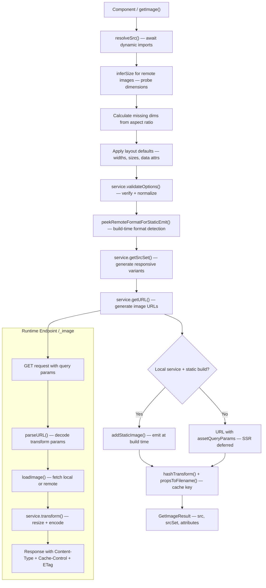
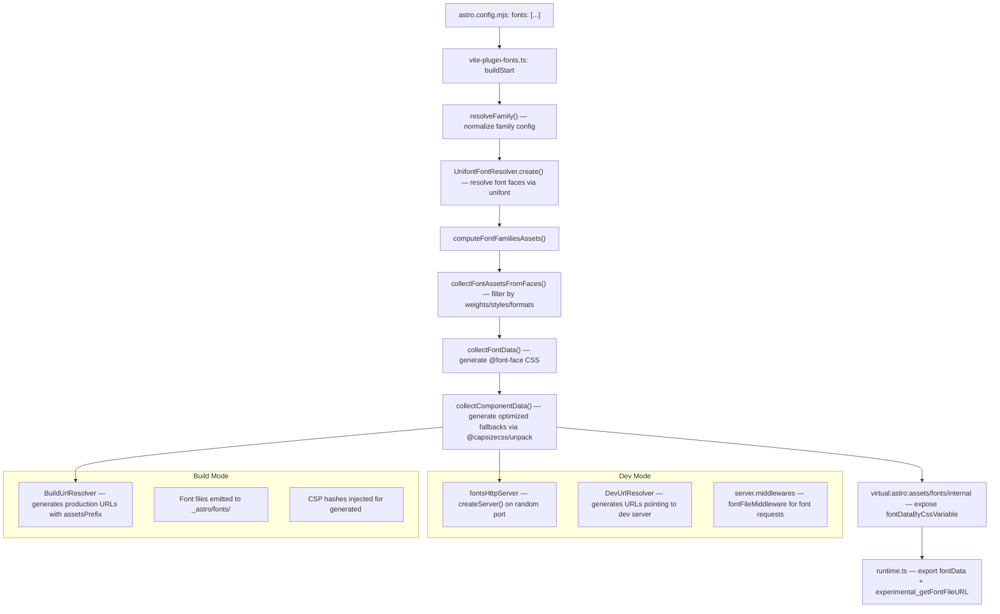

# Astro 7.0.4: Assets and Images

Astro's asset system is built around a pluggable image service architecture that separates the decision of "what transformation to apply" from "how to perform it." The framework ships with a Sharp-based local service, a no-op fallback for platforms without native module support, and a clean `ImageService` interface that external services (Vercel, Cloudinary, etc.) can implement. Images are transformed at build time for static output or on demand through the `/_image` endpoint during development and SSR. Font optimization uses `@capsizecss/unpack` for metrics-based fallback generation and `unifont` for font resolution, with a dedicated HTTP server for serving fonts in development.

**Source:** [withastro/astro](https://github.com/withastro/astro) v7.0.4 | [npm](https://www.npmjs.com/package/astro)

---

## Image Service Architecture

The image system revolves around a single interface: `ImageService`. This interface defines the contract between Astro's image pipeline and whatever backend performs the actual transformations. The architecture splits into two service types: **local** services that run transforms in-process, and **external** services that delegate to a CDN or API.

**Source:** `packages/astro/src/assets/services/service.ts`

### ImageService Interface

```ts
// packages/astro/src/assets/services/service.ts
export type ImageService = LocalImageService | ExternalImageService;
```

The `ImageService` union type distinguishes between two patterns:

| Property | LocalImageService | ExternalImageService |
|----------|-------------------|---------------------|
| `transform` | Required — performs transforms in-process | Not present |
| `parseURL` | Required — decodes endpoint URL back to transform params | Not required |
| `getURL` | Required — generates endpoint URL | Required — generates CDN URL |
| `getHTMLAttributes` | Optional — returns extra HTML attrs | Optional |
| `getSrcSet` | Optional — generates responsive variants | Optional |
| `validateOptions` | Optional — validates and normalizes options | Optional |
| `getRemoteSize` | Optional — probes remote image dimensions | Optional |
| `propertiesToHash` | Optional — properties affecting cache key | Not applicable |

The `isLocalService()` function detects which type a service is by checking for the `transform` method:

```ts
// packages/astro/src/assets/services/service.ts:19
export function isLocalService(service: ImageService | undefined): service is LocalImageService {
	if (!service) {
		return false;
	}
	return 'transform' in service;
}
```

### baseService

Astro provides a `baseService` object that implements the common logic shared by all local services. It handles URL generation, URL parsing, HTML attribute extraction, srcSet generation, and option validation. Custom services extend it by composition:

```ts
// packages/astro/src/assets/services/service.ts:227
export const baseService: Omit<LocalImageService, 'transform'> = {
	propertiesToHash: DEFAULT_HASH_PROPS,
	validateOptions(options) {
		verifyOptions(options);
		if (!options.format) {
			if (isESMImportedImage(options.src)) {
				options.format = resolveDefaultOutputFormat(options.src.format);
			} else {
				const inferred = inferSourceFormat(options.src);
				if (inferred) options.format = resolveDefaultOutputFormat(inferred);
			}
		}
		if (options.width) options.width = Math.round(options.width);
		if (options.height) options.height = Math.round(options.height);
		if (options.layout) delete options.layout;
		if (options.fit === 'none') delete options.fit;
		return options;
	},
	getHTMLAttributes(options) { /* ... */ },
	getSrcSet(options) { /* ... */ },
	getURL(options, imageConfig) { /* ... */ },
	parseURL(url) { /* ... */ },
	getRemoteSize(url, imageConfig) { /* ... */ },
};
```

The `getURL` method encodes transform parameters into query string parameters (`w`, `h`, `q`, `f`, `fit`, `position`, `background`) and appends the `href` parameter containing the image source. The `parseURL` method reverses this encoding.

**Source:** `packages/astro/src/assets/services/service.ts:358-416`

### Sharp Service

The Sharp service is the default image transformation backend. It is an optional peer dependency (`sharp ^0.34.0 || ^0.35.0`) that provides high-performance image processing via libvips.

**Source:** `packages/astro/src/assets/services/sharp.ts`

The Sharp service defines a configuration interface that exposes encoder options for each output format:

```ts
// packages/astro/src/assets/services/sharp.ts:23
export interface SharpImageServiceConfig {
	limitInputPixels?: SharpOptions['limitInputPixels'];
	kernel?: ResizeOptions['kernel'];
	jpeg?: JpegOptions;
	png?: PngOptions;
	webp?: WebpOptions;
	avif?: AvifOptions;
}
```

The quality preset table maps human-readable names to numeric values:

```ts
// packages/astro/src/assets/services/sharp.ts:57
const qualityTable: Record<ImageQualityPreset, number> = {
	low: 25,
	mid: 50,
	high: 80,
	max: 100,
};
```

The `transform` method is the core of the Sharp service. It performs the following steps in order:

1. Lazy-loads Sharp (with cache disabled to avoid race conditions on small files)
2. Detects the input buffer format using the built-in detector
3. Resolves the output format (deferred from `validateOptions` when the format was ambiguous)
4. Passes SVG input through unchanged (unless `dangerouslyProcessSVG` is enabled)
5. Creates a Sharp instance with `failOn: 'none'` and `pages: -1` (for animated images)
6. Calls `rotate()` to correct EXIF orientation
7. Resizes based on width/height with the configured fit mode
8. Applies background flattening if specified
9. Encodes to the target format with resolved encoder options
10. Handles SharedArrayBuffer copying (for WebAssembly builds)

```ts
// packages/astro/src/assets/services/sharp.ts:149
async transform(inputBuffer, transformOptions, config) {
	if (!sharp) sharp = await loadSharp();
	const bufferFormat = detector(inputBuffer);
	const outputFormat = transform.format ?? resolveDefaultOutputFormat(bufferFormat);

	// SVG pass-through
	if (outputFormat === 'svg') {
		if (bufferFormat && bufferFormat !== 'svg') {
			console.warn(`⚠️  Astro expected an SVG for "${transform.src}" but the source is ${bufferFormat}.`);
			return { data: inputBuffer, format: bufferFormat as ImageOutputFormat };
		}
		return { data: inputBuffer, format: 'svg' };
	}

	if (bufferFormat === 'svg' && !config.dangerouslyProcessSVG) {
		throw new AstroError({
			...AstroErrorData.UnsupportedImageFormat,
			message: `SVG image processing is disabled, but the source for "${transform.src}" is an SVG. Pass it through unchanged by setting \`format="svg"\` on the component, or set \`image.dangerouslyProcessSVG: true\` to rasterize SVG sources.`,
		});
	}

	const result = sharp(inputBuffer, {
		failOn: 'none',
		pages: -1,
		limitInputPixels: config.service.config.limitInputPixels,
	});

	result.rotate(); // EXIF orientation correction

	if (transform.width && transform.height) {
		result.resize({
			width: Math.round(transform.width),
			height: Math.round(transform.height),
			kernel,
			fit: fitMap[transform.fit] ?? 'inside',
			position: transform.position,
			withoutEnlargement: true,
		});
	} else if (transform.height) {
		result.resize({ height: Math.round(transform.height), withoutEnlargement: true, kernel });
	} else if (transform.width) {
		result.resize({ width: Math.round(transform.width), withoutEnlargement: true, kernel });
	}

	if (transform.background) {
		result.flatten({ background: transform.background });
	}

	const encoderOptions = resolveSharpEncoderOptions(
		{ format: outputFormat, quality: transform.quality },
		bufferFormat, config.service.config,
	);
	// ... encode to target format
}
```

The fit mapping translates Astro's CSS-like fit values to Sharp's `FitEnum`:

```ts
// packages/astro/src/assets/services/sharp.ts:132
const fitMap: Record<ImageFit, keyof FitEnum> = {
	fill: 'fill',
	contain: 'inside',
	cover: 'cover',
	none: 'outside',
	'scale-down': 'inside',
	outside: 'outside',
	inside: 'inside',
};
```

Note the semantic mapping: Astro's `contain` maps to Sharp's `inside`, and Astro's `none` maps to Sharp's `outside`. This is because Astro uses CSS `object-fit` terminology while Sharp uses its own naming convention.

### Noop Service

When Sharp is not available (platforms without native module support, or users who opt out), Astro falls back to the noop service. This service passes images through unchanged but still performs validation:

```ts
// packages/astro/src/assets/services/noop.ts
const noopService: LocalImageService = {
	...baseService,
	propertiesToHash: ['src'],
	async validateOptions(options) {
		if (isESMImportedImage(options.src) && options.src.format === 'svg') {
			options.format = 'svg';
		} else {
			delete options.format;
		}
		verifyOptions(options);
		return options;
	},
	async transform(inputBuffer, transformOptions) {
		return {
			data: inputBuffer,
			format: transformOptions.format,
		};
	},
};
```

The noop service only hashes on `src` (not on width, height, format, etc.) because it does not actually transform the image — the output is always identical to the input.

### verifyOptions

The `verifyOptions` function performs validation-only checks that apply to all services:

```ts
// packages/astro/src/assets/services/service.ts:145
export function verifyOptions(options: ImageTransform): void {
	// Check src is present and valid
	if (!options.src || (!isRemoteImage(options.src) && !isESMImportedImage(options.src))) {
		throw new AstroError({ ...AstroErrorData.ExpectedImage, /* ... */ });
	}

	// Catch common mistake: passing filesystem paths instead of imports
	if (!isESMImportedImage(options.src)) {
		if (options.src.startsWith('/@fs/') || (!isRemotePath(options.src) && !options.src.startsWith('/'))) {
			throw new AstroError({ ...AstroErrorData.LocalImageUsedWrongly, message: /* ... */ });
		}

		// Remote images require explicit dimensions
		if (!options.width && !options.height) {
			throw new AstroError({ ...AstroErrorData.MissingImageDimension, message: 'both' });
		} else if (!options.width) {
			throw new AstroError({ ...AstroErrorData.MissingImageDimension, message: 'width' });
		} else if (!options.height) {
			throw new AstroError({ ...AstroErrorData.MissingImageDimension, message: 'height' });
		}
	} else {
		if (!VALID_SUPPORTED_FORMATS.includes(options.src.format)) {
			throw new AstroError({ ...AstroErrorData.UnsupportedImageFormat, /* ... */ });
		}
		if (options.widths && options.densities) {
			throw new AstroError(AstroErrorData.IncompatibleDescriptorOptions);
		}
		if (options.src.format !== 'svg' && options.format === 'svg') {
			throw new AstroError(AstroErrorData.UnsupportedImageConversion);
		}
	}
}
```

Key validation rules:
- `src` must be either an ESM-imported image or a remote image URL
- Local paths (not starting with `/` or `/@fs/`) are rejected with a helpful error
- Remote images require both `width` and `height` (cannot be inferred without fetching)
- `widths` and `densities` are mutually exclusive
- Converting a non-SVG to SVG is not supported

### getConfiguredImageService

The `getImage()` function in `internal.ts` resolves the active image service through a global singleton pattern:

```ts
// packages/astro/src/assets/internal.ts:29
export async function getConfiguredImageService(): Promise<ImageService> {
	if (!globalThis?.astroAsset?.imageService) {
		const { default: service }: { default: ImageService } = await import(
			'virtual:image-service'
		).catch((e) => {
			const error = new AstroError(AstroErrorData.InvalidImageService);
			error.cause = e;
			throw error;
		});
		if (!globalThis.astroAsset) globalThis.astroAsset = {};
		globalThis.astroAsset.imageService = service;
		return service;
	}
	return globalThis.astroAsset.imageService;
}
```

The service is loaded from the virtual module `virtual:image-service`, which Vite resolves based on the user's `astro.config.mjs` setting. Once loaded, it is cached on `globalThis.astroAsset.imageService` to avoid repeated dynamic imports.

---

## Image Pipeline

The image transformation pipeline flows from component usage through validation, URL generation, optional build-time emission, and finally endpoint handling.



### getImage() — The Central Function

The `getImage()` function in `internal.ts` orchestrates the entire pipeline:

```ts
// packages/astro/src/assets/internal.ts:48
export async function getImage(
	options: UnresolvedImageTransform,
	imageConfig: AstroConfig['image'] & AstroAdapterClientConfig,
): Promise<GetImageResult>
```

Key steps inside `getImage()`:

1. **Validation of options object** — Throws if `options` is not an object or `src` is undefined. Also rejects `ImageMetadata` objects passed directly (these should be wrapped in the transform options).

2. **Src resolution** — Awaits any Promise-wrapped image imports (common in MDX):
   ```ts
   const resolvedOptions: ImageTransform = {
		...options,
		src: await resolveSrc(options.src),
	};
   ```

3. **Remote size inference** — When `inferSize: true` is set for remote images, the service probes the image URL to get dimensions:
   ```ts
   if (resolvedOptions.inferSize) {
		const result = await getRemoteSize(resolvedOptions.src);
		resolvedOptions.width ??= result.width;
		resolvedOptions.height ??= result.height;
		if (result.format) {
			resolvedOptions.format ??= resolveDefaultOutputFormat(result.format);
		}
   }
   ```

4. **Aspect ratio dimension calculation** — If only width or height is provided, the other is calculated from the original aspect ratio:
   ```ts
   const aspectRatio = originalWidth / originalHeight;
   if (resolvedOptions.height && !resolvedOptions.width) {
		resolvedOptions.width = Math.round(resolvedOptions.height * aspectRatio);
   }
   ```

5. **Priority handling** — The `priority` prop sets loading, decoding, and fetchpriority attributes:
   ```ts
   if (resolvedOptions.priority) {
		resolvedOptions.loading ??= 'eager';
		resolvedOptions.decoding ??= 'sync';
		resolvedOptions.fetchpriority ??= 'high';
   } else {
		resolvedOptions.loading ??= 'lazy';
		resolvedOptions.decoding ??= 'async';
   }
   ```

6. **Layout-based responsive generation** — When `layout` is not `'none'`, Astro auto-generates `widths` and `sizes` attributes using the `getWidths()` and `getSizesAttribute()` functions from `layout.ts`.

7. **Service validation** — Passes options through `service.validateOptions()`.

8. **URL generation** — Calls `service.getURL()` for the primary image and `service.getSrcSet()` for responsive variants.

9. **Static image emission** — For local services during build, calls `globalThis.astroAsset.addStaticImage()` to trigger immediate file emission.

10. **Lazy URL factory** — Uses a lazy evaluation pattern to avoid generating URLs for images that are not actually used in the final output:
    ```ts
    const lazyImageURLFactory = (getValue: () => string) => {
		let cached: string | null = null;
		return () => (cached ??= getValue());
    };
    ```

### ImageFit Types

The `ImageFit` type mirrors CSS `object-fit` values:

```ts
// packages/astro/src/assets/types.ts:10
export type ImageFit = 'fill' | 'contain' | 'cover' | 'none' | 'scale-down' | (string & {});
```

| Value | Behavior | Sharp Equivalent |
|-------|----------|-----------------|
| `fill` | Stretches image to fill exact dimensions (distorts) | `fill` |
| `contain` | Scales to fit within dimensions (may add padding) | `inside` |
| `cover` | Scales to cover dimensions (crops overflow) | `cover` |
| `none` | Keeps original size (may overflow) | `outside` |
| `scale-down` | Scales down if needed, never up | `inside` |

The `(string & {})` union element allows custom fit values that the image service may support but Astro does not know about.

### ImageLayout Types

The `ImageLayout` type controls responsive image behavior:

```ts
// packages/astro/src/assets/types.ts:9
export type ImageLayout = 'constrained' | 'fixed' | 'full-width' | 'none';
```

| Value | Behavior | `sizes` attribute |
|-------|----------|-------------------|
| `constrained` | Scales to fit container, not exceeding specified dimensions | `(min-width: Wpx) Wpx, 100vw` |
| `fixed` | Maintains original dimensions | `Wpx` |
| `full-width` | Scales to fill container width | `100vw` |
| `none` | No responsive behavior | None |

The `getWidths()` function in `layout.ts` implements the breakpoint logic for each layout:

```ts
// packages/astro/src/assets/layout.ts:43
export const getWidths = ({ width, layout, breakpoints = DEFAULT_RESOLUTIONS, originalWidth }) => {
	const smallerThanOriginal = (w) => !originalWidth || w <= originalWidth;

	if (layout === 'full-width') {
		return breakpoints.filter(smallerThanOriginal);
	}
	if (!width) return [];
	if (layout === 'fixed') {
		return originalWidth && width > originalWidth ? [originalWidth] : [width, Math.min(width * 2, originalWidth)];
	}
	if (layout === 'constrained') {
		return [width, width * 2, ...breakpoints]
			.filter((w) => w <= Math.min(width * 2, originalWidth))
			.sort((a, b) => a - b);
	}
	return [];
};
```

The default breakpoints array covers common device widths:

```ts
// packages/astro/src/assets/layout.ts:4
export const DEFAULT_RESOLUTIONS = [
	640, 750, 828, 960, 1080, 1280, 1668, 1920, 2048, 2560, 3200, 3840, 4480, 5120, 6016,
];
```

For statically generated images (build-time), a more limited set is used:

```ts
// packages/astro/src/assets/layout.ts:23
export const LIMITED_RESOLUTIONS = [640, 750, 828, 1080, 1280, 1668, 2048, 2560];
```

### hashTransform and propsToFilename

These two functions in `utils/hash.ts` form the caching backbone of the image system.

**hashTransform** generates a unique hash for a set of transform options:

```ts
// packages/astro/src/assets/utils/hash.ts:62
export function hashTransform(
	transform: ImageTransform,
	imageService: string,
	propertiesToHash: string[],
): string {
	const hashFields = propertiesToHash.reduce(
		(acc, prop) => { acc[prop] = transform[prop]; return acc; },
		{ imageService } as Record<string, unknown>,
	);
	return shorthash(deterministicString(hashFields));
}
```

The `propertiesToHash` array defaults to `DEFAULT_HASH_PROPS`:

```ts
// packages/astro/src/assets/consts.ts:37
export const DEFAULT_HASH_PROPS = [
	'src', 'width', 'height', 'format', 'quality', 'fit', 'position', 'background',
];
```

The hash includes the `imageService` string itself, so switching from Sharp to a custom service invalidates all cached images.

**propsToFilename** converts a file path and transform options into a cache-safe filename:

```ts
// packages/astro/src/assets/utils/hash.ts:47
export function propsToFilename(filePath: string, transform: ImageTransform, hash: string): string {
	let filename = decodeURIComponent(removeQueryString(filePath));
	const ext = extname(filename);
	if (filePath.startsWith('data:')) {
		filename = shorthash(filePath);
	} else {
		filename = basename(filename, ext).replace(INVALID_CHAR_REGEX, '_');
	}
	const prefixDirname = isESMImportedImage(transform.src) ? dirname(filePath) : '';
	let outputExt = transform.format ? `.${transform.format}` : ext;
	return `${prefixDirname}/${filename}_${hash}${outputExt}`;
}
```

The output format is: `<dirname>/<basename>_<hash>.<outputExt>`. This preserves the original directory structure and filename while embedding the transform hash, making it easy to identify transformed images in the output directory.

---

## Image Configuration

### image Service Config in AstroConfig

The image service is configured in `astro.config.mjs`:

```ts
// astro.config.mjs
export default defineConfig({
	image: {
		service: {
			entrypoint: 'astro/assets/services/sharp', // or custom path
			config: {
				// Sharp-specific options
				limitInputPixels: 16777216,
				kernel: 'lanczos3',
			},
		},
		domains: ['example.com'],
		remotePatterns: [{ protocol: 'https', hostname: '*.cdn.example.com' }],
		layout: 'constrained', // default layout for all images
		breakpoints: [640, 1024, 1440], // custom breakpoints
		endpoint: {
			route: '/_image', // custom endpoint route
			entrypoint: 'my-custom-image-endpoint', // custom endpoint module
		},
		dangerouslyProcessSVG: false, // allow SVG rasterization
	},
});
```

The `entrypoint` accepts either a built-in path (`'astro/assets/services/sharp'`) or a custom module path.

### domains and remotePatterns

Remote image access is controlled through two configuration options:

| Option | Type | Purpose |
|--------|------|---------|
| `domains` | `string[]` | List of allowed hostnames |
| `remotePatterns` | `RemotePattern[]` | Pattern matching with protocol, hostname, port, and pathname |

The `RemotePattern` type (from `@astrojs/internal-helpers/remote`) supports glob-style matching:

- `protocol`: `'http'` or `'https'`
- `hostname`: supports wildcards (`*.example.com`)
- `port`: numeric port
- `pathname`: glob pattern (`/images/**`)

### fetchWithRedirects

When loading remote images, Astro follows HTTP redirects with validation at each hop:

```ts
// packages/astro/src/assets/utils/redirectValidation.ts:60
export async function fetchWithRedirects(options: FetchRedirectOptions): Promise<Response> {
	const {
		url, headers, imageConfig,
		fetchFn = globalThis.fetch,
		redirectLimit = 10,
	} = options;

	if (redirectLimit <= 0) {
		throw onMaxRedirectsExceeded(typeof url === 'string' ? url : url.toString());
	}

	const res = await fetchFn(new Request(url, { headers }), { redirect: 'manual' });

	if ([301, 302, 303, 307, 308].includes(res.status)) {
		const location = res.headers.get('Location');
		if (!location) throw onMissingLocationHeader(res.status, urlString);

		const redirectUrl = new URL(location, urlString).toString();

		if (!isRemoteAllowed(redirectUrl, {
			domains: imageConfig.domains ?? [],
			remotePatterns: imageConfig.remotePatterns ?? [],
		})) {
			throw onDisallowedRedirect(urlString, redirectUrl);
		}

		return fetchWithRedirects({ url: redirectUrl, redirectLimit: redirectLimit - 1, /* ... */ });
	}

	return res;
}
```

Key design decisions:
- Maximum of 10 redirects (configurable)
- Each redirect target is validated against `domains` and `remotePatterns`
- Uses `redirect: 'manual'` to intercept each hop individually
- Resolves relative redirects against the current URL

---

## Endpoint System

### _image Endpoint

Astro injects an internal `/_image` endpoint that handles dynamic image generation. The endpoint differs between dev and build modes:

**Source:** `packages/astro/src/assets/endpoint/config.ts`

```ts
// packages/astro/src/assets/endpoint/config.ts:6
export function injectImageEndpoint(settings: AstroSettings, manifest: RoutesList, mode: 'dev' | 'build', cwd?: string) {
	manifest.routes.unshift(getImageEndpointData(settings, mode, cwd));
}

function getImageEndpointData(settings, mode, cwd) {
	const endpointEntrypoint =
		settings.config.image.endpoint.entrypoint === undefined
			? mode === 'dev'
				? 'astro/assets/endpoint/dev'
				: 'astro/assets/endpoint/generic'
			: settings.config.image.endpoint.entrypoint;
	// ... resolve and parse route
}
```

The endpoint is prepended to the routes list (`unshift`) so it takes priority over user-defined routes.

### Dev Endpoint (`dev.ts`)

The dev endpoint reads images directly from the filesystem via Vite:

```ts
// packages/astro/src/assets/endpoint/dev.ts:69
export const GET: APIRoute = async ({ request }) => {
	if (!import.meta.env.DEV) {
		console.error('The dev image endpoint can only be used in dev mode.');
		return new Response('Invalid endpoint', { status: 500 });
	}
	return await handleImageRequest({ request, loadLocalImage });
};
```

The `loadLocalImage` function:
1. Converts `/@fs/` paths to real filesystem paths
2. Checks file loading permissions via Vite's `isFileLoadingAllowed`
3. Reads the file directly with `fs.readFile`
4. Falls back to fetching through Vite's dev server if direct read fails
5. Rejects cross-origin requests

### Generic Endpoint (`generic.ts`)

The build-time endpoint handles both local and remote images:

```ts
// packages/astro/src/assets/endpoint/generic.ts:14
export const GET: APIRoute = async ({ request }) => {
	const imageService = await getConfiguredImageService();
	if (!('transform' in imageService)) throw new Error('Not a local service');

	const url = new URL(request.url);
	const transform = await imageService.parseURL(url, imageConfig);

	// Validate remote access
	const isRemoteImage = isRemotePath(transform.src);
	if (isRemoteImage && !isRemoteAllowed(transform.src, imageConfig)) {
		return new Response('Forbidden', { status: 403 });
	}

	const inputBuffer = await loadImage(sourceUrl, /* headers */, imageConfig, isRemoteImage);
	const { data, format } = await imageService.transform(new Uint8Array(inputBuffer), transform, imageConfig);

	return new Response(data, {
		status: 200,
		headers: {
			'Content-Type': mime.lookup(format) ?? `image/${format}`,
			'Cache-Control': 'public, max-age=31536000', // 1 year
			ETag: etag(data.toString()),
			Date: new Date().toUTCString(),
		},
	});
};
```

Response headers are optimized for CDN caching with a 1-year `Cache-Control` max-age and an ETag for conditional requests.

---

## Font Optimization

Astro's font system provides automated font loading, metric-based fallback optimization, and dev-time font serving. It replaces manual `@font-face` declarations with a declarative configuration approach.

**Source:** `packages/astro/src/assets/fonts/`

### Font Loading Flow



### Font Configuration

Families are declared in `astro.config.mjs` using a Zod-validated schema:

```ts
// packages/astro/src/assets/fonts/config.ts
export const FontFamilySchema = z.object({
	name: z.string(),
	cssVariable: z.string(),
	provider: FontProviderSchema,
	weights: z.tuple([WeightSchema], WeightSchema).optional(),
	styles: z.tuple([StyleSchema], StyleSchema).optional(),
	subsets: z.tuple([z.string()], z.string()).optional(),
	formats: z.tuple([FormatSchema], FormatSchema).optional(),
	fallbacks: z.array(z.string()).optional(),
	optimizedFallbacks: z.boolean().optional(),
	display: DisplaySchema.optional(),
	stretch: z.string().optional(),
	featureSettings: z.string().optional(),
	variationSettings: z.string().optional(),
	unicodeRange: z.tuple([z.string()], z.string()).optional(),
	options: z.record(z.string(), z.any()).optional(),
}).strict();
```

Default values are sensible and minimize downloads:

```ts
// packages/astro/src/assets/fonts/constants.ts:3
export const DEFAULTS: Defaults = {
	weights: ['400'],
	styles: ['normal', 'italic'],
	subsets: ['latin'],
	fallbacks: ['sans-serif'],
	optimizedFallbacks: true,
	formats: ['woff2'],
};
```

### Font Provider System

Font providers implement the `FontProvider` interface:

```ts
// packages/astro/src/assets/fonts/types.ts:30
export interface FontProvider<TFamilyOptions = never> {
	name: string;
	config?: Record<string, any>;
	init?: (context: FontProviderInitContext) => Awaitable<void>;
	resolveFont: (options: ResolveFontOptions) => Awaitable<{ fonts: Array<unifont.FontFaceData> } | undefined>;
	listFonts?: () => Awaitable<Array<string> | undefined>;
}
```

The context provides a storage API for caching and the project root URL. The `init` callback runs once during plugin initialization.

### @capsizecss/unpack Integration

The `CapsizeFontMetricsResolver` uses `@capsizecss/unpack` (^4.0.0) to extract font metrics (ascent, descent, lineGap, unitsPerEm, xWidthAvg) from font files. These metrics power the optimized fallback system:

```ts
// packages/astro/src/assets/fonts/types.ts:216
export type FontFaceMetrics = Pick<Font, 'ascent' | 'descent' | 'lineGap' | 'unitsPerEm' | 'xWidthAvg'>;
```

The `optimizeFallbacks` function generates `@font-face` declarations for system fallback fonts that match the metrics of the primary font. This eliminates Cumulative Layout Shift (CLS) when the primary font has not loaded yet.

### unifont for Font Resolution

The `UnifontFontResolver` uses the `unifont` library (~0.7.4) to resolve font families to actual font face data. It handles:

- Downloading font files from various sources
- Caching resolved fonts in `.astro/fonts/` (dev) or the cache directory (build)
- Filtering by weight, style, subset, and format

### fontace for Font Handling

The `fontace` library (~0.4.1) is used for runtime font file type extraction. The `NodeFontTypeExtractor` determines whether a font file is woff2, woff, ttf, otf, or eot based on its binary signature.

### fontsHttpServer for Dev Font Serving

During development, Astro spins up a dedicated HTTP server to serve font files:

```ts
// packages/astro/src/assets/fonts/vite-plugin-fonts.ts:211
if (this.environment.name === ASTRO_VITE_ENVIRONMENT_NAMES.prerender && fontFileById.size > 0) {
	settings.fontsHttpServer = await new Promise<Server>((r) => {
		const server = createServer((req, res) => {
			if (req.url?.startsWith(baseUrl)) {
				return fontFileMiddleware({ url: req.url.slice(baseUrl.length - 1), response: /* ... */ });
			}
			return next();
		}).listen(() => r(server));
	});
}
```

This server runs on a random port (captured as `serverAddress`) and is used by `DevUrlResolver` and `RemoteRuntimeFontFileUrlResolver` to generate URLs that point to the dev font server. During build, fonts are emitted as static files to `_astro/fonts/` and URLs are resolved by `BuildUrlResolver`.

### Font File Watching

The dev server watches font files for changes:

```ts
// packages/astro/src/assets/fonts/vite-plugin-fonts.ts:247
server.watcher.on('change', (path) => {
	if (localPaths.includes(path)) {
		logger.info('assets', 'Font file updated');
		server.restart();
	}
});
server.watcher.on('unlink', (path) => {
	if (localPaths.includes(path)) {
		logger.warn('assets', `The font file ${JSON.stringify(path)} has been deleted.`);
	}
});
```

Local font files are also served through Vite middleware, so changes trigger HMR restart automatically.

### Runtime API

The font runtime exports two key pieces:

```ts
// packages/astro/src/assets/fonts/runtime.ts
import { fontDataByCssVariable } from 'virtual:astro:assets/fonts/internal';
import { createGetFontFileURL } from './core/create-get-font-file-url.js';

export const fontData = fontDataByCssVariable;
export const experimental_getFontFileURL = createGetFontFileURL(runtimeFontFileUrlResolver);
```

The `fontData` object maps CSS variable names to their `@font-face` data, used by the `<Font />` component. The `experimental_getFontFileURL` function resolves font file URLs at runtime (SSR).

---

## Asset Handling

### Static Asset Serving from public/

Files placed in the `public/` directory are copied verbatim to the build output. They bypass Vite's asset pipeline entirely and are served at the root path. This is the simplest way to include assets that do not need processing.

### Asset Bundling Through Vite Client Build

Images referenced in source files (not in `public/`) go through the Vite client build pipeline. The `vite-plugin-assets.ts` handles this:

1. **Detection** — The plugin uses a regex to match image file extensions:
   ```ts
   const assetRegex = new RegExp(`\\.(${VALID_INPUT_FORMATS.join('|')})`, 'i');
   // Matches: .jpeg, .jpg, .png, .tiff, .webp, .gif, .svg, .avif
   ```

2. **ESM Import** — When an image is imported, Vite's asset handling copies it to the output with a content hash. The import returns an `ImageMetadata` object:
   ```ts
   export type ImageMetadata = {
		src: string;
		width: number;
		height: number;
		format: ImageInputFormat;
		orientation?: number;
		fsPath: string; // non-enumerable, used for image type detection
   };
   ```

3. **isImageMetadata detection** — The `isImageMetadata` function checks for the non-enumerable `fsPath` property:
   ```ts
   export function isImageMetadata(src: any): src is ImageMetadata {
		return src.fsPath && !('fsPath' in src);
   }
   ```

### Asset URL Generation

The `vite-plugin-assets.ts` plugin registers virtual modules that expose asset information to the runtime:

| Virtual Module | Purpose |
|---------------|---------|
| `astro:assets` | Image config, fs deny globs, vite FS config |
| `virtual:image-service` | Resolves to the configured image service |
| `virtual:astro:assets/fonts/internal` | Font data by CSS variable |
| `virtual:astro:assets/fonts/runtime` | Re-exports `astro/assets/fonts/runtime.js` |
| `virtual:astro:image-styles.css` | Generated CSS for image layout/fit/position |

### SSR Assets Extraction and Movement

During the SSR build phase, assets are tracked through `globalThis.astroAsset.staticImages` — a `Map` that collects all image transforms:

```ts
// packages/astro/src/assets/vite-plugin-assets.ts:44
const addStaticImageFactory = (settings: AstroSettings) => {
	return (options, hashProperties, originalFSPath) => {
		if (!globalThis.astroAsset.staticImages) {
			globalThis.astroAsset.staticImages = new Map();
		}
		const hash = hashTransform(options, settings.config.image.service.entrypoint, hashProperties);
		const finalFilePath = prependForwardSlash(
			joinPaths(settings.config.build.assets, propsToFilename(/* ... */)),
		);
		// ... store in staticImages map
	};
};
```

Each entry in `staticImages` tracks:
- `originalSrcPath` — the filesystem path of the original image
- `transforms` — a Map of hash-to-final-path mappings, keyed by transform options

This allows the build to know exactly which transformed images need to be emitted and where they should live in the output directory.

---

## SVG Optimization

### SvgOptimizer Interface

Astro defines a simple interface for SVG optimizers:

```ts
// packages/astro/src/assets/svg/types.ts
export interface SvgOptimizer {
	name: string;
	optimize: (contents: string) => string | Promise<string>;
}
```

### SVGO Integration

The built-in SVGO optimizer wraps the `svgo` library (^4.0.1):

```ts
// packages/astro/src/assets/svg/svgo.ts
import { optimize, type Config } from 'svgo';

export function svgoOptimizer(config?: Config): SvgOptimizer {
	return {
		name: 'svgo',
		optimize: (contents) => optimize(contents, config).data,
	};
}
```

### SVG Handling in the Image Pipeline

SVG files are treated specially throughout the image system:

1. **In `verifyOptions`** — Converting a non-SVG to SVG format is explicitly rejected:
   ```ts
   if (options.src.format !== 'svg' && options.format === 'svg') {
		throw new AstroError(AstroErrorData.UnsupportedImageConversion);
   }
   ```

2. **In the Sharp service** — SVG input is passed through unchanged by default. To rasterize an SVG source, the user must set `image.dangerouslyProcessSVG: true` in the config:
   ```ts
   if (bufferFormat === 'svg' && !config.dangerouslyProcessSVG) {
		throw new AstroError({
			...AstroErrorData.UnsupportedImageFormat,
			message: `SVG image processing is disabled...`,
		});
   }
   ```

3. **In the dev endpoint** — The `handleImageRequest` function rejects attempts to convert non-SVG sources to SVG output at the endpoint level as well, mirroring the `verifyOptions` guard.

4. **In the noop service** — SVG imports keep their format; all other imports have their format deleted (passthrough only):
   ```ts
   if (isESMImportedImage(options.src) && options.src.format === 'svg') {
		options.format = 'svg';
   } else {
		delete options.format;
   }
   ```

5. **In vite-plugin-assets** — SVGs can be emitted as SVG components via the `makeSvgComponent` and `parseSvgComponentData` utilities, enabling inline SVG usage in templates.

---

## Supported Image Formats

The `VALID_INPUT_FORMATS` and `VALID_SUPPORTED_FORMATS` arrays define the same set of formats:

```ts
// packages/astro/src/assets/consts.ts:11
export const VALID_INPUT_FORMATS = ['jpeg', 'jpg', 'png', 'tiff', 'webp', 'gif', 'svg', 'avif'] as const;
export const VALID_SUPPORTED_FORMATS = ['jpeg', 'jpg', 'png', 'tiff', 'webp', 'gif', 'svg', 'avif'] as const;
```

The `VALID_OUTPUT_FORMATS` array is slightly different — it does not include `tiff` or `gif` as output targets:

```ts
// packages/astro/src/assets/consts.ts:36
export const VALID_OUTPUT_FORMATS = ['avif', 'png', 'webp', 'jpeg', 'jpg', 'svg'] as const;
```

The default output format is `webp`:

```ts
export const DEFAULT_OUTPUT_FORMAT = 'webp' as const;
```

The `ImageFunction` type used in content collection schemas matches this set:

```ts
// packages/astro/src/content/config.ts:28
type ImageFunction = () => z.ZodObject<{
	src: zCore.$ZodString;
	width: zCore.$ZodNumber;
	height: zCore.$ZodNumber;
	format: zCore.$ZodUnion<[
		zCore.$ZodLiteral<'png'>, zCore.$ZodLiteral<'jpg'>, zCore.$ZodLiteral<'jpeg'>,
		zCore.$ZodLiteral<'tiff'>, zCore.$ZodLiteral<'webp'>, zCore.$ZodLiteral<'gif'>,
		zCore.$ZodLiteral<'svg'>, zCore.$ZodLiteral<'avif'>,
	]>;
}>;
```

---

## Aha Moments

**Aha: The image service is resolved from a virtual module, not from config directly.** Astro does not import the image service from the path specified in `astro.config.mjs`. Instead, a Vite plugin resolves `virtual:image-service` to the actual module. This means the service can be overridden by integrations, and the runtime does not need to know the service path at all — it just imports from the virtual module. This is the same pattern used for fonts (`virtual:astro:assets/fonts/internal`) and enables clean separation between configuration and runtime.

**Aha: Lazy URL factories prevent unnecessary image generation.** The `lazyImageURLFactory` in `getImage()` creates a closure that only generates the image URL when the `src` getter is actually accessed. This means if a component generates `getImage()` results but the template does not use the `src`, no image file is emitted. This is particularly important for components that generate multiple variants (different sizes, formats) — only the ones that actually appear in the rendered HTML are generated.

**Aha: SVG is intentionally excluded from the transform pipeline by default.** The Sharp service explicitly throws when it encounters an SVG input, unless `dangerouslyProcessSVG` is enabled. This is a deliberate safety decision: Sharp's SVG support is limited and can produce unexpected results. Users who want to rasterize SVG must opt in explicitly. Meanwhile, SVG output (pass-through) is always allowed — a request for `format="svg"` on an SVG source returns the original file unchanged.

**Aha: Fonts use a dedicated HTTP server in dev, not Vite middleware.** Instead of serving fonts through Vite's dev server (which would require special handling for font file types and caching), Astro creates a standalone Node.js HTTP server during the prerender environment build. This server runs on a random port and is accessed via `DevUrlResolver` and `RemoteRuntimeFontFileUrlResolver`. This approach isolates font serving from Vite's asset pipeline and avoids conflicts with Vite's HMR system.

---

## Cross-References

- [Build Pipeline](05-build-pipeline.html) — How the three-environment sequential build handles asset emission across prerender, SSR, and client stages
- [Vite Plugins](04-vite-plugins.html) — How `vite-plugin-assets.ts` integrates image and font handling into the Vite pipeline
- [Content Collections](08-content-collections.html) — How `ImageFunction` is used in content schemas to validate image fields
- [Configuration & Routing](02-config-routing.html) — The full `AstroConfig.image` schema and its relationship to the overall configuration system
- [SSR Runtime](06-ssr-runtime.html) — How the SSR runtime uses `fontsHttpServer` and image endpoints during server-side rendering

---

**Next:** [Middleware & Actions](11-middleware-actions.html) — Request middleware, server actions, and the API context system.
