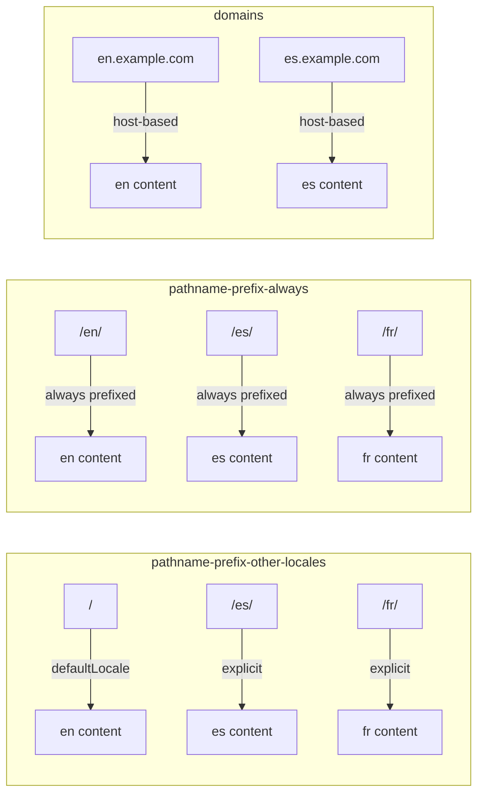
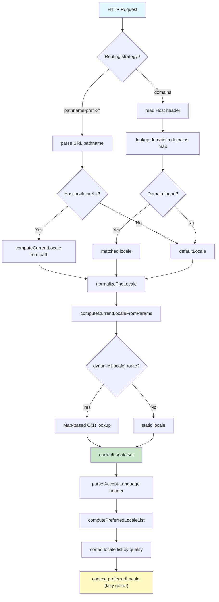

# Internationalization (i18n)

**Internationalization in Astro 7.0.4 is a locale-aware routing and content-resolution system built on top of the core routing infrastructure.** It provides three routing strategies — pathname-prefix with default at root, pathname-prefix always, and domain-based — with automatic Accept-Language negotiation, fallback locale chains, and multi-code-per-locale support. The entire system is implemented as a thin layer over the existing route manifest: i18n routes are normal routes with locale prefixes, and fallback routes are generated by duplicating routes with replaced locale paths.

This document covers every aspect of Astro's i18n implementation: configuration schema, routing strategies, locale resolution algorithms, fallback route generation, locale object types, middleware integration, and the Accept-Language parsing pipeline.

## Configuration Schema: `config.i18n`

The entire i18n system is driven by the `i18n` field in `AstroConfig`. This field is optional — if absent, i18n features are disabled and routing behaves normally. When present, it activates the locale-aware routing pipeline.

Source: `packages/astro/src/types/public/config.ts` — `Locales` type definition.

```ts
// packages/astro/src/types/public/config.ts
type Locales = (
  | string
  | { codes: [string, ...string[]]; path: string }
)[];

interface i18nConfig {
  defaultLocale: string;
  locales: Locales;
  routing?: 'pathname-prefix-other-locales' | 'pathname-prefix-always' | 'domains';
  fallback?: Record<string, string>;
  domains?: Record<string, string>;
}
```

### `defaultLocale`

The `defaultLocale` is a string that identifies which locale code serves as the primary language for the site. This value is used in multiple places: it determines which locale appears at the root path under `pathname-prefix-other-locales`, it anchors fallback resolution when no Accept-Language match is found, and it validates that at least one locale in the `locales` array is marked as default.

For example, with `defaultLocale: 'en'` and `routing: 'pathname-prefix-other-locales'`, English content is served at `/` while other locales get their own prefixes (`/es/`, `/fr/`). With `routing: 'pathname-prefix-always'`, English content is served at `/en/`.

### `locales`

The `locales` array defines all supported locales. Each entry can be either a simple string or an object with multiple codes mapped to a single path.

**String locales** are the simplest form — just a locale code like `'en'`, `'es'`, or `'fr'`. Each string maps to a path segment matching the code itself.

**Object locales** provide a way to map multiple locale codes to a single path. This is useful when you want `en`, `en-US`, and `en-GB` to all serve content from the same `/en/` path. The `codes` array must have at least one element (enforced by the tuple type `[string, ...string[]]`), and `path` determines the URL segment.

```ts
// packages/astro/src/types/public/config.ts
// Object locale: multiple codes, single path
{ codes: ['en', 'en-US', 'en-GB'], path: 'en' }

// String locale: single code, implicit path
'es'  // path is implicitly 'es'
```

The `path` field on object locales is critical — it decouples the URL structure from the locale codes used for content negotiation. A site might negotiate `en-US` from the Accept-Language header but serve content from `/en/`.

### `routing`

The `routing` field determines the URL strategy for locale-aware routes. Three strategies are available:

| Strategy | Value | Default at Root? | Other Locales |
|----------|-------|------------------|---------------|
| Prefix other locales | `'pathname-prefix-other-locales'` | `/` | `/es/`, `/fr/` |
| Prefix always | `'pathname-prefix-always'` | `/en/` | `/es/`, `/fr/` |
| Domains | `'domains'` | N/A | `es.example.com` |

The `toRoutingStrategy()` function in `packages/astro/src/core/app/entrypoints/index.js` converts the config object into an internal strategy enum that the routing engine uses to classify and dispatch requests.

### `fallback`

The `fallback` field is a record mapping a locale code to its fallback locale code. When a route is requested in a locale that doesn't have a matching page, Astro falls back to the content from the fallback locale.

```ts
// packages/astro/src/types/public/config.ts
fallback?: Record<string, string>
// Example: { 'es': 'en', 'fr': 'en', 'de': 'en' }
```

This creates a fallback chain. If `es` falls back to `en`, and a user requests `/es/about` but only `/en/about` exists, Astro serves the English content at the Spanish URL. The fallback mechanism is implemented at route-generation time — fallback routes are created as `type: 'fallback'` entries attached to the original route's `fallbackRoutes` array.

### `domains`

The `domains` field enables domain-based i18n routing. It maps domain names (or domain patterns) to locale codes.

```ts
// packages/astro/src/types/public/config.ts
domains?: Record<string, string>
// Example: { 'en.example.com': 'en', 'es.example.com': 'es' }
```

When `routing: 'domains'` is set, Astro uses the request's `Host` header to determine the locale instead of the URL pathname. The `domains` record maps each domain to its locale code. This is useful for multi-region deployments where each locale lives on a separate domain or subdomain.

## Routing Strategies

Astro supports three distinct routing strategies for internationalization. Each strategy determines how locale codes map to URL structure.



### pathname-prefix-other-locales

This is the most common strategy. The default locale content lives at the root path `/`, while all other locales get their own prefix. This is ideal for sites where one language is primary and others are secondary translations.

With `defaultLocale: 'en'`, `locales: ['en', 'es', 'fr']`, and `routing: 'pathname-prefix-other-locales'`:

| URL | Locale | Content Source |
|-----|--------|---------------|
| `/about` | `en` (default) | `src/pages/about.astro` |
| `/es/sobre` | `es` | `src/pages/es/sobre.astro` or `src/pages/sobre.astro` |
| `/fr/a-propos` | `fr` | `src/pages/fr/a-propos.astro` or `src/pages/a-propos.astro` |

The critical behavior here is that the root path `/` implicitly means the default locale. There is no `/en/` prefix for English content.

### pathname-prefix-always

This strategy requires a locale prefix for all content, including the default locale. There is no root-level content — every URL must have a locale prefix.

With `defaultLocale: 'en'`, `locales: ['en', 'es', 'fr']`, and `routing: 'pathname-prefix-always'`:

| URL | Locale | Content Source |
|-----|--------|---------------|
| `/en/about` | `en` | `src/pages/en/about.astro` |
| `/es/sobre` | `es` | `src/pages/es/sobre.astro` |
| `/fr/a-propos` | `fr` | `src/pages/fr/a-propos.astro` |
| `/about` | — | 404 (no root content) |

**Important:** When using `pathname-prefix-always`, Astro requires a root index page at the locale-specific path. If the route manifest doesn't find an index page for the default locale under this strategy, it throws `MissingIndexForInternationalization`. This prevents silent 404s at the root URL.

### domains

Domain-based routing maps different domains to different locales. The URL path does not contain a locale prefix — the domain itself determines the locale.

With `defaultLocale: 'en'`, `routing: 'domains'`, and `domains: { 'en.example.com': 'en', 'es.example.com': 'es' }`:

| URL | Locale | Content Source |
|-----|--------|---------------|
| `en.example.com/about` | `en` | `src/pages/en/about.astro` |
| `es.example.com/sobre` | `es` | `src/pages/es/sobre.astro` |

The `computeCurrentLocale()` function reads the request's `Host` header, looks it up in the `domains` record, and returns the matching locale. If the host doesn't match any domain entry, the default locale is used.

### toRoutingStrategy()

Source: `packages/astro/src/core/app/entrypoints/index.js`

The `toRoutingStrategy()` function converts the `i18n` config into an internal routing strategy value. It normalizes the `routing` field (which may be absent, in which case a default is chosen based on the presence of `domains`) into one of the three strategy strings. This normalization happens at app initialization time, before routes are registered.

```js
// packages/astro/src/core/app/entrypoints/index.js
function toRoutingStrategy(i18nConfig) {
  if (!i18nConfig) return undefined;
  if (i18nConfig.domains) return 'domains';
  return i18nConfig.routing || 'pathname-prefix-other-locales';
}
```

The function prioritizes `domains` detection: if `domains` is present in the config, it returns `'domains'` regardless of the `routing` field value. Otherwise, it uses the explicit `routing` value or defaults to `'pathname-prefix-other-locales'`.

## Locale Resolution Pipeline

Locale resolution is the process of determining which locale a request should serve. Astro implements a multi-stage resolution pipeline that considers both the URL structure and the client's language preferences.



### computePreferredLocale()

Source: `packages/astro/src/i18n/utils.ts`

`computePreferredLocale()` parses the `Accept-Language` HTTP header and returns the single best-matching locale from the configured locales list. It is the foundation of content negotiation in Astro's i18n system.

The function performs these steps:

1. Reads the `Accept-Language` header from the request
2. Parses the header into a list of locale/quality pairs using `parseLocale()`
3. Sorts the list by quality value (descending) and position (ascending for equal quality)
4. Matches each parsed locale against the configured locales
5. Returns the first matching locale, or `undefined` if no match

```ts
// packages/astro/src/i18n/utils.ts
function computePreferredLocale(
  request: Request,
  locales: Locales,
): string | undefined {
  const header = request.headers.get('Accept-Language') || '';
  const parsed = parseLocale(header);
  const allCodes = getAllCodes(locales);

  for (const { locale } of parsed) {
    const normalized = normalizeTheLocale(locale);
    const match = allCodes.find(
      (code) => normalizeTheLocale(code) === normalized,
    );
    if (match) return match;
  }
  return undefined;
}
```

### computePreferredLocaleList()

Source: `packages/astro/src/i18n/utils.ts`

`computePreferredLocaleList()` returns a sorted array of all configured locales that match the `Accept-Language` header, ordered by preference. Unlike `computePreferredLocale()` which returns only the best match, this returns the full ranked list.

The function iterates through all parsed Accept-Language entries and collects every locale from the configured list that has a match. The result is sorted by quality value (highest first), with original header position as the tiebreaker.

```ts
// packages/astro/src/i18n/utils.ts
function computePreferredLocaleList(
  request: Request,
  locales: Locales,
): string[] {
  const header = request.headers.get('Accept-Language') || '';
  const parsed = parseLocale(header);
  const allCodes = getAllCodes(locales);
  const matched: string[] = [];

  for (const { locale } of parsed) {
    const normalized = normalizeTheLocale(locale);
    for (const code of allCodes) {
      if (normalizeTheLocale(code) === normalized) {
        if (!matched.includes(code)) {
          matched.push(code);
        }
      }
    }
  }
  return matched;
}
```

### computeCurrentLocale()

Source: `packages/astro/src/i18n/utils.ts`

`computeCurrentLocale()` determines the locale from the URL pathname. This is used for pathname-prefix routing strategies to extract the locale segment from the path.

For `pathname-prefix-other-locales`, if the pathname starts with a known locale prefix (like `/es/`), that locale is returned. If the pathname is `/` or doesn't match any prefix, the `defaultLocale` is returned.

For `pathname-prefix-always`, the locale is always extracted from the first path segment.

For `domains`, the function looks up the request's `Host` header in the `domains` record.

### computeCurrentLocaleFromParams()

Source: `packages/astro/src/i18n/utils.ts`

`computeCurrentLocaleFromParams()` handles dynamic `[locale]` route segments. When a page uses a dynamic `[locale]` parameter in its file path, this function determines which locale the parameter resolves to.

**Key insight:** This function uses a `Map`-based lookup for O(1) matching instead of iterating through all locales with nested loops. The Map is keyed by normalized locale codes, allowing instant lookup regardless of how many locales are configured. This is a deliberate performance optimization — with dozens of locales, an O(n^2) nested loop would be noticeable on every request.

```ts
// packages/astro/src/i18n/utils.ts — Map-based O(1) lookup
function computeCurrentLocaleFromParams(
  params: Record<string, string | undefined>,
  locales: Locales,
): string | undefined {
  const localeParam = params['locale'];
  if (!localeParam) return undefined;

  const localeMap = new Map(
    getAllCodes(locales).map((code) => [normalizeTheLocale(code), code]),
  );

  return localeMap.get(normalizeTheLocale(localeParam));
}
```

### parseLocale()

Source: `packages/astro/src/i18n/utils.ts`

`parseLocale()` is the Accept-Language header parser. It handles the full HTTP Accept-Language specification including quality values (`q=`), wildcards (`*`), and locale subtags.

The function parses headers like `fr-CH, fr;q=0.9, en;q=0.8, de;q=0.7, *;q=0.5` into an array of `{ locale: string, quality: number }` objects sorted by quality descending.

```ts
// packages/astro/src/i18n/utils.ts
function parseLocale(header: string): { locale: string; quality: number }[] {
  return header
    .split(',')
    .map((segment) => segment.trim())
    .filter(Boolean)
    .map((segment) => {
      const [locale, ...params] = segment.split(';');
      const qualityParam = params.find((p) => p.trim().startsWith('q='));
      const quality = qualityParam
        ? parseFloat(qualityParam.trim().split('=')[1])
        : 1.0;
      return { locale: locale.trim(), quality };
    })
    .sort((a, b) => b.quality - a.quality);
}
```

The parsing logic:
1. Splits the header on commas to get individual locale segments
2. For each segment, splits on semicolons to separate the locale from parameters
3. Finds the `q=` parameter and extracts the quality value (defaulting to 1.0)
4. Sorts by quality descending so the most preferred locale comes first

### normalizeTheLocale()

Source: `packages/astro/src/i18n/path.ts`

`normalizeTheLocale()` normalizes locale strings for reliable comparison. It handles the common variations that appear in real-world Accept-Language headers and locale configurations:

- Converts underscores to hyphens (`en_US` becomes `en-US`)
- Converts to lowercase (`EN-US` becomes `en-us`)
- Trims whitespace

This normalization ensures that `en-US`, `en_us`, and `EN-US` all match the same configured locale.

```ts
// packages/astro/src/i18n/path.ts
function normalizeTheLocale(locale: string): string {
  return locale.trim().replace(/_/g, '-').toLowerCase();
}
```

### normalizeThePath()

Source: `packages/astro/src/i18n/path.ts`

`normalizeThePath()` normalizes path segments for locale extraction. It strips leading and trailing slashes, collapses multiple slashes, and ensures consistent path representation for locale prefix matching.

This is used by `computeCurrentLocale()` when extracting the locale segment from a URL pathname like `/es/about` to correctly identify `es` as the locale.

## Fallback Route Generation

When a locale is configured to fall back to another locale, Astro generates fallback routes at build time. These routes ensure that if a page doesn't exist in locale A, the content from locale B is served at locale A's URL.

Source: `packages/astro/src/core/routing/create-manifest.ts`

### createI18nFallbackRoutes()

`createI18nFallbackRoutes()` generates fallback route entries during manifest creation. It iterates through the `fallback` config and, for each locale-to-locale mapping, creates new route objects that point to the fallback locale's content.

```ts
// packages/astro/src/core/routing/create-manifest.ts
function createI18nFallbackRoutes(
  routes: RouteData[],
  i18n: i18nConfig,
): RouteData[] {
  const fallbackRoutes: RouteData[] = [];

  for (const route of routes) {
    for (const [fromLocale, toLocale] of Object.entries(i18n.fallback || {})) {
      const fallbackRoute = replaceOrKeep(route, fromLocale, toLocale);
      fallbackRoute.type = 'fallback';
      fallbackRoute.fallbackRoutes = [];
      fallbackRoutes.push(fallbackRoute);
    }
  }

  return fallbackRoutes;
}
```

The generated fallback routes have `type: 'fallback'` to distinguish them from primary routes. They are attached to the original route's `fallbackRoutes` array for runtime lookup.

### replaceOrKeep()

`replaceOrKeep()` is the core function that determines how a route path is transformed for a fallback locale. It takes an existing route, a source locale (the fallback locale), and a target locale (the locale being served).

The function either:
- **Replaces** the locale segment in the route path (when the route has a locale prefix that differs from the fallback locale)
- **Keeps** the original path (when the route doesn't have a locale prefix to replace)

```ts
// packages/astro/src/core/routing/create-manifest.ts
function replaceOrKeep(
  route: RouteData,
  fromLocale: string,
  toLocale: string,
): RouteData {
  // Replace locale in route path, or keep original
  const newPattern = route.pattern.replace(
    `/${toLocale}/`,
    `/${fromLocale}/`,
  );
  return {
    ...route,
    pattern: newPattern,
    locale: fromLocale,
  };
}
```

### Fallback Route Attachment

Fallback routes are attached to the `route.fallbackRoutes` array. At runtime, when a request comes in for a route that doesn't have a matching page in the requested locale, the routing engine checks `fallbackRoutes` to find content from the fallback locale.

The fallback logic works as follows:

1. A request arrives for `/es/about`
2. Astro checks if there's a page at `src/pages/es/about.astro` or `src/pages/about.astro` with `es` locale
3. If no page exists, Astro checks if `es` has a fallback locale (e.g., `en`)
4. If `es` falls back to `en`, Astro serves the content from `/en/about`
5. The URL remains `/es/about` — the user sees the Spanish URL with English content

**Aha:** Fallback routes are generated at build time, not resolved at runtime. This means the route manifest already contains all fallback routes as `type: 'fallback'` entries. The routing engine doesn't need to do any dynamic path rewriting — it simply matches the incoming URL against the pre-generated fallback routes. This is a significant performance optimization: fallback resolution is O(1) route lookup instead of O(n) string manipulation per request.

## Locale Objects and getAllCodes()

### String vs Object Locales

Astro supports two forms of locale definitions, each serving different use cases.

**String locales** are simple locale codes. The path is implicitly derived from the code:

```ts
locales: ['en', 'es', 'fr', 'de', 'ja']
// Paths: /en/, /es/, /fr/, /de/, /ja/
```

**Object locales** allow multiple codes to map to a single path. This is essential when you want to serve the same content for related locale variants:

```ts
locales: [
  { codes: ['en', 'en-US', 'en-GB'], path: 'en' },
  { codes: ['es', 'es-MX', 'es-AR'], path: 'es' },
  { codes: ['pt', 'pt-BR', 'pt-PT'], path: 'pt' },
  'fr',  // string locale alongside objects
  'de',
]
// Paths: /en/, /es/, /pt/, /fr/, /de/
// But Accept-Language negotiation matches en-US -> /en/, es-MX -> /es/, etc.
```

The tuple type `[string, ...string[]]` ensures that every object locale has at least one code — an empty codes array would be a configuration error.

### getAllCodes()

Source: `packages/astro/src/i18n/index.ts`

`getAllCodes()` extracts every individual locale code from a `Locales` array, flattening both string and object locales into a single array of codes.

```ts
// packages/astro/src/i18n/index.ts
function getAllCodes(locales: Locales): string[] {
  const codes: string[] = [];

  for (const locale of locales) {
    if (typeof locale === 'string') {
      codes.push(locale);
    } else {
      codes.push(...locale.codes);
    }
  }

  return codes;
}
```

This function is called by every locale resolution function (`computePreferredLocale`, `computePreferredLocaleList`, `computeCurrentLocaleFromParams`) to get the full set of matchable codes. It's the bridge between the configuration representation (mixed string/object array) and the resolution representation (flat code array).

For the example above, `getAllCodes()` would return: `['en', 'en-US', 'en-GB', 'es', 'es-MX', 'es-AR', 'pt', 'pt-BR', 'pt-PT', 'fr', 'de']` — 11 codes from 5 locale entries.

## Middleware Integration: context.preferredLocale, preferredLocaleList, currentLocale

Source: `packages/astro/src/core/middleware/index.ts`

Astro's middleware system exposes i18n context through the `context` object passed to middleware handlers. Three lazy getters provide access to locale information:

### context.preferredLocale

`context.preferredLocale` is a lazy getter that calls `computePreferredLocale()` on first access. It parses the `Accept-Language` header from the incoming request and returns the best-matching locale from the configured locales.

```ts
// packages/astro/src/core/middleware/index.ts
Object.defineProperty(context, 'preferredLocale', {
  get() {
    const value = computePreferredLocale(request, config.i18n?.locales);
    Object.defineProperty(context, 'preferredLocale', { value });
    return value;
  },
  configurable: true,
});
```

The lazy getter pattern means the Accept-Language header is only parsed when the middleware actually needs the preferred locale. If a middleware never accesses `context.preferredLocale`, the parsing work is never done. The getter also redefines itself on first access (a technique called memoization via self-redefinition) so subsequent accesses are O(1) property reads with no function call overhead.

### context.preferredLocaleList

`context.preferredLocaleList` is a lazy getter that returns the full sorted list of matching locales from `computePreferredLocaleList()`.

```ts
// packages/astro/src/core/middleware/index.ts
Object.defineProperty(context, 'preferredLocaleList', {
  get() {
    const value = computePreferredLocaleList(request, config.i18n?.locales);
    Object.defineProperty(context, 'preferredLocaleList', { value });
    return value;
  },
  configurable: true,
});
```

This is useful for middleware that needs to render a language switcher showing all available languages in the user's preference order.

### context.currentLocale

`context.currentLocale` is a lazy getter that returns the locale derived from the URL pathname using `computeCurrentLocale()`.

```ts
// packages/astro/src/core/middleware/index.ts
Object.defineProperty(context, 'currentLocale', {
  get() {
    const value = computeCurrentLocale(request, config.i18n);
    Object.defineProperty(context, 'currentLocale', { value });
    return value;
  },
  configurable: true,
});
```

The distinction between `preferredLocale` and `currentLocale` is important:

- `preferredLocale` is what the user wants (from Accept-Language)
- `currentLocale` is what the URL is serving (from pathname or domain)

These can differ — a user with `Accept-Language: es` visiting `/fr/accueil` has `preferredLocale: 'es'` but `currentLocale: 'fr'`. Middleware can use this difference to render a "view in your language" link.

## Routing Strategy Comparison

```mermaid
flowchart TB
    subgraph "pathname-prefix-other-locales"
        direction LR
        A1["Root / = defaultLocale"]
        A2["Prefixes = other locales only"]
        A3["SEO: default has clean URLs"]
        A4["Redirect: Accept-Language to matching prefix"]
    end

    subgraph "pathname-prefix-always"
        direction LR
        B1["No root content"]
        B2["All paths have locale prefix"]
        B3["SEO: consistent URL structure"]
        B4["Redirect: Accept-Language to matching prefix"]
    end

    subgraph "domains"
        direction LR
        C1["Host header determines locale"]
        C2["No locale in path"]
        C3["SEO: separate sites per locale"]
        C4["Requires DNS/SSL setup"]
    end

    A1 -.-> |"choose when"| D1["One primary language"]
    B1 -.-> |"choose when"| D2["All locales equal priority"]
    C1 -.-> |"choose when"| D3["Separate brand per region"]
```



| Aspect | pathname-prefix-other-locales | pathname-prefix-always | domains |
|--------|------------------------------|----------------------|---------|
| Root URL | Serves defaultLocale | 404 (or redirect) | N/A |
| URL structure | Mixed (some prefixed, some not) | Always prefixed | No locale in path |
| SEO impact | Default locale gets cleanest URLs | All URLs equally structured | Each domain ranks separately |
| Accept-Language redirect | Redirects `/` to matching locale prefix | Redirects `/` to matching locale prefix | Redirects to matching domain |
| Setup complexity | Low | Low | High (DNS, SSL, hosting) |
| CDN caching | Single origin | Single origin | May need multiple origins |
| Best for | Sites with one primary language | Multi-language sites, equal priority | Regional brands, separate marketing |

## Accept-Language Parsing in Detail

The Accept-Language header follows RFC 7231 format. Astro's `parseLocale()` function handles the full specification.

### Header Format

```
Accept-Language: fr-CH, fr;q=0.9, en;q=0.8, de;q=0.7, *;q=0.5
```

This header means:
1. `fr-CH` (Swiss French) — quality 1.0 (implicit, highest priority)
2. `fr` (French) — quality 0.9
3. `en` (English) — quality 0.8
4. `de` (German) — quality 0.7
5. `*` (any) — quality 0.5 (wildcard fallback)

### Quality Value Semantics

The quality value (`qvalue`) ranges from 0 to 1 with up to 3 decimal places. A value of 0 means "not acceptable." Astro's parser treats missing quality as 1.0 (the RFC default).

The sorting behavior is stable: locales with equal quality maintain their original order in the header. This means if a user sends `en, fr` with no quality values, `en` is preferred over `fr` because it appeared first.

### Matching Algorithm

After parsing, Astro matches each Accept-Language entry against the configured locales using `normalizeTheLocale()`. The matching follows a longest-prefix strategy:

1. First, try exact match: `en-US` matches `en-US`
2. Then, try prefix match: `en-US` matches `en` (the language subtag)
3. Finally, try wildcard: `*` matches any configured locale

The first successful match (in quality-descending order) wins.

## Error Handling: MissingIndexForInternationalization

When using `routing: 'pathname-prefix-always'`, Astro validates that a root index page exists. If the manifest doesn't contain an index route for the default locale, it throws `MissingIndexForInternationalization`.

This error prevents a confusing user experience where visiting the site root returns a 404 because no locale prefix was specified. The error message guides the developer to create the required index page.

```ts
// Error thrown when pathname-prefix-always lacks a root index
throw new MissingIndexForInternationalization(
  `No index page found for default locale '${defaultLocale}'`
);
```

## Integration with the Build Pipeline

i18n routes are generated during the manifest creation phase of the build pipeline. The flow is:

1. File-based routing scans `src/pages/` and creates base routes (as documented in [Configuration & Routing](02-config-routing.html))
2. If `config.i18n` is present, `createI18nFallbackRoutes()` generates fallback routes
3. Each route is tagged with its locale based on its path segment
4. The manifest's `routes` array contains both primary and fallback routes
5. At runtime, the App class uses `computeCurrentLocale()` and `computeCurrentLocaleFromParams()` to match incoming requests

For a deep dive into how routes are registered and matched, see [Configuration & Routing](02-config-routing.html). For how the manifest is used at runtime, see [SSR Runtime](06-ssr-runtime.html).

## Complete Example: Multi-Language Blog

Here is a complete i18n configuration for a blog with English as the primary language and Spanish and French translations:

```ts
// astro.config.ts — Multi-language blog configuration
import { defineConfig } from 'astro/config';

export default defineConfig({
  i18n: {
    defaultLocale: 'en',
    locales: [
      { codes: ['en', 'en-US'], path: 'en' },
      { codes: ['es', 'es-MX'], path: 'es' },
      { codes: ['fr', 'fr-CA'], path: 'fr' },
      'de',
    ],
    routing: 'pathname-prefix-other-locales',
    fallback: {
      es: 'en',
      fr: 'en',
      de: 'en',
    },
  },
});
```

With this configuration:

| Feature | Behavior |
|---------|----------|
| Root URL `/` | Serves English content |
| `/es/` | Serves Spanish content, falls back to English if missing |
| `/fr/` | Serves French content, falls back to English if missing |
| `/de/` | Serves German content, falls back to English if missing |
| `Accept-Language: es` | Redirects `/` to `/es/` |
| `Accept-Language: es-MX` | Matches Spanish locale (via codes array) |
| `Accept-Language: ja` | Falls back to defaultLocale (`en`) |
| `/es/missing-page` | Serves `/en/missing-page` content (fallback) |

## File Map

| Source File | Responsibility |
|-------------|---------------|
| `packages/astro/src/i18n/utils.ts` | `computePreferredLocale`, `computePreferredLocaleList`, `computeCurrentLocale`, `computeCurrentLocaleFromParams`, `parseLocale` |
| `packages/astro/src/i18n/path.ts` | `normalizeTheLocale`, `normalizeThePath` |
| `packages/astro/src/i18n/index.ts` | `getAllCodes` |
| `packages/astro/src/core/app/entrypoints/index.js` | `toRoutingStrategy` |
| `packages/astro/src/core/routing/create-manifest.ts` | `createI18nFallbackRoutes`, `replaceOrKeep` |
| `packages/astro/src/core/middleware/index.ts` | Lazy getters for `preferredLocale`, `preferredLocaleList`, `currentLocale` |
| `packages/astro/src/types/public/config.ts` | `Locales` type, `i18nConfig` interface |

## Cross-References

- [Configuration & Routing](02-config-routing.html) — File-based routing, dynamic params, route manifest creation
- [SSR Runtime](06-ssr-runtime.html) — How the App class uses the manifest to match requests
- [Middleware & Actions](11-middleware-actions.html) — Middleware context, `defineMiddleware`, `sequence`
- [Integration API](07-integration-api.html) — Integration hooks that can modify i18n config
- [Build Pipeline](05-build-pipeline.html) — How routes are collected during the prerender phase

## Summary

Astro's i18n system is a routing-layer implementation that overlays locale awareness on top of the existing file-based routing. The key design decisions are:

1. **Build-time fallback generation** — Fallback routes are pre-computed during manifest creation, not resolved at runtime. This makes fallback matching an O(1) route lookup.
2. **Map-based locale resolution** — `computeCurrentLocaleFromParams()` uses a Map for O(1) matching instead of nested loops, optimizing for sites with many locales.
3. **Lazy middleware getters** — `context.preferredLocale`, `context.preferredLocaleList`, and `context.currentLocale` use self-redefining getters that parse the Accept-Language header only once and only when accessed.
4. **Flexible locale objects** — The string-or-object `Locales` type allows both simple single-code locales and multi-code-per-path locales, supporting real-world scenarios where `en-US` and `en-GB` serve the same content.
5. **Three routing strategies** — The strategy enum (`pathname-prefix-other-locales`, `pathname-prefix-always`, `domains`) covers the full spectrum from simple blogs to enterprise multi-domain deployments.

The system integrates seamlessly with Astro's existing routing: i18n routes are just normal routes with locale prefixes, and fallback routes are normal routes with `type: 'fallback'`. There is no special i18n request handler — the routing engine treats all routes uniformly.
