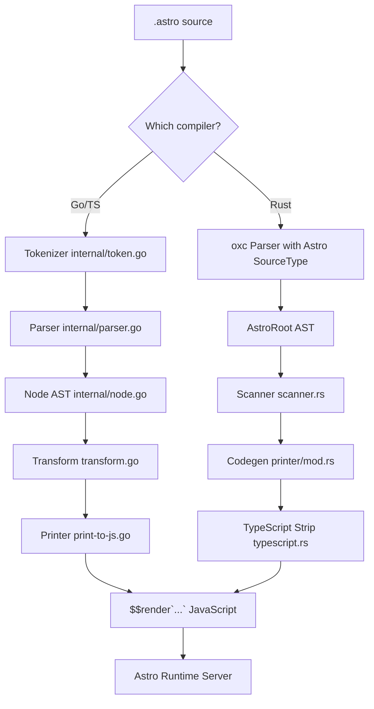
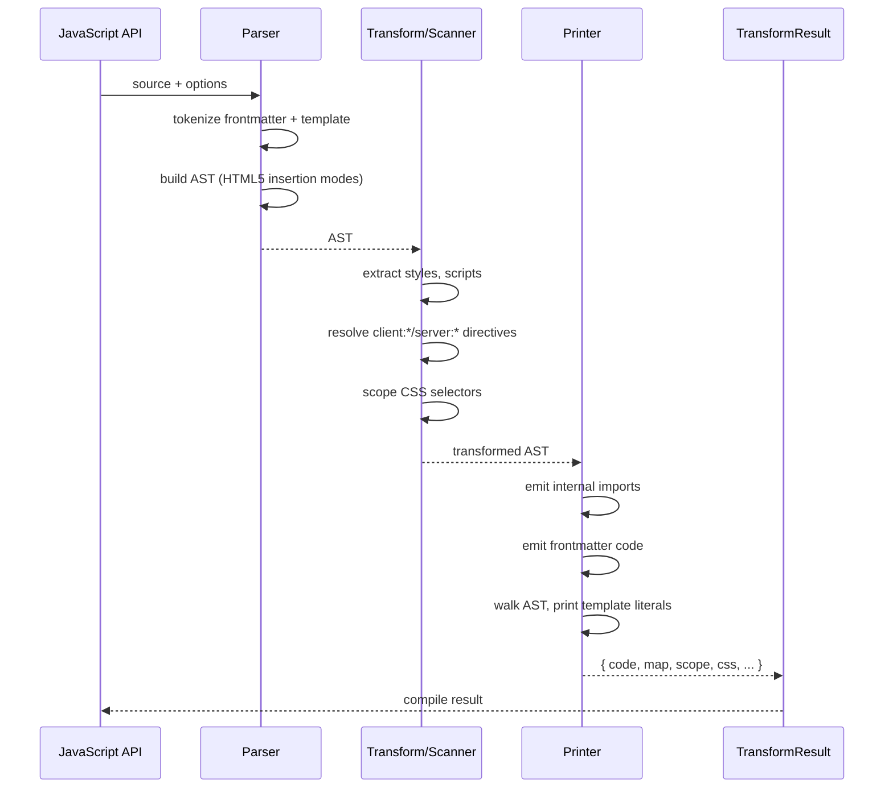

# Overview: The Astro Compiler

The Astro compiler is a dual-implementation compiler (Go/TypeScript and Rust) that transforms `.astro` component files into server-side JavaScript modules. It parses a hybrid syntax combining TypeScript frontmatter, JSX-like templates, and CSS into an AST, then generates JavaScript that imports runtime helpers from `astro/runtime/server/index.js`.

## Two Implementations, One Output

The compiler exists in two parallel implementations:

| Aspect | Go/TypeScript Compiler | Rust Compiler |
|--------|----------------------|---------------|
| Source | `compiler/` | `compiler-rs/` |
| Parser | Hand-written recursive descent (HTML5 spec-based) | oxc parser with Astro extensions |
| AST | Custom `Node` struct (`internal/node.go`) | oxc `AstroRoot` JSX-based AST |
| Output target | WebAssembly (astro.wasm) + Go | Native binary via N-API |
| Tokenizer | `internal/token.go` — 2000+ lines | `oxc_parser` with custom Astro source type |
| Printer | `internal/printer/print-to-js.go` | `crates/astro_codegen/src/printer/mod.rs` |
| Transforms | `internal/transform/transform.go` | `crates/astro_codegen/src/printer/mod.rs` + submodules |
| Binding layer | Go WASM bridge (`packages/compiler/src/node/`) | N-API (`crates/astro_napi/src/lib.rs`) |
| Runtime | Node.js + browser | Node.js only (native addon) |

Both produce **identical JavaScript output**. The Rust compiler is a ground-up rewrite, not a port.

## Architecture at a Glance



## Pipeline: Source to JavaScript

The compilation pipeline has three phases:

1. **Parse** — Source text becomes an AST (Node tree for Go, AstroRoot for Rust)
2. **Transform** — AST is mutated: CSS is scoped, directives are resolved, metadata is collected
3. **Print** — AST walk to emit JavaScript, with optional sourcemap generation



## Key Concepts

### Astro File Structure

An `.astro` file has up to two sections:

```
┌─────────────────────────────────────┐
│ ---                                 │
│ // Frontmatter (TypeScript)         │
│ import Counter from '../Counter.astro'│
│ const name = "World"                │
│ ---                                 │
├─────────────────────────────────────┤
│                                     │
│ <h1>Hello {name}!</h1>             │
│ <Counter client:load />             │
│                                     │
│ <style>                             │
│   h1 { color: blue; }              │
│ </style>                            │
└─────────────────────────────────────┘
```

Source: `compiler/SYNTAX_SPEC.md:1` — The official syntax specification.

### The `$$render` Template Literal

The compiler emits JavaScript wrapped in a template literal tagged by `$$render`:

```js
import { Fragment, render as $$render, createAstro as $$createAstro, ... } from "astro/runtime/server/index.js";

const $$Index = $$createComponent(async ($$result, $$props, $$slots) => {
  const Astro = $$result.createAstro($$props, $$slots);
  Astro.self = $$Index;
  
  // Frontmatter code preserved verbatim
  const name = "World";
  
  return $$render`<h1>Hello ${name}!</h1>`;
}, 'src/pages/index.astro', undefined);
export default $$Index;
```

Source: `compiler/internal/printer/printer.go:42-65` — Runtime function name constants.
Source: `compiler-rs/crates/astro_codegen/src/printer/mod.rs:140-162` — Rust equivalent `runtime` module.

### Internal Runtime Helpers

Both compilers import the same set of runtime helpers:

| Helper | Purpose |
|--------|---------|
| `$$render` | Template tag function for HTML output |
| `$$createComponent` | Wraps component function |
| `$$createAstro` | Creates the `Astro` global |
| `$$renderComponent` | Renders imported components |
| `$$renderHead` / `$$maybeRenderHead` | Head content management |
| `$$renderSlot` / `$$mergeSlots` | Slot rendering |
| `$$addAttribute` / `$$spreadAttributes` | Attribute generation |
| `$$defineStyleVars` / `$$defineScriptVars` | `define:vars` directive handling |
| `$$renderTransition` / `$$createTransitionScope` | View transitions |
| `$$renderScript` | Hoisted script bundling |
| `$$createMetadata` | Component metadata export |

Source: `compiler/internal/printer/printer.go:42-64`

## Project Structure

```
compiler/                          ← Go/TypeScript compiler
├── cmd/astro-wasm/                ← WASM entry point
├── internal/
│   ├── token.go                   ← Tokenizer (117 types)
│   ├── parser.go                  ← HTML5 parser + Astro extensions
│   ├── node.go                    ← AST node definition
│   ├── transform/                 ← AST transform pass
│   ├── printer/                   ← Code generation
│   │   ├── printer.go             ← Main printer
│   │   ├── print-to-js.go         ← JS output
│   │   ├── print-to-tsx.go        ← TSX conversion
│   │   └── print-to-json.go       ← AST serialization
│   └── js_scanner/               ← JS import extraction
├── packages/compiler/             ← npm package
│   └── src/
│       ├── node/                  ← Node.js WASM binding
│       ├── browser/               ← Browser WASM binding
│       └── shared/                ← Shared types
└── lib/esbuild/                   ← Vendored esbuild CSS parser/printer

compiler-rs/                       ← Rust compiler
├── Cargo.toml                     ← Workspace (Rust 1.91+, edition 2024)
├── crates/
│   ├── astro_codegen/             ← Core codegen crate
│   │   ├── src/
│   │   │   ├── lib.rs            ← Public API
│   │   │   ├── scanner.rs        ← Single-pass metadata collection
│   │   │   ├── options.rs        ← TransformOptions
│   │   │   ├── diagnostic.rs     ← Error types
│   │   │   ├── css_scoping.rs    ← CSS scoping logic
│   │   │   └── printer/
│   │   │       ├── mod.rs        ← AstroCodegen struct
│   │   │       ├── components.rs ← Component element printing
│   │   │       ├── elements.rs   ← HTML element printing
│   │   │       ├── expressions.rs← Expression handling
│   │   │       ├── slots.rs      ← Slot printing
│   │   │       ├── style.rs      ← Style extraction
│   │   │       ├── escape.rs     ← String escaping
│   │   │       ├── whitespace.rs ← Whitespace collapsing
│   │   │       ├── typescript.rs ← TS stripping
│   │   │       └── sourcemap_builder.rs
│   │   └── benches/
│   └── astro_napi/                ← N-API binding crate
│       ├── src/lib.rs            ← compileAstro, parseAstro
│       └── src/error.rs          ← Diagnostic conversion
├── .cargo/config.toml             ← Build configuration
└── rust-toolchain.toml           ← Toolchain pin
```

Source: `compiler-rs/Cargo.toml:1-59` — Workspace with oxc dependencies from `github.com/withastro/oxc`.

## The oxc Dependency

The Rust compiler depends on a forked `oxc` repository (`github.com/withastro/oxc` at `rev c429ef28`). The fork adds:

- `SourceType::astro()` — Astro file detection
- `Parser::parse_astro()` — Returns `AstroRoot` instead of standard `Program`
- Modified crates: `oxc_ast`, `oxc_ast_visit`, `oxc_codegen`, `oxc_parser`, `oxc_span`

Source: `compiler-rs/Cargo.toml:16-34`

## Aha: Why Two Compilers?

The Go compiler was the first implementation and remains the reference. It uses WebAssembly for cross-platform distribution, which works everywhere but has a performance penalty (WASM startup, GC, serialization overhead). The Rust compiler is a from-scratch rewrite that:

1. Uses `oxc`'s battle-tested JavaScript/TypeScript parser instead of hand-rolling one
2. Compiles to native code via N-API (no WASM overhead)
3. Uses oxc's `Codegen` for TypeScript stripping instead of custom logic
4. Shares the same AST structure as other oxc tooling (enabling unified toolchains)

The Rust compiler isn't a port — it's a reimagining using a different parser infrastructure. Both must produce identical output for compatibility.

## Next Steps

Continue to the Go parser deep dive: [Go Parser](./01-go-parser.md)
